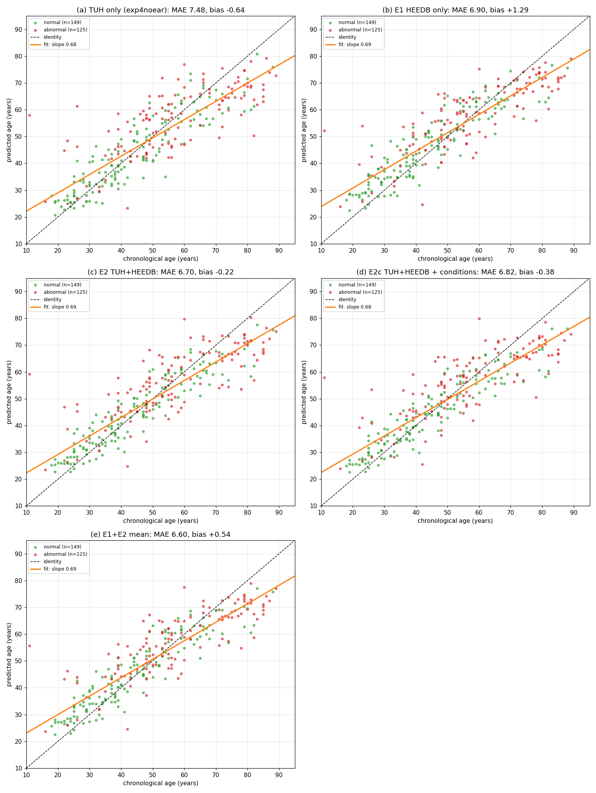
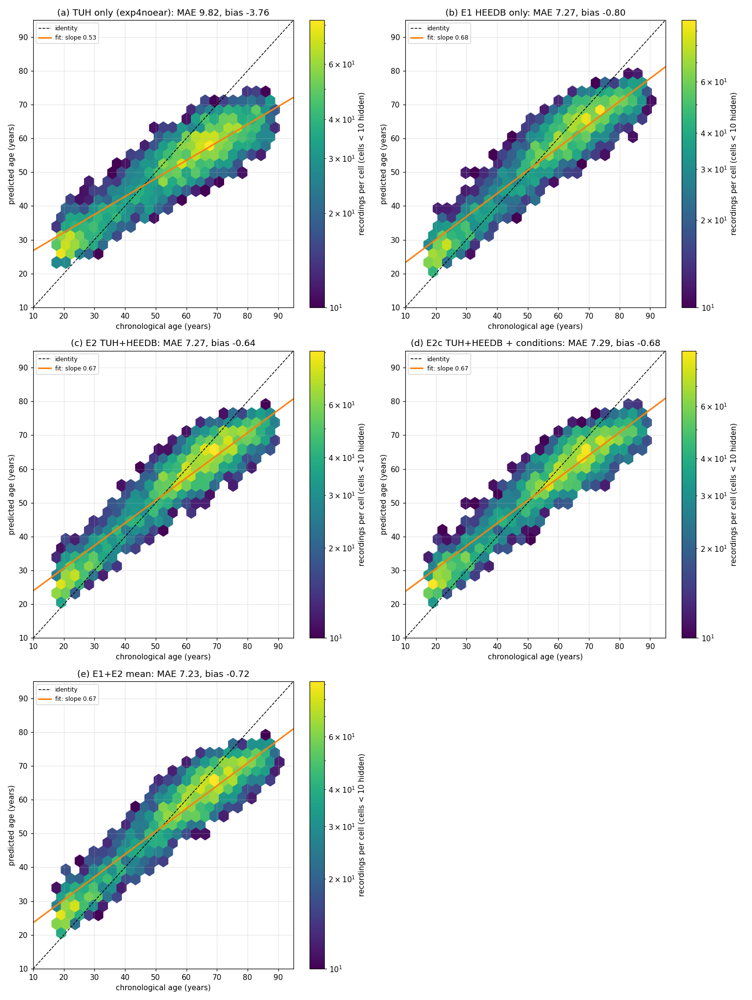
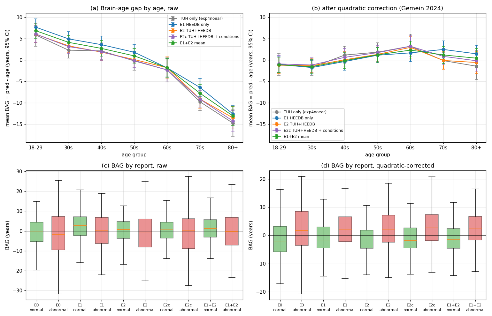
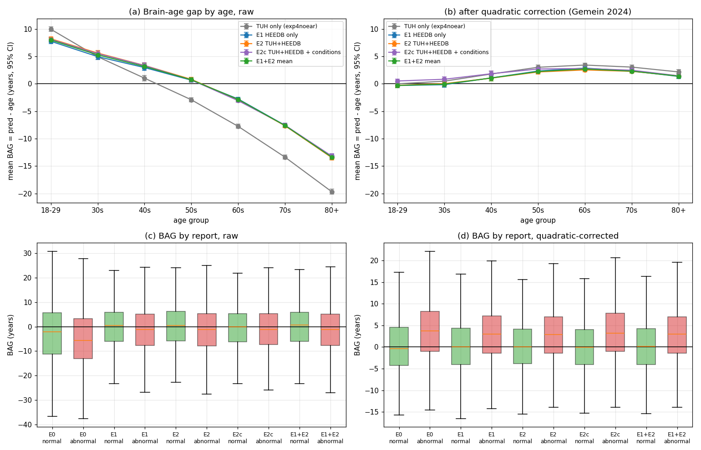

# Brain-age bias correction: TUH-only vs HEEDB-trained models

Real vs predicted age and the brain-age gap before and after bias correction
for the TUH-only baseline (`exp4anymiss-noear-nolabel`, "E0" here), E1
(HEEDB only), E2 (TUH + HEEDB), E2c (E2 + clinical condition inputs: report status
normal/abnormal/not available and 14 pathology flags, `model.session_features=head`;
trained locally on the same split) and the mean of E1 and E2. Test sets:
**TUAB eval** (274 recordings: 149 normal, 125 abnormal) and the full
**HEEDB held-out test** (7,338 recordings: 1,518 normal, 2,253 abnormal,
3,567 unlabelled). Every correction is fitted on the **validation recordings
with a normal report** of the same corpus (TUH val: 1,388 normal of 3,422;
HEEDB val: 1,493 normal of 7,192) and applied to test. Produced by
`scripts/brain_age_bias_report.py` from `scripts/eval_age_by_cohort.py --splits val test`
scores; numbers in `docs/data/brain_age_bias_correction.csv`.

## 1. Definitions

For recording $i$ with chronological age $y_i$ and predicted age $\hat y_i$
(years), the brain-age gap (BAG) is

$$
\mathrm{BAG}_i=\hat y_i-y_i .
\tag{1.1}
$$

On the calibration set (val, normal reports) ordinary least squares
(`np.polyfit`) gives the prediction-on-age line and the quadratic gap curve:

$$
\hat y\approx a\,y+b,
\qquad
\mathrm{BAG}\approx c_0+c_1 y+c_2 y^2 .
\tag{1.2}
$$

The corrections (`labram/eval/age_analysis.py::apply_bias_correction`):

$$
\begin{aligned}
\hat y^{\,\text{cole}}&=\frac{\hat y-b}{a}
&&\text{Cole et al. 2018, uses only }\hat y,\\
\hat y^{\,\text{lin}}&=\hat y-\bigl((a-1)\,y+b\bigr)
&&\text{de Lange \& Cole 2020 (age\_level)},\\
\hat y^{\,\text{quad}}&=\hat y-\bigl(c_0+c_1 y+c_2 y^2\bigr)
&&\text{Gemein et al. 2024 (quadratic\_gap)}.
\end{aligned}
\tag{1.3}
$$

The linear and quadratic corrections use the true age $y$. They give a
corrected **gap** for group comparisons, not a deployable age estimate. The
"MAE" after them is the mean absolute corrected gap. Gemein et al. 2024
(*Brain age revisited*, TUAB) fit the quadratic of Eq. (1.3) on cross-validated
predictions of their non-pathological training data and report TUAB
non-pathological MAE 6.48 (raw) and 6.60 (corrected).

The table columns: MAE = mean $\lvert\mathrm{BAG}\rvert$ (Eq. 1.1 after the
correction); $r$ = Pearson correlation of BAG with age (0 = no age bias);
$\Delta$ = mean BAG of abnormal minus normal recordings; $p$ = Welch t-test
of that difference; AUROC = how well BAG ranks abnormal above normal
recordings:

$$
\mathrm{AUROC}=P\bigl(\mathrm{BAG}_{\text{abnormal}}>\mathrm{BAG}_{\text{normal}}\bigr).
\tag{1.4}
$$

## 2. Real vs predicted age

### Figure 2.1. TUAB eval: predicted vs chronological age

`docs/figures/brain_age_scatter_tuab.png`. One point per recording (green
normal, red abnormal), identity line (dashed) and the least-squares fit
(orange) of Eq. (1.2). Panels: (a) TUH only, (b) E1, (c) E2, (d) E2c, (e) E1+E2 mean.



### Figure 2.2. HEEDB test: predicted vs chronological age (density)

`docs/figures/brain_age_scatter_heedb.png`. Recordings per hexagon (log
colour); hexagons with fewer than 10 recordings are not drawn (DUA small-cell
rule). Panels as in Figure 2.1.



All models regress toward the mean age (fit slope < 1, Figures 2.1, 2.2).
Training on HEEDB raises the HEEDB slope from 0.53 to 0.67–0.68 (Figure
2.2(a) vs (b)–(d)), mostly by lifting predictions above 60. On TUAB the slope
barely changes (0.68 → 0.69, Figure 2.1).

## 3. Bias before and after correction

### Figure 3.1. TUAB eval: brain-age gap by age and by report

`docs/figures/brain_age_bias_tuab.png`.
- (a) Mean BAG (Eq. 1.1) per age group with 95% CI, raw.
- (b) The same after the quadratic correction (Eq. 1.3).
- (c, d) BAG of normal (green) and abnormal (red) recordings per model, raw and corrected.



### Figure 3.2. HEEDB test: brain-age gap by age and by report

`docs/figures/brain_age_bias_heedb.png`, panels as in Figure 3.1. Age groups
with fewer than 10 recordings are not shown.



### Table 3.1. TUAB eval (274), correction fitted on TUH val normal

| Model | Correction | MAE all | MAE normal | MAE abnormal | $r$(BAG, age) | $\Delta$ abn − norm | $p$ | AUROC |
|---|---|---|---|---|---|---|---|---|
| TUH only | none | 7.48 | 5.75 | 9.54 | −0.59 | −0.2 | 0.89 | 0.48 |
| TUH only | linear | 6.23 | 5.45 | 7.17 | 0.03 | +4.0 | 3e-5 | 0.64 |
| TUH only | quadratic | 6.16 | 5.37 | 7.09 | 0.04 | +4.1 | 2e-5 | 0.65 |
| E1 | none | 6.90 | 5.83 | 8.18 | −0.65 | −1.8 | 0.10 | 0.43 |
| E1 | quadratic | 5.23 | 4.62 | 5.95 | 0.16 | +2.9 | 3e-4 | 0.64 |
| E2 | none | 6.70 | 5.13 | 8.56 | −0.63 | −0.4 | 0.74 | 0.48 |
| E2 | linear | 5.26 | 4.35 | 6.35 | 0.04 | +3.7 | 1e-5 | 0.66 |
| **E2** | **quadratic** | 5.19 | **4.24** | 6.32 | 0.07 | **+3.9** | **6e-6** | **0.67** |
| E1+E2 | quadratic | **5.00** | 4.34 | **5.79** | 0.12 | +3.4 | 2e-5 | 0.66 |
| E2c (+ conditions) | none | 6.82 | 5.20 | 8.76 | −0.64 | −0.2 | 0.83 | 0.48 |
| E2c (+ conditions) | quadratic | 5.23 | 4.25 | 6.40 | 0.08 | +4.2 | 8e-7 | 0.68 |

### Table 3.2. HEEDB test (7,338), correction fitted on HEEDB val normal

| Model | Correction | MAE all | MAE normal | MAE abnormal | $r$(BAG, age) | $\Delta$ abn − norm | $p$ | AUROC |
|---|---|---|---|---|---|---|---|---|
| TUH only | none | 9.82 | 9.86 | 10.50 | −0.80 | −1.8 | 7e-6 | 0.45 |
| TUH only | quadratic | 5.81 | 5.21 | 6.22 | 0.15 | **+3.4** | 1e-50 | **0.65** |
| E1 | none | 7.27 | 7.44 | 7.71 | −0.68 | −1.2 | 2e-4 | 0.46 |
| E1 | quadratic | 5.42 | 5.12 | 5.72 | 0.14 | +2.5 | 3e-29 | 0.62 |
| E2 | none | 7.27 | 7.43 | 7.83 | −0.71 | −1.4 | 1e-5 | 0.45 |
| E2 | quadratic | **5.18** | **4.91** | **5.51** | 0.14 | +2.4 | 2e-28 | 0.62 |
| E1+E2 | quadratic | 5.25 | 4.98 | 5.57 | 0.14 | +2.5 | 3e-29 | 0.62 |
| E2c (+ conditions) | none | 7.29 | 7.31 | 7.72 | −0.70 | −0.6 | 0.08 | 0.48 |
| E2c (+ conditions) | quadratic | 5.25 | 4.98 | 5.92 | 0.09 | +3.1 | 6e-43 | 0.64 |

Cole's inversion removes the age trend too ($r$ ≈ 0) but raises the MAE in every
case (TUAB E2 6.70 → 7.79, HEEDB 7.27 → 8.20): it is the deployable choice
when the true age is unknown, at that cost. Full rows in the CSV.

## 4. Findings

- **Raw bias:** every model under-predicts the old and over-predicts the young
  (Figures 3.1(a), 3.2(a)). On HEEDB, training on HEEDB roughly halves the old-age gap: 80+ goes from
  −19.7 to −13.3 (E1) and −13.5 (E2) years (Figure 3.2(a)), and the BAG–age correlation falls
  from −0.80 to −0.68/−0.71 (Table 3.2). On TUAB the raw age dependence is about
  the same for all models ($r$ −0.59 to −0.65, Table 3.1).
- **Correction:** after the correction fitted on val normal recordings the age trend is
  gone (Figures 3.1(b), 3.2(b); $r$ ≈ 0–0.2 vs −0.6 to −0.8). Quadratic and
  linear give almost the same result (≤ 0.1 year), so the bias is essentially
  linear. The corrected gap of normal test recordings is −1.5 to +0.5 years.
- **Against the SOTA paper:** with the same quadratic recipe, E2's
  corrected TUAB normal MAE is 4.24 (raw 5.13), against 6.60 (raw 6.48) in
  Gemein et al. 2024. Their correction was fitted on cross-validated training
  data and ours on val, and they trained on normal recordings only, so the setups
  are close but not identical.
- **Abnormal recordings look older, but only after correction.** Raw, the abnormal − normal
  difference is ≈ 0 or negative (TUAB AUROC 0.43–0.48), as Gemein et al. found (pathological
  under-estimated). That is the age confound: abnormal recordings are older, and
  older recordings are under-predicted. After correction, abnormal recordings
  have a brain age 2.4–4.1 years above normal ones, significant in every model and
  corpus (TUAB p ≤ 4e-4, HEEDB p ≤ 2e-28; Figures 3.1(d), 3.2(d)).
- **Accuracy vs biomarker:** the separation by BAG is modest (AUROC 0.62–0.67)
  and slightly larger for the less accurate TUH-only model on HEEDB (+3.4 vs +2.4
  years). A tighter age fit leaves less room for disease in the gap, the
  known accuracy/sensitivity trade-off of brain-age models. A dedicated
  abnormal head (E3) is the better route for classification. BAG stays a
  descriptive biomarker.

- **Clinical inputs (E2c):** feeding the report status and pathology flags to the
  regressor does not improve age accuracy. E2c is within 0.1 year of E2 raw and corrected on
  both corpora (TUAB 6.82 vs 6.70, HEEDB 7.29 vs 7.27). Its corrected abnormal − normal gap is
  larger (TUAB +4.2 vs +3.9, HEEDB +3.1 vs +2.4; AUROC 0.68/0.64 vs 0.67/0.62), but E2c *sees*
  the abnormal label, so part of that separation is the label itself, not EEG evidence.

## 5. Reproduce

```bash
# val + test predictions (per model and corpus), then the report
python scripts/eval_age_by_cohort.py --data-path <cohort> --run E2=<run>/finetune \
    --pred-stats-from-log --stage-dir none --splits val test --out <scores>/E2_<corpus>_valtest.json
python scripts/brain_age_bias_report.py \
    --corpus tuab=/data/datasets/EEG-public/TUH_EEG/cohorts/all_both_v3_anymiss \
    --corpus heedb=/data/datasets/HEEDB/v4.1/cohorts/heedb_routine_v1 \
    --scores <scores> --models E0 E1 E2 --ensemble E1 E2 \
    --csv docs/data/brain_age_bias_correction.csv --fig-dir docs/figures
```

References: Cole et al. 2018 (Mol. Psychiatry); de Lange & Cole 2020
(NeuroImage: Clinical, *Commentary: correction procedures in brain-age
prediction*); Gemein et al. 2024 (Imaging Neuroscience, *Brain age revisited*,
arXiv 2310.07029).
