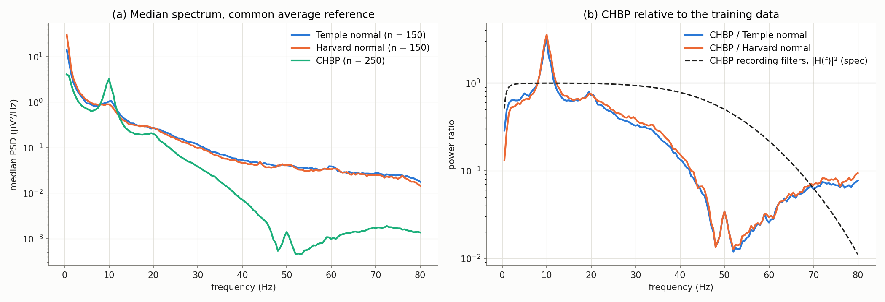
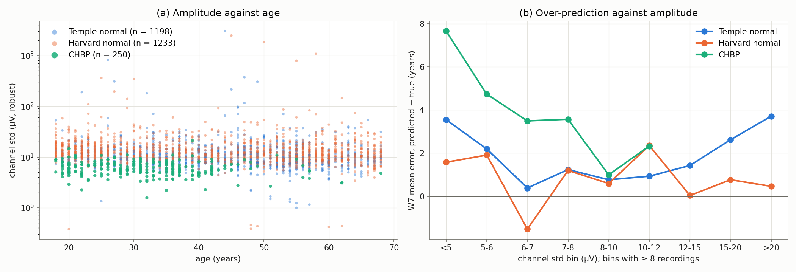
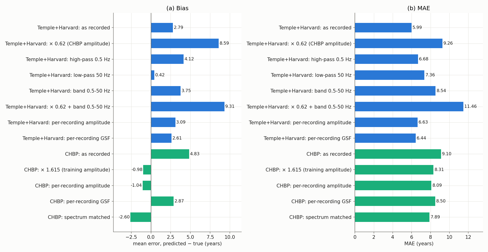
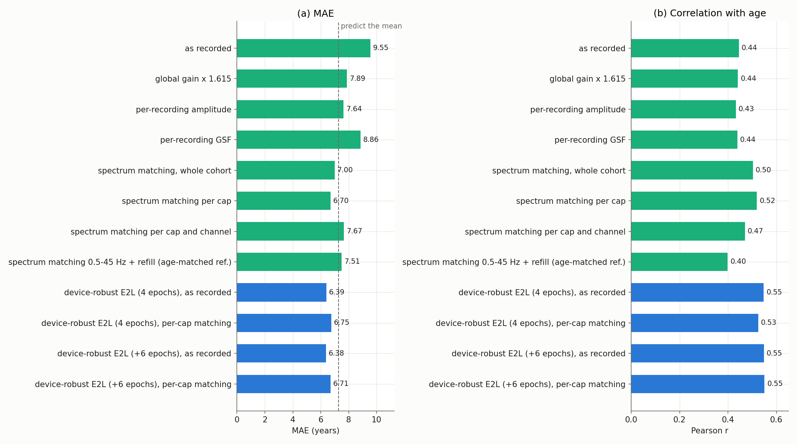

# Why the brain-age models degrade on CHBP: domain-shift analysis

Results note, 2026-11-11. On the Cuban Human Brain Mapping Project (CHBP,
`docs/chbp_onboarding.md`) our brain-age models are much worse than on the
Temple (TUH) and Harvard (HEEDB) data they were trained on, although CHBP is a
healthy cohort. This note asks why, using only signals and frozen models: **CHBP
is never used for training, tuning or fitting** (its ages are used only to score).

The analysis has four parts:
- the models on age-matched training-domain recordings (Section 3);
- the signal features in which CHBP differs (Section 4);
- which features the errors follow (Section 5), including two acquisition
  sub-cohorts inside CHBP (Section 6);
- causal tests that transform the signals in both directions (Section 7).

It ends with the literature (Section 8), conclusions and the comparison with
published CHBP results (Section 9).

Code:
- `scripts/domain_shift_analysis.py`: per-recording signal features and the CHBP
  vs Temple / Harvard comparison;
- `scripts/make_transformed_cohort.py`: label-free signal transforms of an npy
  cohort (gain, band limits, per-recording amplitude, global scale factor,
  spectrum matching) and the age-matched reference sample;
- `scripts/domain_shift_figures.py`: the figures, the transform-test and CHBP-fix tables;
- `scripts/hc_domain_features.py`: handcrafted-feature brain-age models (spectral,
  wavelet, CWT, entropy, cepstral, scattering) across domains, and the
  per-family domain separability;
- `labram_plus.band_hz` / `labram_plus.amplitude_norm` (`labram/data/preprocess.py`):
  the device-robust model inputs of Section 10.2;
- `scripts/external_runs/chbp_domain_shift.sh`: the whole pipeline.

Outputs:
- `docs/data/external_eval/chbp/domain_shift_tests.csv`;
- per-recording features and scores in `/data/runs/heedb/domain_shift/`.

## 1. Summary

1. **The degradation is real, not an artefact of CHBP's narrow age range.** On
   healthy Temple and Harvard recordings weighted to CHBP's ages, W7 has MAE
   5.90 / 4.45 years and r 0.70 / 0.80. On CHBP it has 8.66 and r 0.47
   (Table 3.1).
2. **Two properties of CHBP's recording chain reproduce the whole degradation
   on training-domain recordings** (Table 7.1):
   - **Amplitude is about 0.6×** (channel std 5.8 vs 9.9 / 12.8 µV). It adds a
     pure offset: about +6 years of over-prediction with r unchanged.
   - **The 0.5–50 Hz recording band.** The 50 Hz low-pass alone drops r from
     0.66–0.71 to 0.40–0.44. The models use content above 50 Hz that CHBP does
     not have (its 45–70 Hz power is 4–5 % of the training data's).
   - Together, Temple / Harvard recordings degrade to MAE 11.5–13.7,
     r 0.36–0.37.
3. **CHBP holds two acquisition sub-cohorts.** The 64-channel cap (12-bit EDF,
   n = 161) reaches r 0.58. The 120-channel cap (16-bit EDF, n = 89) has
   r 0.27 and +9 years of bias, with a frequency-dependent spectral
   difference (Table 6.1).
4. **The population is not what drives the error.** CHBP is alert, eyes-closed
   and artifact-free: strong alpha, steeper 1/f slope, no artifact windows. In
   the literature these features read as *younger*, not older (Section 8).
5. **Label-free normalization of CHBP removes the bias but cannot restore the
   ranking** (Table 7.2).
   - Best: spectrum matching to the training data, MAE 7.01–7.89 (E2L 7.01, the
     only value under the 7.27 mean-age baseline); on the 64-channel cap 6.27.
   - r stays at 0.43–0.49, because the missing high-frequency content cannot be
     re-created.
   - The robust fix is on the training side and needs no CHBP data
     (Section 9.2).
6. **Closing the loop (Section 10).** The fixes were tested, still without any
   CHBP labels:
   - **Best: a device-robust model.** E2L fine-tuned on Temple + Harvard with a
     1–45 Hz input band and per-window amplitude normalization scores CHBP
     *as recorded* at MAE 6.38, r 0.55, bias +0.3 (E2L: 9.55, r 0.44). That is
     level with the best published within-CHBP result (6.48, trained on CHBP).
     The 120-channel cap goes from 13.10 to 7.01.
   - **It is invariant to the CHBP-like degradation** (Table 10.3).
   - **It costs some in-domain accuracy:** val 7.86 vs 7.24, LEMON 6.23 vs 5.22,
     with the ranking unchanged. The cost is a level offset at young ages from
     discarding amplitude.
   - **Best without retraining: spectrum matching per cap** to a label-free
     Temple / Harvard reference: E2L 6.70, all four models improved
     (Table 10.1).
   - **Handcrafted features do not transfer better** (Table 10.4). Spectral
     features hold up best, wavelets and STFT worse, and wavelet scattering
     worst (CHBP r 0.11).

## 2. Data and methods

**Sets.**
- *Temple* and *Harvard* are the recordings of the `tuh_heedb_v1` validation
  split with a normal report, aged 18–68: 1,198 (TUH) and 1,233 (HEEDB). None
  were used for training.
- *CHBP* is all 250 recordings of `chbp_v1`.
- For the transform tests (Section 7), 150 Temple and 150 Harvard recordings
  were drawn from those sets, weighted to CHBP's ages (2-year bins, seed 0;
  `make_transformed_cohort.py sample`).

**Signal segment.** Every feature uses what the models see: the first 5 minutes
after a 60 s trim, the 19 10-20 channels (A1, A2, T1, T2 dropped), common average
reference, µV at 200 Hz. In CHBP this segment lies inside the first eyes-closed
block.

**Models.** E2L, L1, W4 and W7, trained on `tuh_heedb_v1`; predictions are
de-normalized with the training age mean / std, 53.52 / 19.29 years.

**Age matching.** Recording $i$ of a reference set with age $a_i$ in 2-year bin
$b(i)$ gets the weight

$$ w_i = \frac{h_{b(i)}}{n_{b(i)}} \tag{2.1} $$

Here $h_b$ is the share of CHBP recordings in bin $b$ and $n_b$ the number of
reference recordings in it. Weighted statistics use $w_i / \sum_j w_j$.

**Metrics.** With $e_i = \hat y_i - y_i$ (predicted minus true age, years):

$$ \mathrm{MAE} = \frac{\sum_i w_i \lvert e_i\rvert}{\sum_i w_i}, \qquad
   \mathrm{bias} = \frac{\sum_i w_i e_i}{\sum_i w_i} \tag{2.2} $$

$w_i = 1$ for CHBP and in Section 7. $r$ is the (weighted) Pearson correlation
of $\hat y$ and $y$ (2.3).

## 3. Is it the age range?

CHBP is young and narrow (18–68, mean 31.7, SD 9.3), which caps any model's R²
(Section 9.3). The question here is whether the models are also poor on
*training-domain* recordings of the same ages.

### Table 3.1. Age-matched comparison, every window

MAE and bias (2.2), weighted to CHBP's ages (2.1); bias for ages 18–29; r (2.3).
Predictions over every window (the training-domain validation predictions are
scored that way).

| model | set | n | MAE | bias | bias 18–29 | r |
|---|---|---|---|---|---|---|
| E2L | Harvard normal | 1,233 | 4.87 | +2.79 | +4.44 | 0.77 |
| E2L | Temple normal | 1,198 | 6.47 | +4.81 | +6.96 | 0.68 |
| E2L | **CHBP** | 250 | **9.35** | +6.96 | +11.38 | 0.45 |
| L1 | Harvard normal | 1,233 | 4.38 | +1.34 | +1.75 | 0.80 |
| L1 | Temple normal | 1,198 | 5.79 | +3.32 | +4.73 | 0.69 |
| L1 | **CHBP** | 250 | **9.11** | +5.25 | +9.04 | 0.46 |
| W4 | Harvard normal | 1,233 | 4.37 | +1.50 | +2.04 | 0.80 |
| W4 | Temple normal | 1,198 | 5.86 | +3.62 | +5.08 | 0.70 |
| W4 | **CHBP** | 250 | **8.92** | +5.03 | +8.90 | 0.47 |
| W7 | Harvard normal | 1,233 | 4.45 | +1.34 | +1.78 | 0.80 |
| W7 | Temple normal | 1,198 | 5.90 | +3.51 | +4.80 | 0.70 |
| W7 | **CHBP** | 250 | **8.66** | +4.78 | +8.58 | 0.47 |

**What Table 3.1 shows:**
- At CHBP's ages the models are good on their own domain: r 0.70 (Temple) and
  0.80 (Harvard), MAE 4.4–6.5.
- On CHBP, r falls to 0.45–0.47 and the MAE rises by 3–5 years. The narrow age
  range is therefore not the reason.
- **Part of the over-prediction of young adults is generic.** Temple's healthy
  18–29-year-olds are over-predicted by +4.7 to +7.0 years too. CHBP adds about
  +4 years on top.

## 4. What differs in the signal

### Features

For recording $r$, let $x_{c,k}$ be channel $c$ in 10 s window $k$, after the
common average reference. Statistics are taken per window and then the median
over windows. Clinical recordings carry large settling and movement artifacts
(Harvard: 20 % of windows), which would otherwise dominate.

$$ \sigma_r = \operatorname{median}_k \operatorname{median}_c \operatorname{std}(x_{c,k}) \tag{4.1} $$

$P_r(f)$ is the channel-median Welch PSD (2 s Hann segments, median averaging),
in µV²/Hz. The absolute power of band $B$ is
$\tfrac{1}{\lvert B\rvert}\sum_{f\in B} P_r(f)$ (4.2). The relative power is
$\sum_{f\in B} P_r(f) / \sum_{1\le f<45} P_r(f)$ (4.3).

The aperiodic component is the OLS line

$$ \log_{10} P_r(f) = o - \chi \log_{10} f, \qquad f \in [2, 40]\ \text{Hz} \setminus [6, 14]\ \text{Hz} \tag{4.4} $$

with exponent $\chi$ and offset $o$. The alpha peak is the frequency
(6–14 Hz) and height of the largest O1/O2 log-PSD excess over line (4.4) (4.5).

A feature's separation between CHBP and a reference set is

$$ \mathrm{AUC} = P(X_{\mathrm{CHBP}} > X_{\mathrm{ref}}) + \tfrac12 P(X_{\mathrm{CHBP}} = X_{\mathrm{ref}}) \tag{4.6} $$

with the reference recordings weighted by (2.1). 0.5 is no difference; 0 or 1
is complete separation.

### Table 4.1. CHBP vs age-matched Temple and Harvard normals

Medians (reference medians weighted by (2.1)); AUC (4.6). Power in µV²/Hz;
"share" columns are fractions.

| feature | CHBP | Temple | Harvard | AUC vs Temple | AUC vs Harvard |
|---|---|---|---|---|---|
| channel std (4.1), µV | 5.84 | 9.95 | 12.81 | 0.13 | 0.05 |
| 99th percentile of \|x\|, µV | 20.2 | 42.7 | 70.6 | 0.17 | 0.11 |
| share of windows with a channel std > 100 µV | 0.000 | 0.033 | 0.200 | 0.31 | 0.08 |
| power 0.1–1 Hz (4.2) | 5.0 | 43.2 | 90.5 | **0.03** | **0.01** |
| power delta 1–4 Hz | 1.86 | 3.86 | 4.36 | 0.21 | 0.17 |
| power theta 4–8 Hz | 0.70 | 1.10 | 1.07 | 0.32 | 0.34 |
| power alpha 8–13 Hz | 1.98 | 1.05 | 0.92 | 0.65 | 0.69 |
| power beta 13–30 Hz | 0.159 | 0.266 | 0.244 | 0.32 | 0.35 |
| power 30–45 Hz | 0.017 | 0.069 | 0.056 | 0.15 | 0.15 |
| power 45–70 Hz | 0.001 | 0.036 | 0.028 | **0.03** | **0.02** |
| relative delta (4.3) | 0.255 | 0.401 | 0.479 | 0.24 | 0.15 |
| relative alpha | 0.438 | 0.173 | 0.152 | 0.82 | 0.87 |
| relative beta | 0.121 | 0.150 | 0.134 | 0.41 | 0.46 |
| aperiodic exponent $\chi$ (4.4) | 1.70 | 1.33 | 1.42 | 0.74 | 0.74 |
| aperiodic offset $o$ | 1.11 | 1.02 | 1.06 | 0.53 | 0.52 |
| alpha peak frequency (4.5), Hz | 10.0 | 10.0 | 10.0 | 0.53 | 0.49 |
| alpha peak height (4.5), log10 | 1.89 | 0.92 | 0.84 | 0.82 | 0.84 |
| posterior / frontal alpha | 1.91 | 1.46 | 1.47 | 0.68 | 0.68 |
| 95 % spectral edge, Hz | 20.5 | 28.5 | 24.5 | 0.25 | 0.34 |
| Hjorth complexity | 2.23 | 3.61 | 4.94 | 0.09 | 0.03 |
| mean \|correlation\| between channels | 0.46 | 0.41 | 0.46 | 0.67 | 0.48 |

### Figure 4.1. Spectra

(a) Median PSD (µV²/Hz, log scale) over recordings and channels, common
average reference: Temple normal (n = 150), Harvard normal (n = 150), both
age-matched, and CHBP (n = 250). (b) CHBP's median PSD divided by each
reference's. The dashed line is the power response $\lvert H(f)\rvert^2$ of
CHBP's recording filters as specified: first-order high-pass 0.5 Hz, second-order
Butterworth low-pass 50 Hz (Valdes-Sosa et al. 2021).

### Table 4.2. EDF calibration headers

From the EDF headers of channel O1 (CHBP: all 250 recordings of release 1.0;
TUAB: 61 sampled normal recordings).

| source | files | signals per file | physical range (µV) | digital range | resolution (µV) |
|---|---|---|---|---|---|
| CHBP, 64-channel cap | 161 | 62 | ±246 | 12-bit, ±2047 | 0.116 |
| CHBP, 120-channel cap | 89 | 123 | ±5,063 | 16-bit, ±32767 | 0.155 |
| TUAB | 58 of 61 | — | ±5,000 | 16-bit | 0.153 |

**What Tables 4.1, 4.2 and Figure 4.1 show.** CHBP differs from the training
data in two kinds of property.

**Recording chain:**
- **Amplitude.** About 0.6× in channel std and 0.3–0.5× in the dynamic range
  actually used.
- **Band limits.** Very low frequencies are 0.06–0.12×, and 45–70 Hz is 0.04–0.05×.
  These two features separate CHBP almost completely (AUC 0.01–0.03).
- **The filters alone do not explain the high-frequency deficit.**
  Figure 4.1(b): from about 20 Hz upward the observed ratio lies far below the
  filter response. CHBP has about 3× (30 Hz) to 10× (45 Hz) less power than the
  filters account for. That fits recordings without muscle (EMG) activity under a
  technician watching for it, against clinical recordings.
- **The 64-channel files have only ±246 µV of range**, but clipping is negligible
  (in 40 files, a median of 0.002 % of samples sit at the per-channel maximum).

**Population and state:**
- An alert eyes-closed state: 2.5–2.9× relative alpha, 2× alpha peak height,
  a steeper 1/f slope (1.70 vs 1.33–1.42).
- No artifact windows (Harvard: 20 %).
- **The alpha peak frequency is the same** (10 Hz).

## 5. Which features the errors follow

### Partial correlation of error with features

Within each set, the Spearman correlation of the error $e_i$ with a feature,
both rank-residualized on age:

$$ \rho_{\mathrm{partial}} = \operatorname{corr}\big(R(e) - \widehat{R(e)}\,\vert\,R(y),\; R(z) - \widehat{R(z)}\,\vert\,R(y)\big) \tag{5.1} $$

$R(\cdot)$ is the rank, $z$ the feature, and $\widehat{\cdot}\,\vert\,R(y)$ the OLS
fit on the age rank. A negative value means the model predicts older when the
feature is lower.

### Table 5.1. Partial correlation (5.1) of the error with signal features, every window

| feature | W7 CHBP | W7 Temple | W7 Harvard | E2L CHBP | E2L Temple | E2L Harvard |
|---|---|---|---|---|---|---|
| channel std (4.1) | **−0.31** | 0.00 | −0.05 | **−0.31** | 0.01 | −0.02 |
| 99th percentile of \|x\| | −0.27 | −0.01 | −0.05 | −0.28 | −0.02 | −0.03 |
| power 0.1–1 Hz | −0.18 | −0.01 | −0.03 | −0.20 | 0.02 | −0.01 |
| power delta | **−0.33** | 0.04 | −0.07 | **−0.34** | 0.07 | −0.06 |
| power alpha | −0.31 | −0.08 | −0.02 | −0.30 | −0.10 | −0.03 |
| power 45–70 Hz | −0.23 | −0.01 | 0.05 | −0.26 | −0.05 | 0.06 |
| aperiodic offset | −0.24 | 0.03 | −0.07 | −0.24 | 0.07 | −0.07 |
| aperiodic exponent | −0.04 | 0.03 | −0.05 | −0.04 | 0.10 | −0.05 |
| alpha peak frequency | −0.04 | −0.13 | −0.16 | −0.03 | −0.15 | −0.21 |
| relative alpha | −0.15 | −0.16 | 0.00 | −0.13 | −0.19 | −0.03 |

### Figure 5.1. Amplitude and over-prediction

(a) Channel std (4.1, µV, log scale) against age for Temple normal
(n = 1,198), Harvard normal (n = 1,233) and CHBP (n = 250). (b) W7's mean error
(2.2), every window, per channel-std bin; bins with at least 8 recordings.

**What Table 5.1 and Figure 5.1 show:**
- **Within CHBP the error follows absolute amplitude** (ρ ≈ −0.3 for channel std
  and delta, alpha and 45–70 Hz power): the lower the amplitude, the older the
  prediction.
- **Within Temple and Harvard amplitude has no such effect** (|ρ| ≤ 0.08). There
  the error follows the alpha peak frequency, as physiology predicts.
- **CHBP lies at the edge of the training distribution.**
  - Half of CHBP is below 5.84 µV, a range that holds only 2.3 % of Harvard and
    7.1 % of Temple healthy adults (Figure 5.1(a)).
  - In the training data those low-amplitude recordings are mostly older people
    (mean age 46–49).
  - The few young ones are over-predicted by +6 to +12 years (n = 13).
  - So the models learned "low amplitude = old", and CHBP sits where that rule
    applies (Figure 5.1(b)).

## 6. Two acquisition sub-cohorts in CHBP

### Table 6.1. CHBP by cap

First 5 minutes. W7 / E2L: MAE and bias (2.2), r (2.3). The predict-the-mean
baseline uses each group's own mean. Bias by age is W7's, over every window.

| | 64-channel cap | 120-channel cap |
|---|---|---|
| recordings, EDF encoding | 161, 12-bit (±246 µV) | 89, 16-bit (±5,063 µV) |
| age, mean ± SD | 31.1 ± 9.1 | 32.8 ± 9.6 |
| channel std (4.1), µV | 5.90 | 5.53 |
| power ratio 120 / 64 at 4 / 10 / 20 / 40 / 45 Hz | — | 0.97 / 0.61 / 0.65 / 1.38 / 2.86 |
| predict the group mean, MAE | 7.19 | 7.32 |
| W7 MAE / bias / r | **7.26** / +2.47 / **0.58** | 12.45 / +9.09 / 0.27 |
| E2L MAE / bias / r | 7.58 / +4.98 / 0.55 | 13.10 / +10.80 / 0.27 |
| W7 bias at 18–29 / 30–39 / 40–68 | +6.4 / −0.4 / −0.4 | +13.1 / +9.7 / −2.9 |

**What Table 6.1 shows:**
- On the 64-channel cap the models behave much like on Temple: r 0.58, bias near
  zero from age 30.
- The 120-channel cap is the problem: r 0.27 and +9 to +11 years of bias.
- Its broadband amplitude is the same. Its spectrum differs in a
  frequency-dependent way: about 40 % less alpha and beta, more power at
  40–45 Hz. That is not a calibration factor.
- Topography is plausible in both caps. Alpha is largest at O1/O2, and the
  inter-channel correlation structures agree (r = 0.97 between caps). There is
  no sign of swapped labels.
- The electrode coordinates shipped with release 1.1 are the same template for
  both caps, so they cannot show real placement differences.
- The data paper itself is inconsistent about the amplifier gain (10,000 in the
  text, "20,000/1000" in its Table 7). The cause cannot be settled from the
  released data.

## 7. Causal tests with frozen models

Every transform is label-free (`make_transformed_cohort.py`), applied to whole
recordings $x$ (µV) before the standard pipeline:

$$ x' = k\,x \tag{7.1} $$

$$ x' = h_{\mathrm{LP}} \ast h_{\mathrm{HP}} \ast x \tag{7.2} $$

(7.2) is zero-phase Butterworth: high-pass order 2, low-pass order 4, applied
forwards and backwards.

$$ x' = \frac{\sigma^\ast}{\sigma_r}\,x \tag{7.3} $$

In (7.3), $\sigma_r$ is (4.1) over the whole recording and
$\sigma^\ast = 10.05$ µV, the median of the reference sample.

$$ G_r = \frac{1}{19\,\lvert F\rvert} \sum_{c} \sum_{f\in F} \log_{10} P_{r,c}(f),\quad F = [1, 19]\ \text{Hz}, \qquad x' = 10^{(G^\ast - G_r)/2}\,x \tag{7.4} $$

(7.4) is the global scale factor (GSF) of the Cuban qEEG norms (Hernández et al.
1994; HarMNqEEG code), with $G^\ast = -0.058$, the reference median.

$$ X'(f) = X(f)\,\operatorname{clip}\!\Big(\sqrt{\bar P_{\mathrm{ref}}(f) / \bar P_{\mathrm{CHBP}}(f)},\ 0.1,\ 10\Big) \tag{7.5} $$

In (7.5), $X$ is the Fourier transform of a channel and $\bar P$ the median PSD
over recordings and channels. The gain is one cohort-level curve for all of CHBP
(spectrum matching).

### Table 7.1. Forward tests: Temple + Harvard normals made CHBP-like

n = 300 (150 + 150, age-matched); first 5 minutes; MAE, bias (2.2), r (2.3).
All four models: `docs/data/external_eval/chbp/domain_shift_tests.csv`.

| transform of the training-domain recordings | W7 MAE | W7 bias | W7 r | E2L MAE | E2L bias | E2L r |
|---|---|---|---|---|---|---|
| none | 5.99 | +2.79 | 0.70 | 7.02 | +5.10 | 0.66 |
| amplitude × 0.62 (7.1) | 9.26 | +8.59 | 0.70 | 11.34 | +10.91 | 0.66 |
| high-pass 0.5 Hz (7.2) | 6.68 | +4.12 | 0.67 | 7.71 | +5.96 | 0.63 |
| low-pass 50 Hz (7.2) | 7.36 | +0.42 | **0.44** | 8.04 | +3.75 | **0.40** |
| band 0.5–50 Hz (7.2) | 8.54 | +3.75 | 0.40 | 9.75 | +6.79 | 0.38 |
| × 0.62 and band 0.5–50 Hz | **11.46** | +9.31 | 0.37 | **13.71** | +12.59 | 0.37 |
| per-recording amplitude (7.3) | 6.63 | +3.09 | 0.65 | 7.90 | +5.45 | 0.59 |
| per-recording GSF (7.4) | 6.44 | +2.61 | 0.67 | 7.33 | +4.88 | 0.62 |

### Table 7.2. Inverse tests: CHBP normalized towards the training data

CHBP, n = 250 as recorded, first 5 minutes; same columns. The last two columns
are the 64-channel cap only (n = 161; predict-the-mean 7.19).

| normalization of CHBP | W7 MAE | W7 bias | W7 r | E2L MAE | E2L bias | E2L r | 64-ch E2L MAE | 64-ch E2L r |
|---|---|---|---|---|---|---|---|---|
| none | 9.10 | +4.83 | 0.46 | 9.55 | +7.05 | 0.44 | 7.58 | 0.55 |
| amplitude × 1.615 (7.1) | 8.31 | −0.98 | 0.46 | 7.89 | +0.83 | 0.44 | 6.89 | 0.52 |
| per-recording amplitude (7.3) | 8.09 | −1.04 | 0.46 | 7.64 | +0.78 | 0.43 | 6.99 | 0.48 |
| per-recording GSF (7.4) | 8.50 | +2.87 | 0.46 | 8.86 | +5.11 | 0.44 | 7.56 | 0.49 |
| spectrum matching (7.5) | **7.89** | −2.60 | 0.49 | **7.01** | +0.48 | 0.48 | **6.27** | **0.56** |

### Figure 7.1. Transform tests, W7

(a) Mean error (2.2) and (b) MAE of W7 for every test: Temple + Harvard
(n = 300, blue) and CHBP (n = 250, aqua), first 5 minutes.

**What Tables 7.1, 7.2 and Figure 7.1 show:**
- **The amplitude shift is a pure offset.** × 0.62 leaves r unchanged and adds
  about +6 years to every model.
- **The band limit breaks the ranking.** The 50 Hz low-pass alone takes r from
  0.66–0.71 to 0.40–0.44 on the training domain; the high-pass costs much less. The
  models rely on content above 50 Hz, or at least have never seen EEG without
  it. Content there is mostly muscle and line-noise residue in clinical
  recordings.
- **Together, the two reproduce CHBP's degradation on Temple / Harvard
  recordings** (MAE 11.5–13.7, r 0.36–0.37), even worse than CHBP itself.
- **On CHBP, amplitude normalization removes the bias but not the ranking loss.**
  Per-recording amplitude does as well as a global gain. The GSF is weaker,
  because CHBP's strong alpha inflates its log-power mean, so it under-corrects.
- **Spectrum matching works best** (E2L 7.01; 64-channel cap 6.27, r 0.56). The
  content CHBP never recorded above 50 Hz cannot be put back, so r stays below
  0.5.
- **Per-recording amplitude or GSF normalization costs the frozen models only
  0.3–0.9 years** on the training domain (Table 7.1). Amplitude carries little
  age information there.

## 8. What the literature says

**Device, gain and harmonization**
- CHBP's own group removes a per-subject **global scale factor** before
  building qEEG norms: the geometric mean of power over channels and
  frequencies after average reference. It explains 42 % of the variance of
  age-corrected log spectra and is partly age-dependent (Hernández et al.
  1994).
- HarMNqEEG models device / site *batch* effects on top of it. CHBP is one of
  its batches, "Medicid-5 CHBMP" (Li et al. 2022, code).
- A successor normalizes power per electrode below 20 Hz, "to avoid the region
  where device-specific high-frequency roll-off differences become
  non-negligible". It warns that such normalization absorbs real amplitude
  effects (Bosch-Bayard et al. 2026).

**Age effects in the spectrum**
- With age, broadband power (aperiodic offset) and the 1/f exponent decrease,
  and alpha peak frequency slows (Voytek et al. 2015; Donoghue et al. 2020:
  exponent 1.43 vs 0.75, offset −11.1 vs −11.9, alpha 10.7 vs 9.6 Hz in 20–30
  vs 60–70-year-olds; Merkin et al. 2023; Tröndle et al. 2023).
- A gain loss therefore mimics ageing through the offset. CHBP's steep slope
  and strong alpha mimic youth.
- In simulations of a ridge brain-age model, a pure input gain or damping
  shifts the brain-age gap systematically (Gemein et al. 2026).

**Clinical vs research recordings**
- About half of routine adult clinical EEGs at MGH (a Harvard hospital) reach
  early sleep (Karakis et al. 2012).
- CHBP's technicians watched "to prevent drowsiness" (Valdes-Sosa et al. 2021).
- Muscle and other peripheral signals carry age information in TUAB-type data
  (Bomatter et al. 2024). CHBP lacks them.

**Band limits and cross-dataset transfer**
- The most important setting for cross-dataset brain-age generalization in a
  1,805-configuration study was a broadband 1–45 Hz input (Tveitstøl et al.
  2026).
- The CHBP benchmark itself used 0.1–49 Hz (Engemann et al. 2022).
- Models trained on TUEG with per-epoch z-scored 1–45 Hz input transfer to LEMON
  and TDBRAIN with R² 0.48–0.63 (Hajhassani et al. 2026).

**Label-free alignment**
- Riemannian re-centering raised TUAB → LEMON R² from about 0.26 to
  0.44 ± 0.06 (Mellot et al. 2023).
- It fails when the target's age distribution differs from the source's. On
  HarMNqEEG, which includes CHBP: R² −0.35, MAE 16.97, because the dataset mean
  covariance correlates with age (Mellot et al. 2024, GOPSA). CHBP is such a
  case: young and narrow.

**Bias correction**
- Corrections that use each test subject's age inflate R² (Butler et al. 2021).
- Only corrections fitted on training data may be applied to an external test
  (de Lange & Cole 2020; Beheshti et al. 2019).

## 9. Conclusions

### 9.1 Why the models degrade on CHBP, ranked by measured effect

1. **CHBP's 0.5–50 Hz recording band, above all the 50 Hz low-pass.**
   - Measured effect: r 0.66–0.71 → 0.40–0.44 on the training domain
     (Table 7.1).
   - CHBP's 45–70 Hz power is 4–5 % of the training data's, and below 1 Hz
     6–12 % (Table 4.1).
   - The models were trained on 0.1–75 Hz clinical EEG, where muscle activity
     fills that range.
2. **Amplitude about 0.6× the training data's.**
   - Measured effect: about +6 years of over-prediction, r unchanged
     (Table 7.1).
   - The models have no amplitude normalization and learned that low amplitude
     means old. CHBP sits where few young training recordings are (Figure 5.1).
   - The source of the low amplitude (gain, electrodes, export scale or
     population) cannot be separated with the released data. The paper's two
     gain values disagree.
3. **The 120-channel cap.**
   - A third of CHBP; a frequency-dependent difference from the 64-channel cap.
   - Bias +9 years, r 0.27, against r 0.58 on the 64-channel cap (Table 6.1).
4. **Not the cause, but part of the mismatch: population and state.**
   - Alert, clean, eyes-closed recordings with strong alpha and a steep slope.
   - These read as *younger*. The domain is still different from clinical
     routine EEG, where about half the recordings contain drowsiness.
5. **Not the cause: the narrow age range.** At CHBP's ages the models reach
   r 0.70–0.80 on their own domain (Table 3.1). The range does cap the
   attainable R² (Section 9.3).

### 9.2 How to bring CHBP-like data into the training domain

**At test time, with no labels:**
- **Spectrum matching** (7.5) to the training data's median spectrum is the
  best single step: bias about 0, E2L 7.01, 64-channel cap 6.27.
- **A global or per-recording amplitude normalization** (7.1, 7.3) removes the
  bias almost as well.
- None of them can restore the ranking (r ≤ 0.49).

**Robust fix, on the training side** (Temple / Harvard data only; CHBP stays an
external test). Each step is supported by Section 8:
1. **Train on a band every device records**, for example 0.5 (or 1) to 45 Hz,
   instead of 0.1–75 Hz. That removes the models' dependence on the content
   CHBP lacks; Table 7.1 shows that dependence is what breaks the ranking.
2. **Make the input amplitude-robust:** per-recording amplitude or GSF
   normalization (7.3, 7.4) during training, or random gain augmentation (for
   example × 0.5–2). On the frozen models this costs only 0.3–0.9 years
   in-domain (Table 7.1).
3. **Track the forward tests of Table 7.1** (gain × 0.62, band 0.5–50 Hz) on
   the Temple / Harvard validation split while training. They are a label-free
   robustness benchmark that needs no external data.
4. **Report CHBP per cap**, and as a separate check on top of the cohort mean,
   the age-matched training-domain reference of Table 3.1.

Section 10 tests these steps.

### 9.3 Comparison with published CHBP results

The only published CHBP age results are within-CHBP 10-fold CV (Engemann et
al. 2022, Table 1, n = 282, eyes open and closed pooled, 0.1–49 Hz):
- handcrafted features + random forest: MAE 6.48 ± 0.60, R² 0.18 ± 0.17;
- ShallowNet 6.65; Deep4Net 6.89; filterbank-riemann 7.17;
- predict the mean: 7.33 ± 0.83.

These models are trained on CHBP. Ours never are:
- **As recorded:** best 8.66 (W7, every window) and 9.10 (first 5 minutes).
- **After label-free spectrum matching:** 7.01 (E2L), and 6.27 on the
  64-channel cap.

For reference only, since they use CHBP ages: on the same kind of 10 subject
folds, a two-parameter recalibration of the frozen predictions gives 6.44–6.59,
and a ridge regression on frozen E2 embeddings gives 5.93
(`docs/data/external_eval/chbp/cv10_*.csv`). Neither is pursued, because CHBP is
kept as an external test.

## 10. Closing the loop: fixing CHBP for the age models

No CHBP age is used to fit, select or tune anything in this section. CHBP ages
only score the result. The test-time methods use CHBP *signals* (cohort-level
spectra), never its labels. A recording's cap (64 or 120 channels, from the EDF
header, Table 4.2) is acquisition metadata.

### 10.1 Test-time normalization of CHBP (no retraining)

**Methods.** Besides (7.1)–(7.5):
- **per cap:** spectrum matching (7.5) with one gain curve per acquisition group,
  $\bar P_{\mathrm{CHBP}}$ taken over that cap's recordings;
- **per cap and channel:** one curve per cap and channel;
- **band-restricted matching with spectral completion:** (7.5) with gain 1
  outside 0.5–45 Hz, then independent Gaussian noise added to every channel in
  the bands the recording chain removed:

$$ n_c(t)\ \text{with one-sided PSD}\ \bar P_{\mathrm{ref}}(f)\ \text{for}\ f \in [0.1, 0.5] \cup [48, 75]\ \text{Hz},\ 0\ \text{elsewhere} \tag{10.1} $$

**Reference spectrum.** $\bar P_{\mathrm{ref}}$ is the median spectrum of 300
random adult Temple + Harvard validation recordings (150 + 150, normal report,
ages 18–89, mean 47). It is **not** matched to CHBP's ages. The age-matched
reference of Section 7 implicitly used CHBP's age distribution; this
label-free one does at least as well (per cap: E2L 6.70 vs 6.81).

### Table 10.1. CHBP fixes without retraining

CHBP, first 5 minutes, n = 250 (64-ch cap 161, 120-ch cap 89). MAE and bias
(2.2), r (2.3); the last two columns are E2L per cap, MAE (r). Predict the mean:
7.27 (per cap 7.19 / 7.32). All models: `docs/data/external_eval/chbp/chbp_fix_methods.csv`.

| method | E2L MAE | E2L bias | E2L r | W7 MAE | W7 bias | W7 r | E2L 64-ch | E2L 120-ch |
|---|---|---|---|---|---|---|---|---|
| as recorded | 9.55 | +7.05 | 0.44 | 9.10 | +4.83 | 0.46 | 7.58 (0.55) | 13.10 (0.27) |
| global gain × 1.615 (7.1) | 7.89 | +0.83 | 0.44 | 8.31 | −0.98 | 0.46 | 6.89 (0.52) | 9.69 (0.34) |
| per-recording amplitude (7.3) | 7.64 | +0.78 | 0.43 | 8.09 | −1.04 | 0.46 | 6.99 (0.48) | 8.81 (0.35) |
| per-recording GSF (7.4) | 8.86 | +5.11 | 0.44 | 8.50 | +2.87 | 0.46 | 7.56 (0.49) | 11.20 (0.34) |
| spectrum matching, whole cohort (7.5) | 7.00 | +1.63 | 0.50 | 7.54 | −1.54 | 0.51 | 6.17 (0.58) | 8.50 (0.39) |
| **spectrum matching per cap** | **6.70** | +0.82 | **0.52** | 7.38 | −2.39 | 0.53 | 6.23 (0.57) | **7.55 (0.45)** |
| spectrum matching per cap and channel | 7.67 | +3.88 | 0.47 | 7.39 | +1.49 | 0.49 | 6.53 (0.55) | 9.72 (0.37) |
| matching 0.5–45 Hz + refill (10.1), age-matched ref. | 7.51 | +0.58 | 0.40 | 8.40 | −3.00 | 0.42 | 6.70 (0.45) | 8.96 (0.31) |

### Table 10.2. Known-truth validation on Temple + Harvard recordings

The age-matched sample of Section 7 (n = 300) made CHBP-like and then repaired
with the same label-free methods. Here the truth is known and no CHBP data is
involved. First 5 minutes; MAE, bias (2.2), r (2.3).

| Temple + Harvard recordings | W7 MAE | W7 bias | W7 r | E2L MAE | E2L bias | E2L r |
|---|---|---|---|---|---|---|
| as recorded | 5.99 | +2.79 | 0.70 | 7.02 | +5.10 | 0.66 |
| low-pass 50 Hz | 7.36 | +0.42 | 0.44 | 8.04 | +3.75 | 0.40 |
| low-pass 50 Hz, then refill > 48 Hz (10.1) | 7.02 | −3.03 | 0.52 | 6.71 | +0.23 | 0.48 |
| band 0.5–50 Hz | 8.54 | +3.75 | 0.40 | 9.75 | +6.79 | 0.38 |
| band 0.5–50 Hz, then refill both bands (10.1) | 7.01 | −1.29 | 0.51 | 7.21 | +2.29 | 0.47 |
| × 0.62 and band 0.5–50 Hz | 11.46 | +9.31 | 0.37 | 13.71 | +12.59 | 0.37 |
| × 0.62 and band 0.5–50 Hz, then spectrum matching (7.5) | 7.61 | +1.83 | 0.46 | 8.74 | +5.33 | 0.43 |

**What Tables 10.1 and 10.2 show:**
- **Per-cap spectrum matching is the best test-time fix.** It improves every model
  (E2L 9.55 → 6.70, L1 9.37 → 7.29, W4 9.19 → 7.13, W7 9.10 → 7.38) and the
  120-channel cap most (E2L 13.10 → 7.55). It needs no labels, only the
  cohort's own spectrum and its cap.
- **Gain-only fixes** (global or per recording) remove the bias but not the
  ranking (r 0.43–0.44).
- **The per-recording GSF under-corrects**, because CHBP's strong alpha inflates
  its log-power mean.
- **Per-channel curves help the 64-channel cap for three of the four models but
  hurt the 120-channel cap.** That cap's difference is not an electrode-specific
  gain or frequency response.
- **On known truth, spectrum matching repairs the offset completely but the
  ranking only in part** (Table 10.2: bias back to +1.8 / +5.3, as before the
  degradation; r 0.37 → 0.43–0.46, not 0.70).
- **Synthetic refill of the missing bands recovers part of the ranking**
  (r 0.40 → 0.48–0.52). The rest of what the models take from above 50 Hz is
  real information, which no test-time method can restore.

### 10.2 Device-robust model, trained on Temple + Harvard only

Two model-owned input options (`labram_plus.band_hz`, `labram_plus.amplitude_norm`;
`labram/data/preprocess.py`) are applied to every 10 s input window after the
common average reference, in training and evaluation alike. The band limit is

$$ \begin{aligned} X'(f) &= X(f)\,G_{\mathrm{HP}}(f)\,G_{\mathrm{LP}}(f), \qquad f_{\mathrm{lo}} = 1\ \text{Hz},\ f_{\mathrm{hi}} = 45\ \text{Hz} \\ G_{\mathrm{HP}}(f) &= \frac{(f/f_{\mathrm{lo}})^{16}}{1 + (f/f_{\mathrm{lo}})^{16}}, \qquad G_{\mathrm{LP}}(f) = \frac{1}{1 + (f/f_{\mathrm{hi}})^{16}} \end{aligned} \tag{10.2} $$

the squared magnitude of order-8 Butterworth filters (zero phase), applied with
1 s of reflect padding. The amplitude normalization is

$$ x' = \frac{a^\ast}{s}\,x, \qquad s = \operatorname{median}_c \operatorname{std}_t(x_c), \quad a^\ast = 0.1\ (= 10\ \text{µV}) \tag{10.3} $$

where the median runs over the non-zero channels of the window.

**Training.**
- Starting point: E2L's best checkpoint.
- Data: the `tuh_heedb_v1` train split (84,891 recordings), with 6 windows per
  recording per epoch (509,346 windows), 4 epochs.
- Optimizer: lr 1e-4 (1-epoch warm-up, cosine to 1e-6), E2L's layer decay and
  mixup.
- Selection: the in-domain validation MAE. The best epoch was 2: val 8.10,
  test 8.04 (E2L: 7.24 / 7.00).
- Continuation: 6 more epochs from that checkpoint, 12 windows per recording
  per epoch, lr 1e-4 (no warm-up, cosine to 1e-6). The best epoch was 2 of 6:
  val 7.86, test 7.73. Later epochs: val 7.93–7.99.
- Launchers: `scripts/external_runs/chbp_robust_e2l.sh train` / `continue` /
  `score`.

### Table 10.3. E2L and device-robust E2L

First 5 minutes; MAE / bias (2.2) / r (2.3). CHBP is scored as recorded, with no
test-time step. "4 ep." is the first fine-tune; "+6 ep." its continuation.
In-domain val / test is the `tuh_heedb_v1` validation and test split, all
reports and ages (MAE only). Per-model rows:
`docs/data/external_eval/chbp/robust_e2l_comparison.csv`.

| set | n | E2L | robust, 4 ep. | robust, +6 ep. |
|---|---|---|---|---|
| in-domain val / test, MAE | — | 7.24 / 7.00 | 8.10 / 8.04 | 7.86 / 7.73 |
| Temple + Harvard, age-matched | 300 | 7.02 / +5.10 / 0.66 | 8.61 / +7.48 / 0.65 | 8.50 / +7.39 / 0.65 |
| same, × 0.62 and band 0.5–50 Hz | 300 | 13.71 / +12.59 / 0.37 | 8.48 / +7.30 / 0.65 | **8.23** / +6.99 / **0.65** |
| LEMON | 214 | 5.22 / −1.11 / 0.95 | 6.52 / +1.05 / 0.94 | 6.23 / +1.49 / 0.94 |
| **CHBP as recorded** | 250 | 9.55 / +7.05 / 0.44 | 6.39 / +1.34 / 0.55 | **6.38 / +0.28 / 0.55** |
| CHBP 64-ch cap | 161 | 7.58 / +4.98 / 0.55 | 6.07 / +1.11 / 0.59 | **6.03 / −0.10 / 0.60** |
| CHBP 120-ch cap | 89 | 13.10 / +10.80 / 0.27 | 6.98 / +1.77 / 0.46 | 7.01 / +0.95 / 0.45 |
| CHBP, per-cap spectrum matching | 250 | 6.70 / +0.82 / 0.52 | 6.75 / +2.53 / 0.53 | 6.71 / +2.74 / 0.55 |

### Figure 10.1. Every CHBP fix, E2L

(a) MAE and (b) r of E2L on CHBP (n = 250, first 5 minutes) for every
test-time normalization (aqua) and for the device-robust model (blue). The
dashed line is the predict-the-mean MAE, 7.27.

**What Table 10.3 and Figure 10.1 show:**
- **The device-robust model is the best fix.**
  - On CHBP as recorded: MAE 6.38, R² 0.18, r 0.55, bias +0.3 after the
    continuation (4 epochs: 6.39, R² 0.19, bias +1.3).
  - It needs no test-time step at all. Spectrum matching on top adds nothing
    (6.71).
  - It also fixes the 120-channel cap (13.10 → 7.01) without knowing about it.
- **It is invariant to the CHBP-like degradation on known truth**
  (8.50 → 8.23, r 0.65 → 0.65; E2L: 7.02 → 13.71, r 0.66 → 0.37).
- **Training longer narrows its in-domain cost without changing CHBP.**
  - In-domain val 8.10 → 7.86 (E2L 7.24).
  - LEMON 6.52 → 6.23 (E2L 5.22).
  - CHBP stays at 6.38–6.39.
- **The remaining cost is a level offset at young ages, not compression.** On
  the age-matched in-domain sample the bias is +7.4 vs E2L's +5.1, while the
  ranking is equal (r 0.65 vs 0.66). The spread of the predictions matches that
  of the ages (SD 9.56 vs 9.57 years).
  - Per-window amplitude normalization (10.3) discards a cue that is real within
    one device: young clinical recordings have higher amplitude (Figure 5.1(a)).
    The same cue misleads across devices, which is why it was removed.
  - Keeping it within a device while removing the gain between devices points
    to the next variant: band-limited training without amplitude normalization,
    plus one cohort-level gain to the training median at test time (7.1).

### 10.3 Handcrafted features: wavelets, scattering and others

**Setup.**
- Features: the toolkit of `labram/features` (`scripts/hc_domain_features.py`)
  under its reference preparation (19 channels, CAR, 1–45 Hz, median over 30
  clean 10 s windows). The input is band-limited to 1–45 Hz by construction, so
  these models do not see the content CHBP lacks.
- Model: one ridge regression per feature family (standardized,
  $\alpha \in 10^{[-1, 5]}$ by efficient leave-one-out).
- Training data: 2,400 Temple + Harvard normal-report adults of the train
  split (1,200 + 1,200; age 47.8 ± 18.5).
- Training-domain 5-fold out-of-fold r: 0.71 over the full age range.
- "Gain-invariant" centres every log-power family per recording (a
  feature-domain GSF); it changes the results by at most 0.5 years.

A family's domain separability is

$$ \mathrm{AUC}_{\mathrm{dom}} = P\big(\hat s_{\mathrm{CHBP}} > \hat s_{\mathrm{in\text{-}domain}}\big) \tag{10.4} $$

where $\hat s$ is the out-of-fold score (5 folds) of an L2 logistic regression on
the family's standardized features, reduced to 50 principal components. It
separates the age-matched in-domain validation set (n = 300) from CHBP
(n = 250).

### Table 10.4. Feature-based brain age, in-domain and on CHBP

MAE, bias (2.2), r (2.3). In-domain is the age-matched Temple + Harvard
validation sample (n = 300). The last column is CHBP after per-cap spectrum
matching. Full table (both gain variants):
`docs/data/external_eval/chbp/hc_feature_models.csv`.

| features (ridge unless noted) | in-domain MAE / bias / r | CHBP MAE / bias / r | CHBP matched MAE / r |
|---|---|---|---|
| spectral: band powers, ratios, 1/f, peak alpha | 11.41 / +8.45 / 0.39 | 10.28 / +3.84 / 0.27 | **9.90 / 0.29** |
| 1 Hz log-PSD bins | 10.81 / +7.81 / 0.48 | 12.19 / +9.36 / 0.31 | 11.12 / 0.32 |
| DWT (db4, 6 levels) | 11.59 / +8.56 / 0.38 | 10.19 / +4.99 / 0.21 | 10.53 / 0.20 |
| wavelet packets (db4, 5 levels) | 11.41 / +8.68 / 0.43 | 11.18 / +7.00 / 0.20 | 10.26 / 0.24 |
| complex-Morlet CWT | 11.40 / +8.95 / 0.40 | 11.71 / +7.66 / 0.24 | 11.71 / 0.22 |
| STFT statistics | 11.73 / +9.37 / 0.38 | 12.11 / +9.25 / 0.20 | 12.49 / 0.18 |
| band-power dynamics | 15.16 / +13.94 / 0.23 | 13.96 / +11.96 / −0.04 | 14.79 / −0.03 |
| cepstral coefficients | 10.79 / +7.86 / 0.45 | 11.30 / +6.01 / 0.25 | 11.23 / 0.26 |
| multiscale permutation entropy | 12.73 / +10.98 / 0.40 | 10.79 / +6.73 / 0.24 | 12.19 / 0.27 |
| time domain (Hjorth, variance, …) | 14.85 / +13.37 / 0.21 | 13.56 / +12.01 / 0.06 | 13.25 / 0.07 |
| wavelet scattering J = 7 | 12.02 / +10.37 / 0.40 | 16.47 / +12.96 / 0.11 | 17.97 / 0.10 |
| wavelet scattering J = 9 | 11.58 / +9.62 / 0.41 | 15.34 / +11.44 / 0.11 | 17.45 / 0.12 |
| all but scattering | 10.32 / +7.50 / 0.49 | 10.63 / +6.68 / 0.28 | 10.46 / 0.28 |
| all | 10.63 / +8.12 / 0.47 | 13.10 / +9.06 / 0.16 | 14.09 / 0.17 |
| gradient boosting, spectral + PSD + DWT + WPD + cepstral (gain-invariant) | 10.79 / +9.31 / 0.50 | 10.42 / +8.35 / 0.34 | 10.01 / 0.38 |
| deep E2L (reference, Table 10.3) | 7.02 / +5.10 / 0.66 | 9.55 / +7.05 / 0.44 | 6.70 / 0.52 |

### Table 10.5. How separable CHBP is from the training domain, per feature family

AUC (10.4) between the in-domain validation sample and CHBP, as recorded and
after whole-cohort spectrum matching (age-matched reference). 0.5 means
indistinguishable.

| family | as recorded | matched | family | as recorded | matched |
|---|---|---|---|---|---|
| spectral | 0.979 | 0.955 | STFT | 0.994 | 0.979 |
| PSD bins | 0.995 | 0.952 | band-power dynamics | 0.955 | 0.946 |
| DWT | 0.981 | 0.962 | cepstral | 0.982 | 0.973 |
| wavelet packets | 0.993 | 0.934 | time domain | 0.983 | 0.964 |
| CWT | 0.988 | 0.985 | multiscale entropy | 0.970 | 0.903 |
| scattering J = 7 | 0.976 | 0.985 | scattering J = 9 | 0.975 | 0.985 |
| all | 0.988 | 0.993 | | | |

**What Tables 10.4 and 10.5 show:**
- **Handcrafted features are weaker than the deep models, in-domain and on CHBP.**
  - At CHBP's ages in-domain: r 0.21–0.50 vs 0.66–0.70.
  - On CHBP: r ≤ 0.34 (ridge) / 0.38 (gradient boosting), vs 0.52–0.55 for the
    deep fixes.
  - Their in-domain bias at young ages is large (+7.5 to +14). Inverting it with
    the training-set calibration line makes the MAE worse (13–18 years), as the
    literature warns (de Lange & Cole 2020; Beheshti et al. 2019).
- **Even with a 1–45 Hz input they transfer worse than the device-robust deep
  model.** The band alone is not enough; the deep representation matters.
- **Spectral features transfer best** (CHBP MAE 9.9–10.3). Wavelets, CWT, STFT
  and cepstral features are worse.
- **Wavelet scattering is the most domain-specific** (CHBP r 0.11, MAE 15–18),
  although it is competitive in-domain.
- **Every family still separates the domains almost perfectly** (AUC 0.90–0.995),
  and spectrum matching hardly changes that. CHBP differs from clinical EEG in
  far more than the spectrum. What decides transfer is whether a model's age
  mapping relies on the properties that differ.

### 10.4 Which fix is best

**Ranking on CHBP** (E2L, MAE / r; no CHBP labels anywhere):
1. **device-robust model, as recorded: 6.38 / 0.55** (6.39 after 4 epochs);
2. per-cap spectrum matching: 6.70 / 0.52;
3. whole-cohort spectrum matching: 7.00 / 0.50;
4. gain-only fixes: 7.6–7.9 / 0.43–0.44;
5. as recorded: 9.55 / 0.44.

The feature models reach ≥ 9.5 / ≤ 0.38.

**Recommendation:**
1. **Train age models on device-robust inputs:** band 1–45 Hz and per-window
   amplitude normalization (10.2, 10.3). It removes both shifted properties at
   the source and needs nothing from the target cohort. The remaining cost is
   in-domain: val 7.86 vs 7.24, LEMON 6.23 vs 5.22, a young-age offset from the
   discarded amplitude cue. The next variant is band-only training with a
   cohort-level gain at test time (Section 10.2).
2. **Without retraining, use per-cap spectrum matching** to a label-free
   Temple / Harvard reference spectrum (7.5).
3. **Keep CHBP an external test.** Report it per cap, beside the 7.27
   mean-age baseline.

**Against the published result.** The best published CHBP result is
within-CHBP 10-fold CV, 6.48 ± 0.60 (R² 0.18; Engemann et al. 2022), trained
on CHBP. The device-robust model reaches 6.38 (R² 0.18) zero-shot, never having
seen CHBP. Spectrum matching to a training-set barycenter spectrum is the idea
behind Convolutional Monge Mapping Normalization (Gnassounou et al. 2023), which
was used for sleep staging.

## 11. References

- Beheshti I et al. 2019. Bias-adjustment in neuroimaging-based brain age frameworks. *NeuroImage: Clinical* 24:102063. doi:10.1016/j.nicl.2019.102063
- Bomatter P et al. 2024. Machine learning of brain-specific biomarkers from EEG. *EBioMedicine* 106:105259. doi:10.1016/j.ebiom.2024.105259
- Bosch-Bayard J et al. 2020. EEG source-spectra norms… *Front Neurosci* 14:555119. doi:10.3389/fnins.2020.555119
- Bosch-Bayard J et al. 2026. Back to the future of qEEG. *Brain Topogr* 39(5):87. doi:10.1007/s10548-026-01240-4
- Butler ER et al. 2021. Pitfalls in brain age analyses. *Hum Brain Mapp* 42:4092–4101. doi:10.1002/hbm.25533
- de Lange AMG, Cole JH. 2020. Commentary: correction procedures in brain-age prediction. *NeuroImage: Clinical* 26:102229. doi:10.1016/j.nicl.2020.102229
- Donoghue T et al. 2020. Parameterizing neural power spectra into periodic and aperiodic components. *Nat Neurosci* 23:1655–1665. doi:10.1038/s41593-020-00744-x
- Gnassounou T, Flamary R, Gramfort A. 2023. Convolutional Monge mapping normalization for learning on sleep data. NeurIPS 36, arXiv:2305.18831
- Engemann DA et al. 2022. A reusable benchmark of brain-age prediction from M/EEG resting-state signals. *NeuroImage* 262:119521. doi:10.1016/j.neuroimage.2022.119521
- Gemein LAW et al. 2024. Brain age revisited. *Imaging Neuroscience*. doi:10.1162/imag_a_00210
- Gemein LAW et al. 2026. Clinically altered brain activity may not look like aged brain activity. *Alzheimer's Dement TRCI* 12(3):e70302. doi:10.1002/trc2.70302
- Hajhassani D et al. 2026. Automated artifact removal in EEG age prediction. arXiv:2609.31195
- Hernández JL et al. 1994. A global scale factor in brain topography. *Int J Neurosci* 76:267–278. doi:10.3109/00207459408986009
- Karakis I et al. 2012. Frequency and determinants of sleep in routine EEG. *J Clin Neurophysiol* 29:333. doi:10.1097/WNP.0b013e31826244ae
- Li M et al. 2022. Harmonized-Multinational qEEG norms (HarMNqEEG). *NeuroImage* 256:119190. doi:10.1016/j.neuroimage.2022.119190; code github.com/LMNonlinear/HarMNqEEG
- Mellot A et al. 2023. Harmonizing and aligning M/EEG datasets with covariance-based techniques. *Imaging Neuroscience* 1. doi:10.1162/imag_a_00040
- Mellot A, Collas A et al. 2024. Geodesic optimization for predictive shift adaptation on EEG data (GOPSA). NeurIPS 2024, arXiv:2407.03878
- Merkin A et al. 2023. Do age-related differences in aperiodic neural activity explain differences in resting EEG alpha? *Neurobiol Aging* 121:78–87. doi:10.1016/j.neurobiolaging.2022.09.003
- Tröndle M et al. 2023. Decomposing age effects in EEG alpha power. *Cortex* 161:116–144. doi:10.1016/j.cortex.2023.02.002
- Tveitstøl T et al. 2026. Assessing the robustness of deep learning based brain age prediction models across multiple EEG datasets. *IEEE TBME* 73(7):2582–2601. doi:10.1109/TBME.2025.3639477
- Valdes-Sosa PA et al. 2021. The Cuban Human Brain Mapping Project. *Sci Data* 8:45. doi:10.1038/s41597-021-00829-7
- Voytek B et al. 2015. Age-related changes in 1/f neural electrophysiological noise. *J Neurosci* 35:13257–13265. doi:10.1523/JNEUROSCI.2332-14.2015

Items read only as abstracts by the literature search (not full text):
Hernández 1994, Merkin 2023, Tröndle 2023, Karakis 2012, Tveitstøl 2026,
Li 2022 (its method was read from the authors' code).
