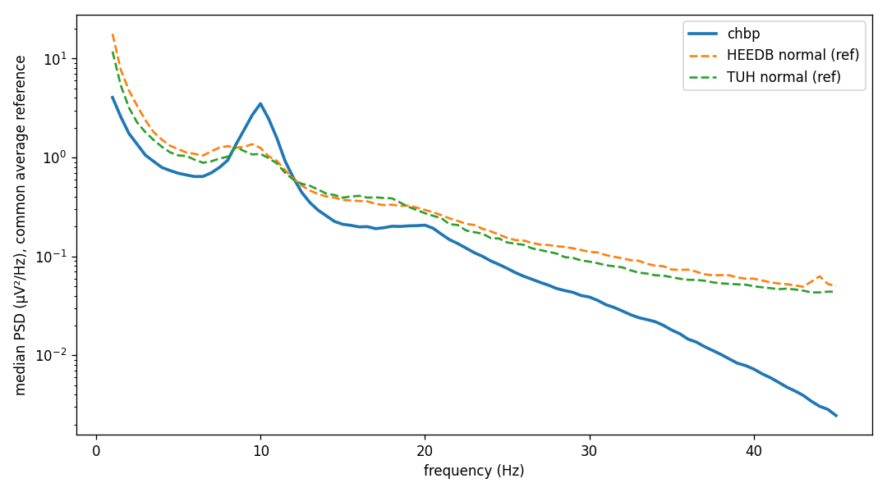
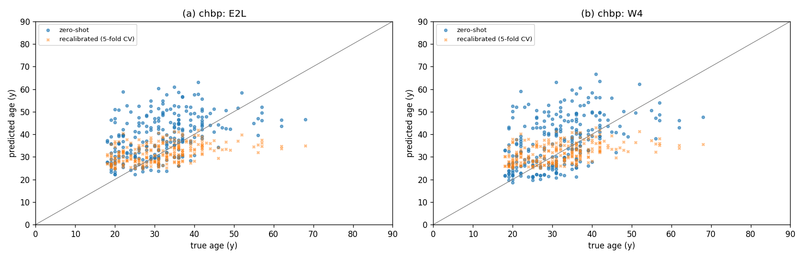

# CHBP onboarding and zero-shot brain age (Synapse)

Results note, 2026-11-11. The Cuban Human Brain Mapping Project (CHBP,
Valdes-Sosa et al. 2021, Synapse `syn22324937`) is the first Synapse corpus
onboarded. It is used as an **external test set**: the brain-age models trained
on TUH + HEEDB (cohort `tuh_heedb_v1`) score it without retraining, as LEMON and
MIPDB were scored (`docs/external_eval_results.md`). The multinational norms
MNCS / HarMNqEEG (`syn26712693`) were downloaded too. They hold cross-spectra
only, so they can serve a spectral baseline but not LaBraM (Section 5).

Code:
- `dataset_maker/download_synapse.py`: Synapse download of the EEG part only
  (the MRI folders are skipped), resumable, with a `listing.jsonl` of every file;
- `dataset_maker/make_external_npy.py --dataset chbp`: EDF to the npy cohort
  format through the training pipeline (`make_TUH_npy.preprocess_raw`);
- `scripts/external_runs/chbp.sh`: download, convert, score, report;
- `scripts/external_eval_report.py`: metrics, QC and figures (CHBP age groups added).

## 1. Data and storage

### Table 1.1. What Synapse holds

| part | Synapse id | content | size |
|---|---|---|---|
| release 1.0 (`ds_bids_chbmp`, 2020) | `syn22324960` | BIDS EEG: 250 EDF + sidecars (the release Engemann et al. 2022 benchmarked) | 12.7 GB |
| release 1.1 (`ds_bids_cbm_loris_24_11_21`, 2021) | `syn28129311` | 253 EDF, adds channel status (good/bad), electrode positions, artifact marks in `derivatives/` | 12.8 GB |
| cognitive scales | `syn22324942` | `Demographic_data.csv` (code, sex, age, weight, education), handedness, MMSE, WAIS-III, reaction time | < 1 MB |
| electrode positions | `syn22324953` | cap layout figures | < 1 MB |
| MNCS `ShareRawData` | `syn26718114` | 1,966 subject `.mat` cross-spectra from 14 studies | 3.3 GB |

Release 1.0 and 1.1 carry **identical signals**: on subject `CBM00001` the
samples differ by 0 µV; only the EDF headers (channel labels) differ. The
cohort is built from release 1.0. The demographics table lists 282 people, but
only 250 of them have an EEG in release 1.0 (the others have MRI only).

| | local | S3 (private, checked with `download_heedb.check_private`) |
|---|---|---|
| raw (both releases + tables) | `/data/datasets/EEG-public/CHBP/raw` | `s3://eeg-data-public/CHBP/v1/raw` |
| cohort | `/data/datasets/EEG-public/CHBP/cohorts/chbp_v1` | `s3://eeg-data-public/CHBP/v1/cohorts/chbp_v1` |
| MNCS spectra | `/data/datasets/EEG-public/MNCS/raw` | `s3://eeg-data-public/MNCS/v1/raw` |

The Synapse token (scopes `view`, `download`) is read from `~/.synapseConfig`
or `$SYNAPSE_AUTH_TOKEN`, never from code; `synapseclient` lives in its own
venv (`/data/venvs/synapse`) because its pins conflict with the training env.

### Table 1.2. The cohort `chbp_v1`

| | value |
|---|---|
| recordings (= subjects) | 250 |
| age (years) | 18–68, mean 31.7 ± 9.3, median 31; 18–29: 107, 30–39: 101, 40–68: 42 |
| sex | 177 M, 73 F |
| recording | 200 Hz, recorded 0.5–50 Hz with a 60 Hz notch (`channels.tsv`), 120 EEG channels (10-5), "common" reference |
| protocol | ≈ 10 min eyes closed, then alternating eyes open / closed, hyperventilation (3 × 1 min), recovery, photic stimulation |
| kept | the resting part, from the start to the first hyperventilation / recovery / photic event: median 19.1 min (6.1–26.8) |
| channels | 19 of 23 in every recording (A1, A2, T1, T2 absent, `channel_mask`); T7/T8/P7/P8 → T3/T4/T5/T6 |
| windows | 27,803 × 10 s (median 114 per recording) |

Two recordings needed label handling: `CBM00203` is referenced to linked ears
(`Fp1-A12`), and `CBM00218` has a truncated label (`F4 -`). The reader matches
only the part of a label before the hyphen.

## 2. Preprocessing and its validation

CHBP goes through `make_TUH_npy.preprocess_raw` like every training cohort
(0.1–75 Hz band-pass, spectrum-interpolation line removal at 50 and 60 Hz,
200 Hz, µV, float16). The reference is kept as recorded; the models apply a
common average reference at their input. Evaluation uses the training
protocol: the first 5 minutes after a 60 s trim, which falls inside the first
eyes-closed block of every recording.

The recording itself was already band-limited to 0.5–50 Hz. The training
recordings keep 0.1–75 Hz, so CHBP lacks the slowest delta and everything above
50 Hz.

### Table 2.1. Signal QC, median over recordings (quartiles in `docs/data/external_eval/chbp/qc_summary.csv`)

First 5 min after the trim, common average reference. Band powers are relative
powers of 1–45 Hz (Welch, 2 s segments). The reference sets are 100 random
normal-report recordings of each training corpus, shown only as aggregates.

| source | n | channel std (µV) | alpha peak (Hz), O1/O2 | delta | theta | alpha | beta | share of samples > 300 µV |
|---|---|---|---|---|---|---|---|---|
| TUH normal (training) | 100 | 9.96 | 9.00 | 0.495 | 0.124 | 0.136 | 0.131 | 0.000 |
| HEEDB normal (training) | 100 | 13.01 | 9.00 | 0.527 | 0.125 | 0.156 | 0.123 | 0.025 |
| LEMON (`external_eval_results.md`) | 215 | 8.98 | 9.75 | 0.452 | 0.130 | 0.183 | 0.139 | 0.000 |
| **CHBP** | 250 | **5.89** | 10.00 | **0.257** | 0.121 | **0.457** | 0.115 | 0.000 |

### Figure 2.1. Median power spectrum, CHBP vs the training references

Median PSD (µV²/Hz, log scale) over recordings and channels, 1–45 Hz, common
average reference. Solid line: CHBP (n = 250); dashed: the TUH and HEEDB
reference samples (n = 100 each).

**What Table 2.1 and Figure 2.1 show:** CHBP is far from the training data,
much farther than LEMON.
- **Amplitude.** The channel std is 5.9 µV against 10.0 (TUH) and 9.0 (LEMON).
  The models do not z-score their input (`labram_plus.z_score_patches: false`),
  so they see a much weaker signal than in training.
- **Spectral shape.** Below 7 Hz CHBP's power is 1.5–4× lower than the
  training references' (Figure 2.1). Above 20 Hz it falls off steeply, to
  nearly 10× below them by 40 Hz. Alpha dominates (relative alpha 0.46 vs 0.14), with
  a 10 Hz peak. This fits alert, healthy young adults with eyes closed, recorded
  through a 0.5–50 Hz filter, against clinical recordings.

## 3. Zero-shot brain age

### Metrics

For recording $i$ with true age $y_i$ and predicted age $\hat y_i$ (years),
$e_i = \hat y_i - y_i$, over the $n$ recordings of a group
(`scripts/external_eval_report.py::metrics`):

$$ \mathrm{MAE} = \tfrac{1}{n}\textstyle\sum_i \lvert e_i \rvert \tag{3.1} $$

$$ \mathrm{bias} = \tfrac{1}{n}\textstyle\sum_i e_i \tag{3.2} $$

$$ R^2 = 1 - \frac{\sum_i e_i^2}{\sum_i (y_i - \bar y)^2} \tag{3.3} $$

$r$ is the Pearson correlation of $\hat y$ and $y$ (3.4), and the
predict-the-mean baseline is $\tfrac{1}{n}\sum_i \lvert y_i - \bar y\rvert$
with the group's own mean $\bar y$ (3.5). The recalibrated MAE (3.6) applies
$\hat y_i' = a\,\hat y_i + b$, where $(a, b)$ is the OLS fit of age on
prediction, cross-fitted over 5 subject-grouped folds
(`crossfit_recalibration`). It uses CHBP's ages, so it is **not** zero-shot.
Predictions are window means per recording, de-normalized with the training
targets' mean / std (53.52 / 19.29 years, the same for every model).

### Table 3.1. CHBP, n = 250, first 5 minutes (training protocol)

Columns: MAE (3.1), bias (3.2), r (3.4), R² (3.3), MAE recalibrated (3.6);
"every window" is the MAE (3.1) over all resting windows (`--eval-minutes 0`).
The last column rescales every CHBP signal by 1.69 = TUH / CHBP median channel
std (Table 2.1). That factor uses no age labels, but it is not part of the
training preprocessing, so the column is a diagnostic.

| model | MAE | bias | r | R² | MAE recalibrated (CV) | MAE, every window | MAE, amplitude × 1.69 (bias) |
|---|---|---|---|---|---|---|---|
| predict the CHBP mean (3.5) | 7.27 | 0 | — | 0 | — | — | — |
| predict the training mean (53.5 y) | 22.21 | +21.8 | — | — | — | — | — |
| E2 | **8.93** | +6.27 | 0.46 | −0.53 | 6.50 | **8.40** | **7.80** (+0.47) |
| E2L | 9.55 | +7.05 | 0.44 | −0.71 | 6.59 | 9.35 | 7.85 (+0.34) |
| W4 | 9.19 | +5.04 | 0.47 | −0.62 | 6.47 | 8.92 | 8.30 (−1.53) |
| L1 | 9.37 | +5.26 | 0.47 | −0.68 | 6.45 | 9.11 | 8.46 (−1.44) |
| W7 | 9.10 | +4.83 | 0.46 | −0.60 | 6.47 | 8.66 | 8.36 (−1.43) |
| X1 | 9.38 | +5.53 | **0.48** | −0.67 | **6.43** | 9.03 | 8.44 (−0.75) |
| X3 | 9.86 | +6.40 | 0.46 | −0.83 | 6.53 | 9.62 | 8.58 (+0.44) |

Published within-CHBP 10-fold CV (Engemann et al. 2022): handcrafted features
+ random forest 6.48 (R² 0.18), ShallowNet 6.65, Deep4Net 6.89, predict the
mean 7.33.

### Table 3.2. MAE (bias) by age group, first 5 minutes

| model | 18–29 (n = 107) | 30–39 (n = 101) | 40–68 (n = 42) |
|---|---|---|---|
| predict the group mean (3.5) | 3.07 | 2.40 | 5.90 |
| E2 | 10.98 (+10.64) | 7.44 (+4.43) | 7.31 (−0.44) |
| E2L | 11.63 (+11.28) | 8.17 (+5.62) | 7.55 (−0.27) |
| W4 | 10.01 (+8.55) | 8.61 (+3.43) | 8.49 (+0.00) |
| L1 | 10.11 (+8.62) | 8.83 (+3.78) | 8.80 (+0.27) |
| W7 | 9.77 (+8.28) | 8.53 (+3.46) | 8.77 (−0.68) |
| X1 | 10.09 (+8.78) | 8.94 (+4.25) | 8.60 (+0.30) |
| X3 | 10.83 (+9.82) | 9.27 (+5.07) | 8.78 (+0.92) |

### Figure 3.1. Predicted vs true age

Recording-level predicted age against true age (years), CHBP n = 250, first
5 minutes. (a) E2L, (b) W4. Blue: zero-shot; orange: recalibrated (3.6). The
grey line is identity.

**What Table 3.1, Table 3.2 and Figure 3.1 show:**
- **No model beats predicting CHBP's mean age zero-shot.** The best is E2 at
  8.93 years (8.40 over every window) against 7.27. That differs from LEMON,
  where every model was within 4.5–5.8 years and R² ≥ 0.86.
- **The error is mostly a positive offset at young ages.** The bias is +4.8 to
  +7.1 years overall and +8 to +11 years for the 18–29 group (Table 3.2). The
  40–68 group is unbiased. This is the known over-prediction of young adults,
  made larger by the domain shift.
- **Amplitude explains the offset.** Rescaling to TUH's median amplitude
  brings the bias to −1.5 … +0.5 years and the MAE down by 0.8–1.7 years (E2
  7.80; last column of Table 3.1). The MAE is still above the 7.27 baseline: the
  low amplitude makes everyone look older, but it is not the only shift
  (Figure 2.1's spectral shape stays).
- **The ranking is weak but real.** r = 0.44–0.48 for every model. With CHBP's
  narrow, young range (SD 9.3 years), a linear recalibration on CHBP's own ages
  gives 6.43–6.59 (X1 best). That is level with Engemann's best within-CHBP
  result (6.48) without any training on CHBP. Recalibration does fit two
  parameters on CHBP, so this is not a zero-shot result.
- **The models disagree little.** All seven are within 1 year of each other.
  The ranking that held on LEMON (X3 best, E2 worst) reverses here: E2 is best
  and X3 worst. The shift hits the newer attention / bag models a bit harder.

## 4. What to do next

1. **Amplitude-robust input.** Train or fine-tune with per-recording amplitude
   normalization, or with amplitude-scaling augmentation. Then CHBP, LEMON and
   MIPDB can be rescored without the diagnostic factor. Unsupervised re-centring
   (Mellot 2023) is the label-free post-hoc alternative.
2. **Within-CHBP 10-fold CV fine-tune.** Fine-tune the best checkpoint on 9
   folds, shuffled and split by subject with a fixed seed, and predict the 10th.
   This is like-for-like with Engemann's 6.48 (guide Section 6.4,
   `synapse_age_eval.chbp_cv_splits`).
3. **Band-limit test on the training side.** Score the TUH / HEEDB test sets
   after a 0.5–50 Hz filter. That measures how much of the gap is the recording
   filter alone.
4. **Eyes-closed vs eyes-open.** Release 1.0 marks every block
   (`ojos cerrados` / `ojos abiertos`), so both states can be scored separately.

## 5. MNCS (HarMNqEEG)

All 1,966 subject `.mat` files (14 sites, 3.3 GB) are in
`/data/datasets/EEG-public/MNCS/raw/ShareRawData/<site>/`. They are
cross-spectra: 19 channels, 1.17–19.14 Hz in 0.39 Hz bins, with no waveform,
so LaBraM cannot score them. Their use is the spectral ridge baseline of the
guide (fit on TUH / HEEDB normal spectra computed the same way, test on MNCS
adults). The `.mat` keys still have to be inspected.
