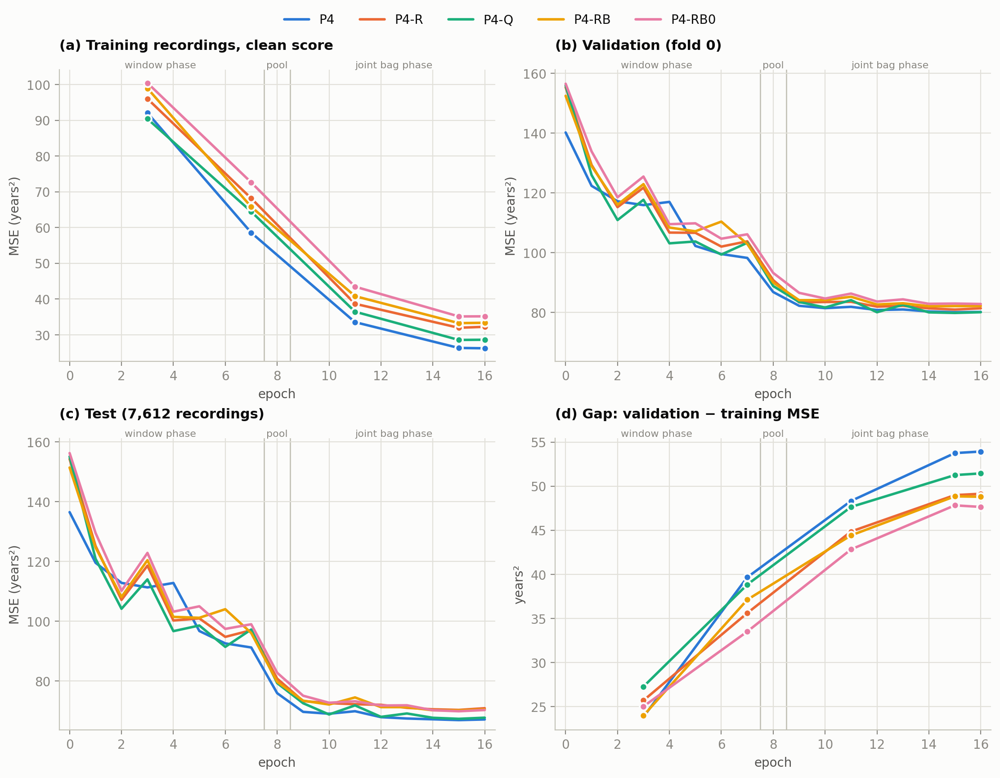
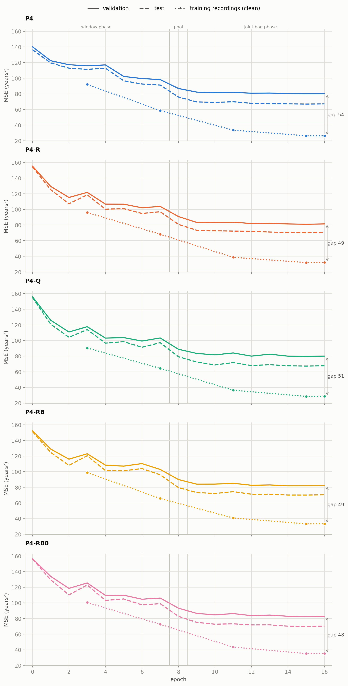
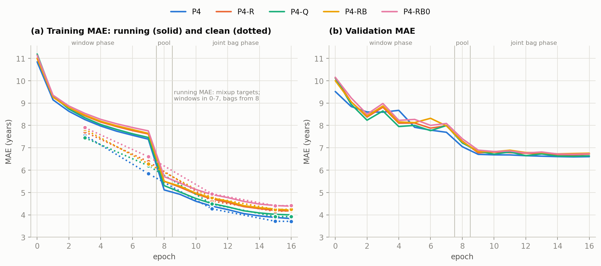
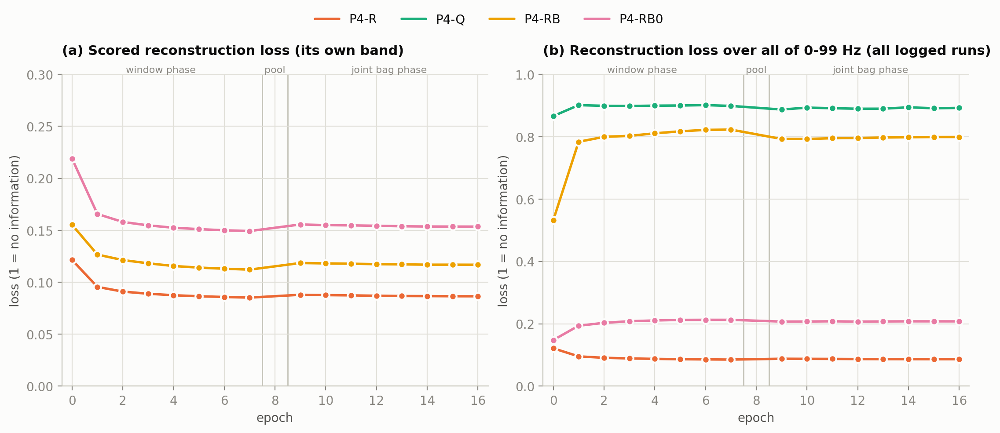

# Codebook regularisation of P4 (fold 0): quantization and spectral reconstruction

**Question.** Does a term that keeps the encoder's patch tokens close to the
pretrained VQNSP codebook (quantization), or keeps the patch spectrum
decodable by the frozen VQNSP decoder (reconstruction), make the P4 brain-age
model overfit less and predict better?

**Answer.** No. All four variants were run on P4's fold 0. The reconstruction
variants shrink the gap between training and validation error only by fitting
the training recordings worse. On the 7,612 held-out test recordings they lose
0.19–0.23 years of MAE against P4 (Table 3.3). The quantization term collapsed
in the first epoch and did nothing (Section 5). Of the reconstruction
variants, the one scored on 0–45 Hz is the best. It is still 0.10 years behind
its same-seed control and has no consistent external gain (Section 3). The
line is closed for P4 (Section 6).

The earlier TUAB-only attempt (`model.codebook_reg`, scenario D, runs DX1 / DX4
/ DX4b) is in [`age_overfitting_experiments.md`](age_overfitting_experiments.md) §8. Its
verdict was the same. This study uses the new opt-in `codebook_aux`, which
works with P4's MIL bags, missing channels and class-token readout.

## 1. Setup

All five runs are P4_L1 fold 0. They share:
- **Recipe:** the P4 recipe of [`mil_stage1_results.md`](mil_stage1_results.md) Section 13.
- **Data:** the Temple + Harvard cohort `tuh_heedb_v1`, 19 channels with average reference.
- **Split:** fold 0 of the shared five-fold subject split, with the original test split held out (7,612 recordings).
- **Schedule:** 8 window epochs, 1 attention-only bag epoch, then 8 joint bag epochs.
- **Training:** mixup 0.4, a per-window age loss of weight 0.5 in the joint phase, learning rate 2.8e-4 on one cosine schedule.

They differ only in the auxiliary term of Table 1.1.

The term (`codebook_aux`, `labram/models/codebook_aux.py`) reads the encoder's
final patch tokens $t_j$. P4 predicts from the class token, so these tokens are
not part of its prediction path. Three frozen parts are applied to them:
- **Projection layer $p$:** Linear 200→200, tanh, Linear 200→64.
- **Codebook $\lbrace e_k \rbrace$:** the released `vqnsp.pth`, 8,192 unit-norm codes of dimension 64.
- **Decoder:** VQNSP's 3-block decoder and amplitude head.

None of these parts is trained; the gradient only passes through them into the
encoder. The projection layer was fitted once, before the runs, to the
pretrained encoder (`scripts/fit_codebook_projection.py`):
- **Training data:** 2,000 fold-0 training recordings × 4 windows, 3,000 steps.
- **Result:** reconstruction loss of Eq. (1.3) on 800 held-out windows fell from 0.94 with the released layer to 0.12.

Each patch token is projected, normalised and assigned its nearest code:

$$
z_j=\frac{p(t_j)}{\lVert p(t_j)\rVert_2},\qquad
k_j=\arg\min_k \lVert z_j-e_k\rVert_2^2 .
\tag{1.1}
$$

The reconstruction target is the FFT amplitude of each 1 s patch (200 samples at
200 Hz, so one bin per Hz) of channel $c$ and patch $s$, standardised within
window $w$ over all channels, patches and the bins 0–99 Hz:

$$
a_{c,s,f}=\Bigl\lvert \sum_{n=0}^{199} x_{c,s}[n]\,e^{-2\pi i f n/200}\Bigr\rvert ,\qquad
\tilde a_{c,s,f}=\frac{a_{c,s,f}-\mu_w}{\sigma_w},\qquad f=0,\dots ,99 ,
\tag{1.2}
$$

where $x$ is the window after the model's average reference (in units of
100 µV), and $\mu_w$ and $\sigma_w$ are the mean and sample SD of $a$ over the
window's $C\times S\times 100$ values. The decoder reads the codes through the
straight-through estimator $z_j+\operatorname{sg}(e_{k_j}-z_j)$ and outputs
$\hat a$. The reconstruction loss is the mean squared error over the scored
band $F$:

$$
L_\text{rec}=\frac{1}{B\,C\,S\,\lvert F\rvert}\sum_{w=1}^{B}\sum_{c,s}\sum_{f\in F}\bigl(\hat a_{w,c,s,f}-\tilde a_{w,c,s,f}\bigr)^2 .
\tag{1.3}
$$

Here $B$ is the number of windows in the batch. Because $\tilde a$ has mean 0
and SD 1 per window, predicting nothing gives about 1 ("no information"). The
band $F$ (`codebook_aux.freq_band_hz`) changes only which bins are scored: the
target stays standardised over 0–99 Hz, the scale the decoder was trained on.

The quantization loss is the squared distance of each normalised token to its
code, averaged over tokens and the 64 dimensions, with $\beta = 1$:

$$
L_\text{quant}=\frac{\beta}{B\,C\,S\cdot 64}\sum_{w}\sum_{j}\lVert z_j-e_{k_j}\rVert_2^2 .
\tag{1.4}
$$

The training loss adds the terms to P4's own age loss $L_\text{P4}$:
- **Window phase:** Huber loss (δ = 1) on z-scored age.
- **Joint phase:** the bag loss, plus 0.5 × the per-window loss, plus 0.01 × the attention-entropy term.

$$
L=L_\text{P4}+\lambda_\text{rec}\,L_\text{rec}+\lambda_\text{q}\,L_\text{quant} .
\tag{1.5}
$$

The terms are active in every window epoch and every joint epoch, and off in
the attention-only epoch 8, when the encoder is frozen. When windows of one
batch lack different channels, each channel pattern runs separately and the
terms are averaged with weights equal to the patterns' token counts.

### Table 1.1. Runs

$\lambda_\text{rec}$ and $\lambda_\text{q}$ are the weights of Eq. (1.5), and $F$ is the scored band of Eq. (1.3).
- **P4-Q:** logs its reconstruction loss every 20 steps without gradient.
- **Code:** all four runs use commit `abbe1e9` or later of `feat/codebook-aux`.
- **Jobs:** defined as `P4R_L1`, `P4Q_L1`, `P4RB_L1` and `P4RB0_L1` in `scripts/mil_runs/submit_grid.sh`.

| Run | $\lambda_\text{rec}$ | $F$ | $\lambda_\text{q}$ | Instance | ClearML |
|---|---|---|---|---|---|
| P4 | 0 | – | 0 | g5.4xlarge spot | [fold_0](https://app.clear.ml/projects/a4115428afa142df9beff2a73f3f9563/experiments/4cea884887f64363b4328b2785a7ab61), [final resume](https://app.clear.ml/projects/a4115428afa142df9beff2a73f3f9563/experiments/3b00d40d8f694d86be2156ee06d3ccee) |
| P4-R | 1.0 | 0–99 Hz | 0 | g5.4xlarge on-demand | [heedb_mil_P4R_L1_fold0](https://app.clear.ml/projects/1073f53704a24f028b0d5a921a977e8c/tasks/ee4d82509dad4da5a7b65a695bf36117/output/log) |
| P4-Q | 0 | – | 10 | g5.4xlarge spot | [heedb_mil_P4Q_L1_fold0](https://app.clear.ml/projects/e45dc1d4902f4f2bb44c8bba460faac0/tasks/dad1716fccb941e99c8a6f80deb72ccb/output/log), [after spot resume](https://app.clear.ml/projects/e45dc1d4902f4f2bb44c8bba460faac0/tasks/52c002b58b5a4c0e9f80f7c0e7c4f767/output/log) |
| P4-RB | 1.0 | 1–45 Hz | 0 | g5.4xlarge spot | [heedb_mil_P4RB_L1_fold0](https://app.clear.ml/projects/e0cdceb64ed142b295026875e50ae1c9/tasks/3643473f45214f8ebd8771eb576f1821/output/log) |
| P4-RB0 | 1.0 | 0–45 Hz | 0 | g5.4xlarge on-demand | [heedb_mil_P4RB0_L1_fold0](https://app.clear.ml/projects/f19ff64538984e6d8c8f14ecc3c9f878/tasks/aafd20e9589a43b08364018226fe3cce/output/log) |

**Seeds.** Attaching the auxiliary module consumes random numbers when it is
built, so the four auxiliary runs share a random stream that differs from P4's.
Comparisons among P4-R, P4-Q, P4-RB and P4-RB0 are therefore cleaner than any
comparison with P4. P4-Q is the closest same-stream control: its term did
nothing after epoch 0 (Section 5).

## 2. Metrics

A recording's prediction pools its evaluation windows with the attention
weights $\alpha_{rk}$ of the MIL pool. The evaluation windows are the first 5
minutes after 60 s trims at both ends. With a linear head this equals the
weighted mean of the window predictions $\hat y_{rk}$ (in years):

$$
\hat y_r=\sum_{k}\alpha_{rk}\,\hat y_{rk},\qquad \sum_k\alpha_{rk}=1 .
\tag{2.1}
$$

Over the $R$ recordings of a split with true age $y_r$, the errors are, in
years and years² (`labram/utils/regression_metrics.py`):

$$
\operatorname{MAE}=\frac1R\sum_{r=1}^{R}\lvert\hat y_r-y_r\rvert ,\qquad
\operatorname{MSE}=\frac1R\sum_{r=1}^{R}(\hat y_r-y_r)^2 .
\tag{2.2}
$$

The training error is the clean score of a fixed, seeded sample of 500
training recordings per dataset (Temple, Harvard). It is scored like
validation, without mixup, at epochs 3, 7, 11, 15 and 16. The generalisation
gap is validation error minus that training error; Table 4.1 also gives it as
a share of validation:

$$
G=\operatorname{MSE}_\text{val}-\operatorname{MSE}_\text{train},\qquad
g=\frac{G}{\operatorname{MSE}_\text{val}} \quad(\text{same for MAE}).
\tag{2.3}
$$

A paired difference of run B against run A on the same recordings, with
$e_r=\hat y_r-y_r$:

$$
\Delta_{B-A}=\frac1R\sum_{r=1}^{R}\bigl(\lvert e^{B}_r\rvert-\lvert e^{A}_r\rvert\bigr) .
\tag{2.4}
$$

Its 95 % interval is the 2.5th–97.5th percentile of 2,000 bootstrap resamples
of the recordings (`scripts/paired_bag_mae.py`). The interval covers test-sample
noise only, not seed-to-seed variation.

The decodability probe $D$ asks how much of the patch spectrum the final
encoder still holds (`scripts/codebook_decodability_probe.py`):
- **Fit:** a fresh projection layer between the frozen encoder and the frozen codebook and decoder, 1,500 steps on 300 TUAB recordings.
- **Score:** Eq. (1.3) over 0–99 Hz on 192 held-out windows from 48 other recordings.

$$
D=L_\text{rec}\bigl(F=\lbrace 0,\dots ,99\rbrace\bigr)\ \text{on held-out windows, after the fit} .
\tag{2.5}
$$

## 3. Results

Figure 3.1 shows MSE, Eq. (2.2), of the recording predictions of Eq. (2.1) for every run, epoch and split. Table 3.1
lists each run at its best validation epoch, Table 3.2 the test cohorts, and
Table 3.3 the paired test differences.

### Figure 3.1. MSE by split over epochs

Recording-level MSE in years², Eq. (2.2), for all five runs:
- **(a)** Clean training sample (Section 2), at the epochs where it is scored.
- **(b)** Fold-0 validation.
- **(c)** Test (7,612 recordings).
- **(d)** Gap of Eq. (2.3).

Vertical lines separate the window phase (epochs 0–7), the attention-only epoch 8 and the joint phase (9–16).
Per-epoch values: [`data/codebook_aux_p4/per_epoch.csv`](data/codebook_aux_p4/per_epoch.csv).

### Table 3.1. Each run at its best validation epoch

Columns:
- **Val / test MAE and MSE:** Eq. (2.2), in years and years².
- **LEMON, TDBRAIN:** recording MAE of the zero-shot test sets scored inside the run. TDBRAIN was not yet a test set when P4 ran.

| Run | Best epoch | Val MAE | Test MAE | Val MSE | Test MSE | LEMON | TDBRAIN |
|---|---|---|---|---|---|---|---|
| P4 | 15 | **6.59** | **6.06** | 80.1 | **66.9** | 4.87 | – |
| P4-R | 15 | 6.68 | 6.29 | 81.0 | 70.3 | 4.90 | **5.41** |
| P4-Q | 15 | 6.62 | 6.14 | **79.8** | 67.3 | 4.85 | 5.46 |
| P4-RB | 14 | 6.73 | 6.30 | 82.1 | 70.2 | 4.89 | 5.53 |
| P4-RB0 | 15 | 6.71 | 6.25 | 83.0 | 69.9 | **4.64** | 5.56 |

### Table 3.2. Test MAE by source and report cohort, best epochs

Recording MAE, Eq. (2.2), on the test split's cohorts. The numbers of recordings are in the header.

| Run | Harvard normal (1,518) | Harvard abnormal (2,253) | Harvard unlabelled (3,567) | Temple normal (149) | Temple abnormal (125) |
|---|---|---|---|---|---|
| P4 | **5.71** | **6.62** | **5.82** | 4.65 | 8.31 |
| P4-R | 5.94 | 6.83 | 6.10 | 4.72 | **7.87** |
| P4-Q | 5.91 | 6.64 | 5.92 | **4.53** | 8.19 |
| P4-RB | 5.99 | 6.80 | 6.13 | 4.66 | 8.12 |
| P4-RB0 | 5.94 | 6.74 | 6.05 | 4.80 | 8.25 |

### Table 3.3. Paired test differences

$\Delta_{B-A}$ of Eq. (2.4) on the 7,612 test recordings, with its bootstrap 95 % interval. A positive value means B is worse.
- **Among the auxiliary runs:** epoch 15, the best epoch of P4-R, P4-Q and P4-RB0. P4-RB's own best epoch is 14: P4-R → P4-RB at epochs 15 → 14 gives +0.02 [−0.03, +0.06].
- **Against P4:** epoch 14, because P4's epoch-15 outputs were not saved.

| A → B | Epoch | $\Delta_{B-A}$ (years) | 95 % interval |
|---|---|---|---|
| P4-R → P4-RB | 15 | +0.03 | [−0.01, +0.08] |
| P4-R → P4-RB0 | 15 | −0.04 | [−0.09, +0.00] |
| P4-RB → P4-RB0 | 15 | −0.07 | [−0.12, −0.03] |
| P4-Q → P4-R | 15 | +0.15 | [+0.09, +0.20] |
| P4-Q → P4-RB | 15 | +0.18 | [+0.12, +0.23] |
| P4-Q → P4-RB0 | 15 | +0.10 | [+0.04, +0.16] |
| P4 → P4-Q | 14 | +0.08 | [+0.03, +0.14] |
| P4 → P4-R | 14 | +0.22 | [+0.16, +0.28] |
| P4 → P4-RB | 14 | +0.23 | [+0.18, +0.29] |
| P4 → P4-RB0 | 14 | +0.19 | [+0.12, +0.25] |

What Tables 3.1–3.3 show:
- **Every reconstruction variant is worse than P4** on test, by 0.19–0.23 years
  (Table 3.3), and on every Harvard cohort (Table 3.2). Each is also worse than
  its same-stream control P4-Q, by 0.10–0.18 years.
- **The band matters a little; the 0 Hz bin helps.** Scoring 0–45 Hz (P4-RB0)
  beats 1–45 Hz (P4-RB) by 0.07 years. Scoring 1–45 Hz ties the full 0–99 Hz
  (P4-R).
- **External sets do not move together.** P4-RB0 has the best LEMON of all five
  runs: from epoch 12 on it sits 0.15–0.28 years below P4 at every epoch where
  LEMON was scored. Before epoch 12 it was not consistently better (worse
  than P4 at epochs 8 and 10), and it has the worst TDBRAIN. One run on 214 LEMON subjects is not evidence of an external gain.
- **Model selection is reliable.** In every run the validation and test curves
  have Spearman correlation 0.98–1.00 over epochs 3–16, and the best-validation
  epoch is also the best-test epoch (zero regret).

## 4. Overfitting and underfitting

Figure 4.1 shows training, validation and test MSE side by side for each run.
Figure 4.2 adds the MAE every epoch, including the error during training.
Table 4.1 gives the gap of Eq. (2.3) at the last epoch.

### Figure 4.1. Training vs validation vs test MSE, one panel per run

MSE in years², Eq. (2.2), for each run:
- **Solid line:** validation.
- **Dashed line:** test.
- **Dotted line with markers:** the clean training sample.

The arrow marks the gap $G$ of Eq. (2.3) at epoch 16.

### Figure 4.2. MAE every epoch

MAE in years:
- **(a)** Training, two ways. Solid: the running mean during the epoch, against mixup targets, over windows in epochs 0–7 and bags from epoch 8; the drop at epoch 8 is that switch. Dotted: the clean training sample.
- **(b)** Validation.

### Table 4.1. Gap between validation and clean training error, epoch 16

Clean training and validation MSE in years² and their gap $G$ with its share $g$, Eq. (2.3). Then the gap in MAE (years), overall and per source.

| Run | Train MSE | Val MSE | $G$ (MSE) | $G$ (MAE) | $g$ (MAE) | Harvard $G$ (MAE) | Temple $G$ (MAE) |
|---|---|---|---|---|---|---|---|
| P4 | 26.2 | 80.2 | 53.9 | 2.89 | 44 % | 1.99 | 4.30 |
| P4-R | 32.3 | 81.4 | 49.1 | 2.53 | 38 % | 1.75 | 3.75 |
| P4-Q | 28.6 | 80.1 | 51.4 | 2.71 | 41 % | 1.87 | 4.08 |
| P4-RB | 33.4 | 82.2 | 48.8 | 2.51 | 37 % | 1.68 | 3.82 |
| P4-RB0 | 35.2 | 82.8 | 47.6 | 2.32 | 34 % | 1.55 | 3.55 |

What Figures 4.1–4.2 and Table 4.1 show:
- **No underfitting.** Training error falls throughout in every run (P4: MSE 92
  → 26), and validation follows it until about epoch 9 (Figure 3.1).
- **Overfitting from about epoch 9.** From epoch 9 to the end, validation MSE
  falls by only 2–4 years²; from epoch 11 to the end, training MSE falls by
  another 6–8. The gap grows 1.9–2.3× in MSE (2.2–2.8× in MAE) from epoch 3 to
  the end. Every run ends with a gap above 30 % of validation MAE, most of it
  on Temple (Table 4.1).
- **The overfitting is harmless here.** Validation never turns back up, and the
  best epoch is 14 or 15 of 16.
- **The terms shrink the gap without generalising better.** The reconstruction
  runs have the smallest gaps, smallest for P4-RB0, but only because their
  training error is higher (Table 4.1); validation and test errors are not
  lower (Table 3.1). Compared with P4 and P4-Q this is a slight underfit, not
  better generalisation.
- **Converged.** Over the last three epochs validation moved by 0.02–0.09
  years, with the learning rate already annealed close to zero. A longer
  schedule would not change the ranking.

## 5. What the terms did

Figure 5.1 and Table 5.1 follow the terms during training, Table 5.2 probes the
final encoders, and Table 5.3 shows what the 0 Hz bin carries.

### Figure 5.1. Reconstruction terms during training

Epoch means of Eq. (1.3), in training mode (drop-path on); 1 means no information.
- **(a)** The scored loss, each run on its own band $F$.
- **(b)** The loss over 0–99 Hz for every run that logged it. For P4-Q it is only monitored, without gradient.

Epoch 8 has no value because the encoder is frozen.

### Table 5.1. The terms at the last epoch (epoch 16)

Columns:
- **Scored loss:** Eq. (1.3) on the run's band $F$.
- **Loss over 0–99 Hz:** Eq. (1.3) over all bins.
- **Quantization:** Eq. (1.4), unweighted.
- **Codes:** distinct codes $k_j$ of Eq. (1.1) per batch, out of about 48,600 tokens.
- **Age loss:** $L_\text{P4}$ of Eq. (1.5). All values are training-epoch means.

| Run | Scored loss | Loss over 0–99 Hz | Quantization | Codes per batch | Age loss |
|---|---|---|---|---|---|
| P4 | – | – | – | – | 0.088 |
| P4-R | 0.086 | 0.086 | 0.0160 | 1,487 | 0.098 |
| P4-Q | – (monitored) | 0.89 | 0.00003 | 7 | 0.092 |
| P4-RB | 0.117 | 0.80 | 0.0170 | 1,271 | 0.099 |
| P4-RB0 | 0.154 | 0.21 | 0.0154 | 1,514 | 0.104 |

### Table 5.2. Decodability of the final encoders

$D$ of Eq. (2.5) at each run's best epoch, plus the pretrained encoder. Lower means more of the patch spectrum can be rebuilt. P4-RB and P4-RB0 were not probed.

| Encoder | $D$ | Distinct codes on the held-out windows |
|---|---|---|
| Pretrained LaBraM-base | 0.14 | about 1,300 |
| P4 | 0.29 | 927 |
| P4-R | 0.09 | 1,382 |
| P4-Q | 0.66 | 2 |

### Table 5.3. What each frequency bin carries

Pretrained encoder with the fitted projection layer, 200 Temple and 200 Harvard fold-0 training recordings × 4 windows (`scripts/codebook_dc_bin_check.py`). Columns:
- **Target mean:** mean of $\tilde a$ of Eq. (1.2), in SD units.
- **Error:** the decoder's mean squared error, the summand of Eq. (1.3).
- **Share:** that bin's share of a 0–45 Hz loss.
- **Raw amplitude:** $a$ of Eq. (1.2) divided by the 200 samples and converted to µV, per source.
- **ρ with age:** Spearman correlation of the per-recording mean $\tilde a$ with age.

| Bin | Target mean | Error | Share of 0–45 Hz loss | Raw amplitude, Temple / Harvard (µV) | ρ with age |
|---|---|---|---|---|---|
| 0 Hz | +5.03 | 3.13 | 27 % | 12.0 / 16.9 | +0.03 |
| 1 Hz | +2.43 | 1.53 | 13 % | 5.4 / 5.5 | +0.17 |
| 2 Hz | +1.37 | 0.93 | 8 % | 3.4 / 3.1 | +0.14 |
| 4 Hz | +0.71 | 0.50 | 4 % | 2.3 / 1.7 | +0.11 |
| 10 Hz | +0.41 | 0.35 | 3 % | 1.3 / 1.1 | −0.10 |
| 20 Hz | +0.01 | 0.08 | 0.7 % | 1.0 / 0.5 | −0.24 |
| 45 Hz | −0.16 | 0.03 | 0.3 % | 0.7 / 0.3 | +0.02 |

What Figure 5.1 and Tables 5.1–5.3 show:
- **Reconstruction is easy to hold.** Each scored loss reaches its floor by
  epoch 2 and stays there (Figure 5.1(a)).
- **The term grows into a large part of the objective.** In P4-R it makes up
  34 % of the training loss in epoch 0 and 47 % in epoch 16, because the age
  loss keeps falling while the term stays flat.
- **It costs age fit.** The training age loss ends 6–13 % above P4-Q's (Table 5.1).
- **What is not scored is dropped.** P4-RB, scored on 1–45 Hz only, lost
  0–99 Hz decodability within two epochs (Figure 5.1(b)). The 0 Hz bin drives
  most of that drop: it holds the largest standardised values and is rebuilt
  worst (Table 5.3).
- **Keeping the spectrum decodable does not help age.** P4-R's final encoder is
  more decodable than the pretrained one; plain age training (P4) loses half
  of it (Table 5.2). Yet P4-R predicts age worse than P4 and P4-Q.
- **The quantization term collapsed in epoch 0.** P4-Q's tokens fell onto a
  handful of codes (Table 5.1), and its final patch tokens rebuild almost
  nothing (Table 5.2). Its age error stayed close to P4's: P4 predicts from the
  class token, so the content of the final patch tokens hardly matters to the
  prediction. That also explains why constraining them cannot steer what the
  model learns about age; it only costs capacity through the weights the two
  token types share.
- **The 0 Hz bin looked like the wrong thing to keep, yet including it helped.**
  It carries no age signal (ρ = +0.03), differs between the two sources
  (Harvard 40 % higher, while the other bins are equal or lower in Harvard),
  and takes 27 % of a 0–45 Hz loss on its own (Table 5.3). Our reading, not
  tested: because the decoder rebuilds this bin badly and it dominates the
  loss, it dilutes the pressure on 1–45 Hz, where the age information sits, so
  the term interferes less with the age features.

## 6. Conclusions

1. **No codebook term improves P4.** Reconstruction on 0–99, 1–45 or 0–45 Hz
   and quantization all lose to P4 on the in-domain test, by 0.08–0.23 years of
   MAE (Table 3.3). None gives a consistent external gain (Table 3.1).
2. **The terms change how much the model memorises, not how well it
   generalises.** They narrow the train–validation gap by raising training
   error while validation stays the same or gets worse (Table 4.1). Every run
   still memorises, mostly on Temple.
3. **Quantization alone is absorbed by the last block.** Its tokens collapse
   onto a few codes in the first epoch, so it acts like a P4 rerun (Section 5).
4. **Decision: close this line for P4.** A 5-fold check of P4-RB0's LEMON
   result would cost about 5 × 16 GPU hours against a known in-domain loss, and
   is not recommended. `codebook_aux` stays in the code, opt-in and off by
   default.

## 7. Reproduction and cost

- **Projection layer:** fitted by `scripts/fit_codebook_projection.py` on fold
  0's training recordings. Stored at
  `s3://eeg-data-public/HEEDB/v4.1/derived/models/codebook_aux/vqnsp_proj_labram_base_cls19_fold0.pth`
  (private bucket).
- **Jobs:** `ONLY="P4R_L1 P4Q_L1 P4RB_L1 P4RB0_L1" FOLD=0 WORKERS=24 scripts/mil_runs/submit_grid.sh`.
- **Outputs:** each job's `output/model.tar.gz` holds the per-epoch `log.txt`,
  the checkpoints and the per-window outputs (`analysis/*_bag_weights_epochNN.parquet`).
- **Figures and table of this doc:** `scripts/plot_codebook_aux_fit_curves.py --run NAME=<log.txt> …`.

Table 7.1 lists the jobs, their cost and how long each sat in SageMaker's final upload stage.

### Table 7.1. Jobs and cost

Epoch time is the sum of the runs' `epoch_time_sec`. Billed hours come from
SageMaker and include each job's time in the final upload stage.

| Run | SageMaker job | Epoch time (h) | Billed (h) | Final upload stage |
|---|---|---|---|---|
| P4 | `labram-mil-p4-l1-f0-fold-0-2026-11-13-23-46-35-439` | 12.8 | 6.9 (spot) | 48 s |
| P4-R | `labram-mil-p4r-l1-f0-fold-0-2026-11-21-07-39-56-107` | 15.8 | 18.7 | 2.8 h, then stopped |
| P4-Q | `labram-mil-p4q-l1-f0-fold-0-2026-11-21-07-40-45-981` | 13.5 | 7.0 (spot) | 2.9 h, then stopped |
| P4-RB | `labram-mil-p4rb-l1-f0-fold-0-2026-11-22-15-41-46-981` | 15.8 | 9.2 (spot) | 1.9 h, then stopped |
| P4-RB0 | `labram-mil-p4rb0-l1-f0-fold-0-2026-11-22-15-42-26-307` | 15.8 | 18.8 | 1.9 h, then stopped |

**Open issue: the final upload hang.** All four auxiliary jobs sat in
SageMaker's final "Uploading" stage for hours after training had ended. Each
had already written its complete `model.tar.gz` and was then stopped by hand;
P4 left that stage in 48 s. During training, the S3 copy of the checkpoint
folder also lagged by hours. The cause is not known. Until it is found, check a
finished job's `model.tar.gz` and stop the job rather than let it run to its
`max_run_sec`. The P4-RB jobs capped `max_run_sec` at 24 h for that reason.
