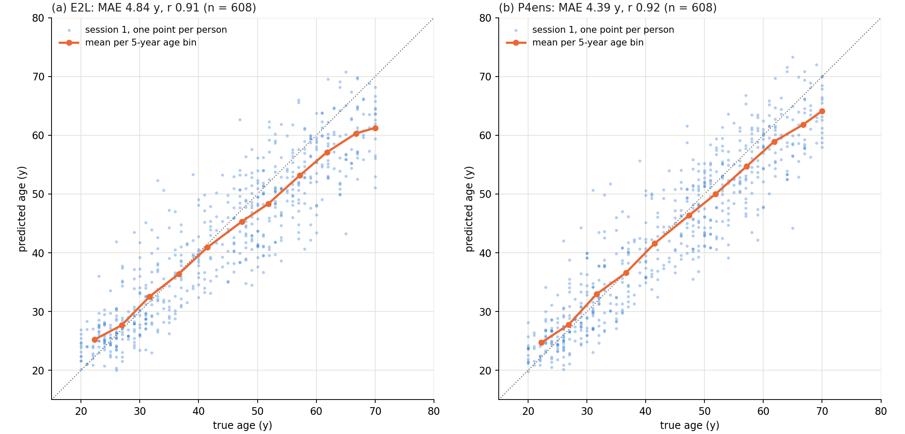
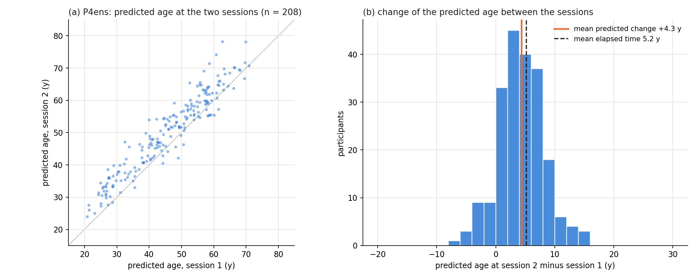

# Dortmund Vital Study: an external test cohort for the brain-age models

Onboarded 2026-11-16 with `scripts/external_runs/dortmund.sh` (skill `onboard-eeg-dataset`). Test-only: nothing in this
cohort is used to fit, tune, select or calibrate a model. Its ages only score.

## 1. Summary

1. **The cohort.** Resting-state EEG of 608 healthy adults aged 20–70 (OpenNeuro ds005385, CC0), four runs of about
   3 minutes per session, and a second session about 5 years later for 208 of them.
2. **The recording chain is inside the training range.** 64-channel cap, FCz reference, 1000 Hz, DC–250 Hz; after our
   pipeline the amplitude and every spectral feature sit between or next to Temple and Harvard (Table 5.1). The EDF
   files carry a different physical range each, but they decode consistently (Section 3).
3. **Zero-shot accuracy equals the in-domain level.** The P4 ensemble reaches an MAE of 4.53 years [4.25, 4.82],
   $R^2 = 0.85$, r = 0.92 per session (816 sessions); 4.39 years on the first sessions (608 people). Healthy Temple and
   Harvard test recordings at the same ages give 4.54 and 5.54 years (Table 6.4). Rejecting the 20 % least certain
   sessions gives 4.32 years.
4. **The predicted age follows the person over time.** Between the two sessions the predicted age rises by 4.3 years
   [3.8, 4.8] for 5.2 elapsed years, 89 % of the participants look older at the second session, and the brain-age gap
   of a person at the first session predicts the gap 5 years later (r = 0.77; Table 8.1).
5. **State matters.** After 2 hours of cognitive tasks the same person looks 1.5 to 1.7 years older; eyes open against
   eyes closed makes no difference (Table 7.1).
6. **Limits.** Old-age compression is the same as on the other cohorts (−4.2 years of bias from age 60), and a
   follow-up age is known only to about ±1 year.

## 2. Data, terms and storage

### Table 2.1. The dataset

| item | value |
|---|---|
| source | OpenNeuro ds005385, version 1.0.3, "Resting-state EEG data before and after cognitive activity across the adult lifespan and a 5-year follow-up" (Wascher, Schneider, Gajewski, Getzmann; IfADo, Dortmund) |
| licence | CC0: no agreement, no login, redistribution allowed |
| study | Dortmund Vital Study (ClinicalTrials.gov NCT05155397; protocol: Gajewski et al. 2022, doi 10.2196/32352) |
| participants | 608, 376 women and 232 men, age 20–70 (mean 44.1 ± 14.5), healthy by exclusion: no neurological, psychiatric, cardiovascular or oncological disease, no psychotropic drugs |
| sessions | session 1 for everyone (2016–2024); session 2 for 208, 4 to 8 years later (median 5) |
| runs per session | eyes closed, then eyes open, about 3 minutes each, before (`pre`) and after (`post`) a 2-hour block of cognitive tasks |
| files | 3,264 EDF, 79.5 GB; sidecars and event tables per run |
| labels | age in whole years, sex, handedness; recording year per session. No diagnoses (everyone is healthy) |

Storage: `/data/datasets/EEG-public/DORTMUND/{raw/ds005385,meta,cohorts/dortmund_v1}`, mirrored to
`s3://eeg-data-public/DORTMUND/v1/` (bucket checked private before every upload). The download uses the public
OpenNeuro bucket without sending an AWS identity (`aws s3 sync --no-sign-request`); all 17,542 listed files arrived
with the listed sizes.

Earlier use by others (Table 23.2 of `docs/tdbrain_onboarding.md`): the cohort is not in LaBraM's pre-training corpus,
so a model fine-tuned from the LaBraM base checkpoint scores it zero-shot. It is in the pre-training corpus of the LEAD
foundation model. One age-prediction result exists, trained and tested inside the cohort (Section 10).

## 3. Recording chain

### Table 3.1. Audit of the recording chain

| item | Dortmund | consequence |
|---|---|---|
| amplifier, cap | BrainAmp DC, actiCAP 64 (10-10 labels), ground AFz | the same hardware family as LEMON |
| sampling rate | 1000 Hz in every file | resampled to 200 Hz by the pipeline |
| hardware filters | DC-coupled, 250 Hz low-pass (22 runs list no cut-offs) | wider than our 0.1–75 Hz band: nothing is missing, unlike CHBP's 50 Hz low-pass |
| line frequency | 50 Hz, strong (24–50 µV²/Hz at O1 in the first files) | removed by the pipeline's spectrum interpolation |
| reference | FCz (not recorded) | kept: the models apply a common average reference over the 19 channels |
| channels | all 19 of the 10-20 set, with T7 / T8 / P7 / P8 for T3 / T4 / T5 / T6; no A1 / A2 / T1 / T2 | `channel_mask` has 19 entries in every run |
| EDF calibration | 16-bit, one physical range per file, 615 to 16,384 µV (step 0.02 to 0.5 µV); all valid | see below |
| header patient field | the same dummy text in every file | no birth date, no age in the headers |
| run length | median 184 s (60 to 294 s) | 18 windows per run; no trim, as for TDBRAIN |
| discontinuities | 50 runs have more than one `boundary` event | cut to the longest continuous piece |
| stray triggers | 88 runs carry a train of `S n` trigger marks (the `late_ses*` count of the participants table) | kept and flagged |
| other notes | 52 runs carry "no USB Connection to actiCAP" | kept and flagged |
| acquisition groups | none: one amplifier, one cap, one site | no per-group analysis needed |

**EDF calibration.** EDF stores 16-bit integers $d$ and scales them per signal with the header's physical and digital
ranges:

$$ x = (d - d_{\min})\,\frac{p_{\max} - p_{\min}}{d_{\max} - d_{\min}} + p_{\min} \tag{3.1} $$

The README warns that the physical ranges "may contain invalid values". `scripts/edf_header_audit.py` reads every
header (`docs/data/external_eval/dortmund/edf_headers.csv`): no range is missing, zero or inverted, and all 64 EEG
signals of a file share one range. What differs is the range from file to file, by a median factor of 2.4 between the
runs of one session (up to 19): the exporter scaled each file to its own extreme value, which a DC-coupled recording
with offsets of millivolts makes large and variable. 50 files sit at the amplifier's limit of ±16,383.5 µV. Three
checks say the decoded amplitude is right:

- the spectra of two runs of one session with ranges of ±3,148 and ±10,659 µV agree (O1 at 10 Hz: 177 and 189 µV²/Hz);
- over all 3,262 runs the amplitude after our pipeline barely follows the file's physical range (Spearman 0.18; a
  wrong scaling would give a value near 1);
- the cohort's amplitude lands inside the training data's (Table 5.1).

## 4. Conversion

`dataset_maker/make_external_npy.py --dataset dortmund` reads each run with the reader `open_dortmund` and passes it
through the training pipeline (`make_TUH_npy.preprocess_raw`: 0.1–75 Hz, line removal at 50 and 60 Hz, 200 Hz, µV,
float16, the 23 TUH channels with a mask). The reader does three corpus-specific things:

- it drops the `Status` signal and maps the 10-10 names to the 19 channels;
- a run with discontinuities is cut to its longest continuous piece, so that no filter runs across a jump;
- constant padding at the ends is cut and each channel's mean is removed, because the pipeline's 0.1 Hz high-pass
  would turn a DC offset of millivolts into a transient over the first seconds of a 3-minute run.

Every run is its own recording (stem `sub-<id>_ses-<n>_<EC|EO>-<pre|post>_dortmund`) with `task`, `acq`, the flags of
Table 3.1 and `label = normal`. The age of a session-2 recording is

$$ \text{age}_2 = \text{age}_{\text{participants}} + (\text{year}_2 - \text{year}_1) \tag{4.1} $$

with the recording years of `sub-<id>_sessions.tsv`. The participants table has one age per person and does not say at
which session; it ranges from 20 to 70 like the study's inclusion range, so it is taken as the age at session 1. A
session-2 age is therefore known to about ±1 year.

### Table 4.1. The converted cohort `dortmund_v1`

| | value |
|---|---|
| runs converted | 3,262 of 3,264 |
| not converted | 2: under 60 s of continuous signal (`sub-230` session 1 eyes closed pre, 60 s; `sub-541` session 1 eyes open post, 52 s after the cut) |
| people / sessions | 608 / 816 (608 first, 208 second) |
| windows of 10 s | 59,421; 18 per run in the median (6 to 29) |
| runs with fewer than 12 windows | 10, all cut at a discontinuity |
| age at session 1 / session 2 | 44.1 ± 14.5 / 52.2 ± 13.6 years; oldest 75 |
| size | 5.2 GB |

## 5. Label-free signal check against the training data

`scripts/domain_shift_analysis.py` computes signal features on what the models see (19 channels, common average
reference, medians over the windows of a recording): every Dortmund run without a trim, and healthy Temple and Harvard
validation recordings of 20–70 years (1,200 and 1,188) on the first 5 minutes after the usual 60 s trim. The reference
medians are weighted to Dortmund's age distribution, for description only.

### Table 5.1. Dortmund against healthy Temple and Harvard recordings of the same ages

Medians; power in µV²/Hz. AUC: the probability that a Dortmund run exceeds a reference recording (0.5 = no difference).
All features: `docs/data/external_eval/dortmund/feature_shift_summary.csv`.

| feature | Dortmund | Temple | Harvard | AUC vs Temple | AUC vs Harvard |
|---|---|---|---|---|---|
| channel standard deviation (µV) | 10.2 | 9.6 | 12.1 | 0.54 | 0.36 |
| 99th percentile of the absolute signal (µV) | 42.0 | 40.2 | 64.9 | 0.52 | 0.30 |
| share of windows with a channel above 100 µV | 0.00 | 0.03 | 0.17 | 0.36 | 0.09 |
| power 0.1–1 Hz | 46.9 | 41.3 | 78.4 | 0.54 | 0.35 |
| power 1–4 Hz | 3.04 | 3.30 | 3.64 | 0.47 | 0.44 |
| power 8–13 Hz | 0.91 | 1.02 | 0.89 | 0.49 | 0.52 |
| power 13–30 Hz | 0.28 | 0.24 | 0.26 | 0.55 | 0.54 |
| power 30–45 Hz | 0.077 | 0.060 | 0.057 | 0.61 | 0.63 |
| power 45–70 Hz | 0.050 | 0.032 | 0.029 | 0.66 | 0.68 |
| relative alpha power | 0.18 | 0.18 | 0.16 | 0.52 | 0.55 |
| aperiodic exponent | 1.20 | 1.29 | 1.33 | 0.42 | 0.39 |
| alpha peak frequency (Hz) | 10.0 | 10.0 | 10.0 | 0.56 | 0.51 |

**What Table 5.1 shows:**
- Dortmund sits between or next to the two training corpora on every feature. No AUC of the table is outside
  0.09–0.68; for CHBP the amplitude and the band edges had AUCs of 0.01–0.13.
- The amplitude (10.2 µV) is in the training range, and the 5th to 95th percentile of the runs (6.2 to 18.7 µV) is
  inside Temple's (5.5 to 25.3).
- There is more power above 30 Hz than in the clinical data (1.3 to 1.7 times), as expected from awake, seated
  volunteers and a 250 Hz recording band; the band our models use is fully present.
- The recordings are cleaner: almost no window has a channel above 100 µV.
- By run type the amplitude is 9.0 µV (eyes closed, pre), 9.8 (eyes open, pre), 10.2 (eyes closed, post) and 12.2
  (eyes open, post): the post-task runs are 14 to 24 % larger. Relative alpha is 0.28–0.30 with eyes closed and 0.12
  with eyes open.

No fix is needed, and none was applied.

## 6. Zero-shot results

Protocol: every window of every run, no trim (a run is 3 minutes); the models are frozen and never saw the cohort. The
scoring unit is the **session**: the mean of the predictions of its runs. With prediction $\hat y_s$ and age $y_s$ of
session $s$, over $N$ sessions,

$$ \mathrm{MAE} = \frac{1}{N}\sum_s \lvert \hat y_s - y_s \rvert, \qquad \mathrm{bias} = \frac{1}{N}\sum_s (\hat y_s - y_s), \qquad R^2 = 1 - \frac{\sum_s (\hat y_s - y_s)^2}{\sum_s (y_s - \bar y)^2} \tag{6.1} $$

with $\bar y$ the cohort's mean age and r the Pearson correlation of $\hat y$ and $y$. Intervals are 95 % percentile
intervals over 2,000 bootstrap resamples of people (a person's two sessions stay together). Models: E2L (window model),
the device-robust E2L (band 1–45 Hz + amplitude normalisation), and the P3 and P4 five-fold ensembles
(`docs/tech_report/`). Predicting the cohort's mean age gives an MAE of 12.74 years; predicting the training mean
(53.5 years) gives 13.49.

### Table 6.1. Accuracy per session (`docs/data/external_eval/dortmund/dortmund_accuracy.csv`)

| model | sessions | MAE (y) | bias (y) | r | $R^2$ |
|---|---|---|---|---|---|
| E2L | 816 | 5.01 [4.70, 5.36] | −2.06 | 0.91 | 0.81 |
| device-robust E2L | 816 | 5.45 [5.12, 5.80] | +2.56 | 0.90 | 0.78 |
| P3 ensemble | 816 | 4.72 [4.45, 5.02] | −1.64 | 0.92 | 0.83 |
| **P4 ensemble** | 816 | **4.53 [4.25, 4.82]** | −1.14 | 0.92 | 0.85 |
| P4 ensemble, session 1 only | 608 | 4.39 [4.12, 4.69] | −0.83 | 0.92 | 0.85 |
| P4 ensemble, session 2 only | 208 | 4.93 [4.43, 5.46] | −2.06 | 0.90 | 0.79 |
| P4 ensemble, runs without a recording flag | 803 | 4.57 [4.28, 4.86] | −1.16 | 0.92 | 0.84 |
| P4 ensemble, 80 % kept by spread | 653 | 4.24 [3.97, 4.54] | −0.86 | 0.94 | 0.87 |
| P4 ensemble, 80 % kept by total uncertainty | 653 | 4.32 [4.03, 4.63] | −1.02 | 0.93 | 0.87 |
| P4 ensemble, 80 % kept by the learned score | 653 | 4.32 [4.03, 4.62] | −0.88 | 0.93 | 0.86 |

The rejection rows set aside the 20 % of sessions with the highest label-free uncertainty
(`docs/data/external_eval/dortmund/external_cohort_table.csv`; the learned score is fitted on validation folds of the
training cohort only).

### Table 6.2. P4 ensemble by age band, and E2L for comparison

| age (y) | sessions | P4 MAE | P4 bias | E2L MAE | E2L bias |
|---|---|---|---|---|---|
| 20–29 | 142 | 2.91 | +1.5 | 3.04 | +1.6 |
| 30–39 | 155 | 4.41 | +1.1 | 4.20 | +0.7 |
| 40–49 | 145 | 4.58 | −0.4 | 4.80 | −1.2 |
| 50–59 | 194 | 4.89 | −2.6 | 5.69 | −4.1 |
| 60 and over | 180 | 5.47 | −4.2 | 6.70 | −5.9 |

### Table 6.3. By run type: one run, and sessions built from two of the four runs (P4 ensemble)

| unit | n | MAE (y) | bias (y) | r |
|---|---|---|---|---|
| single run, any | 3,262 | 5.16 [4.92, 5.43] | −1.14 | 0.90 |
| single run, eyes closed, pre-task | 815 | 5.41 | −1.88 | 0.89 |
| single run, eyes open, pre-task | 816 | 5.58 | −2.00 | 0.89 |
| single run, eyes closed, post-task | 816 | 4.57 | −0.41 | 0.91 |
| single run, eyes open, post-task | 815 | 5.09 | −0.28 | 0.90 |
| session, the two pre-task runs | 816 | 5.03 [4.73, 5.36] | −1.94 | 0.91 |
| session, the two post-task runs | 816 | 4.51 [4.24, 4.79] | −0.34 | 0.92 |
| session, the two eyes-closed runs | 816 | 4.68 [4.40, 4.98] | −1.15 | 0.92 |
| session, the two eyes-open runs | 816 | 5.00 [4.71, 5.33] | −1.14 | 0.91 |
| session, all four runs | 816 | 4.53 [4.25, 4.82] | −1.14 | 0.92 |

### Table 6.4. Age-matched reference inside the training domain

Test recordings of the training cohort with a normal EEG report, 20–75 years, weighted to Dortmund's age distribution
(first 5 minutes, the training protocol). It separates a real degradation from an effect of the age range.

| set | n (effective) | E2L MAE / r | P3 ens. MAE / r | P4 ens. MAE / r |
|---|---|---|---|---|
| Temple, normal reports | 138 (87) | 4.73 / 0.92 | 4.63 / 0.92 | 4.54 / 0.92 |
| Harvard, normal reports | 1,295 (1,109) | 6.12 / 0.84 | 5.61 / 0.87 | 5.54 / 0.87 |
| **Dortmund, zero-shot** | 816 | 5.01 / 0.91 | 4.72 / 0.92 | 4.53 / 0.92 |

### Figure 6.1. Predicted against true age, first sessions



One point per person (608), with the mean prediction per 5-year age bin; dotted: identity. (a) E2L, (b) P4 ensemble.

**What Section 6 shows:**
- **No degradation.** Dortmund is predicted as well as healthy Temple recordings of the same ages and better than
  healthy Harvard ones (Table 6.4). It is the third external cohort at this level, after TDBRAIN (4.92) and LEMON
  (4.67), and the first with exact ages evenly spread from 20 to 70.
- **The ensembles help as elsewhere:** 5.01 (E2L) → 4.72 (P3) → 4.53 (P4), the order seen on TDBRAIN and LEMON.
- **The device-robust model is not needed here** and costs 0.4 years, with a bias of +5.5 years below 40: the same
  young-age offset as in-domain (`docs/chbp_domain_shift.md`), from hiding the amplitude.
- **Compression at old age:** the bias goes from +1.5 years in the twenties to −4.2 years from 60 on (Figure 6.1).
- **More signal helps:** one 3-minute run gives 5.16 years, the four runs of a session 4.53.
- **Recording flags do not matter:** leaving out the 187 flagged runs changes the MAE by 0.04 years.
- **Rejection works here too:** 4.24 to 4.32 years for the 80 % kept, with each of the three scores.
- The post-task runs score better than the pre-task ones (4.51 against 5.03). This is the state shift of Section 7
  cancelling part of the negative bias, not a better signal.

## 7. State effects: eyes and the 2-hour task block

Inside a session the same person is recorded four times. For two run types $a$ and $b$ the paired difference of the
predictions is

$$ \delta_s = \hat y_s^{(a)} - \hat y_s^{(b)} \tag{7.1} $$

reported as its mean over sessions with a bootstrap interval over people, and its standard deviation.

### Table 7.1. Paired differences of the predicted age (`dortmund_state_effects.csv`), 815 sessions

| contrast | E2L | device-robust E2L | P3 ens. | P4 ens. | SD (P4) |
|---|---|---|---|---|---|
| eyes open − eyes closed, pre-task | −0.15 [−0.53, 0.23] | −0.01 [−0.39, 0.38] | −0.44 [−0.91, 0.03] | −0.12 [−0.54, 0.29] | 5.4 |
| eyes open − eyes closed, post-task | +0.45 [0.13, 0.77] | +0.37 [0.01, 0.70] | +0.18 [−0.25, 0.57] | +0.14 [−0.23, 0.49] | 4.8 |
| post − pre, eyes closed | +1.61 [1.31, 1.88] | +0.78 [0.46, 1.10] | +1.11 [0.75, 1.46] | +1.47 [1.14, 1.79] | 4.6 |
| post − pre, eyes open | +2.20 [1.91, 2.48] | +1.16 [0.84, 1.48] | +1.72 [1.36, 2.05] | +1.72 [1.40, 2.01] | 4.4 |

**What Table 7.1 shows:**
- **Eyes open or closed does not shift the predicted age** (within ±0.5 years for every model), although the two
  conditions differ strongly in alpha power. This supports pooling them, as done for TDBRAIN.
- **After the task block people look older, by 1.5 to 1.7 years with the P4 ensemble** and by 1.1 to 2.2 years with
  the other raw-input models. With the amplitude-normalised model the shift is about half (0.8 to 1.2 years), so part
  of it goes with the larger post-task amplitude (Section 5) and part with the signal's shape. Fatigue, drowsiness and
  2 more hours of drying electrode gel are all possible causes; the data cannot separate them.
- **A single run is noisy:** two runs of one person a few minutes apart differ by about 5 years (SD), with a
  correlation of 0.93–0.95.

For a paper: fix the state. A brain-age gap compared between groups recorded at different points of a session would
carry a shift of the size of many clinical effects (`docs/tdbrain_onboarding.md` Section 22: 0.6 to 2.5 years).

## 8. The 5-year follow-up

208 people have both sessions. With the session predictions $\hat y_1, \hat y_2$, the ages $y_1, y_2$ and the gaps
$g_j = \hat y_j - y_j$:

$$ \Delta \hat y = \hat y_2 - \hat y_1, \qquad \Delta y = y_2 - y_1 \tag{8.1} $$

The stability of the gap is its Pearson correlation between the sessions and the intraclass correlation for absolute
agreement of single measurements, with $MS_R$, $MS_C$ and $MS_E$ the mean squares of people, sessions and error and
$n$ people:

$$ \mathrm{ICC}(2,1) = \frac{MS_R - MS_E}{MS_R + MS_E + 2\,(MS_C - MS_E)/n} \tag{8.2} $$

### Table 8.1. Change between the sessions and stability of the gap (`dortmund_longitudinal.csv`)

| model | elapsed $\Delta y$ | predicted change $\Delta \hat y$ | share looking older | r of the predictions | r of the gaps | ICC of the gaps |
|---|---|---|---|---|---|---|
| E2L | 5.17 | +4.34 [3.78, 4.87] | 90 % | 0.94 | 0.79 | 0.78 |
| device-robust E2L | 5.17 | +4.16 [3.53, 4.77] | 83 % | 0.93 | 0.77 | 0.76 |
| P3 ensemble | 5.17 | +4.42 [3.84, 4.97] | 86 % | 0.95 | 0.75 | 0.74 |
| P4 ensemble | 5.17 | +4.32 [3.79, 4.85] | 89 % | 0.95 | 0.77 | 0.77 |
| P4 ensemble, session 1: post-task against pre-task runs (2 hours apart, 608 people) | 0 | +1.69 [1.40, 1.96] | 72 % | 0.97 | 0.81 | 0.77 |

### Figure 8.1. The two sessions, P4 ensemble



(a) Predicted age at session 2 against session 1 (208 people; dotted: identity). (b) Distribution of the change of the
predicted age, with its mean and the mean elapsed time.

**What Section 8 shows:**
- **The models see people age.** The predicted age rises by 4.3 years for 5.2 elapsed years, and 89 % of the
  participants are predicted older at the second session.
- **The shortfall is the compression.** The cross-sectional slope of the P4 prediction on age is 0.85 here
  (Section 9), which predicts $0.85 \times 5.17 = 4.4$ years: the longitudinal change agrees with the cross-sectional
  one.
- **The gap is a stable property of the person.** Whoever looks older than their age at session 1 still does 5 years
  later (r = 0.77, ICC 0.77), almost as much as within one visit 2 hours apart (r = 0.81). The same was found for
  repeated clinical recordings by Gemein et al. 2024, who read it as a trait.
- **Individual change is noisy.** The SD of $\Delta \hat y$ is 3.9 years: the population ages visibly, a single
  person's 5-year change is within the noise of two 12-minute sessions.

Two cautions. The elapsed time is a difference of calendar years, known to ±1 year per person. And the second session
was recorded 2021–2024 with the same setup; a drift of the hardware over the years would add to $\Delta \hat y$ and
cannot be told apart from ageing here.

## 9. Age-bias correction

As for the other cohorts (`docs/tdbrain_onboarding.md` Section 19), with the corrections fitted on validation
recordings of the training cohort with a normal report, never on Dortmund.

### Table 9.1. P4 ensemble under each correction, sessions (`docs/data/external_eval/dortmund/bias_correction.csv`)

| correction | MAE (y) | bias (y) | slope of prediction on age | r of the gap with age |
|---|---|---|---|---|
| none | 4.53 | −1.14 | 0.85 | −0.40 |
| Cole inversion (no true age) | 5.61 | −1.86 | 1.07 | +0.15 |
| recalibration (no true age) | 4.50 | −0.95 | 0.84 | −0.42 |
| linear gap (uses the true age) | 4.45 | −1.47 | 1.05 | +0.15 |
| quadratic gap (uses the true age) | 4.45 | −1.87 | 1.03 | +0.08 |

The correction transfers: the slope goes from 0.85 to 1.03–1.07, as on TDBRAIN and LEMON. As there, removing the bias
without the true age costs accuracy (Cole: +1.1 years), and the raw prediction stays the best age estimate.

## 10. Published results on this cohort

- **Azami and Zandbagleh 2025** (Alzheimer's & Dementia, conference abstract) train and test inside the cohort:
  spectral features, 10-fold cross-validation, MAE 2.24 years and $R^2$ 0.91 with eyes open and closed combined (2.92
  eyes closed, 4.14 eyes open). The abstract does not say whether a person's runs stay in one fold. This is a
  within-cohort result and not comparable with a zero-shot score.
- No zero-shot or cross-dataset age result on this cohort was found (search of 2026-11-16, not exhaustive).
- Ours: 4.53 years, $R^2$ 0.85, zero-shot, on sessions; 4.39 on first sessions.

## 11. Open points

- **Which age the participants table holds** is assumed (session 1). If it were the age at the last session, the
  first-session ages of 208 people would be about 5 years too high.
- **Not yet in the technical report.** The report covers five cohorts; adding Dortmund as the sixth means rebuilding
  its figures with this set.
- **Not a default test set during training.** The cohort's S3 location is registered (`sagemaker.data_s3_uris`); to
  score it during a fine-tune add to `evaluation.test_sets`:
  `dortmund=/data/datasets/EEG-public/DORTMUND/cohorts/dortmund_v1?trim_start_sec=0&trim_end_sec=0&eval_minutes=0`.
- **Keep it test-only.** It is the only large healthy cohort with exact ages over 20–70 and a follow-up.

## 12. Reproduce

```bash
scripts/external_runs/dortmund.sh list      # listing of the public bucket
scripts/external_runs/dortmund.sh fetch     # 79.5 GB, resumable
scripts/external_runs/dortmund.sh audit     # EDF calibration headers
scripts/external_runs/dortmund.sh mirror    # private S3 copy
scripts/external_runs/dortmund.sh convert   # cohort dortmund_v1
scripts/external_runs/dortmund.sh score     # E2L family + P3 / P4 folds, window predictions, ensembles
scripts/external_runs/dortmund.sh tables    # Tables 6-8, Figures 6.1 and 8.1
```

Table 5.1: `scripts/domain_shift_analysis.py --cohort dortmund=<cohort> --ref-cohort <tuh_heedb_v1> --age-range 20 70
--trim 60 --ext-trim 0`. Tables 6.1 (rejection rows) and 9.1: `scripts/external_cohort_table.py` and
`scripts/bias_correction_cohorts.py` with the set `dortmund:<cohort>:<eval json>:<windows dir>`. Table 6.4: the test
split of `own_5min_models.json`, normal reports, weighted with `domain_shift_analysis.age_weights`.

## 13. References

- Wascher E, Schneider D, Gajewski PD, Getzmann S. Resting-state EEG data before and after cognitive activity across
  the adult lifespan and a 5-year follow-up. OpenNeuro ds005385, v1.0.3. doi:10.18112/openneuro.ds005385.v1.0.3
- Gajewski PD et al. 2022. Impact of biological and lifestyle factors on cognitive aging and work ability in the
  Dortmund Vital Study: protocol of an interdisciplinary, cross-sectional, and longitudinal study. *JMIR Research
  Protocols* 11(3):e32352. doi:10.2196/32352
- Azami H, Zandbagleh A. 2025. *Alzheimer's & Dementia* (supplement abstract), PMC12782802. Read as an abstract only.
- Gemein LAW et al. 2024. Brain age revisited. *Imaging Neuroscience* 2. doi:10.1162/imag_a_00210
