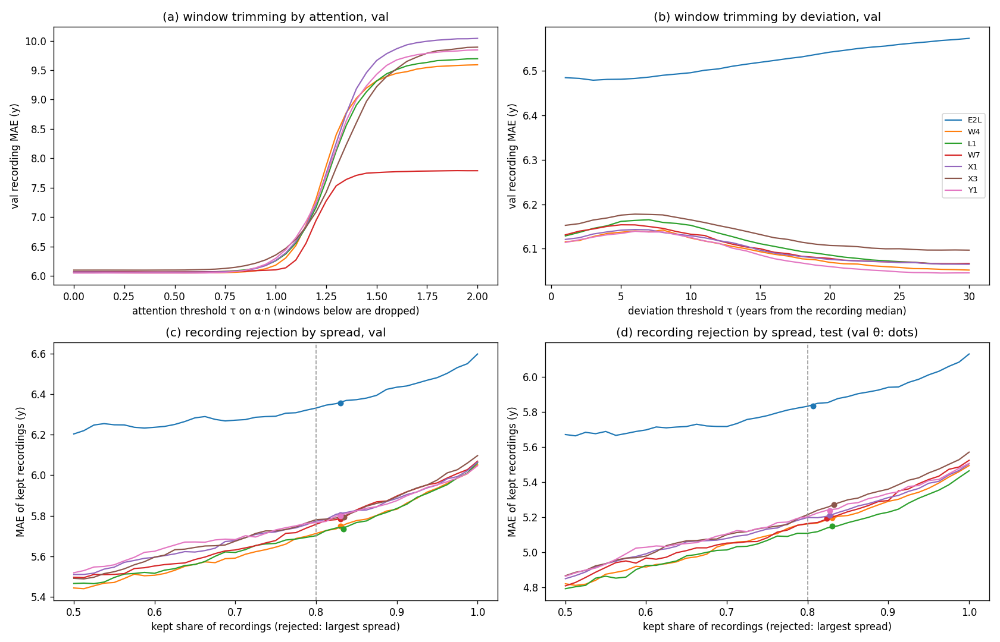

# Brain age on external cohorts: LEMON and MIPDB (zero-shot)

Results note, 2026-11-10. The best brain-age models trained on TUH + HEEDB
(cohort `tuh_heedb_v1`) are scored **without retraining** on two public
resting-state cohorts they never saw, MPI-LEMON and CMI MIPDB. CHBP and TDBRAIN
need a data use agreement and follow when access is in place.

Code:
- `dataset_maker/make_external_npy.py`: raw files to the npy cohort format;
- `scripts/eval_age_by_cohort.py`: scoring, now also bag (MIL) models,
  test-only cohorts, `--eval-minutes` and `--pred-stats`;
- `scripts/external_eval_report.py`: metrics, QC and figures.

Tables are in `docs/data/external_eval/`, and the per-recording predictions in
`/data/runs/heedb/external_eval/*.json`.

## 1. Data and storage

### Table 1.1. Cohorts

| cohort | source | n scored | age | recording | channels used |
|---|---|---|---|---|---|
| LEMON (Babayan et al. 2019) | `s3://fcp-indi/data/Projects/INDI/MPI-LEMON` (public) | 214 of 215 (sub-032492 has 80 s) | 20–80, published only as 5-year bins: young 20–40 (n = 144), old 55–80 (n = 70) | 16 min, 1-min blocks alternating eyes closed / open; BrainVision, 2500 Hz, FCz reference | 19 of 61 (10-20 positions; T7/T8/P7/P8 → T3/T4/T5/T6) |
| MIPDB (Langer et al. 2017) | `s3://fcp-indi/data/Projects/EEG_Eyetracking_CMI_data` (public; ages from `MIPDB_PublicFile.csv`) | 116 (all with a resting file) | 6–44, median 13; 52 aged 6–12, 33 aged 13–17, 31 adults | ≈ 6.5 min resting (trigger 90), eyes open 20 s / closed 40 s; EGI HydroCel 128, 500 Hz, vertex reference | 19 of 128, nearest 10-20 electrodes (Luu & Ferree 2005; Cz = vertex reference) |

Storage follows the TUH / HEEDB convention. Before writing, the bucket was
checked private with `download_heedb.check_private`.

| | local | S3 |
|---|---|---|
| raw | `/data/datasets/EEG-public/{LEMON,MIPDB}/raw` | `s3://eeg-data-public/{LEMON,MIPDB}/v1/raw` |
| metadata | `.../meta` | `.../v1/meta` |
| cohort | `.../cohorts/{lemon_v1,mipdb_v1}` | `.../v1/cohorts/` |

Each cohort has `manifest.json`, `age_metadata.json`, `age_split.json` (every
recording in test) and `recordings/*.npy`.

## 2. Preprocessing and its validation

Both corpora go through the training pipeline itself:
`make_TUH_npy.preprocess_raw`, the function every training cohort used, now
split out of the EDF reader. The steps:
- 0.1–75 Hz FIR band-pass;
- spectrum-interpolation line removal at 50 and 60 Hz;
- resampling to 200 Hz;
- µV, float16;
- the 23 TUH channels in model order, with A1/A2/T1/T2 absent (zero, `channel_mask`; the models drop them);
- whole 10 s windows.

The reference is kept as recorded, as for TUH and HEEDB, because the models
apply a common average reference at their input (`labram_plus.common_average_reference`).
MIPDB is the one exception: its vertex reference makes Cz identically zero, so
its 19 channels are re-referenced to their mean on reading. After the input
CAR this is equivalent to any other reference.

Evaluation uses the training protocol: the first 5 minutes after a 60 s trim
at both ends (at most 30 windows). Every window was also scored
(`--eval-minutes 0`, Table 3.1, last column).

### Table 2.1. Signal QC, median over recordings, first 5 min after the trim, common average reference

The reference sets are 100 random normal-report recordings of each training
corpus (TUH, HEEDB), shown only as aggregates.

| source | n | channel std (µV) | alpha peak (Hz), O1/O2 | delta | theta | alpha | beta | share of samples > 300 µV |
|---|---|---|---|---|---|---|---|---|
| TUH normal (training) | 100 | 9.96 | 9.00 | 0.495 | 0.124 | 0.136 | 0.131 | 0.000 |
| HEEDB normal (training) | 100 | 13.01 | 9.00 | 0.527 | 0.125 | 0.156 | 0.123 | 0.025 |
| **LEMON** | 215 | 8.98 | 9.75 | 0.452 | 0.130 | 0.183 | 0.139 | 0.000 |
| **MIPDB** | 116 | 18.95 | 9.75 | 0.611 | 0.135 | 0.133 | 0.066 | 0.002 |

The band powers are relative powers of 1–45 Hz (Welch, 2 s segments).

### Figure 2.1. Median power spectrum per source


Median PSD (µV²/Hz, log scale) over recordings and channels, 1–45 Hz. Solid
lines are the external cohorts, dashed lines the training references.

**What Table 2.1 and Figure 2.1 show:** the preprocessing reproduces the
training data's signal properties.
- LEMON's spectrum lies almost on TUH's: amplitude 9.0 vs 10.0 µV, similar
  band powers. Its alpha peak is slightly higher (9.75 vs 9.0 Hz), as
  expected for healthy, mostly young volunteers against clinical recordings.
- MIPDB has about twice the amplitude and more delta and less beta. That is
  the known EEG of children and adolescents, not a scaling error: its adults
  (Section 3) are predicted with errors similar to LEMON's young group.
- Neither cohort shows a residual 50 or 60 Hz line, and almost no samples
  exceed 300 µV.

## 3. Results

Predictions are de-normalised with the training-target statistics of
`tuh_heedb_v1` (mean 53.52, std 19.29; all models were trained on it).

The models:
- **E2:** TUH + HEEDB;
- **E2L:** E2 trained longer;
- **W4 / L1 / W7 / X1 / X3 / X6 / Y1 / Y2:** the attention-MIL models of `docs/mil_stage1_results.md`, scored bag-wise.

Columns, for recordings $r$ of a group $G$ with true age $y_r$ and prediction $\hat y_r$:

$$
\mathrm{MAE}=\tfrac1{|G|}\sum_r\lvert\hat y_r-y_r\rvert,\quad
\mathrm{bias}=\tfrac1{|G|}\sum_r(\hat y_r-y_r),\quad
R^2=1-\frac{\sum_r(\hat y_r-y_r)^2}{\sum_r(y_r-\bar y_G)^2}
\tag{3.1}
$$

$$
\mathrm{MAE}_\text{mean}=\tfrac1{|G|}\sum_r\lvert y_r-\bar y_G\rvert,\qquad
\hat y^\text{recal}_r=a_{-k}\hat y_r+b_{-k}
\tag{3.2}
$$

$\mathrm{MAE}_\text{mean}$ is the predict-the-mean baseline (it knows the
group's mean age). $\hat y^\text{recal}$ is a linear recalibration fitted on
the other four of five subject folds of the same cohort (OLS of $y$ on
$\hat y$). It uses the cohort's ages, so it is **not** zero-shot.

### Table 3.1. LEMON (n = 214; ages are 5-year bin midpoints)

| model | MAE | bias | Pearson r | R² | young MAE (bias) | old MAE (bias) | MAE recalibrated (CV) | MAE, every window |
|---|---|---|---|---|---|---|---|---|
| predict the mean | 18.60 | 0 | — | 0 | 2.96 | 3.90 | — | — |
| E2 | 5.81 | −0.37 | 0.94 | 0.86 | 4.52 (+3.35) | 8.47 (−8.04) | 5.13 | 5.75 |
| E2L | 5.22 | −1.11 | 0.95 | 0.88 | 3.88 (+1.97) | 7.97 (−7.43) | 4.82 | 5.20 |
| W4 | 4.62 | −1.31 | 0.95 | 0.90 | **3.55** (+0.48) | 6.82 (−5.00) | 4.55 | 4.51 |
| L1 | 4.68 | −1.24 | 0.95 | 0.90 | 3.75 (+0.32) | 6.61 (−4.44) | 4.65 | 4.56 |
| W7 | 4.66 | −1.20 | 0.95 | 0.90 | 3.73 (+0.41) | 6.57 (−4.52) | 4.60 | 4.59 |
| X1 | 4.53 | −0.50 | 0.95 | 0.91 | 3.68 (+1.24) | 6.29 (−4.08) | 4.54 | 4.50 |
| **X3** | **4.47** | −0.67 | **0.96** | **0.91** | 3.61 (+0.85) | 6.24 (−3.81) | **4.46** | **4.37** |
| X6 (bags 8–64) | 4.49 | −0.30 | 0.95 | 0.91 | 3.65 (+1.08) | 6.21 (−3.13) | 4.53 | 4.46 |
| Y1 (ungated + retention, 10 ep) | 4.55 | −0.59 | 0.95 | 0.91 | 3.78 (+0.87) | **6.13** (−3.60) | 4.55 | 4.51 |
| Y2 (ungated h + q + retention, 10 ep) | 4.56 | −0.73 | 0.95 | 0.91 | 3.61 (+1.11) | 6.52 (−4.51) | 4.51 | 4.51 |

Binning alone costs about 1.25 y of MAE: the mean absolute distance of a
uniform age from its 5-year bin's midpoint.

### Table 3.2. MIPDB (n = 116; whole-year ages)

| model | MAE | bias | Pearson r | R² | 6–12 MAE | 13–17 MAE | adults 18–44 MAE (bias) | controls (DX 0, n = 93) MAE | MAE recalibrated (CV) |
|---|---|---|---|---|---|---|---|---|---|
| predict the mean | 6.32 | 0 | — | 0 | 1.21 | 1.16 | 5.85 | 6.84 | — |
| E2 | 13.11 | +13.03 | 0.63 | −2.26 | 16.40 | 10.87 | 9.97 (+9.68) | 11.96 | **4.90** |
| E2L | 12.66 | +12.43 | 0.59 | −2.07 | 15.86 | 10.83 | 9.22 (+8.37) | 11.57 | 5.06 |
| W4 | 10.28 | +9.83 | 0.55 | −1.39 | 13.22 | 8.30 | 7.43 (+5.77) | 9.36 | 5.19 |
| L1 | **10.01** | +9.57 | 0.55 | −1.34 | 13.17 | 7.78 | **7.10** (+5.45) | 9.05 | 5.25 |
| W7 | 10.03 | +9.48 | 0.55 | −1.31 | **13.02** | **7.75** | 7.44 (+5.43) | **9.00** | 5.26 |
| X1 | 11.46 | +11.04 | 0.52 | −1.81 | 15.03 | 9.01 | 8.09 (+6.53) | 10.31 | 5.46 |
| X3 | 11.31 | +10.89 | 0.51 | −1.82 | 14.77 | 9.06 | 7.89 (+6.33) | 10.14 | 5.49 |

### Figure 3.1. Predicted vs. true age


Each recording is a point (years). Circles are the zero-shot predictions,
crosses the 5-fold recalibrated ones of Eq. (3.2):
- (a) LEMON, E2L;
- (b) LEMON, W4;
- (c) MIPDB, E2L;
- (d) MIPDB, W4.

**What Tables 3.1–3.2 and Figure 3.1 show:**

* **LEMON transfers well.**
  - Every model separates the young and old groups (r 0.94–0.96).
  - MAE is 4.5–5.8 y, of which about 1.25 y is the bin quantisation.
  - The attention models are 0.6 y better than E2L and 1.2–1.3 y better
    than E2, the same order as on our own test set (`mil_stage1_results.md`
    Section 12).
  - Recalibrating on LEMON itself barely helps (4.46–5.13). The zero-shot
    predictions are already calibrated for this age range.
* **But LEMON rewards group separation.**
  - Within a group, the models do not rank ages: r ≈ 0.45, and MAE is above
    the group-mean baseline (young 3.6 vs 3.0, old 6.2–8.5 vs 3.9).
  - The old group is predicted 4–8 y too young: the same regression to the
    mean seen at 70+ on our test set. The attention models halve E2's bias
    (−3.8 to −5.0 vs −8.0).
  - R² 0.86–0.91 is therefore mostly the two-group structure. MAE and the
    per-group numbers are the informative ones, as Engemann et al. note.
* **MIPDB is outside the training age range.**
  - Children are predicted 13–16 y too old. No prediction falls below about
    18 y (Figure 3.1(c, d)): the training cohorts hold almost no children
    (HEEDB is adult-only).
  - Predictions still increase with age (r 0.51–0.63). A cohort-specific
    linear recalibration brings MAE to 4.9–5.5 y, but that uses MIPDB's ages.
  - MIPDB's adults (18–44, n = 31) are predicted with MAE 7.1–7.4 and a
    +5.5 y bias (L1, W7, W4).
  - Again the attention models beat E2/E2L by 2.5–3 y. Among them, L1 and
    W7 are best and the 20-epoch X runs worst.
* **Every window vs. 5 minutes:** on LEMON, scoring all ≈ 14 min instead of
  5 lowers MAE by 0.05–0.1 y for the attention models (X3 4.47 → 4.37) and
  changes nothing for E2/E2L. On MIPDB the recordings are short, so it makes
  no difference.

## 4. Comparison with the literature

### Table 4.1. Published brain-age results on these cohorts (verified against the sources)

Protocol:
- **WD-CV:** trained and tested within the dataset, cross-validated;
- **cross:** trained on another corpus, applied without retraining.

| cohort | paper | protocol | model | MAE | R² |
|---|---|---|---|---|---|
| LEMON | Engemann et al. 2022, *NeuroImage* 262:119521 (Table 1; n = 227, exact ages) | WD-CV 10-fold | Deep4Net | 7.75 ± 1.78 | 0.69 ± 0.16 |
| | | | ShallowNet / filterbank-source | 8.67 / 8.67 | 0.69 / 0.67 |
| | | | filterbank-riemann / handcrafted + RF | 10.78 / 10.23 | 0.54 / 0.51 |
| | | | dummy (mean) | 18.70 | −0.13 |
| | Mellot et al. 2023, *Imaging Neurosci.* (n = 213) | cross: TUAB normal → LEMON | Riemann, without / with re-centring | — | ≈ 0.26 / 0.44 ± 0.06 |
| | Hajhassani et al. 2026, arXiv:2609.31195 (preprint) | cross: TUEG → LEMON, zero-shot | GEDAI + CTNet | 9.91 | 0.632 |
| | **ours** (n = 214, bin midpoints) | **cross: TUH + HEEDB → LEMON, zero-shot** | **X3 / W4 / E2L** | **4.47 / 4.62 / 5.22** | **0.91 / 0.90 / 0.88** |
| MIPDB | none found | — | — | — | — |
| | **ours** (n = 116) | cross, zero-shot | L1 / W7 | 10.01 / 10.03 | −1.34 / −1.31 |

**What Table 4.1 shows:**
* **On LEMON the zero-shot models beat every published number.** That
  includes models trained on LEMON itself: MAE 4.5 vs 7.75 (Engemann's
  Deep4Net) and R² 0.91 vs 0.69. Against the closest protocol, a TUEG-trained
  model applied zero-shot (Hajhassani 2026), the gap is 4.5 vs 9.9 y MAE.
* **The comparison has caveats.**
  - Engemann et al. had exact ages; we use bin midpoints, which add about
    1.25 y of MAE to our numbers.
  - Their recordings and epoching differ (EC + EO pooled, their own
    preprocessing).
  - The papers report no per-group (young / old) numbers, where our models
    are no better than the group mean.
* **MIPDB has no published age-regression result.** Ours is a first, and
  shows the limit of the training data: children.

## 5. LEMON as a standing test set during training

Every age fine-tune now scores extra test sets next to the regular test split
(`evaluation.test_sets`, `labram/data/test_sets.py`): every 5 epochs
(`evaluation.test_sets_every`), on the last epoch, and on any epoch that sets a
new best val (`evaluation.test_sets_at_best`), so the best-epoch numbers come
from the selected model. The age
configs default to:

```json
"test_sets": ["temple", "lemon=/data/datasets/EEG-public/LEMON/cohorts/lemon_v1"]
```

- `temple` is the TUH part of the run's own test split, i.e. the TUAB eval
  set for `tuh_heedb_v1`.
- `lemon` is this cohort, scored zero-shot with the run's own window
  selection and training-target statistics.

Both are logged like the test split:
- ClearML heads `test_temple`, `test_lemon`;
- console `Test[lemon] EEG mae: …`;
- `best_test_set_stats` in the run summary and `test_<name>_*` final metrics.

On SageMaker the LEMON folder is mounted from its S3 copy
(`sagemaker.data_s3_uris`) as the input channel `test_lemon`. Data that is
missing on a machine is skipped with a warning. Add MIPDB with
`--set 'evaluation.test_sets=["temple","lemon=…","mipdb=/data/datasets/EEG-public/MIPDB/cohorts/mipdb_v1"]'`.

## 6. Evaluation strategies per cohort: 5 min, all windows, window trimming, recording rejection

Script: `scripts/eval_strategies_table.py`, with rows in
`docs/data/external_eval/strategies_by_cohort.csv`. The data are the own test
split of `tuh_heedb_v1` (Harvard = HEEDB, Temple = the TUAB eval set) and LEMON,
scored zero-shot.

For a recording $r$ with selected windows $i \in S_r$, attention weights
$\alpha_i$ and window predictions $p_i$ (years), every column pools as

$$
\hat y_r = \frac{\sum_{i\in S_r}\alpha_i\,p_i}{\sum_{i\in S_r}\alpha_i},
\qquad
\mathrm{MAE} = \frac{1}{|R|}\sum_{r\in R}\lvert \hat y_r - y_r\rvert
\tag{6.1}
$$

and the columns differ in $S_r$ and $R$:
- **5 min** (default): $S_r$ = the first 30 windows after the 60 s trim; $R$ = all recordings.
- **all windows**: $S_r$ = every window between the 60 s trims (`--eval-minutes 0`).
- **trim 20 % windows**: $S_r$ = all windows except those whose relative weight $\alpha_i\,n_r$ is below the 20th percentile over the split. This is label-free; a recording keeps at least its top window.
- **keep 80 % recordings**: all windows. $R$ excludes the 20 % of recordings with the largest attention-weighted spread $s_r$, Eq. (6.2). The other 20 % get no prediction, so this column is selective prediction over 80 % of the recordings.
- **trim 20 % + keep 80 %**: both at once. $S_r$ is the trim-20 % set, $R$ the keep-80 % set (ranked by $s_r$ over all windows).
- **val trim / val keep / val trim + keep**: the same three operations with
  **thresholds fitted on the validation split** (Section 7, Eqs. (7.1)–(7.2);
  `scripts/confidence_thresholds.py`, the variant fitted to keep at least
  80 % of val, $k_{\min} = 0.80$, for a like-for-like comparison with keep
  80 %). Val trim drops the windows below the val-chosen $\tau$; val keep
  rejects the recordings whose spread $s_r$ exceeds the val-fitted $\theta$;
  val trim + keep does both, with $\theta$ fitted on val after the trim. The
  share of the cohort's recordings kept is in parentheses: unlike keep 80 %,
  it is not fixed per cohort. E2 has no val windows (—).

The fixed-share columns (trim 20 %, keep 80 %) are label-free but set their
cut-off from the test cohort itself, so each cohort loses exactly 20 %. The
val columns are what a deployed model can do: one threshold, fixed before
the test data are seen.

$$
s_r = \sqrt{\sum_{i} \alpha_i \,(p_i-\hat y_r)^2},\qquad
d_i = \bigl\lvert p_i - \operatorname{median}_{j\in r} p_j \bigr\rvert
\tag{6.2}
$$

The window-level models E2 and E2L have no attention: $\alpha_i = 1/n_r$, so
$\hat y_r$ is the mean of the window predictions and $s_r$ their plain
(population) std. The attention trim would drop nothing for them (every
$\alpha_i n_r = 1$). Their trim columns (marked †) instead drop each
recording's $\lfloor 0.2\,n_r \rfloor$ windows with the largest deviation
$d_i$ from the recording's median prediction, Eq. (6.2), i.e. a 20 % trimmed
mean, also label-free (`scripts/attention_trimming.py::trims`, `trim20_dev`;
the same rule for the attention models is in the CSV of
`scripts/attention_trimming.py`). Their per-window predictions come from
`scripts/eval_age_by_cohort.py --save-windows`, which writes uniform weights
for window models.

The setup column names the pool, what the attention reads ($h$: the
window's encoder embedding; $q$: its quality / spectral descriptors), the
regularizer and the training epochs. Every model shares the
`tuh_heedb_v1` training split, 10 s windows, and LaBraM-base weights (E2,
E2L) or an E2L warm start (all attention models; bags of 32 recordings × 8
windows). **Bold** marks the best value in a column of a table.

### Table 6.1. Own test split, all recordings (n = 7,612), MAE in years

| model | setup | 5 min | all windows | trim 20 % | keep 80 % | trim 20 % + keep 80 % | val trim | val keep (kept) | val trim + keep (kept) |
|---|---|---|---|---|---|---|---|---|---|
| E2 | window model; 8 ep | 7.25 | 6.36 | 6.11† | 6.12 | 5.92† | — | — | — |
| E2L | window model; 16 ep | 7.00 | 6.13 | 5.95† | 5.83 | 5.69† | 5.97 | 5.81 (77 %) | 5.87 (82 %) |
| W4 | gated, h; 4 ep | 6.10 | 5.49 | 5.52 | 5.16 | 5.19 | 5.49 | 5.16 (80 %) | 5.16 (80 %) |
| L1 | ungated, h; 4 ep | 6.09 | **5.46** | **5.51** | **5.11** | **5.16** | **5.46** | **5.10 (80 %)** | **5.11 (81 %)** |
| W7 | gated, h, ret. 0.1; 4 ep | 6.12 | 5.52 | 5.54 | 5.16 | 5.18 | 5.53 | 5.16 (79 %) | 5.16 (80 %) |
| X1 | gated, h, ret. 0.1; 20 ep | 6.09 | 5.50 | 5.53 | 5.20 | 5.23 | 5.51 | 5.20 (80 %) | 5.20 (80 %) |
| X3 | gated, h + q, ret. 0.1; 20 ep | 6.15 | 5.57 | 5.62 | 5.21 | 5.26 | 5.57 | 5.24 (81 %) | 5.25 (82 %) |
| Y1 | ungated, h, ret. 0.1; 10 ep | **6.08** | 5.51 | 5.57 | 5.20 | 5.27 | 5.51 | 5.20 (79 %) | 5.21 (79 %) |

### Table 6.2. Harvard normal (n = 1,518), MAE in years

| model | setup | 5 min | all windows | trim 20 % | keep 80 % | trim 20 % + keep 80 % | val trim | val keep (kept) | val trim + keep (kept) |
|---|---|---|---|---|---|---|---|---|---|
| E2 | window model; 8 ep | 7.43 | 6.07 | 5.68† | 5.93 | 5.65† | — | — | — |
| E2L | window model; 16 ep | 7.12 | 5.77 | 5.46† | 5.55 | 5.35† | 5.49 | 5.52 (72 %) | 5.44 (82 %) |
| W4 | gated, h; 4 ep | 5.72 | 4.80 | 4.78 | 4.52 | 4.51 | 4.79 | 4.52 (80 %) | 4.50 (80 %) |
| L1 | ungated, h; 4 ep | **5.71** | **4.79** | 4.78 | **4.47** | **4.49** | **4.78** | **4.47 (79 %)** | **4.47 (80 %)** |
| W7 | gated, h, ret. 0.1; 4 ep | 5.83 | 4.88 | 4.87 | 4.61 | 4.61 | 4.88 | 4.57 (77 %) | 4.57 (78 %) |
| X1 | gated, h, ret. 0.1; 20 ep | **5.71** | 4.80 | **4.77** | 4.52 | 4.50 | 4.79 | 4.51 (78 %) | 4.51 (79 %) |
| X3 | gated, h + q, ret. 0.1; 20 ep | 5.87 | 4.93 | 4.91 | 4.61 | 4.61 | 4.92 | 4.60 (80 %) | 4.63 (81 %) |
| Y1 | ungated, h, ret. 0.1; 10 ep | 5.75 | 4.85 | 4.84 | 4.58 | 4.59 | 4.85 | 4.54 (77 %) | 4.55 (77 %) |

### Table 6.3. Harvard abnormal (n = 2,253), MAE in years

| model | setup | 5 min | all windows | trim 20 % | keep 80 % | trim 20 % + keep 80 % | val trim | val keep (kept) | val trim + keep (kept) |
|---|---|---|---|---|---|---|---|---|---|
| E2 | window model; 8 ep | 7.83 | 6.84 | 6.64† | 6.53 | 6.35† | — | — | — |
| E2L | window model; 16 ep | 7.56 | 6.63 | 6.49† | 6.27 | 6.16† | 6.50 | 6.22 (77 %) | 6.33 (82 %) |
| W4 | gated, h; 4 ep | 6.77 | 6.27 | 6.33 | 5.89 | 5.96 | 6.28 | 5.90 (81 %) | 5.92 (80 %) |
| L1 | ungated, h; 4 ep | 6.79 | 6.25 | 6.33 | 5.86 | 5.94 | 6.26 | 5.86 (80 %) | 5.90 (81 %) |
| W7 | gated, h, ret. 0.1; 4 ep | 6.73 | 6.23 | **6.27** | **5.82** | **5.85** | 6.24 | **5.80 (79 %)** | **5.82 (79 %)** |
| X1 | gated, h, ret. 0.1; 20 ep | 6.75 | 6.27 | 6.33 | 5.90 | 5.98 | 6.28 | 5.90 (80 %) | 5.91 (81 %) |
| X3 | gated, h + q, ret. 0.1; 20 ep | 6.78 | 6.33 | 6.43 | 5.93 | 6.02 | 6.34 | 5.96 (81 %) | 5.98 (82 %) |
| Y1 | ungated, h, ret. 0.1; 10 ep | **6.67** | **6.22** | 6.32 | 5.88 | 5.99 | **6.22** | 5.88 (81 %) | 5.89 (81 %) |

### Table 6.4. Harvard unlabelled (n = 3,567), MAE in years

| model | setup | 5 min | all windows | trim 20 % | keep 80 % | trim 20 % + keep 80 % | val trim | val keep (kept) | val trim + keep (kept) |
|---|---|---|---|---|---|---|---|---|---|
| E2 | window model; 8 ep | 6.86 | 6.15 | 5.94† | 5.93 | 5.74† | — | — | — |
| E2L | window model; 16 ep | 6.64 | 5.94 | 5.78† | 5.66 | 5.52† | 5.80 | 5.64 (79 %) | 5.71 (82 %) |
| W4 | gated, h; 4 ep | 5.83 | 5.27 | 5.30 | 4.91 | 4.94 | 5.26 | 4.91 (80 %) | 4.91 (79 %) |
| L1 | ungated, h; 4 ep | **5.80** | **5.22** | **5.27** | **4.83** | **4.89** | **5.22** | **4.83 (80 %)** | **4.83 (80 %)** |
| W7 | gated, h, ret. 0.1; 4 ep | 5.87 | 5.32 | 5.33 | 4.95 | 4.96 | 5.32 | 4.94 (79 %) | 4.94 (80 %) |
| X1 | gated, h, ret. 0.1; 20 ep | 5.84 | 5.28 | 5.32 | 4.98 | 5.02 | 5.28 | 4.97 (80 %) | 4.98 (80 %) |
| X3 | gated, h + q, ret. 0.1; 20 ep | 5.87 | 5.33 | 5.38 | 4.98 | 5.03 | 5.33 | 5.02 (81 %) | 5.02 (81 %) |
| Y1 | ungated, h, ret. 0.1; 10 ep | 5.83 | 5.30 | 5.37 | 5.00 | 5.07 | 5.30 | 4.97 (79 %) | 4.99 (79 %) |

### Table 6.5. Temple (TUAB) normal (n = 149), MAE in years

| model | setup | 5 min | all windows | trim 20 % | keep 80 % | trim 20 % + keep 80 % | val trim | val keep (kept) | val trim + keep (kept) |
|---|---|---|---|---|---|---|---|---|---|
| E2 | window model; 8 ep | 5.13 | 5.14 | 5.00† | 5.01 | 4.83† | — | — | — |
| E2L | window model; 16 ep | 4.91 | 4.81 | 4.72† | 4.66 | 4.54† | 4.74 | 4.71 (95 %) | 4.60 (81 %) |
| W4 | gated, h; 4 ep | 4.45 | 4.15 | 4.14 | 4.13 | 4.11 | 4.14 | 4.12 (93 %) | 4.11 (93 %) |
| L1 | ungated, h; 4 ep | 4.41 | 4.15 | 4.13 | 4.18 | 4.17 | 4.15 | 4.10 (93 %) | 4.10 (93 %) |
| W7 | gated, h, ret. 0.1; 4 ep | 4.36 | 4.15 | 4.12 | 4.08 | 4.07 | 4.15 | 4.15 (94 %) | 4.15 (94 %) |
| X1 | gated, h, ret. 0.1; 20 ep | **4.27** | **4.09** | **4.01** | **4.02** | **3.98** | **4.08** | 4.09 (91 %) | 4.08 (91 %) |
| X3 | gated, h + q, ret. 0.1; 20 ep | 4.43 | 4.10 | 4.11 | 4.05 | 4.06 | 4.10 | **4.03 (94 %)** | **4.03 (94 %)** |
| Y1 | ungated, h, ret. 0.1; 10 ep | 4.50 | 4.18 | 4.22 | 4.19 | 4.22 | 4.19 | 4.15 (93 %) | 4.17 (91 %) |

### Table 6.6. Temple (TUAB) abnormal (n = 125), MAE in years

| model | setup | 5 min | all windows | trim 20 % | keep 80 % | trim 20 % + keep 80 % | val trim | val keep (kept) | val trim + keep (kept) |
|---|---|---|---|---|---|---|---|---|---|
| E2 | window model; 8 ep | 8.56 | 8.32 | 8.27† | 7.79 | 7.68† | — | — | — |
| E2L | window model; 16 ep | 8.50 | 8.52 | 8.42† | 7.87 | 7.78† | 8.49 | 8.03 (86 %) | 8.85 (74 %) |
| W4 | gated, h; 4 ep | 8.20 | 8.14 | 8.14 | 7.98 | 7.97 | 8.14 | 7.95 (87 %) | 7.96 (87 %) |
| L1 | ungated, h; 4 ep | 8.13 | **8.12** | **8.13** | 8.30 | 8.31 | **8.12** | 8.11 (87 %) | 8.11 (87 %) |
| W7 | gated, h, ret. 0.1; 4 ep | **8.07** | 8.14 | 8.16 | **7.65** | **7.66** | 8.14 | **7.91 (85 %)** | **7.91 (85 %)** |
| X1 | gated, h, ret. 0.1; 20 ep | 8.18 | 8.29 | 8.30 | 7.91 | 7.87 | 8.29 | 8.00 (86 %) | 8.00 (86 %) |
| X3 | gated, h + q, ret. 0.1; 20 ep | 8.17 | 8.17 | 8.15 | 7.74 | 7.74 | 8.17 | 7.97 (86 %) | 7.97 (86 %) |
| Y1 | ungated, h, ret. 0.1; 10 ep | 8.23 | 8.24 | 8.23 | 8.05 | 8.04 | 8.23 | 8.10 (86 %) | 8.12 (86 %) |

### Table 6.7. LEMON all (n = 214), MAE in years

| model | setup | 5 min | all windows | trim 20 % | keep 80 % | trim 20 % + keep 80 % | val trim | val keep (kept) | val trim + keep (kept) |
|---|---|---|---|---|---|---|---|---|---|
| E2 | window model; 8 ep | 5.81 | 5.75 | 5.43† | 4.78 | 4.56† | — | — | — |
| E2L | window model; 16 ep | 5.22 | 5.20 | 4.89† | 4.37 | 4.19† | 4.95 | 4.59 (87 %) | 4.61 (86 %) |
| W4 | gated, h; 4 ep | 4.62 | 4.51 | 4.39 | 3.80 | 3.82 | 4.52 | 3.97 (86 %) | 3.94 (85 %) |
| L1 | ungated, h; 4 ep | 4.68 | 4.56 | 4.51 | 3.86 | 3.94 | 4.56 | 4.05 (86 %) | 4.06 (86 %) |
| W7 | gated, h, ret. 0.1; 4 ep | 4.66 | 4.59 | 4.58 | 3.96 | 3.96 | 4.60 | 4.11 (85 %) | 4.11 (85 %) |
| X1 | gated, h, ret. 0.1; 20 ep | 4.53 | 4.50 | 4.30 | 3.88 | 3.72 | 4.49 | **3.93 (87 %)** | **3.93 (87 %)** |
| X3 | gated, h + q, ret. 0.1; 20 ep | **4.47** | **4.37** | **4.20** | **3.75** | **3.68** | **4.37** | **3.93 (89 %)** | **3.93 (89 %)** |
| Y1 | ungated, h, ret. 0.1; 10 ep | 4.55 | 4.51 | 4.40 | 3.89 | 3.83 | 4.50 | 3.99 (86 %) | 3.95 (88 %) |

### Table 6.8. LEMON young (n = 144), MAE in years

| model | setup | 5 min | all windows | trim 20 % | keep 80 % | trim 20 % + keep 80 % | val trim | val keep (kept) | val trim + keep (kept) |
|---|---|---|---|---|---|---|---|---|---|
| E2 | window model; 8 ep | 4.52 | 4.59 | 4.22† | 3.42 | 3.19† | — | — | — |
| E2L | window model; 16 ep | 3.88 | 3.94 | 3.59† | 3.04 | 2.85† | 3.61 | 3.64 (93 %) | 3.31 (92 %) |
| W4 | gated, h; 4 ep | **3.55** | **3.48** | 3.32 | 2.86 | 2.97 | **3.49** | 3.16 (92 %) | 3.17 (92 %) |
| L1 | ungated, h; 4 ep | 3.75 | 3.63 | 3.56 | 2.97 | 3.11 | 3.63 | 3.26 (92 %) | 3.27 (92 %) |
| W7 | gated, h, ret. 0.1; 4 ep | 3.73 | 3.64 | 3.60 | 2.94 | 2.94 | 3.65 | 3.34 (92 %) | 3.34 (92 %) |
| X1 | gated, h, ret. 0.1; 20 ep | 3.68 | 3.64 | 3.40 | 2.82 | **2.70** | 3.64 | **3.13 (92 %)** | **3.13 (92 %)** |
| X3 | gated, h + q, ret. 0.1; 20 ep | 3.61 | 3.51 | **3.31** | **2.72** | **2.70** | 3.51 | 3.21 (93 %) | 3.21 (93 %) |
| Y1 | ungated, h, ret. 0.1; 10 ep | 3.78 | 3.74 | 3.50 | 2.98 | 2.94 | 3.74 | 3.33 (91 %) | 3.27 (93 %) |

### Table 6.9. LEMON old (n = 70), MAE in years

| model | setup | 5 min | all windows | trim 20 % | keep 80 % | trim 20 % + keep 80 % | val trim | val keep (kept) | val trim + keep (kept) |
|---|---|---|---|---|---|---|---|---|---|
| E2 | window model; 8 ep | 8.47 | 8.12 | 7.91† | 7.07 | 6.98† | — | — | — |
| E2L | window model; 16 ep | 7.97 | 7.77 | 7.56† | 6.91 | 6.82† | 7.70 | 6.99 (76 %) | 7.92 (74 %) |
| W4 | gated, h; 4 ep | 6.82 | 6.65 | 6.60 | 5.90 | 6.02 | 6.64 | 6.02 (74 %) | 5.97 (71 %) |
| L1 | ungated, h; 4 ep | 6.61 | 6.47 | 6.47 | 5.90 | 6.05 | 6.47 | 6.05 (74 %) | 6.06 (74 %) |
| W7 | gated, h, ret. 0.1; 4 ep | 6.57 | 6.54 | 6.58 | 5.97 | 5.81 | 6.55 | 6.18 (70 %) | 6.19 (70 %) |
| X1 | gated, h, ret. 0.1; 20 ep | 6.29 | 6.25 | 6.14 | 5.76 | 5.71 | 6.26 | 5.88 (77 %) | 5.89 (77 %) |
| X3 | gated, h + q, ret. 0.1; 20 ep | 6.24 | 6.13 | **6.01** | 5.73 | **5.64** | 6.13 | 5.64 (81 %) | **5.64 (81 %)** |
| Y1 | ungated, h, ret. 0.1; 10 ep | **6.13** | **6.08** | 6.25 | **5.57** | 5.82 | **6.06** | **5.63 (76 %)** | **5.64 (77 %)** |

What Tables 6.1–6.9 show:

* **Scoring the whole recording is the largest gain on our own test split.**
  - All windows instead of the first 5 minutes lower the test MAE by 0.6–0.9 y
    for every model (Table 6.1). L1 goes 6.09 → 5.46 and E2L 7.00 → 6.13.
  - The gain is on HEEDB, whose recordings are long (median about 25 min):
    Harvard normal 5.71 → 4.79 (L1), unlabelled 5.80 → 5.22, abnormal
    6.79 → 6.25.
  - TUAB gains less: normal 4.41 → 4.15 (L1), abnormal unchanged at about 8.1.
  - The window-level models gain as much as the attention models (E2L
    −0.87 y overall). The 5-minute evaluation budget, not the pooling, was
    the main limit.
  - The attention models' lead over E2/E2L stays (5.46–5.57 vs. 6.13–6.36).
* **Trimming helps the window models, not the attention models.**
  - E2 / E2L gain 0.15–0.25 y overall from trimming (fixed 20 % or the val
    threshold, which drops about half the windows): E2L 6.13 → 5.95 / 5.97.
  - For the attention models the fixed 20 % trim is slightly harmful on our
    data (+0.02 to +0.06 y overall), and the val threshold leaves them
    unchanged (±0.01 y). On LEMON the fixed 20 % trim still helps them
    (X3 4.37 → 4.20), the val threshold does not.
* **Rejecting recordings is the reliable gain, and the val threshold matches
  the fixed 20 %.**
  - Overall, val keep gives the same MAE as keep 80 % (L1 5.10 vs 5.11, W4 /
    W7 5.16, X1 / Y1 5.20) while keeping 79–81 % of the recordings.
  - Per cohort the val threshold redistributes the rejections: it keeps
    77–81 % of Harvard (E2L 72 % of Harvard normal), 91–95 % of TUAB normal
    and 85–87 % of TUAB abnormal. On TUAB normal, where the fixed 20 % cut
    also rejects good recordings, it is better for L1, X3 and Y1 (L1 4.10 vs
    4.18) and 0.07 y worse for W7 and X1, while keeping 13 points more.
  - On LEMON the val threshold keeps 85–89 % (young 91–93 %, old 70–81 %), so
    its MAE (3.93–4.11) is above keep 80 % (3.75–3.96), which rejects more.
    The old group, the hardest one, is rejected most: the spread flags it.
* **Trim + keep adds nothing over keep for the attention models** (fixed or
  val: overall 0 to +0.07 y; per cohort ±0.15 y, helping X1 / X3 only on
  LEMON). For E2L the fixed version is its best setting
  (5.69 overall), but the val version (θ fitted after a trim that removed
  half the windows) is worse than val keep alone on TUAB abnormal (8.85,
  74 % kept) and LEMON old.
* **Y1** (ungated + retention, 10 epochs) gains 0.57 y from all windows
  (6.08 → 5.51) and is the best model on Harvard abnormal (6.22) and LEMON
  old (6.08; 5.57 after rejection).
* **Best per cohort with all windows:**
  - Harvard: L1 / W4 / X1 (normal 4.79–4.80, unlabelled 5.22–5.28), Y1 / W7 on abnormal (6.22–6.23);
  - TUAB: X1 normal (4.09), L1 abnormal (8.12);
  - LEMON: X3 (4.37; 4.20 with trimming), Y1 for the old group (6.08).
* **Implication:** evaluate on every window by default (`data.eval_minutes=0`
  for val / test). Model selection and the reported numbers should follow,
  because the 5-minute protocol understates every model by about 0.6 y on HEEDB.

## 7. Thresholds fitted on validation: window trimming and recording rejection

Section 6 trims a fixed 20 % of windows and rejects the 20 % least confident
recordings of each test cohort itself. This section fixes **absolute,
label-free thresholds on the validation split** (10,614 recordings, all
windows) and applies them unchanged to the test split and to LEMON. Every
decision (the trimming rule, $\tau$, $\theta$) is made on val; test and LEMON
only report the result. Script: `scripts/confidence_thresholds.py`; rows in
`docs/data/confidence_thresholds/` (`trim_grid.csv`, `trim_selected.csv`,
`reject_selected.csv`, `coverage_curves.csv`; the 80 % variant in
`min_keep_0.80/`). The val and test windows come from
`scripts/eval_age_by_cohort.py --eval-minutes 0 --save-windows`.

For window $i$ of recording $r$ ($n_r$ windows, attention $\alpha_i$, window
prediction $p_i$ in years), the window confidences are

$$
c_i = \alpha_i\, n_r \;\;(\text{attention; } 1 = \text{uniform}),\qquad
d_i = \bigl\lvert p_i - \operatorname{median}_{j\in r} p_j \bigr\rvert \;\;(\text{deviation, years})
\tag{7.1}
$$

A window is kept when $c_i \ge \tau$ (attention models) or $d_i \le \tau$
(every model); each recording keeps its most confident window, and the kept
windows are pooled with renormalised $\alpha$, Eq. (6.1). $\tau$ is the grid
value (attention $0, 0.05, \dots, 2$; deviation $1, 2, \dots, 30$ y and
$\infty$) with the lowest val MAE; no trimming is on both grids. A recording
is **rejected** when the spread of Eq. (6.2), computed on its kept windows,
exceeds $\theta$:

$$
\theta = \arg\min_{\theta'} \operatorname{MAE}\bigl(\{r\in\text{val} : s_r \le \theta'\}\bigr)
\quad\text{s.t.}\quad
\frac{\lvert\{r\in\text{val} : s_r \le \theta'\}\rvert}{\lvert\text{val}\rvert} \ge k_{\min}
\tag{7.2}
$$

with $k_{\min} = 0.83$: the goal is to keep at least 80 % of new
recordings, and a val-fitted $\theta$ keeps 1–3 points fewer on the Harvard
test cohorts (Table 7.3). Rejection is applied with and without the
val-chosen trim; val picks the better. The spread is fixed as the rejection
score: letting val choose between spread, the effective window share
$1/(n_r\sum_i a_i^2)$ and the attention entropy picked the entropy for W4,
which transferred worse (test 5.23 vs 5.16, LEMON 4.38 vs 3.94 at
$k_{\min} = 0.8$).

### Table 7.1. Window trimming: val-chosen rule and threshold, MAE in years

Columns: the rule and $\tau$ chosen on val, Eq. (7.1); the share of test
windows it drops; recording MAE with all windows → trimmed on val, test and
LEMON; "best $\tau$ on test" is a reference only (it uses test labels and
decides nothing).

| model | setup | rule, $\tau$ (val) | test windows dropped | val | test | best $\tau$ on test (MAE) | LEMON |
|---|---|---|---|---|---|---|---|
| E2L | window model, 16 ep | deviation, 3 y | 49 % | 6.60 → 6.48 | 6.13 → **5.97** | 4 y (5.965) | 5.20 → **4.95** |
| W4 | gated, h; 4 ep | attention, 0.55 | 3.9 % | 6.052 → 6.049 | 5.494 → 5.495 | 0.25 (5.494) | 4.51 → 4.52 |
| L1 | ungated, h; 4 ep | attention, 0.40 | 2.5 % | 6.061 → 6.059 | 5.464 → 5.465 | none (5.464) | 4.56 → 4.56 |
| W7 | gated, h, ret. 0.1; 4 ep | attention, 0.45 | 2.8 % | 6.069 → 6.066 | 5.524 → 5.525 | 1.05 (5.522) | 4.59 → 4.60 |
| X1 | gated, h, ret. 0.1; 20 ep | attention, 0.45 | 2.7 % | 6.065 → 6.062 | 5.504 → 5.505 | 0.15 (5.504) | 4.50 → 4.49 |
| X3 | gated, h + q, ret. 0.1; 20 ep | attention, 0.35 | 2.7 % | 6.097 → 6.096 | 5.571 → 5.573 | 0.05 (5.571) | 4.37 → 4.37 |
| Y1 | ungated, h, ret. 0.1; 10 ep | deviation, 28 y | 0.5 % | 6.047 → 6.045 | 5.507 → 5.511 | none (5.507) | 4.51 → 4.50 |

### Table 7.2. Recording rejection at $k_{\min} = 0.83$: kept share and MAE of the kept recordings

$\theta$ from Eq. (7.2) on val; "trim" is the val-chosen trim applied first
(— none). Each cell is kept share / MAE of the kept recordings (years);
"all" is the MAE without rejection.

| model | trim, $\theta$ | val | test all | Harvard n | Harvard a | Harvard u | TUAB n | TUAB a | LEMON |
|---|---|---|---|---|---|---|---|---|---|
| E2L | —, 6.75 y | 83.1 % / 6.36 | 80.7 % / 5.83 (all 6.13) | **76.0 %** / 5.51 | 80.5 % / 6.28 | 81.9 % / 5.66 | 96.6 % / 4.69 | 88.0 % / 7.99 | 89.3 % / 4.63 (all 5.20) |
| W4 | attn 0.55, 8.96 y | 83.0 % / 5.74 | 83.1 % / 5.19 (all 5.49) | 82.8 % / 4.55 | 83.1 % / 5.96 | 82.6 % / 4.92 | 93.3 % / 4.13 | 89.6 % / 8.08 | 86.4 % / 3.96 (all 4.52) |
| L1 | attn 0.40, 9.06 y | 83.1 % / 5.73 | 82.8 % / **5.14** (all 5.46) | 82.0 % / **4.46** | 82.7 % / 5.91 | 82.5 % / **4.86** | 93.3 % / 4.10 | 90.4 % / 8.30 | 86.0 % / 4.06 (all 4.56) |
| W7 | attn 0.45, 8.48 y | 83.2 % / 5.78 | 82.6 % / 5.19 (all 5.53) | 81.7 % / 4.64 | 82.2 % / **5.82** | 82.6 % / 4.99 | 95.3 % / 4.12 | 86.4 % / 7.94 | 86.0 % / 4.19 (all 4.60) |
| X1 | attn 0.45, 8.65 y | 83.4 % / 5.80 | 83.1 % / 5.22 (all 5.51) | 81.8 % / 4.55 | 83.2 % / 5.94 | 83.0 % / 5.00 | 94.6 % / 4.08 | 87.2 % / 8.04 | 90.2 % / **3.94** (all 4.49) |
| X3 | —, 8.49 y | 83.5 % / 5.79 | 83.3 % / 5.27 (all 5.57) | 82.5 % / 4.64 | 83.2 % / 5.96 | 83.0 % / 5.06 | 95.3 % / **4.04** | 87.2 % / **7.88** | 89.7 % / 3.95 (all 4.37) |
| Y1 | —, 8.40 y | 83.0 % / 5.80 | 82.8 % / 5.24 (all 5.51) | 80.2 % / 4.58 | 83.8 % / 5.93 | 82.5 % / 5.01 | 96.0 % / 4.16 | 87.2 % / 8.12 | 88.8 % / 4.08 (all 4.51) |

### Table 7.3. The same at $k_{\min} = 0.80$ (no margin): kept share on test

| model | $\theta$ | val | test all | Harvard n | Harvard a | Harvard u | TUAB n | TUAB a | LEMON | test MAE kept |
|---|---|---|---|---|---|---|---|---|---|---|
| E2L | 6.53 y | 80.0 % | **77.2 %** | **71.7 %** | **76.9 %** | **78.6 %** | 95.3 % | 86.4 % | 87.4 % | 5.81 |
| W4 | 8.68 y | 80.0 % | **79.8 %** | **79.5 %** | **79.9 %** | **79.0 %** | 92.6 % | 87.2 % | 85.0 % | 5.16 |
| L1 | 8.84 y | 80.5 % | 80.6 % | 80.0 % | 80.7 % | 80.0 % | 93.3 % | 87.2 % | 86.0 % | **5.11** |
| W7 | 8.28 y | 80.0 % | **79.1 %** | **76.9 %** | **78.9 %** | **79.4 %** | 94.0 % | 84.8 % | 84.6 % | 5.16 |
| X1 | 8.40 y | 80.4 % | 80.2 % | **78.6 %** | 80.9 % | **79.8 %** | 90.6 % | 86.4 % | 86.9 % | 5.20 |
| X3 | 8.31 y | 81.5 % | 81.2 % | 80.2 % | 81.2 % | 80.9 % | 94.0 % | 85.6 % | 89.3 % | 5.24 |
| Y1 | 8.16 y | 80.1 % | **79.4 %** | **76.8 %** | 80.6 % | **78.9 %** | 92.6 % | 85.6 % | 86.0 % | 5.20 |

**Bold** kept shares are below 80 %.

### Figure 7.1. Val trimming curves and rejection coverage curves



Recording MAE (years) of the seven models, drawn by
`scripts/confidence_thresholds.py --figure`:
- (a) val MAE vs. the attention threshold $\tau$ on $c_i$, Eq. (7.1), attention models;
- (b) val MAE vs. the deviation threshold $\tau$ on $d_i$ (years), every model (E2L is the top line);
- (c) val MAE of the kept recordings vs. the kept share, rejecting by spread, no trim;
- (d) the same on test; the dots mark the val-fitted $\theta$ of Eq. (7.2).

What Tables 7.1–7.3 and Figure 7.1 show:

* **Trimming by a val threshold only pays for the window model.**
  - E2L keeps the windows within 3 y of its recording median (half of
    them): test 6.13 → 5.97 and LEMON 5.20 → 4.95. The threshold
    transfers: the best value on test itself (4 y) gives 5.965.
  - The attention models get $\tau = 0.35$–$0.55$, which drops 2–4 % of
    windows and changes the MAE by at most 0.004 y. Windows below uniform
    weight hardly enter their pool, so there is nothing to trim
    (Figure 7.1(a), flat to $c_i \approx 0.8$).
  - Keeping only high-attention windows is much worse (Figure 7.1(a):
    9.5–10 y at $\tau = 2$). The pool combines windows; the windows it
    weights most are not individually reliable predictors.
* **A val-fitted spread threshold is a good recording-rejection rule.**
  - At $k_{\min} = 0.83$ the attention models keep 82.6–83.3 % of test
    recordings and lower the test MAE by 0.27–0.34 y (L1 5.46 → 5.14, the
    best). The rejected test recordings have MAE 6.8–7.1 y.
  - The spread thresholds of the attention models are close to each other
    (8.4–9.1 y): one global value of about 8.5 y would serve them all.
  - On LEMON they keep 86–90 % and lower the MAE by 0.4–0.6 y (X1 / X3 /
    W4 3.94–3.96). The rejected LEMON recordings have MAE 7.1–9.6 y.
* **The 80 % margin.** Without it (Table 7.3), five of seven models keep
  less than 80 % of some Harvard test cohort (down to 76.8 % for Y1 and
  71.7 % for E2L). With $k_{\min} = 0.83$ every attention model keeps at
  least 80.2 % in every test cohort and on LEMON, for 0.02–0.04 y more MAE.
  E2L still keeps only 76.0 % of Harvard normal: its spread scale differs
  between datasets, and it would need per-dataset thresholds.
* **TUAB is rejected least** (86–97 % kept). On TUAB abnormal (125
  recordings) rejection does not always help: for L1 the kept MAE is 8.30
  vs 8.12 without rejection.
* **Rule to deploy:** an attention model (L1 or X1), no trimming, reject
  when the spread exceeds the val-fitted $\theta$ (about 8.6–9.1 y), fitted
  at $k_{\min} = 0.83$.

## 8. Not yet done

- **CHBP and TDBRAIN** need a data use agreement (Synapse; brainclinics.com).
  The converter takes a new reader per corpus in `make_external_npy.DATASETS`.
- **A3 and the frozen-feature pools** were not scored. A3 needs the
  test-time-augmentation window cache.
- **Comparators the papers suggest:** unsupervised re-centring (Mellot 2023)
  and a children-aware model, i.e. training data with paediatric EEG, for
  cohorts like MIPDB.
