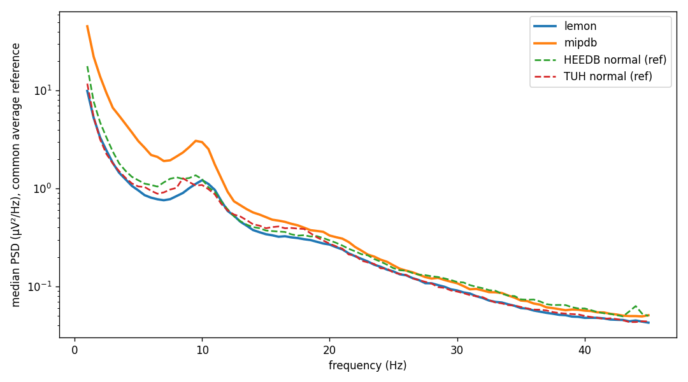
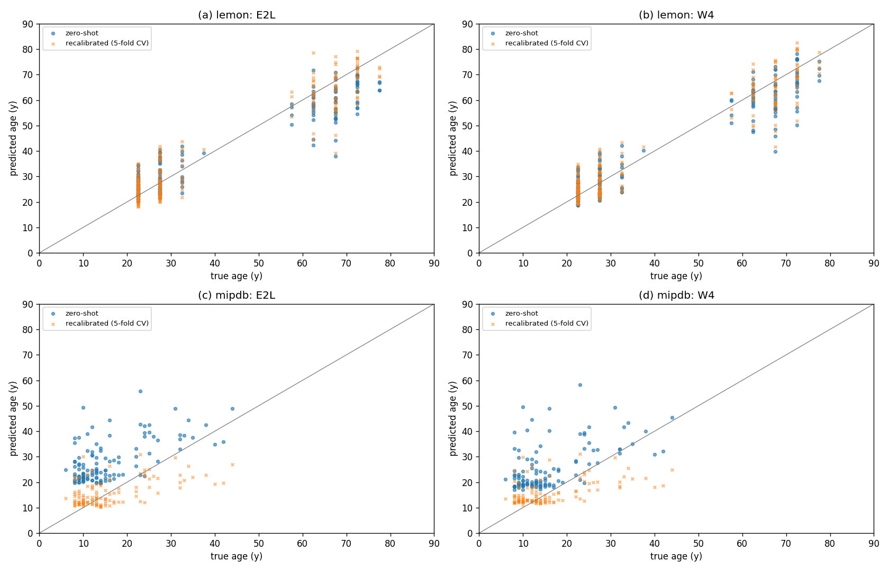

# Brain age on external cohorts: LEMON and MIPDB (zero-shot)

Results note, 2026-11-10. The best brain-age models trained on TUH + HEEDB
(cohort `tuh_heedb_v1`) are scored **without retraining** on two public
resting-state cohorts they never saw, MPI-LEMON and CMI MIPDB. CHBP and TDBRAIN
need a data use agreement and follow when access is in place.

Code:
- `dataset_maker/make_external_npy.py`: raw files to the npy cohort format;
- `scripts/eval_age_by_cohort.py`: scoring, now also bag (MIL) models,
  test-only cohorts, `--eval-minutes` and `--pred-stats`;
- `scripts/external_eval_report.py`: metrics, QC and figures.

Tables are in `docs/data/external_eval/`, and the per-recording predictions in
`/data/runs/heedb/external_eval/*.json`.

## 1. Data and storage

### Table 1.1. Cohorts

| cohort | source | n scored | age | recording | channels used |
|---|---|---|---|---|---|
| LEMON (Babayan et al. 2019) | `s3://fcp-indi/data/Projects/INDI/MPI-LEMON` (public) | 214 of 215 (sub-032492 has 80 s) | 20–80, published only as 5-year bins: young 20–40 (n = 144), old 55–80 (n = 70) | 16 min, 1-min blocks alternating eyes closed / open; BrainVision, 2500 Hz, FCz reference | 19 of 61 (10-20 positions; T7/T8/P7/P8 → T3/T4/T5/T6) |
| MIPDB (Langer et al. 2017) | `s3://fcp-indi/data/Projects/EEG_Eyetracking_CMI_data` (public; ages from `MIPDB_PublicFile.csv`) | 116 (all with a resting file) | 6–44, median 13; 52 aged 6–12, 33 aged 13–17, 31 adults | ≈ 6.5 min resting (trigger 90), eyes open 20 s / closed 40 s; EGI HydroCel 128, 500 Hz, vertex reference | 19 of 128, nearest 10-20 electrodes (Luu & Ferree 2005; Cz = vertex reference) |

Storage follows the TUH / HEEDB convention. Before writing, the bucket was
checked private with `download_heedb.check_private`.

| | local | S3 |
|---|---|---|
| raw | `/data/datasets/EEG-public/{LEMON,MIPDB}/raw` | `s3://eeg-data-public/{LEMON,MIPDB}/v1/raw` |
| metadata | `.../meta` | `.../v1/meta` |
| cohort | `.../cohorts/{lemon_v1,mipdb_v1}` | `.../v1/cohorts/` |

Each cohort has `manifest.json`, `age_metadata.json`, `age_split.json` (every
recording in test) and `recordings/*.npy`.

## 2. Preprocessing and its validation

Both corpora go through the training pipeline itself:
`make_TUH_npy.preprocess_raw`, the function every training cohort used, now
split out of the EDF reader. The steps:
- 0.1–75 Hz FIR band-pass;
- spectrum-interpolation line removal at 50 and 60 Hz;
- resampling to 200 Hz;
- µV, float16;
- the 23 TUH channels in model order, with A1/A2/T1/T2 absent (zero, `channel_mask`; the models drop them);
- whole 10 s windows.

The reference is kept as recorded, as for TUH and HEEDB, because the models
apply a common average reference at their input (`labram_plus.common_average_reference`).
MIPDB is the one exception: its vertex reference makes Cz identically zero, so
its 19 channels are re-referenced to their mean on reading. After the input
CAR this is equivalent to any other reference.

Evaluation uses the training protocol: the first 5 minutes after a 60 s trim
at both ends (at most 30 windows). Every window was also scored
(`--eval-minutes 0`, Table 3.1, last column).

### Table 2.1. Signal QC, median over recordings, first 5 min after the trim, common average reference

The reference sets are 100 random normal-report recordings of each training
corpus (TUH, HEEDB), shown only as aggregates.

| source | n | channel std (µV) | alpha peak (Hz), O1/O2 | delta | theta | alpha | beta | share of samples > 300 µV |
|---|---|---|---|---|---|---|---|---|
| TUH normal (training) | 100 | 9.96 | 9.00 | 0.495 | 0.124 | 0.136 | 0.131 | 0.000 |
| HEEDB normal (training) | 100 | 13.01 | 9.00 | 0.527 | 0.125 | 0.156 | 0.123 | 0.025 |
| **LEMON** | 215 | 8.98 | 9.75 | 0.452 | 0.130 | 0.183 | 0.139 | 0.000 |
| **MIPDB** | 116 | 18.95 | 9.75 | 0.611 | 0.135 | 0.133 | 0.066 | 0.002 |

The band powers are relative powers of 1–45 Hz (Welch, 2 s segments).

### Figure 2.1. Median power spectrum per source



Median PSD (µV²/Hz, log scale) over recordings and channels, 1–45 Hz. Solid
lines are the external cohorts, dashed lines the training references.

**What Table 2.1 and Figure 2.1 show:** the preprocessing reproduces the
training data's signal properties.
- LEMON's spectrum lies almost on TUH's: amplitude 9.0 vs 10.0 µV, similar
  band powers. Its alpha peak is slightly higher (9.75 vs 9.0 Hz), as
  expected for healthy, mostly young volunteers against clinical recordings.
- MIPDB has about twice the amplitude and more delta and less beta. That is
  the known EEG of children and adolescents, not a scaling error: its adults
  (Section 3) are predicted with errors similar to LEMON's young group.
- Neither cohort shows a residual 50 or 60 Hz line, and almost no samples
  exceed 300 µV.

## 3. Results

Predictions are de-normalised with the training-target statistics of
`tuh_heedb_v1` (mean 53.52, std 19.29; all models were trained on it).

The models:
- **E2:** TUH + HEEDB;
- **E2L:** E2 trained longer;
- **W4 / L1 / W7 / X1 / X3:** the attention-MIL models of `docs/mil_stage1_results.md`, scored bag-wise.

Columns, for recordings $r$ of a group $G$ with true age $y_r$ and prediction $\hat y_r$:

$$
\mathrm{MAE}=\tfrac1{|G|}\sum_r\lvert\hat y_r-y_r\rvert,\quad
\mathrm{bias}=\tfrac1{|G|}\sum_r(\hat y_r-y_r),\quad
R^2=1-\frac{\sum_r(\hat y_r-y_r)^2}{\sum_r(y_r-\bar y_G)^2}
\tag{3.1}
$$

$$
\mathrm{MAE}_\text{mean}=\tfrac1{|G|}\sum_r\lvert y_r-\bar y_G\rvert,\qquad
\hat y^\text{recal}_r=a_{-k}\hat y_r+b_{-k}
\tag{3.2}
$$

$\mathrm{MAE}_\text{mean}$ is the predict-the-mean baseline (it knows the
group's mean age). $\hat y^\text{recal}$ is a linear recalibration fitted on
the other four of five subject folds of the same cohort (OLS of $y$ on
$\hat y$). It uses the cohort's ages, so it is **not** zero-shot.

### Table 3.1. LEMON (n = 214; ages are 5-year bin midpoints)

| model | MAE | bias | Pearson r | R² | young MAE (bias) | old MAE (bias) | MAE recalibrated (CV) | MAE, every window |
|---|---|---|---|---|---|---|---|---|
| predict the mean | 18.60 | 0 | — | 0 | 2.96 | 3.90 | — | — |
| E2 | 5.81 | −0.37 | 0.94 | 0.86 | 4.52 (+3.35) | 8.47 (−8.04) | 5.13 | 5.75 |
| E2L | 5.22 | −1.11 | 0.95 | 0.88 | 3.88 (+1.97) | 7.97 (−7.43) | 4.82 | 5.20 |
| W4 | 4.62 | −1.31 | 0.95 | 0.90 | **3.55** (+0.48) | 6.82 (−5.00) | 4.55 | 4.51 |
| L1 | 4.68 | −1.24 | 0.95 | 0.90 | 3.75 (+0.32) | 6.61 (−4.44) | 4.65 | 4.56 |
| W7 | 4.66 | −1.20 | 0.95 | 0.90 | 3.73 (+0.41) | 6.57 (−4.52) | 4.60 | 4.59 |
| X1 | 4.53 | −0.50 | 0.95 | 0.91 | 3.68 (+1.24) | 6.29 (−4.08) | 4.54 | 4.50 |
| **X3** | **4.47** | −0.67 | **0.96** | **0.91** | 3.61 (+0.85) | **6.24** (−3.81) | **4.46** | **4.37** |
| X6 (bags 8–64) | 4.49 | −0.30 | 0.95 | 0.91 | 3.65 (+1.08) | 6.21 (−3.13) | 4.53 | 4.46 |

Binning alone costs about 1.25 y of MAE: the mean absolute distance of a
uniform age from its 5-year bin's midpoint.

### Table 3.2. MIPDB (n = 116; whole-year ages)

| model | MAE | bias | Pearson r | R² | 6–12 MAE | 13–17 MAE | adults 18–44 MAE (bias) | controls (DX 0, n = 93) MAE | MAE recalibrated (CV) |
|---|---|---|---|---|---|---|---|---|---|
| predict the mean | 6.32 | 0 | — | 0 | 1.21 | 1.16 | 5.85 | 6.84 | — |
| E2 | 13.11 | +13.03 | 0.63 | −2.26 | 16.40 | 10.87 | 9.97 (+9.68) | 11.96 | **4.90** |
| E2L | 12.66 | +12.43 | 0.59 | −2.07 | 15.86 | 10.83 | 9.22 (+8.37) | 11.57 | 5.06 |
| W4 | 10.28 | +9.83 | 0.55 | −1.39 | 13.22 | 8.30 | 7.43 (+5.77) | 9.36 | 5.19 |
| L1 | **10.01** | +9.57 | 0.55 | −1.34 | 13.17 | 7.78 | **7.10** (+5.45) | 9.05 | 5.25 |
| W7 | 10.03 | +9.48 | 0.55 | −1.31 | **13.02** | **7.75** | 7.44 (+5.43) | **9.00** | 5.26 |
| X1 | 11.46 | +11.04 | 0.52 | −1.81 | 15.03 | 9.01 | 8.09 (+6.53) | 10.31 | 5.46 |
| X3 | 11.31 | +10.89 | 0.51 | −1.82 | 14.77 | 9.06 | 7.89 (+6.33) | 10.14 | 5.49 |

### Figure 3.1. Predicted vs. true age



Each recording is a point (years). Circles are the zero-shot predictions,
crosses the 5-fold recalibrated ones of Eq. (3.2):
- (a) LEMON, E2L;
- (b) LEMON, W4;
- (c) MIPDB, E2L;
- (d) MIPDB, W4.

**What Tables 3.1–3.2 and Figure 3.1 show:**

* **LEMON transfers well.**
  - Every model separates the young and old groups (r 0.94–0.96).
  - MAE is 4.5–5.8 y, of which about 1.25 y is the bin quantisation.
  - The attention models are 0.6 y better than E2L and 1.2–1.3 y better
    than E2, the same order as on our own test set (`mil_stage1_results.md`
    Section 12).
  - Recalibrating on LEMON itself barely helps (4.46–5.13). The zero-shot
    predictions are already calibrated for this age range.
* **But LEMON rewards group separation.**
  - Within a group, the models do not rank ages: r ≈ 0.45, and MAE is above
    the group-mean baseline (young 3.6 vs 3.0, old 6.2–8.5 vs 3.9).
  - The old group is predicted 4–8 y too young: the same regression to the
    mean seen at 70+ on our test set. The attention models halve E2's bias
    (−3.8 to −5.0 vs −8.0).
  - R² 0.86–0.91 is therefore mostly the two-group structure. MAE and the
    per-group numbers are the informative ones, as Engemann et al. note.
* **MIPDB is outside the training age range.**
  - Children are predicted 13–16 y too old. No prediction falls below about
    18 y (Figure 3.1(c, d)): the training cohorts hold almost no children
    (HEEDB is adult-only).
  - Predictions still increase with age (r 0.51–0.63). A cohort-specific
    linear recalibration brings MAE to 4.9–5.5 y, but that uses MIPDB's ages.
  - MIPDB's adults (18–44, n = 31) are predicted with MAE 7.1–7.4 and a
    +5.5 y bias (L1, W7, W4).
  - Again the attention models beat E2/E2L by 2.5–3 y. Among them, L1 and
    W7 are best and the 20-epoch X runs worst.
* **Every window vs. 5 minutes:** on LEMON, scoring all ≈ 14 min instead of
  5 lowers MAE by 0.05–0.1 y for the attention models (X3 4.47 → 4.37) and
  changes nothing for E2/E2L. On MIPDB the recordings are short, so it makes
  no difference.

## 4. Comparison with the literature

### Table 4.1. Published brain-age results on these cohorts (verified against the sources)

Protocol:
- **WD-CV:** trained and tested within the dataset, cross-validated;
- **cross:** trained on another corpus, applied without retraining.

| cohort | paper | protocol | model | MAE | R² |
|---|---|---|---|---|---|
| LEMON | Engemann et al. 2022, *NeuroImage* 262:119521 (Table 1; n = 227, exact ages) | WD-CV 10-fold | Deep4Net | 7.75 ± 1.78 | 0.69 ± 0.16 |
| | | | ShallowNet / filterbank-source | 8.67 / 8.67 | 0.69 / 0.67 |
| | | | filterbank-riemann / handcrafted + RF | 10.78 / 10.23 | 0.54 / 0.51 |
| | | | dummy (mean) | 18.70 | −0.13 |
| | Mellot et al. 2023, *Imaging Neurosci.* (n = 213) | cross: TUAB normal → LEMON | Riemann, without / with re-centring | — | ≈ 0.26 / 0.44 ± 0.06 |
| | Hajhassani et al. 2026, arXiv:2609.31195 (preprint) | cross: TUEG → LEMON, zero-shot | GEDAI + CTNet | 9.91 | 0.632 |
| | **ours** (n = 214, bin midpoints) | **cross: TUH + HEEDB → LEMON, zero-shot** | **X3 / W4 / E2L** | **4.47 / 4.62 / 5.22** | **0.91 / 0.90 / 0.88** |
| MIPDB | none found | — | — | — | — |
| | **ours** (n = 116) | cross, zero-shot | L1 / W7 | 10.01 / 10.03 | −1.34 / −1.31 |

**What Table 4.1 shows:**
* **On LEMON the zero-shot models beat every published number.** That
  includes models trained on LEMON itself: MAE 4.5 vs 7.75 (Engemann's
  Deep4Net) and R² 0.91 vs 0.69. Against the closest protocol, a TUEG-trained
  model applied zero-shot (Hajhassani 2026), the gap is 4.5 vs 9.9 y MAE.
* **The comparison has caveats.**
  - Engemann et al. had exact ages; we use bin midpoints, which add about
    1.25 y of MAE to our numbers.
  - Their recordings and epoching differ (EC + EO pooled, their own
    preprocessing).
  - The papers report no per-group (young / old) numbers, where our models
    are no better than the group mean.
* **MIPDB has no published age-regression result.** Ours is a first, and
  shows the limit of the training data: children.

## 5. LEMON as a standing test set during training

Every age fine-tune now scores extra test sets each epoch, next to the regular
test split (`evaluation.test_sets`, `labram/data/test_sets.py`). The age
configs default to:

```json
"test_sets": ["temple", "lemon=/data/datasets/EEG-public/LEMON/cohorts/lemon_v1"]
```

- `temple` is the TUH part of the run's own test split, i.e. the TUAB eval
  set for `tuh_heedb_v1`.
- `lemon` is this cohort, scored zero-shot with the run's own window
  selection and training-target statistics.

Both are logged like the test split:
- ClearML heads `test_temple`, `test_lemon`;
- console `Test[lemon] EEG mae: …`;
- `best_test_set_stats` in the run summary and `test_<name>_*` final metrics.

On SageMaker the LEMON folder is mounted from its S3 copy
(`sagemaker.data_s3_uris`) as the input channel `test_lemon`. Data that is
missing on a machine is skipped with a warning. Add MIPDB with
`--set 'evaluation.test_sets=["temple","lemon=…","mipdb=/data/datasets/EEG-public/MIPDB/cohorts/mipdb_v1"]'`.

## 6. Not yet done

- **CHBP and TDBRAIN** need a data use agreement (Synapse; brainclinics.com).
  The converter takes a new reader per corpus in `make_external_npy.DATASETS`.
- **A3 and the frozen-feature pools** were not scored. A3 needs the
  test-time-augmentation window cache.
- **Comparators the papers suggest:** unsupervised re-centring (Mellot 2023)
  and a children-aware model, i.e. training data with paediatric EEG, for
  cohorts like MIPDB.
