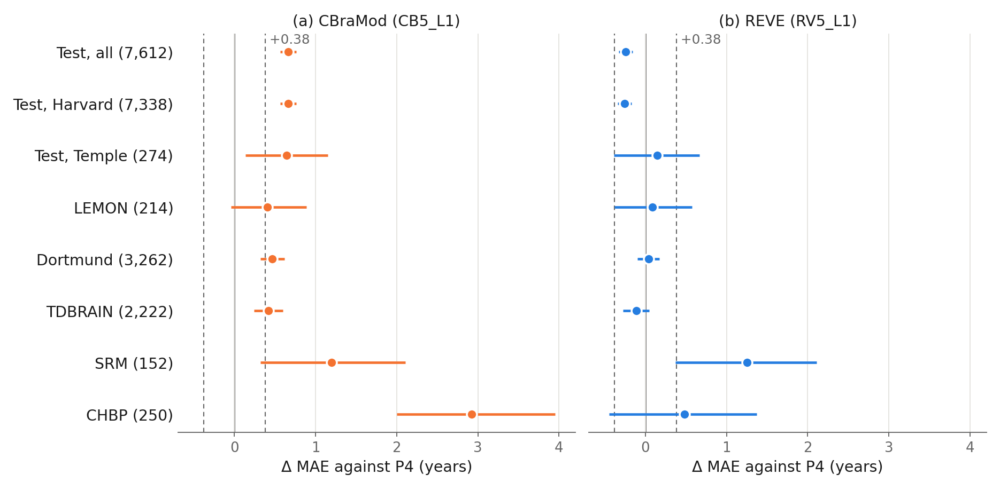

# LaBraM, CBraMod and REVE for EEG brain age: summary

**[PDF version](fm_encoder_summary.pdf)**

State of 28 Nov 2026. A short version of `docs/fm_encoder_onboarding.md`, which has every run,
setting and intermediate result. This summary compares the current best model, **P4**
(LaBraM-base fine-tuned with the P4 recipe), with the best fine-tuned model of each of the two
foreign encoders: **CBraMod** (`CB5_L1`) and **REVE** (`RV5_L1`) (Table 1.1). All three were
trained and selected on the same fold (fold 0 of P4's 5-fold subject split) and scored on the same
recordings.

**Result in brief.**

- **REVE with its authors' fine-tuning protocol passes the decision rule against LaBraM on fold
  0.** It is 0.24 years better on the 7,612 test recordings, all of it on the Harvard part, and
  level with P4 on LEMON, Dortmund, TDBRAIN and CHBP; it is 1.25 years worse on SRM (Table 3.1).
- **CBraMod does not replace LaBraM.** With its authors' settings it is 0.66 years worse on test
  and 0.4 to 2.9 years worse on every external cohort (Table 3.1).
- **Per pathology group REVE is more accurate than P4 in 11 of 12 Harvard groups** and keeps the
  brain-age gaps of the pathology groups, slightly larger than P4's (Tables 5.1 and 5.3).
- **As a sixth member of LaBraM's 5-fold ensemble, REVE lowers the error on every cohort**
  (Table 6.1).
- **One fold only.** REVE's other four folds are running and end on 30 Nov and 1 Dec (Section 7).

## 1. Models compared

### Table 1.1. The three models

All three use P4's split, schedule (17 epochs: 8 on single windows, 1 that trains the pool only,
8 on bags of 8 windows per recording), bags, pool and evaluation; they differ in the encoder and
in how it is fine-tuned. Training time is for one fold on one A10G; inference speed is 10 s
windows of 19 channels per second on one A10G (`docs/fm_encoder_onboarding.md`, Table 7.1).

| | P4 (LaBraM-base) | `CB5_L1` (CBraMod) | `RV5_L1` (REVE-base) |
|---|---|---|---|
| Weights | 5.8 M | 12.5 M (encoder 4.9 M, all-token readout 7.6 M) | 69.3 M |
| Pretraining data | about 2,500 h | TUEG, about 9,000 h | over 60,000 h, 92 datasets |
| Fine-tuning | peak learning rate 2.8e-4 with layer-wise decay 0.65, mixup | its authors' settings: every encoder layer at 1e-4, head 5e-4, gradient clip 1, readout over all channel × patch tokens, no mixup | its authors' protocol: head only in epoch 0, then every layer at 1e-4, gradient clip 2, pretrained attention pooling, noise on electrode positions, mixup |
| Training time per fold | 12.8 h | about 13 h | about 40 h |
| Inference speed | 2,726 windows/s | 3,329 windows/s | 820 windows/s |

### Table 1.2. All fine-tuning runs of the two encoders

Fold 0, each run at its best validation epoch; MAE in years (Eq. (2.1)) on the fold-0 validation
recordings and on the 7,612 test recordings. The two bold runs are the ones compared in this
summary.

| Run | Encoder and recipe | Validation | Test |
|---|---|---|---|
| P4 | LaBraM, P4 recipe (reference) | 6.59 | 6.06 |
| `CB4_L1` | CBraMod, P4 recipe | 8.56 | 8.19 |
| **`CB5_L1`** | **CBraMod, its authors' settings** | **7.18** | **6.72** |
| `RV4_L1` | REVE, P4 recipe | stopped after epoch 5 (7.87) | (7.57) |
| `RV4T6_L1` | REVE, P4 recipe, only the last 6 of 22 layers trained | 7.17 | 6.63 |
| `RV4DP_L1` | REVE, P4 recipe with stochastic depth | 6.55 | 5.94 |
| **`RV5_L1`** | **REVE, its authors' protocol** | **6.43** | **5.81** |

## 2. Metrics

For recording $r$ with chronological age $y_r$ (years) and the model's prediction $\hat{y}_r$
(years; the model pools all scored windows of the recording), the error of a model on a set of
$n$ recordings is

$$
\mathrm{MAE} = \frac{1}{n} \sum_{r} \left| \hat{y}_r - y_r \right|
\tag{2.1}
$$

and the comparison of a model with P4 on the same recordings is the paired difference

$$
\Delta = \mathrm{MAE}_{\mathrm{model}} - \mathrm{MAE}_{\mathrm{P4}}
\tag{2.2}
$$

negative when the model is better. Its 95 % interval comes from 2,000 bootstrap resamples of the
recordings (`labram/eval/cv_compare.py::bootstrap_delta_mae`), or of the subjects where a subject
has several recordings (Section 5). **Decision rule** (fixed before the runs): a difference
counts when its interval excludes 0 or it exceeds 0.38 years; an encoder replaces LaBraM only if
it wins on the Harvard test recordings and does not lose on LEMON and Dortmund.

Test recordings are scored on their first 5 minutes; the external cohorts on every window of
their adults (`scripts/external_runs/fm_external.sh`, `scripts/fm_external_compare.py`).

## 3. Accuracy per cohort

### Table 3.1. MAE per cohort

MAE in years (Eq. (2.1)); Δ against P4 (Eq. (2.2)) with its 95 % interval. Validation is each
run's logged value (no interval). LEMON, Dortmund and SRM hold healthy adults; TDBRAIN adults
with and without a psychiatric indication; CHBP healthy adults recorded with another device.

| Cohort | $n$ | P4 | CBraMod | Δ CBraMod | REVE | Δ REVE |
|---|---|---|---|---|---|---|
| Validation (fold 0) | 19,071 | 6.59 | 7.18 | +0.59 | 6.43 | −0.16 |
| Test, all | 7,612 | 6.06 | 6.72 | +0.66 [+0.56, +0.76] | 5.81 | −0.24 [−0.33, −0.16] |
| Test, Harvard | 7,338 | 6.05 | 6.71 | +0.66 [+0.57, +0.76] | 5.79 | −0.26 [−0.34, −0.17] |
| Test, Temple | 274 | 6.32 | 6.97 | +0.64 [+0.13, +1.15] | 6.47 | +0.15 [−0.39, +0.66] |
| LEMON | 214 | 4.73 | 5.14 | +0.40 [−0.04, +0.89] | 4.82 | +0.09 [−0.38, +0.57] |
| Dortmund | 3,262 | 5.29 | 5.75 | +0.46 [+0.32, +0.62] | 5.33 | +0.04 [−0.10, +0.17] |
| TDBRAIN | 2,222 | 5.48 | 5.90 | +0.42 [+0.24, +0.60] | 5.37 | −0.11 [−0.27, +0.05] |
| SRM | 152 | 5.01 | 6.20 | +1.20 [+0.32, +2.11] | 6.26 | +1.25 [+0.37, +2.11] |
| CHBP | 250 | 7.45 | 10.38 | +2.92 [+2.00, +3.95] | 7.93 | +0.48 [−0.44, +1.37] |

### Figure 3.1. Paired differences against P4 per cohort

The rows of Table 3.1 with an interval: Δ (Eq. (2.2), dot) and its 95 % interval (line), years,
recordings in brackets; the solid line is 0, the dashed lines the ±0.38-year threshold of the
decision rule. (a) CBraMod (`CB5_L1`), (b) REVE (`RV5_L1`).

- **REVE passes the decision rule; CBraMod does not** (Table 3.1, Figure 3.1). REVE wins on the
  Harvard test recordings (−0.26 years) and does not lose on LEMON (+0.09) or Dortmund (+0.04).
  CBraMod loses on the Harvard test recordings (+0.66) and on Dortmund (+0.46).
- **REVE's gain is in the training domain.** Outside it REVE is level with P4 on four cohorts
  and 1.25 years worse on SRM, the smallest cohort (152 recordings). On the Temple test
  recordings it is level (+0.15, interval −0.39 to +0.66, 274 recordings).
- **CBraMod is behind everywhere,** and furthest on CHBP (+2.92), whose recordings come from
  another device.

## 4. By EEG-report status

### Table 4.1. MAE by report status

The test recordings split by the verdict of their clinical EEG report (normal, abnormal, or
unlabelled = no report in the source data; all unlabelled test recordings are from Harvard),
and TDBRAIN adults split into healthy participants and all others. Columns as Table 3.1.

| Cohort | Report | $n$ | P4 | CBraMod | Δ CBraMod | REVE | Δ REVE |
|---|---|---|---|---|---|---|---|
| Test | normal | 1,667 | 5.62 | 6.35 | +0.73 [+0.54, +0.92] | 5.44 | −0.18 [−0.33, −0.02] |
| Test | abnormal | 2,378 | 6.71 | 7.43 | +0.71 [+0.52, +0.90] | 6.49 | −0.22 [−0.38, −0.05] |
| Test | unlabelled | 3,567 | 5.82 | 6.42 | +0.60 [+0.47, +0.74] | 5.53 | −0.29 [−0.41, −0.17] |
| Test, Temple | normal | 149 | 4.65 | 5.53 | +0.88 [+0.29, +1.50] | 4.65 | −0.00 [−0.55, +0.56] |
| Test, Temple | abnormal | 125 | 8.31 | 8.68 | +0.36 [−0.46, +1.21] | 8.64 | +0.32 [−0.60, +1.24] |
| TDBRAIN adults | healthy | 354 | 5.43 | 6.33 | +0.90 [+0.39, +1.45] | 5.41 | −0.02 [−0.49, +0.46] |
| TDBRAIN adults | all others | 1,868 | 5.49 | 5.81 | +0.33 [+0.13, +0.53] | 5.36 | −0.13 [−0.31, +0.05] |

- **REVE is better in every report group of the test recordings** (Table 4.1), by 0.18 to 0.29
  years with intervals that exclude 0; on the small Temple groups it is level.
- **Abnormal recordings are harder for all three models,** by about 1.1 years on test for P4 and
  REVE.

## 5. Brain age per pathology group

Recordings: every adult recording of fold 0 that none of the three models trained on, i.e. the
validation fold (used only to pick each model's best epoch) and the test split: 20,301 Harvard
and 6,380 Temple recordings. P4's validation predictions were re-scored from its best checkpoint
with `scripts/eval_age_by_cohort.py --cv-fold` and reproduce its logged validation MAE (6.59).
Groups (`scripts/pathology_brain_age.py`): the report status; the **reference** group, recordings
with a normal report and a health record without any of the pathology groups; and the pathology
groups of the cohort's clinical targets (ICD-10 groups for Harvard, NEDC clinical-sheet groups for
Temple; a patient can be in several groups). Cells with fewer than 30 recordings or 10 subjects
are suppressed; the tables show groups with at least 30 subjects (the others are in
`docs/data/fm_encoders/pathology_fold0.csv`).

The brain-age gap of recording $r$ is

$$
g_r = \hat{y}_r - y_r
\tag{5.1}
$$

positive when the model predicts an older age. To compare a group $G$ with the reference group at
the same age and sex, the gap is regressed on the recordings of $G$ and of the reference group:

$$
g_r = \beta_1 \mathbf{1}[r \in G] + c_{b(r)} + \beta_2 a_r + \beta_3 m_r + \varepsilon_r
\tag{5.2}
$$

where $c_{b(r)}$ is one intercept per 5-year age band (85+ is one band), $a_r$ the age in decades
around its mean, $m_r$ = 1 for men; the standard errors are clustered by subject
(`pathology_brain_age.py::adjusted`). The **adjusted gap** of the group is the coefficient of
its indicator in Eq. (5.2):

$$
\mathrm{gap}_{\mathrm{adj}}(G) = \beta_1
\tag{5.3}
$$

in years: how much older the group looks than the reference at the same age and sex. A less
accurate model has noisier gaps, so the adjusted gap is also expressed in units of the
reference group's spread:

$$
d(G) = \frac{\mathrm{gap}_{\mathrm{adj}}(G)}{\sigma_{\mathrm{ref}}}
\tag{5.4}
$$

where $\sigma_{\mathrm{ref}}$ is the standard deviation of the reference group's gap (Eq. (5.1))
around its age-band means (Harvard: 6.97 years for P4, 7.45 for CBraMod, 6.80 for REVE). In
Tables 5.1 and 5.2 the interval of Δ (Eq. (2.2)) resamples subjects, so that a patient's recordings stay
together (`scripts/fm_pathology_compare.py`).

### Table 5.1. MAE per pathology group, Harvard

MAE in years (Eq. (2.1)) on the pooled held-out Harvard recordings of fold 0; Δ against P4
(Eq. (2.2)) with a 95 % subject-bootstrap interval. The group's mean age is in brackets.

| Group (mean age) | $n$ | Subjects | P4 | CBraMod | Δ CBraMod | REVE | Δ REVE |
|---|---|---|---|---|---|---|---|
| normal report (48 y) | 4,150 | 3,854 | 5.61 | 6.22 | +0.62 [+0.50, +0.74] | 5.42 | −0.18 [−0.28, −0.08] |
| abnormal report (59 y) | 6,253 | 5,066 | 6.72 | 7.37 | +0.65 [+0.53, +0.78] | 6.49 | −0.23 [−0.34, −0.12] |
| no report (53 y) | 9,898 | 8,320 | 5.93 | 6.53 | +0.60 [+0.51, +0.69] | 5.67 | −0.26 [−0.34, −0.18] |
| healthy reference (46 y) | 896 | 858 | 5.51 | 6.23 | +0.71 [+0.46, +0.95] | 5.38 | −0.14 [−0.36, +0.08] |
| clinical seizures (50 y) | 6,480 | 4,505 | 5.94 | 6.79 | +0.85 [+0.73, +0.97] | 5.73 | −0.21 [−0.32, −0.11] |
| electrographic seizures (53 y) | 1,449 | 1,301 | 6.49 | 7.44 | +0.95 [+0.70, +1.20] | 6.39 | −0.09 [−0.32, +0.13] |
| epilepsy (50 y) | 6,448 | 4,477 | 5.94 | 6.78 | +0.84 [+0.72, +0.97] | 5.73 | −0.21 [−0.32, −0.11] |
| stroke (65 y) | 2,096 | 1,484 | 6.80 | 7.36 | +0.56 [+0.34, +0.80] | 6.48 | −0.32 [−0.53, −0.12] |
| depression (56 y) | 3,652 | 2,753 | 6.26 | 6.91 | +0.66 [+0.50, +0.82] | 5.98 | −0.28 [−0.41, −0.15] |
| dementia (72 y) | 1,495 | 1,052 | 6.80 | 6.71 | −0.09 [−0.34, +0.16] | 6.64 | −0.16 [−0.37, +0.05] |
| multiple sclerosis (53 y) | 277 | 204 | 6.47 | 7.44 | +0.97 [+0.40, +1.56] | 6.53 | +0.06 [−0.39, +0.57] |
| other diagnosis (54 y) | 953 | 719 | 6.06 | 6.96 | +0.89 [+0.59, +1.21] | 5.96 | −0.11 [−0.35, +0.13] |
| headache / migraine (54 y) | 4,943 | 3,718 | 6.10 | 6.86 | +0.75 [+0.61, +0.88] | 5.94 | −0.17 [−0.28, −0.06] |
| sleep disorders (58 y) | 4,076 | 3,101 | 6.19 | 6.65 | +0.46 [+0.32, +0.61] | 5.96 | −0.23 [−0.35, −0.10] |
| CNS tumours (58 y) | 1,099 | 823 | 6.50 | 7.13 | +0.64 [+0.34, +0.91] | 6.35 | −0.14 [−0.39, +0.10] |
| movement disorders (59 y) | 2,775 | 1,997 | 6.51 | 7.24 | +0.73 [+0.54, +0.93] | 6.39 | −0.13 [−0.29, +0.04] |

### Table 5.2. MAE per pathology group, Temple

As Table 5.1, for the pooled held-out Temple recordings of fold 0.

| Group (mean age) | $n$ | Subjects | P4 | CBraMod | Δ CBraMod | REVE | Δ REVE |
|---|---|---|---|---|---|---|---|
| normal report (47 y) | 2,444 | 1,450 | 6.43 | 6.93 | +0.50 [+0.25, +0.75] | 6.32 | −0.11 [−0.35, +0.15] |
| abnormal report (55 y) | 3,443 | 1,646 | 8.20 | 8.72 | +0.52 [+0.26, +0.80] | 8.18 | −0.01 [−0.31, +0.31] |
| no report (56 y) | 493 | 138 | 7.85 | 9.08 | +1.23 [+0.18, +2.24] | 8.31 | +0.46 [−0.38, +1.27] |
| healthy reference (48 y) | 2,103 | 1,229 | 6.41 | 6.84 | +0.44 [+0.17, +0.70] | 6.34 | −0.06 [−0.34, +0.21] |
| clinical seizures (49 y) | 403 | 203 | 7.70 | 7.61 | −0.09 [−0.87, +0.76] | 7.02 | −0.68 [−1.76, +0.23] |
| epilepsy (46 y) | 131 | 58 | 7.24 | 7.59 | +0.36 [−1.20, +1.75] | 7.66 | +0.43 [−0.94, +1.77] |
| stroke (65 y) | 226 | 97 | 8.94 | 7.92 | −1.02 [−2.03, +0.02] | 9.13 | +0.20 [−0.81, +1.43] |
| traumatic brain injury (45 y) | 74 | 34 | 10.09 | 10.72 | +0.62 [−0.35, +1.60] | 6.28 | −3.82 [−7.55, +0.16] |
| substance use (46 y) | 274 | 140 | 9.09 | 10.49 | +1.40 [+0.49, +2.22] | 9.22 | +0.12 [−0.94, +1.39] |
| bipolar disorder (44 y) | 74 | 57 | 6.20 | 7.96 | +1.76 [+0.71, +2.85] | 7.03 | +0.83 [−0.96, +2.89] |

### Table 5.3. Brain-age gap per pathology group, adjusted for age and sex

Adjusted gap (Eq. (5.3)) in years against the reference group of the same dataset, with its 95 %
interval (subject-clustered); * marks a Benjamini-Hochberg-adjusted $q$ < 0.05 over the
pathology groups of one model and dataset (report rows are not in that set). Positive: the group
looks older than healthy people of the same age and sex.

| Dataset | Group | $n$ | P4 | CBraMod | REVE |
|---|---|---|---|---|---|
| Harvard | abnormal report | 6,253 | +1.81 [+1.24, +2.37] | +2.97 [+2.36, +3.57] | +2.12 [+1.56, +2.67] |
| Harvard | no report | 9,898 | +0.45 [−0.05, +0.95] | +1.16 [+0.63, +1.69] | +0.47 [−0.01, +0.96] |
| Harvard | clinical seizures | 6,480 | +0.61* [+0.08, +1.14] | +1.42* [+0.86, +1.98] | +0.71* [+0.19, +1.23] |
| Harvard | electrographic seizures | 1,449 | +1.26* [+0.55, +1.97] | +2.19* [+1.44, +2.94] | +1.43* [+0.73, +2.12] |
| Harvard | epilepsy | 6,448 | +0.60* [+0.07, +1.13] | +1.40* [+0.84, +1.97] | +0.70* [+0.18, +1.22] |
| Harvard | stroke | 2,096 | +2.50* [+1.75, +3.26] | +3.98* [+3.16, +4.79] | +2.90* [+2.14, +3.66] |
| Harvard | depression | 3,652 | +1.21* [+0.64, +1.78] | +2.12* [+1.52, +2.73] | +1.29* [+0.74, +1.84] |
| Harvard | dementia | 1,495 | +2.20* [+1.29, +3.11] | +3.75* [+2.76, +4.75] | +2.49* [+1.55, +3.43] |
| Harvard | multiple sclerosis | 277 | +1.79* [+0.56, +3.03] | +2.80* [+1.49, +4.10] | +1.80* [+0.61, +2.99] |
| Harvard | other diagnosis | 953 | +0.96* [+0.23, +1.69] | +1.95* [+1.14, +2.75] | +1.12* [+0.41, +1.84] |
| Harvard | headache / migraine | 4,943 | +0.84* [+0.30, +1.39] | +1.79* [+1.21, +2.38] | +0.90* [+0.37, +1.43] |
| Harvard | sleep disorders | 4,076 | +0.94* [+0.36, +1.52] | +1.71* [+1.07, +2.35] | +0.90* [+0.32, +1.48] |
| Harvard | CNS tumours | 1,099 | +1.13* [+0.38, +1.88] | +2.28* [+1.48, +3.08] | +1.38* [+0.64, +2.12] |
| Harvard | movement disorders | 2,775 | +1.76* [+1.14, +2.39] | +2.98* [+2.28, +3.67] | +2.04* [+1.41, +2.67] |
| Temple | abnormal report | 3,443 | +1.95 [+1.12, +2.77] | +2.75 [+1.95, +3.54] | +3.05 [+2.26, +3.83] |
| Temple | no report | 493 | +0.90 [−0.51, +2.30] | +1.62 [+0.12, +3.12] | +2.13 [+0.78, +3.47] |
| Temple | clinical seizures | 403 | −0.67 [−2.55, +1.20] | +0.42 [−1.25, +2.09] | +0.05 [−1.46, +1.55] |
| Temple | epilepsy | 131 | −0.72 [−4.02, +2.58] | +0.01 [−3.18, +3.21] | −0.29 [−3.71, +3.12] |
| Temple | stroke | 226 | −1.05 [−3.30, +1.21] | +0.04 [−2.17, +2.24] | −0.17 [−2.77, +2.43] |
| Temple | traumatic brain injury | 74 | +4.73 [−1.22, +10.67] | +4.64 [−0.04, +9.31] | +3.32* [+1.22, +5.43] |
| Temple | substance use | 274 | +3.68* [+1.24, +6.12] | +4.95* [+2.53, +7.38] | +5.11* [+2.69, +7.52] |
| Temple | bipolar disorder | 74 | +3.01* [+0.78, +5.24] | +4.04* [+1.70, +6.37] | +1.97 [−0.91, +4.86] |

### Table 5.4. Adjusted gap in units of the reference group's spread (Harvard)

$d(G)$ of Eq. (5.4) for the Harvard pathology groups of Table 5.3.

| Group | $n$ | P4 | CBraMod | REVE |
|---|---|---|---|---|
| clinical seizures | 6,480 | 0.09 | 0.19 | 0.10 |
| electrographic seizures | 1,449 | 0.18 | 0.29 | 0.21 |
| epilepsy | 6,448 | 0.09 | 0.19 | 0.10 |
| stroke | 2,096 | 0.36 | 0.53 | 0.43 |
| depression | 3,652 | 0.17 | 0.29 | 0.19 |
| dementia | 1,495 | 0.32 | 0.50 | 0.37 |
| multiple sclerosis | 277 | 0.26 | 0.38 | 0.27 |
| other diagnosis | 953 | 0.14 | 0.26 | 0.17 |
| headache / migraine | 4,943 | 0.12 | 0.24 | 0.13 |
| sleep disorders | 4,076 | 0.13 | 0.23 | 0.13 |
| CNS tumours | 1,099 | 0.16 | 0.31 | 0.20 |
| movement disorders | 2,775 | 0.25 | 0.40 | 0.30 |

### Figure 5.1. Brain-age gap per pathology group on the Harvard recordings

The Harvard pathology groups of Tables 5.3 and 5.4, recordings in brackets, sorted by P4's
adjusted gap; P4, CBraMod and REVE. (a) Adjusted gap in years (Eq. (5.3)) with its 95 %
interval; (b) the same in units of the reference group's spread (Eq. (5.4)).

- **REVE is more accurate than P4 in almost every Harvard group** (Table 5.1): its MAE is lower
  in 11 of the 12 pathology groups (multiple sclerosis +0.06), with an interval that excludes 0
  in six of them (clinical seizures, epilepsy, stroke, depression, headache, sleep disorders).
  CBraMod is less accurate than P4 in 11 of 12 groups; only in dementia it is level.
- **All three models find every Harvard pathology group older than healthy people of the same age
  and sex** (Table 5.3, all $q$ < 0.05), and in nearly the same order: stroke and dementia first
  (2.2 to 4.0 years), then multiple sclerosis and movement disorders, epilepsy last (0.6 to 1.4
  years) (Figure 5.1(a)).
- **REVE's gaps are slightly larger than P4's, CBraMod's much larger.** REVE's adjusted gap is
  −0.04 to +0.40 years above P4's, CBraMod's 0.8 to 1.6 years above. In units of the reference
  group's spread (Table 5.4, Figure 5.1(b)) REVE separates the groups by 0.00 to 0.07 more than
  P4, CBraMod by 0.10 to 0.18 more. REVE therefore combines a lower error on healthy people with
  at least P4's separation of the patient groups. Why CBraMod separates them most is not tested:
  most recordings of these groups have an abnormal report, so a model that reads EEG abnormality
  as age would show the same pattern.
- **Temple groups are small** (34 to 203 subjects) and their intervals wide (Tables 5.2 and 5.3).
  Substance use has the largest gap in all three models (3.7 to 5.1 years). In Temple, clinical
  seizures, epilepsy and stroke show no gap in any model, unlike in Harvard; the two datasets
  define the groups differently (NEDC sheet against ICD-10 codes).

## 6. In an ensemble with LaBraM

### Table 6.1. LaBraM's 5-fold ensemble with one more model

"P4 ensemble (LaBraM CrossValid)": the mean of the predictions of the 5 P4 models, one per
cross-validation fold; "+ model": the same ensemble with CBraMod or REVE as a sixth member of
equal weight, Δ against the P4 ensemble with its 95 % interval. MAE in years (Eq. (2.1)). The
first row is the number of weights of all models of the ensemble.

| Cohort | $n$ | P4 ensemble (LaBraM CrossValid) | + CBraMod | Δ | + REVE | Δ |
|---|---|---|---|---|---|---|
| Weights | | 29.2 M | 41.7 M | +12.5 M | 98.5 M | +69.3 M |
| Test, all | 7,612 | 5.94 | 5.94 | −0.00 [−0.02, +0.02] | 5.83 | −0.12 [−0.13, −0.10] |
| Test, Harvard | 7,338 | 5.94 | 5.94 | −0.00 [−0.02, +0.02] | 5.82 | −0.12 [−0.13, −0.11] |
| Test, Temple | 274 | 6.02 | 6.00 | −0.02 [−0.11, +0.08] | 5.95 | −0.07 [−0.16, +0.02] |
| LEMON | 214 | 4.67 | 4.69 | +0.02 [−0.06, +0.11] | 4.59 | −0.08 [−0.16, +0.01] |
| Dortmund | 3,262 | 5.16 | 5.08 | −0.08 [−0.11, −0.05] | 5.01 | −0.15 [−0.18, −0.12] |
| TDBRAIN | 2,222 | 5.36 | 5.28 | −0.08 [−0.11, −0.05] | 5.19 | −0.17 [−0.20, −0.14] |
| SRM | 152 | 4.84 | 4.67 | −0.17 [−0.35, +0.01] | 4.60 | −0.25 [−0.43, −0.07] |
| CHBP | 250 | 7.95 | 7.81 | −0.14 [−0.35, +0.06] | 7.55 | −0.40 [−0.57, −0.25] |

- **REVE improves LaBraM's ensemble on every cohort** (Table 6.1), by 0.07 to 0.40 years; the
  interval excludes 0 on six of eight rows (not on Temple test and LEMON). It helps on SRM too,
  where it is worse than P4 alone (Table 3.1): its errors differ from P4's.
- **CBraMod helps on Dortmund and TDBRAIN only** (−0.08 years each).

## 7. Conclusions and next steps

- **REVE-base, fine-tuned with its authors' protocol, is the first encoder that is better than
  LaBraM on this task on the same fold**: 0.24 years on the in-domain test recordings, more
  accurate in almost every report and pathology group, with the pathology gaps kept, and level
  outside the training domain except on SRM (Tables 3.1, 4.1, 5.1, 5.3). The recipe matters:
  REVE fine-tuned with LaBraM's recipe over-fitted, and with only its last layers trained it was
  0.57 years behind P4 (Table 1.2).
- **CBraMod is not a replacement**: behind P4 with either recipe, on every cohort.
- **The cost is real**: 12 times P4's weights, about 3 times the training time per fold and 3.3
  times the inference time.
- **The open question is the other folds.** One fold can show a gain that does not repeat.
  REVE's folds 1 to 4 run since 28 Nov, 11:20 UTC (folds 2 and 3 on SageMaker, folds 1 and 4 on
  the local GPU); folds 1 to 3 end about 30 Nov, 03:00 UTC, fold 4 about 1 Dec, 19:00 UTC
  (`docs/fm_encoder_onboarding.md`, Table 7.2). With all five folds this summary will compare
  REVE's 5-fold ensemble with P4's and with both together, and the pathology analysis will use
  every training-cohort recording once (out of fold).
- **Not yet explained:** REVE's loss on SRM (+1.25 years, 152 recordings), and which settings of
  the authors' protocol carry the gain over LaBraM's recipe.
