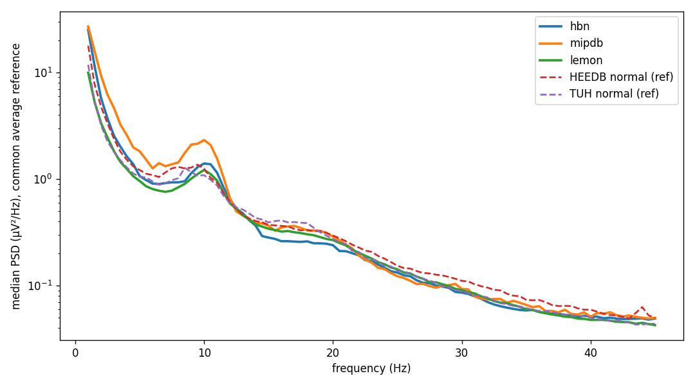
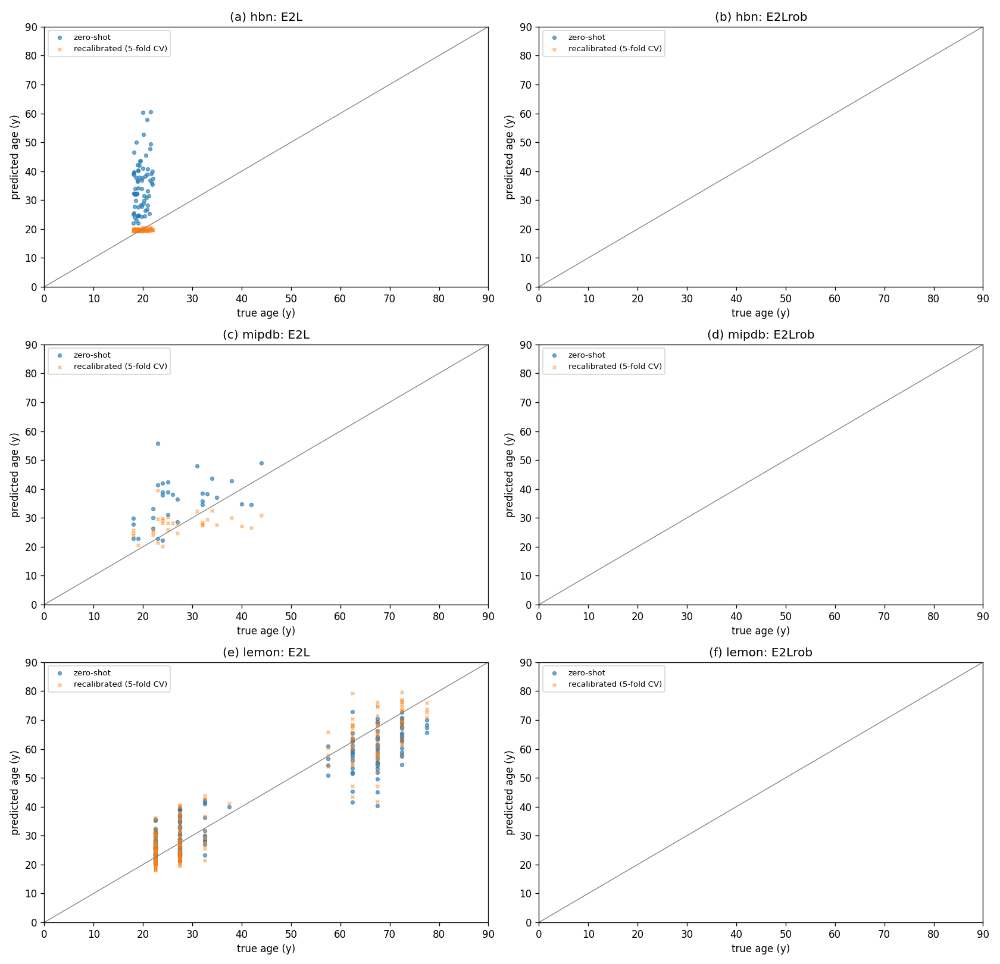

# HBN-EEG adults: external test set for brain age (zero-shot)

Results note, 2026-11-15. HBN-EEG is the next external cohort after LEMON, MIPDB, CHBP
and TDBRAIN (`docs/external_eval_results.md`, `docs/chbp_onboarding.md`,
`docs/tdbrain_onboarding.md`). Only its **adults** (age ≥ 18) are onboarded and scored,
because the age models are trained on adults.

**Status: onboarded, excluded from the final reports (decision 2026-11-15).** HBN is a
paediatric study (ages 5-21); its 68 "adults" are 18-22-year-olds at the top of a
child and adolescent sample, and the models were trained on adult data. The cohort
and this note are kept for reference, but HBN is not to be added to the external
evaluation tables, cohort comparisons or summaries of the other documents.

**Result.** E2L over-predicts the 68 HBN adults (18.0–22.0 years) by 15.7 years. The
P3_L1 five-fold median ensemble halves the excess to 10.3 years, P4_L1 reaches 11.7.
The preprocessing matches the pipeline used for MIPDB, the same lab's earlier study on
the same EEG net, and MIPDB's 18–23-year-olds show the same direction of error (+10.5
years). The cohort is too narrow in age (SD 1.2 years) for MAE or $R^2$ to rank models;
it is a bias check on one device and one age.

Code:
- `scripts/external_runs/hbn.sh`: download, private S3 mirror, conversion, scoring, report;
- `dataset_maker/make_external_npy.py --dataset hbn`: the reader (`hbn_recordings`, `open_hbn`);
- `scripts/external_fold_ensemble.py`: fold models and their median ensemble;
- `scripts/external_cohort_comparison.py --min-age --max-age`: one age band across cohorts.

Tables are in `docs/data/external_eval/hbn/`, per-recording predictions in
`/data/runs/heedb/external_eval/hbn_adults_v1_*.json`.

## 1. Data and storage

### Table 1.1. HBN-EEG as onboarded

| | |
|---|---|
| source | OpenNeuro `ds005505`–`ds005516` (11 releases, no `ds005513`), public bucket `s3://openneuro.org`, CC-BY-SA 4.0, no account |
| participants | 3,155 aged 5–21; **74 adults** (18.0–22.0 years) |
| adults with a resting file | **68**: 63 flagged `available` and 5 `caution` by the release's own quality check; 6 have none |
| sex | 37 M, 31 F |
| recording | EGI HydroCel 128 + vertex reference `Cz`, 500 Hz, EEGLAB `.set`; resting block of eyes open 20 s / closed 40 s, five times |
| duration | median 362 s (323–855 s), 2,764 windows of 10 s in total |
| labels | age (decimal years), sex, handedness, four psychopathology factor scores; no diagnosis without the Child Mind Institute data agreement |
| population | help-seeking community sample, most with a psychiatric diagnosis: **not** labelled `normal` |

Release 11 (`ds005516`) needed a workaround. The bucket's current objects of that
release lack every `.set` file and the task columns of `participants.tsv` (delete
markers). The published snapshot is intact, so the launcher takes the table from the
dataset's git mirror and each missing `.set` from the snapshot's file endpoint.

Storage follows the other external cohorts:

| | local | S3 (private bucket, checked with `check_private`) |
|---|---|---|
| raw | `/data/datasets/EEG-public/HBN/raw/ds0055xx/` | `s3://eeg-data-public/HBN/v1/raw` |
| cohort | `/data/datasets/EEG-public/HBN/cohorts/hbn_adults_v1` | `s3://eeg-data-public/HBN/v1/cohorts/hbn_adults_v1` |

`MIN_AGE=0 scripts/external_runs/hbn.sh download` would fetch every participant's
resting file (about 300 GB); that is not done.

## 2. Preprocessing: the proposed recipe against the current pipeline

The onboarding plan ("Onboarding NITRC EEG Datasets for Brain-Age Testing") proposed a
per-dataset recipe. The cohort was instead converted with the pipeline every training
and external cohort went through (`make_TUH_npy.preprocess_raw`), so that HBN differs
from MIPDB and the training data only by its recordings. Table 2.1 lists each step.

### Table 2.1. Proposed recipe and what was run

| step | plan document | current pipeline (used) | effect of the difference |
|---|---|---|---|
| band-pass | not stated | 0.1–75 Hz FIR | none |
| mains removal | 60 Hz only | spectrum interpolation at 50 and 60 Hz | none: the 50 Hz bin of a 60 Hz recording holds no line |
| resampling | 500 → 200 Hz | 500 → 200 Hz | none |
| reference | common average at preprocessing | mean of the 19 mapped channels on reading (the vertex reference makes `Cz` all zero), then the models' own input CAR | equivalent |
| channel map | nearest electrodes by MNE template | published 10-20 equivalents (Luu & Ferree 2005), as for MIPDB | 7 of 19 electrodes differ, Table 2.2 |
| missing A1, A2, T1, T2 | masked | zero + `channel_mask`; the models drop them | none |
| trim | about 5 s | training protocol (60 s per end, first 5 min), every window, and 10 s per end | Table 3.1: within 0.1 year |
| windows | all 10 s windows of the resting block | the same | none |

The two channel maps differ at Fp1, Fp2, Fz, C3, C4, P3 and P4. Table 2.2 gives the
angle between each chosen electrode and the 10-20 site,

$$
\theta_c = \arccos\!\left(\hat{u}_c^{\text{EGI}} \cdot \hat{u}_c^{\text{10-20}}\right), \tag{2.1}
$$

where $\hat{u}$ is the unit vector from the centre of a sphere fitted to MNE's
`GSN-HydroCel-129` and `standard_1005` templates respectively, in degrees. The two
templates are not co-registered, so the angles are approximate.

### Table 2.2. Channel maps: angle to the 10-20 site, Eq. (2.1), and E2L result

| site | current map | $\theta$ (°) | plan's map | $\theta$ (°) |
|---|---|---|---|---|
| Fp1 | E22 | 10.3 | E25 | 12.2 |
| Fp2 | E9 | 10.4 | E8 | 12.9 |
| Fz | E11 | 9.2 | E5 | 13.0 |
| C3 | E36 | 5.1 | E42 | 18.6 |
| C4 | E104 | 5.6 | E93 | 19.1 |
| P3 | E52 | 9.3 | E60 | 5.8 |
| P4 | E92 | 8.8 | E85 | 6.2 |
| mean over the 19 sites | | 7.8 | | 9.3 |
| **E2L MAE, every window (years)** | | **15.72** | | **16.07** |

The current map is kept: it is closer on average, much closer at C3 / C4, identical to
MIPDB's, and scores 0.35 years better. The other 12 sites are the same in both maps
(`EGI_HYDROCEL_1020`, `EGI_HYDROCEL_1020_TEMPLATE`; `HBN_CHANNEL_MAP=template` converts
with the plan's map).

### Table 2.3. Signal QC, median over recordings, adults only

Columns as in Table 2.1 of `docs/external_eval_results.md`: median channel standard
deviation, occipital alpha-peak frequency and relative band powers of 1–45 Hz (Welch,
2 s segments), after a common average reference. The references are 100 random
normal-report recordings per training corpus (`docs/data/external_eval/hbn/qc_summary.csv`).

| source | n | channel std (µV) | alpha peak (Hz) | delta | theta | alpha | beta | share of samples > 300 µV |
|---|---|---|---|---|---|---|---|---|
| TUH normal (training) | 100 | 9.96 | 9.00 | 0.495 | 0.124 | 0.136 | 0.131 | 0.000 |
| HEEDB normal (training) | 100 | 13.01 | 9.00 | 0.527 | 0.125 | 0.156 | 0.123 | 0.025 |
| **HBN adults** | 68 | 14.50 | 10.25 | 0.623 | 0.102 | 0.141 | 0.086 | 0.001 |
| MIPDB adults (same net) | 31 | 15.29 | 9.75 | 0.514 | 0.134 | 0.132 | 0.104 | 0.001 |
| LEMON | 215 | 8.98 | 9.75 | 0.452 | 0.130 | 0.183 | 0.139 | 0.000 |

### Figure 2.1. Median power spectrum per source

Median PSD (µV²/Hz, log scale) over recordings and channels, 1–45 Hz; external cohorts
solid, training references dashed.

**What Tables 2.1–2.3 and Figure 2.1 show.**
- The conversion is sound: amplitude is in the range of the training data and of
  MIPDB, no line residue, almost no samples above 300 µV, and the alpha peak sits at
  10.25 Hz, as expected for young adults.
- No start transient: the median window amplitude is flat over the recording
  (first window 20.8 µV, then 13–18 µV), as in MIPDB and LEMON.
- HBN differs from the training data in spectral shape: more delta (0.62 against
  0.50–0.53) and less beta (0.09 against 0.12–0.13). MIPDB's adults show the same
  beta deficit. Slow activity and weak fast activity are what the models read as old.
- One recording (855 s) also holds a video segment (`video_start` / `video_stop`
  markers); it is kept, as one of the 5 `caution` files.

## 3. Results

For recording $i$ with true age $y_i$ and prediction $p_i$ (years, the mean of its
window predictions), over $n$ recordings (`external_eval_report.metrics`):

$$
\text{MAE} = \frac{1}{n}\sum_i \lvert p_i - y_i \rvert, \qquad
\text{bias} = \frac{1}{n}\sum_i (p_i - y_i). \tag{3.1}
$$

$\bar p$ and $s_p$ are the mean and standard deviation of the predictions. $R^2$ about
the cohort's own mean is below −95 for every model here, because the age SD is
1.2 years; it is not tabulated. Predicting the cohort mean age gives MAE 1.03.

### Table 3.1. E2L family on HBN adults, n = 68, mean age 19.7 (Eq. (3.1))

| model | windows | MAE | bias | $\bar p$ | Pearson r |
|---|---|---|---|---|---|
| E2L | training protocol (60 s trims, first 5 min) | 15.66 | +15.66 | 35.4 | 0.21 |
| E2L | every window | 15.72 | +15.72 | 35.4 | 0.26 |
| E2L | 10 s trimmed per end | 15.70 | +15.70 | 35.4 | — |
| E2Lrob (band 1–45 Hz + amplitude norm, fine-tuned) | every window | 17.46 | — | — | — |
| E2LrobF (the same, from scratch) | every window | 16.22 | — | — | — |

The window selection does not matter (15.66–15.72). The device-robust variants, which
closed the gap on CHBP (`docs/chbp_domain_shift.md`), do not help here.

### Table 3.2. P3_L1 and P4_L1 cross-validation folds and ensembles, every window (`docs/data/external_eval/hbn/p34_cv_all.csv`)

Each fold model is de-normalized with its own training-age statistics. The fold
ensemble predicts, for recording $i$, the median over the $K$ fold models
(`external_fold_ensemble.ensemble`):

$$
p_i^{\text{ens}} = \operatorname{median}_{k=1..K}\; p_i^{(k)}. \tag{3.2}
$$

| model | folds | MAE | bias | $\bar p$ | $s_p$ | Pearson r |
|---|---|---|---|---|---|---|
| E2L (single model) | 1 | 15.72 | +15.72 | 35.4 | 9.0 | 0.26 |
| P3_L1, mean ± SD over folds | 5 | 10.21 ± 0.94 | +10.18 | 29.9 | 8.9 | 0.22 |
| P3_L1, best / worst fold | | 9.25 / 11.49 | | | | |
| **P3_L1 median ensemble**, Eq. (3.2) | 5 | **10.33** | +10.31 | 30.0 | 8.6 | 0.23 |
| P4_L1, mean ± SD over folds | 5 | 11.77 ± 0.64 | +11.77 | 31.5 | 9.4 | 0.24 |
| P4_L1, best / worst fold | | 10.85 / 12.63 | | | | |
| **P4_L1 median ensemble** | 5 | **11.66** | +11.66 | 31.4 | 9.2 | 0.25 |
| P3_L1 + P4_L1 median ensemble | 10 | 10.88 | +10.88 | 30.6 | 8.7 | 0.25 |

With the training protocol's windows the ensembles score 10.24 (P3_L1), 11.65 (P4_L1)
and 10.79 (both); `p34_cv_5min.csv`.

**What Table 3.2 shows.**
- Both phased MIL models cut E2L's excess by a third: 10.3 and 11.7 against 15.7 years.
  Every one of the ten folds beats E2L, the worst by 3.1 years.
- The ensemble does not beat its own folds' mean (10.33 against 10.21; 11.66 against
  11.77). The error is a shared bias, MAE = bias for all models, and a median over
  models with the same bias cannot remove it.
- P3_L1 is better than P4_L1 here by 1.3 years, about 1.5 fold SDs.
- The spread of predictions stays at 9 years for people within 4 years of age.

### Table 3.3. E2L on 18–23-year-olds of every cohort, every window (`docs/data/external_eval/hbn/cohort_comparison_age18-23_all_windows.csv`)

| cohort | device | n | mean age | MAE | bias | $\bar p$ | $s_p$ |
|---|---|---|---|---|---|---|---|
| own test (TUH + HEEDB) | clinical | 692 | 20.4 | 5.53 | +5.51 | 26.0 | 5.6 |
| TDBRAIN | 26-channel cap | 227 | 20.6 | 3.16 | +2.86 | 23.4 | 4.6 |
| LEMON (20–25 bin, midpoint 22.5) | 62-channel cap | 74 | 22.5 | 3.67 | +3.30 | 25.8 | 3.5 |
| MIPDB | EGI HydroCel 128 | 10 | 20.8 | 10.54 | +10.50 | 31.3 | 10.3 |
| CHBP | 120-channel cap, 0.5–50 Hz | 56 | 20.5 | 13.44 | +13.44 | 33.9 | 8.1 |
| **HBN** | EGI HydroCel 128 | 68 | 19.7 | 15.72 | +15.72 | 35.4 | 9.0 |

**What Table 3.3 shows.** At the same age E2L is 3–6 years too old on the training
corpora, LEMON and TDBRAIN, and 10–16 years too old on both EGI cohorts and CHBP. The
excess on HBN is therefore tied to the recordings (device and population), not to the
age band, and it agrees in sign and size with MIPDB, which went through the same reader.

### Figure 3.1. Predicted against true age

Per-recording predictions against true age (years), every window, for HBN adults next
to MIPDB adults and LEMON; the diagonal is a perfect prediction.

### 3.1. What goes with a high prediction

Within the 68 recordings (E2L, every window; Spearman correlation with the prediction):

| | value |
|---|---|
| relative alpha power | −0.42 |
| relative delta power | +0.25 |
| true age | +0.23 |
| channel std, alpha-peak frequency, beta, duration, p-factor | within ±0.16 |
| mean prediction, women (n = 31) / men (n = 37) | 40.7 / 31.0 years |
| mean prediction, `caution` (n = 5) / `available` (n = 63) | 36.7 / 35.3 years |

Weak alpha and strong delta go with older predictions. Women are predicted 9.7 years
older than men of the same age; whether this holds in the other cohorts is not checked
yet. The release's `caution` flag does not matter.

## 4. Comparison with the plan's expectations

- The plan expected an over-prediction of young adults by about 6 years. That holds
  on the training corpora (+5.5, Table 3.3) but HBN's is nearly three times larger.
- The plan recommended reporting only the mean error for HBN, since 63 people aged
  18–22 cannot support MAE or $R^2$. With all usable files the set is 68; the advice
  stands, and bias is the number to read in Tables 3.1–3.3.
- There is no published adult brain-age result on HBN to compare with.

## 5. Not yet done

- Nothing was fitted on HBN: no recalibration, no fine-tuning.
- Whether the +10 to +16 years on the EGI cohorts comes from the net (saline
  electrodes, slow drifts) or from the population is open. MIPDB's adult controls and
  a spectral transform toward the training data, as done for CHBP, would separate them.
- The sex difference of Section 3.1 should be checked on LEMON, TDBRAIN and the own test split.
- The other models (L1, W4, W7, X1, X3) were not scored on HBN.
- The children (3,081 participants) are not downloaded.

## References

- Shirazi SY et al. 2024. HBN-EEG: The FAIR implementation of the Healthy Brain Network electroencephalography dataset. bioRxiv. doi:10.1101/2024.10.03.615261
- Alexander LM et al. 2017. An open resource for transdiagnostic research in pediatric mental health and learning disorders. *Sci Data* 4:170181. doi:10.1038/sdata.2017.181
- Luu P, Ferree T. 2005. Determination of the HydroCel Geodesic Sensor Nets' average electrode positions and their 10-10 international equivalents. EGI technical note.
