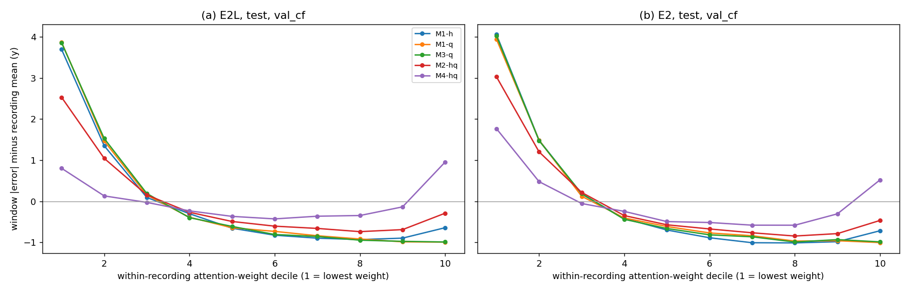
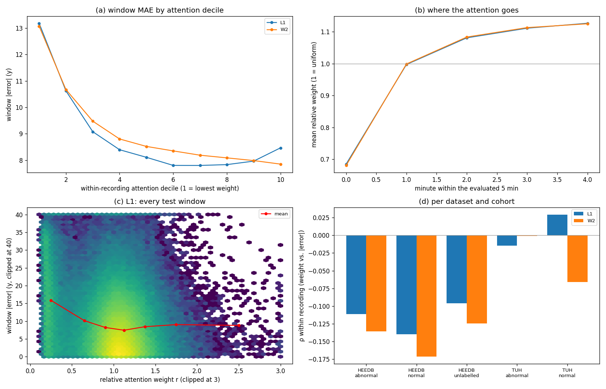
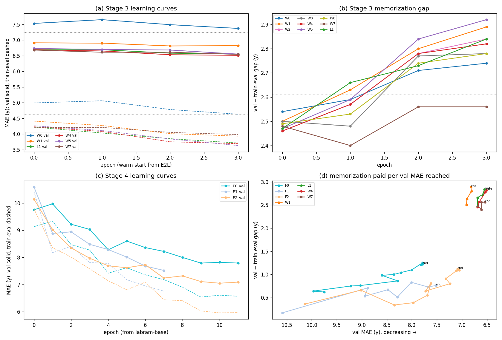
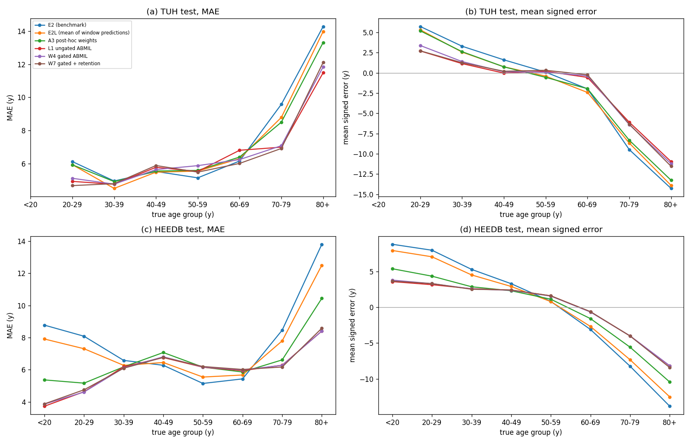
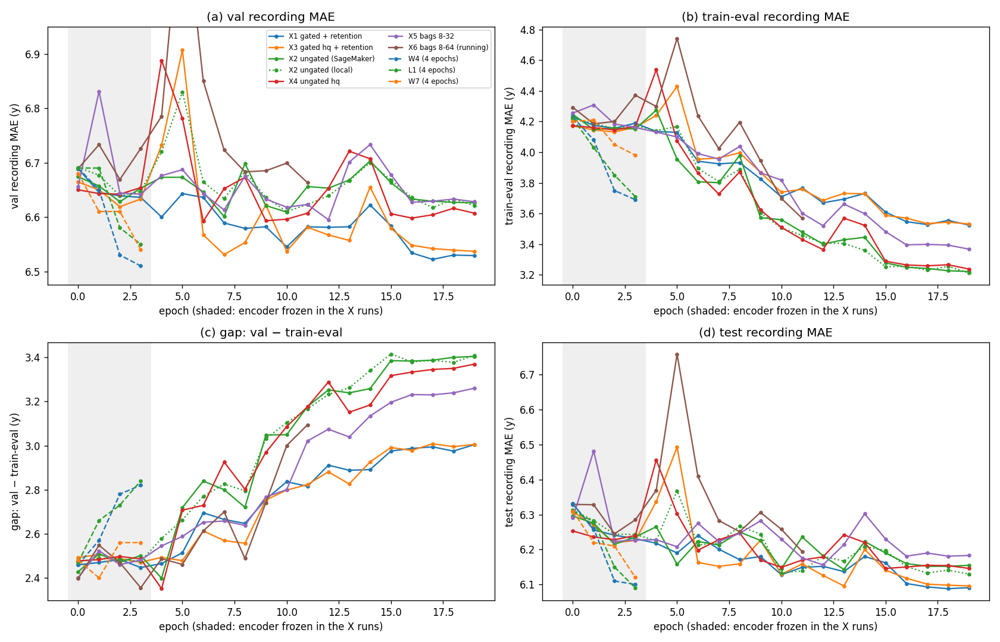

# MIL Stage 1: attention pooling on frozen E2L / E2 window features

Results note, 2026-11-09. This is Stage 1 of
[`b1_attention_mil_plan.md`](b1_attention_mil_plan.md). The bag pooling
layers M0–M4 are trained on **cached, frozen** window features of E2L (the
run under test) and E2 (the benchmark). The comparison is against mean
pooling, and it includes analytics of what the attention weights follow.
Stages 3–4 (end-to-end bag training on SageMaker) are listed in section 5.

Code:
- `labram/mil/cache.py` + `scripts/mil_cache.py`: the feature cache.
- `labram/layers/bag_pool.py`: M0–M4.
- `labram/mil/stage1.py` + `scripts/mil_stage1.py`: training, metrics and analytics.
- `scripts/mil_stage1_report.py`: these tables and figures.

Tables are in `docs/data/mil_stage1/`. The cache (3.0 M windows per run) is at
`/data/runs/heedb/mil_cache/` and mirrored to the private
`s3://eeg-data-public/HEEDB/v4.1/derived/mil_cache/`.

## 1. Setup

**Cache.** Every window of a recording's eval budget (the first 5 min after
the 60 s trim, up to 30 windows) is stored for val (10,614 recordings), test
(7,612) and train (84,891, the same 30-window budget). Per window, the cache
holds:
- $h_i$: E2L's head-input feature, the CLS token after the final norm (200-d), computed through the run's channel-drop path exactly as in training;
- the run's window prediction $\hat y_i$;
- 39 descriptors: 5 quality, 18 STFT spectrogram and 16 wavelet;
- the minute of the window within the 5-minute budget.

**Model.** A pool of [`b1_attention_mil_plan.md`](b1_attention_mil_plan.md)
Eq. (2.1) maps the bag to $z_c$; the linear head, **initialised from the
run's own head**, predicts the z-scored age. The loss is Huber plus
$0.01\,(\log n - H(\alpha))$ for the softmax pools (Eq. (2.2) of the plan).
Training uses AdamW with a cosine schedule: pool lr 1e-3, head lr 1e-4,
dropout 0.1 on $h_i$.

**Protocols.**
- `val_cf`: fitted on val, 5-fold cross-fitted with folds grouped by subject (out-of-fold val predictions); refitted on all of val for test, 30 epochs.
- `train`: fitted on the training bags, 15 epochs, epoch chosen on val (so val is optimistic and test is the honest number).

**Benchmarks.**
- `M0-run`: the run's own reported mean pooling, i.e. the mean of $\hat y_i$, nothing fitted.
- `M0`: mean pooling of $h_i$ with the head refitted, the like-for-like control of every attention variant.

### Table 1.1. Variants

| name | pool | attention reads | notes |
|---|---|---|---|
| M1-h / M1-q / M1-hq | gated attention, $L = 128$ (M1) | $h_i$ / $q_i$ / both | softmax over the bag |
| M1-hq-time | M1-hq | both | + sinusoidal minute encoding added to $h_i$ |
| M1-hq-noent | M1-hq | both | no entropy term |
| M2-h / M2-hq | 4 gated branches, $L = 64$ (M2) | $h_i$ / both | top-window masking $p = 0.3$ |
| M3-h / M3-q / M3-hq | sigmoid gates, $L = 64$ (M3) | $h_i$ / $q_i$ / both | non-competing gates |
| M4-hq / M4-hq-sa | learned query, 4 heads (M4) | both | M4-hq-sa: + 1 self-attention block |

## 2. Recording MAE

### Table 2.1. `val_cf`: fitted on val (out-of-fold), test MAE in years

The Δ columns are the paired change of test MAE against `M0`, with 95 %
bootstrap CIs over recordings (1,000 resamples).

| variant | E2L val | E2L test | E2L test TUH | E2L test HEEDB | E2 val | E2 test | Δ test vs M0, E2L | Δ test vs M0, E2 |
|---|---|---|---|---|---|---|---|---|
| M0-run | 7.25 | 7.00 | 6.55 | 7.02 | 7.43 | 7.25 | +0.47 [+0.41, +0.52] | +0.69 [+0.62, +0.75] |
| **M0** (benchmark) | 6.90 | 6.54 | 6.36 | 6.54 | 6.88 | 6.56 | — | — |
| M1-h | 6.68 | 6.29 | 6.22 | 6.30 | 6.61 | 6.26 | −0.24 [−0.31, −0.18] | −0.30 [−0.36, −0.24] |
| **M1-q** | **6.64** | **6.22** | 6.43 | **6.22** | 6.61 | **6.23** | **−0.31** [−0.36, −0.26] | **−0.33** [−0.38, −0.28] |
| M1-hq | 6.72 | 6.32 | 6.42 | 6.32 | 6.64 | 6.28 | −0.21 [−0.28, −0.15] | −0.28 [−0.34, −0.21] |
| M1-hq-time | 6.66 | 6.27 | 6.33 | 6.27 | 6.58 | 6.23 | −0.26 [−0.32, −0.20] | −0.33 [−0.39, −0.28] |
| M1-hq-noent | 6.77 | 6.39 | 6.54 | 6.38 | 6.67 | 6.36 | −0.14 [−0.22, −0.07] | −0.20 [−0.28, −0.13] |
| M2-h | 6.66 | 6.29 | 6.29 | 6.29 | 6.60 | 6.25 | −0.24 [−0.30, −0.19] | −0.31 [−0.37, −0.26] |
| M2-hq | 6.67 | 6.25 | 6.36 | 6.24 | 6.60 | 6.24 | −0.29 [−0.34, −0.23] | −0.32 [−0.37, −0.26] |
| M3-h | 6.69 | 6.32 | 6.49 | 6.31 | 6.59 | 6.27 | −0.22 [−0.28, −0.15] | −0.29 [−0.36, −0.23] |
| **M3-q** | 6.65 | 6.23 | 6.49 | 6.22 | 6.62 | 6.25 | **−0.31** [−0.36, −0.26] | −0.31 [−0.36, −0.26] |
| M3-hq | 6.69 | 6.34 | 6.53 | 6.34 | 6.60 | 6.28 | −0.19 [−0.25, −0.12] | −0.28 [−0.35, −0.22] |
| M4-hq | 6.81 | 6.32 | 6.46 | 6.31 | 6.75 | 6.31 | −0.22 [−0.28, −0.16] | −0.25 [−0.31, −0.18] |
| M4-hq-sa | 7.82 | 7.31 | 7.42 | 7.31 | 7.75 | 7.17 | +0.78 [+0.66, +0.89] | +0.60 [+0.50, +0.72] |

### Table 2.2. `train`: fitted on the training bags (epoch chosen on val), test MAE in years

| variant | E2L val | E2L test | E2L test TUH | E2L test HEEDB | E2 val | E2 test | Δ test vs M0, E2L | Δ test vs M0, E2 |
|---|---|---|---|---|---|---|---|---|
| M0-run | 7.25 | 7.00 | 6.55 | 7.02 | 7.43 | 7.25 | +0.50 [+0.45, +0.55] | +0.72 [+0.66, +0.79] |
| **M0** (benchmark) | 6.86 | 6.50 | 6.23 | 6.51 | 6.83 | 6.53 | — | — |
| M1-h | 6.59 | 6.20 | 6.23 | 6.20 | 6.54 | 6.20 | −0.30 [−0.35, −0.26] | −0.33 [−0.38, −0.28] |
| M1-q | 6.60 | 6.20 | 6.30 | 6.19 | 6.56 | 6.21 | −0.30 [−0.35, −0.26] | −0.32 [−0.36, −0.27] |
| M1-hq | 6.59 | 6.19 | 6.21 | 6.19 | 6.52 | 6.20 | −0.31 [−0.36, −0.27] | −0.34 [−0.39, −0.28] |
| M1-hq-time | 6.62 | 6.22 | 6.23 | 6.22 | 6.55 | 6.22 | −0.28 [−0.32, −0.24] | −0.31 [−0.36, −0.26] |
| M1-hq-noent | 6.63 | 6.23 | 6.29 | 6.23 | 6.53 | 6.23 | −0.27 [−0.32, −0.22] | −0.30 [−0.36, −0.24] |
| M2-h | 6.60 | 6.21 | 6.18 | 6.21 | 6.54 | 6.21 | −0.30 [−0.34, −0.25] | −0.32 [−0.37, −0.27] |
| M2-hq | 6.59 | 6.19 | **6.15** | 6.19 | 6.53 | 6.20 | −0.31 [−0.35, −0.27] | −0.33 [−0.38, −0.29] |
| M3-h | 6.61 | 6.21 | 6.30 | 6.21 | 6.54 | 6.21 | −0.29 [−0.34, −0.24] | −0.32 [−0.37, −0.26] |
| M3-q | 6.60 | 6.19 | 6.34 | 6.18 | 6.55 | 6.20 | −0.31 [−0.36, −0.26] | −0.33 [−0.38, −0.28] |
| M3-hq | 6.61 | 6.21 | 6.30 | 6.21 | 6.53 | 6.20 | −0.29 [−0.34, −0.24] | −0.33 [−0.38, −0.28] |
| **M4-hq** | 6.57 | **6.18** | 6.28 | **6.17** | 6.52 | **6.18** | **−0.33** [−0.37, −0.28] | **−0.36** [−0.40, −0.31] |
| M4-hq-sa | 6.59 | 6.17 | 6.23 | 6.17 | 6.54 | 6.19 | −0.33 [−0.38, −0.28] | −0.34 [−0.40, −0.29] |

### Table 2.3. E2L test MAE per dataset and report cohort (`train` protocol)

| variant | TUH normal (149) | TUH abnormal (125) | HEEDB normal (1,518) | HEEDB abnormal (2,253) | HEEDB unlabelled (3,567) |
|---|---|---|---|---|---|
| M0-run | 4.91 | 8.50 | 7.12 | 7.56 | 6.64 |
| M0 | 4.50 | 8.29 | 6.42 | 7.09 | 6.19 |
| M1-h | 4.63 | 8.14 | 5.84 | 6.80 | 5.97 |
| M1-q | 4.59 | 8.34 | 5.86 | 6.76 | 5.98 |
| M3-q | 4.64 | 8.37 | 5.82 | 6.75 | 5.98 |
| M2-hq | 4.55 | 8.06 | 5.85 | 6.80 | 5.96 |
| M4-hq | 4.59 | 8.31 | 5.83 | 6.76 | 5.95 |

What Table 2.1, Table 2.2 and Table 2.3 show:

1. **Refitting the head on recordings is the first big step.** `M0`, mean
   pooling of embeddings with the head refitted, beats the run's own mean of
   predictions by 0.47–0.72 y. With a linear head, pooling embeddings or
   predictions is the same thing, so the gain comes from the **refit**: a
   head trained per window with mixup, and read out by averaging, is
   miscalibrated at the recording level. This is a recording-level
   recalibration (it also includes the bias the window training leaves). It
   has to be the reference, or attention gets credit for it.
2. **Attention adds another 0.24–0.36 y on top of `M0`**, with every CI clear
   of zero. That is a total of about 0.8 y below E2L's reported 7.00 (test
   6.18–6.22).
3. **With little fitting data (`val_cf`, about 8,500 bags per fold), the
   descriptors carry the attention.** M1-q and M3-q are best. Adding $h_i$ to
   the scores (hq) is worse than either input alone, and removing the entropy
   term costs 0.1 y. The self-attention variant (M4-hq-sa) overfits badly.
4. **With the full training set (`train`, 84,891 bags) every variant ends up
   in the same place**: 6.17–6.23 on test, within the noise of each other.
   M4 and M4-sa, the largest pools, are now slightly best. The choice of pool
   and of attention input matters only when data is scarce.
5. **The gain is mostly on HEEDB** (normal 6.42 → about 5.84, abnormal
   7.09 → about 6.77). TUH abnormal moves a little, and TUH normal not at all
   (4.50 for `M0` vs 4.55–4.64). Same pattern as Proposal A.
6. **E2 shows the same ranking with slightly larger gains**, so nothing here
   is specific to the longer-trained E2L.

## 3. What the attention weights follow

With $w_i$ the pooling weight, $\hat y_i = g(h_i)$ the window's prediction
through the fitted head, and $e_i = |\hat y_i - y_c|$:
- $\rho_{\text{within}}$ is the mean over recordings of $\operatorname{Spearman}_{i\in W_c}(w_i, e_i)$ (Eq. (3.1) of [`window_confidence_results.md`](window_confidence_results.md));
- the "Δ low-w" and "Δ high-w" columns are the excess error of the lowest and highest within-recording weight fifths;
- $\rho(w, \cdot)$ are within-recording Spearman correlations with descriptors;
- "ρ(conc, rec err)" and "ρ(wSD, rec err)" correlate the weight concentration $1-\text{ESS}/n$ and the weighted SD of the window predictions with the recording's error;
- "MAE@50" is the error left after deferring the less confident half of recordings by wSD.

### Table 3.1. E2L attention analytics, test, `val_cf`

| variant | ρ within | share ρ<0 | Δ low-w (y) | Δ high-w (y) | ρ(w, minute) | ρ(w, ch. spread) | ρ(w, EMG) | mean max w | ρ(conc, rec err) | ρ(wSD, rec err) | MAE@50 by wSD | max \|Σw ŷ − ŷ\| |
|---|---|---|---|---|---|---|---|---|---|---|---|---|
| M1-h | −0.11 | 0.62 | 2.52 | −0.77 | 0.17 | −0.17 | 0.05 | 0.13 | 0.22 | 0.17 | 5.62 | 0.00 |
| M1-q | −0.12 | 0.65 | 2.67 | −0.99 | 0.21 | −0.37 | 0.10 | 0.07 | 0.08 | 0.16 | 5.63 | 0.00 |
| M1-hq | −0.10 | 0.62 | 2.36 | −0.70 | 0.17 | −0.19 | 0.09 | 0.15 | 0.23 | 0.16 | 5.73 | 0.00 |
| M1-hq-noent | −0.13 | 0.64 | 2.74 | −0.91 | 0.22 | −0.31 | 0.11 | 0.24 | 0.19 | 0.17 | 5.64 | 0.00 |
| M2-hq | −0.06 | 0.57 | 1.79 | −0.49 | 0.12 | −0.17 | 0.06 | 0.13 | 0.21 | 0.12 | 5.88 | 0.00 |
| M3-h | **−0.16** | 0.64 | **2.99** | **−1.03** | 0.22 | −0.25 | 0.05 | 0.15 | 0.15 | **0.20** | **5.54** | 0.04 |
| M3-q | −0.13 | **0.67** | 2.69 | −0.98 | **0.29** | **−0.41** | 0.11 | 0.07 | 0.09 | 0.19 | 5.57 | 0.00 |
| M4-hq | 0.00 | 0.48 | 0.47 | 0.41 | −0.07 | −0.04 | −0.00 | 0.08 | 0.13 | 0.01 | 6.39 | 16.39 |

(The full table for both runs and both protocols is in
`docs/data/mil_stage1/*_analytics.csv`.)

### Figure 3.1. Excess window error by attention-weight decile, test, `val_cf`

The y axis is the mean $e_i$ minus the recording's mean $e$ (years), by
within-recording weight decile (1 = lowest weight), for 7,612 test
recordings. (a) E2L, (b) E2.

What Table 3.1 and Figure 3.1 show:

* **The weights track window error, as strongly as A3 did.**
  $\rho_{\text{within}}$ is −0.11 to −0.16 (A3: −0.16 to −0.18), and in about
  65 % of recordings the lower-weight windows are the worse ones. The
  bottom-weight decile is 3.7–4 y worse than the recording average, and the
  top deciles about 1 y better (Figure 3.1).
* **They learned what A3 learned.** Weights rise with the window's minute
  (ρ +0.17 to +0.29; +0.55 for M1-q/M3-q in the `train` protocol: the bad
  first minutes of HEEDB) and fall with the across-channel power spread
  (ρ −0.17 to −0.41: one deviant channel). The EMG ratio is again slightly
  *positive*.
* **The weighted-sum identity holds:** for M0–M3 the recording prediction
  equals $\sum_i w_i \hat y_i$ (max error 0.00–0.04 y), so the weights are
  exactly the share each window's own prediction contributes. It does not
  hold for M4 or for the time-encoding variants. There the pooled value is a
  projection of $h_i$ (M4) or $h_i$ plus a time code, so $w_i$ is not the
  weight of $g(h_i)$. M4's flat decile curve is the result of that, not
  evidence that M4 ignores bad windows.
* **The recording confidence from the weights is a usable signal.** The
  weighted SD of the window predictions correlates with the recording error
  at ρ = 0.16–0.20. Deferring the less confident half by it leaves MAE
  5.5–5.6 y (vs 6.2–6.3 overall). Weight concentration works for $h$-based
  attention (ρ 0.15–0.23), not for descriptor-only attention.

## 4. Conclusions for Stages 3–4

1. **The bar for end-to-end MIL** is `M0` + attention on frozen E2L features:
   6.18–6.22 test (from 7.00). A trained bag model must beat about 6.2 to
   justify end-to-end training. Its recording-level loss must buy something
   beyond what a frozen-feature pooling plus a head refit already gives.
2. **Head refit and attention are separate gains** (about 0.5 and 0.3 y).
   Stage 3 reports both: `case_mean_mae` (mean of window predictions in the
   same model) next to the attention MAE.
3. **Descriptor-scored attention (M1-q / M3-q) is the robust choice** when
   the pooling sees few recordings, and any pool works with the full
   training set. Stage 3 therefore runs M0, M1-q, M3-q, M1-h, M1-hq-time,
   M2-hq and M1-q with feature retention; Stage 4 runs M0, M1-q and
   M1-hq-time, each against its window-level control.

## 5. Stages 3–4: the grid (running)

Every run uses E2L's data, split, channels and protocol; the ClearML project
is `LaBraM/heedb_mil`.
- **Stage 3:** warm start from E2L, 4 epochs, lr 1e-4, encoder frozen in epoch 0, pool and head lr ×5.
- **Stage 4:** from `labram-base`, 12 epochs, lr 2.8e-4.
- **Batches:** bag runs use 32 recordings × 8 windows per step; window controls use 8 windows per recording per epoch, batch 256.
- **Launchers:** `scripts/mil_runs/submit_grid.sh` (SageMaker, S3 compact cohort, streamed) and `scripts/mil_runs/run_local_grid.sh` (local GPU, local npy).

**First attempt (2026-11-09 01:10 UTC).** Spot capacity for g5 was
unavailable, so 5 jobs moved to on-demand. Every `ml.g5.2xlarge` job with
24 loader workers then **ran out of host memory** (32 GB) after 0.5–2.7 h:
each worker gradually copies the dataset's ~17 M-name file list. W0
(16 workers) and W1 (`ml.g5.4xlarge`, 64 GB, 32 workers) survived. Streamed
reads also make `g5.2xlarge` slow: W0 needed about 2 h per epoch at 16
workers, vs about 20 min per epoch for W1 on `g5.4xlarge`/32 workers, and
about 15 min locally.

**Second attempt (05:25 UTC).**
- Stage 4 (F0, F2, F1, F3) runs on the **local GPU**, one job after another, about 4 h each.
- Stage 3 W2 runs on on-demand and W3 on spot `g5.4xlarge` (32 workers).
- W4–W7 run on on-demand `g5.2xlarge` with 10 workers.

### Table 5.1. Jobs and final results (2026-11-09 08:30 UTC; recording MAE in years)

"Mean-pool" is the same model's mean of its window predictions (test).
"Gap" is val minus train-eval, the memorization measure.

| job | config | where | status | val | test | test TUH / HEEDB | test mean-pool | train-eval (gap) |
|---|---|---|---|---|---|---|---|---|
| E2L | reference, best epoch 11 | — | — | 7.24 | 7.00 | 6.54 / 7.02 | — | 4.63 (2.61) |
| W0 | window-level control, warm start | SM g5.2xlarge spot | done (resumed once) | 7.37 | 7.17 | 6.58 / 7.19 | — | 4.63 (2.74) |
| W1 | M0 bag (mean of embeddings) | SM g5.4xlarge | done | 6.82 | 6.44 | 6.19 / 6.45 | 6.44 | 3.93 (2.89) |
| L1 | ungated ABMIL on $h$ (section 6) | local | done | 6.55 | **6.09** | 6.11 / **6.09** | 6.49 | 3.71 (2.84) |
| W2 | M1-q (gated, descriptors) | SM g5.4xlarge | done | 6.61 | 6.13 | 6.09 / 6.13 | 6.43 | 3.77 (2.84) |
| W3 | M3-q (sigmoid, descriptors) | SM g5.4xlarge spot | done | 6.59 | 6.12 | **6.05** / 6.12 | 6.42 | 3.81 (2.78) |
| W4 | M1-h (gated, features) | SM g5.2xlarge | done | **6.51** | 6.10 | 6.16 / 6.10 | 6.50 | 3.69 (2.82) |
| W5 | M1-hq + time | SM g5.2xlarge | done | 6.55 | 6.10 | 6.23 / 6.10 | 6.69 | 3.63 (2.92) |
| W6 | M2-hq (4 branches) | SM g5.2xlarge | done | 6.55 | **6.09** | 6.15 / **6.09** | 6.49 | 3.77 (2.78) |
| W7 | M1-q + retention 0.1 | SM g5.2xlarge | done | 6.54 | 6.12 | 6.06 / 6.12 | 6.44 | 3.98 (**2.56**) |
| F0 | window-level control, from `labram-base` | local | done, best epoch 9 | 7.79 | 7.64 | 6.89 / 7.67 | — | 6.54 (1.25) |
| F2 | M1-q, from `labram-base` | local | done, best epoch 10 | 7.05 | 6.69 | 6.99 / 6.68 | 7.09 | 5.96 (1.09) |
| F1 | M0 bag, from `labram-base` | local | done, best epoch 10 | 7.28 | 6.98 | 6.84 / 6.99 | 6.98 | 6.29 (0.99) |
| F3 | M1-hq + time, from `labram-base` | local | done, best epoch 11 | 6.95 | 6.57 | 6.80 / 6.56 | 8.10 | 5.92 (1.03) |

### Table 5.2. Stage 3 test MAE per dataset and cohort (final epoch)

| job | TUH normal (149) | TUH abnormal (125) | HEEDB normal (1,518) | HEEDB abnormal (2,253) | HEEDB unlabelled (3,567) |
|---|---|---|---|---|---|
| E2L | 4.91 | 8.49 | 7.12 | 7.56 | 6.63 |
| W0 | 4.96 | 8.52 | 7.30 | 7.78 | 6.78 |
| W1 | 4.53 | 8.16 | 6.26 | 7.16 | 6.07 |
| L1 | 4.41 | 8.13 | **5.71** | 6.79 | **5.80** |
| W2 | 4.45 | 8.04 | 5.78 | 6.82 | 5.84 |
| W3 | 4.41 | **8.00** | 5.77 | 6.83 | 5.83 |
| W4 | 4.45 | 8.20 | 5.72 | 6.77 | 5.83 |
| W5 | 4.39 | 8.42 | 5.72 | 6.77 | 5.83 |
| W6 | 4.45 | 8.18 | 5.72 | 6.77 | 5.81 |
| W7 | **4.36** | 8.07 | 5.83 | **6.73** | 5.87 |

**The control settles the "more epochs" question.** W0 (E2L continued for 4
epochs with the window-level loss) ends at 7.37 / 7.17, *worse* than E2L's
7.24 / 7.00, while every bag run of the same schedule improves by 0.4–0.9 y.

All attention runs end at 6.09–6.13 test and 6.51–6.61 val. The
architecture and the attention input make no difference beyond about
0.05 y, while they all beat end-to-end mean pooling (W1, 6.44) by about
0.33 y. Retention (W7) is the only setting that narrows the train-eval gap
(2.56 vs 2.78–2.92), without costing accuracy.

### Table 5.3. Stage 4 per epoch: window-level F0 vs. bag-level F2 (M1-q), F1 (mean) and F3 (M1-hq + time), all from `labram-base` (val / test / train-eval, years)

| epoch | F0 val | F0 test | F0 train-eval | F0 gap | F2 val | F2 test | F2 train-eval | F2 gap | F1 val | F1 test | F1 train-eval | F1 gap | F3 val | F3 test | F3 gap |
|---|---|---|---|---|---|---|---|---|---|---|---|---|---|---|---|
| 0 | 9.75 | 9.81 | 9.13 | 0.62 | 10.14 | 9.87 | 9.78 | 0.36 | 10.59 | 10.12 | 10.42 | 0.17 | 9.74 | 9.46 | 0.19 |
| 1 | 9.97 | 10.16 | 9.33 | 0.64 | 9.02 | 8.53 | 8.36 | 0.66 | 8.88 | 8.47 | 8.17 | 0.71 | 9.81 | 9.62 | 0.75 |
| 2 | 9.22 | 9.32 | 8.47 | 0.75 | 8.35 | 8.19 | 8.01 | 0.34 | 8.94 | 8.88 | 8.41 | 0.53 | 8.75 | 8.59 | 0.60 |
| 3 | 9.03 | 9.11 | 8.27 | 0.76 | 7.97 | 7.56 | 7.58 | 0.39 | 8.48 | 8.06 | 7.81 | 0.67 | 8.06 | 7.75 | 0.46 |
| 4 | 8.28 | 8.19 | 7.42 | 0.86 | **7.69** | **7.31** | 7.14 | **0.55** | 8.29 | 7.96 | 7.78 | 0.51 | 7.94 | 7.60 | 0.71 |
| 5 | 8.60 | 8.61 | 7.62 | 0.98 | 7.62 | 7.27 | 6.81 | 0.81 | 8.01 | 7.62 | 7.18 | 0.83 | 7.89 | 7.51 | 0.93 |
| 6 | 8.36 | 8.35 | 7.36 | 1.00 | 7.73 | 7.46 | 7.09 | 0.64 | 7.68 | 7.33 | 6.95 | 0.73 | 7.47 | 7.11 | 0.84 |
| 7 | 8.22 | 8.18 | 7.18 | 1.04 | 7.24 | 6.85 | 6.44 | 0.80 | 7.52 | 7.16 | 6.76 | 0.76 | 7.19 | 6.83 | 0.90 |
| 8 | 8.00 | 7.95 | 6.90 | 1.10 | 7.32 | 6.93 | 6.41 | 0.91 | 7.50 | 7.13 | 6.50 | 1.00 | 7.30 | 6.89 | 0.93 |
| 9 | 7.79 | 7.64 | 6.54 | 1.25 | 7.11 | 6.75 | 6.03 | 1.08 | 7.43 | 7.12 | 6.48 | 0.95 | 7.03 | 6.69 | 0.98 |
| 10 | 7.82 | 7.70 | 6.61 | 1.21 | **7.05** | **6.69** | 5.96 | 1.09 | **7.28** | **6.98** | 6.29 | 0.99 | 6.95 | 6.57 | 1.01 |
| 11 | 7.79 | 7.67 | 6.57 | 1.22 | 7.09 | 6.73 | 5.97 | 1.12 | 7.29 | 6.98 | 6.28 | 1.01 | **6.95** | **6.57** | 1.03 |

Both runs see 8 windows per recording per epoch: 12 epochs × 0.68 M
windows, far less than E2L's about 40 M, which is why F0 ends above E2L
(7.79 vs 7.24 val).

### Table 5.4. Stage 4 final, test MAE per dataset and cohort (F0 best epoch 9, F1 and F2 best epoch 10, F3 best epoch 11)

| run | all | TUH normal (149) | TUH abnormal (125) | HEEDB normal (1,518) | HEEDB abnormal (2,253) | HEEDB unlabelled (3,567) |
|---|---|---|---|---|---|---|
| E2L (reference, 16 epochs, all windows) | 7.00 | 4.91 | 8.49 | 7.12 | 7.56 | 6.63 |
| F0 window-level | 7.64 | 5.34 | 8.75 | 7.87 | 8.12 | 7.30 |
| F1 bag, mean pooling | 6.98 | **5.28** | **8.70** | 7.15 | 7.39 | 6.67 |
| F2 bag, M1-q | 6.69 | 5.40 | 8.88 | 6.63 | 7.09 | 6.45 |
| F3 bag, M1-hq + time | **6.57** | **5.27** | **8.62** | **6.50** | **6.92** | **6.35** |

What Table 5.3 and Table 5.4 show:

* **F3 (gated attention on features + descriptors + time encoding) is the
  best model trained from `labram-base`**: 6.95 val / 6.57 test at epoch 11,
  against F2's 7.05 / 6.69, F1's 7.28 / 6.98 and E2L's 7.24 / 7.00. It is
  better than F2 in every test cohort:
  - HEEDB normal 6.63 → 6.50, abnormal 7.09 → 6.92, unlabelled 6.45 → 6.35;
  - TUAB normal 5.40 → 5.27, abnormal 8.88 → 8.62.

  Its gap (1.03) is between F1's (0.99) and F2's (1.09). In the warm starts,
  time encoding (W5) memorized the most, but from scratch it does not. F3
  differs from F2 in two ways at once: the attention also reads the encoder
  features, and it gets the time encoding. This run cannot separate them.
  It is still 0.4–0.5 y behind the warm starts (W4 6.51 / 6.10), which
  saw about 40 M windows through E2L before bag training.
* **All three bag runs converge by epochs 10–11** (F2 and F3 both have a
  bump at epoch 8). 12 epochs are enough at 8 windows per recording per
  epoch.

* **From the same pretrained start and the same data budget, the bag-level
  model wins by a wide margin**: F2 is at 7.05 val / 6.69 test against F0's
  7.79 / 7.64, a difference of 0.74 / 0.95 y. F2 was ahead from epoch 1
  onward, and it beats E2L on test (6.69 vs 7.00) after seeing about 1/5 of
  E2L's windows.
* **It memorizes less at a given val error.** The gap grows in both runs, but
  F2 passes F0's best val error (7.79) at epoch 4 (7.69), with a gap of
  0.55 instead of 1.25. At its best epoch, F2's gap is 1.09 while its val error is
  0.74 y lower. The recording-level loss slows memorization; it does not
  stop it.
* **The whole gain is on HEEDB** (normal 7.87 → 6.63, abnormal 8.12 → 7.09,
  unlabelled 7.30 → 6.45). TUH is unchanged or slightly worse (normal 5.34 →
  5.40, abnormal 8.75 → 8.88; TUH val 7.62 vs F0's 7.49).
* **Where F2's gain over F0 comes from (F1 separates the two parts).**
  - **Recording-level loss** (F0 → F1, both mean pooling): −0.51 y val /
    −0.66 y test. About 70 % of the total, and the gap falls 1.25 → 0.99.
  - **Attention** (F1 → F2, same loss): −0.23 y val / −0.29 y test. About
    30 %, with a slightly larger gap (1.09).
  
  Per cohort (test), the loss helps every HEEDB cohort (normal 7.87 → 7.15,
  abnormal 8.12 → 7.39, unlabelled 7.30 → 6.67). Attention adds the most on
  HEEDB normal (→ 6.63) and less on abnormal / unlabelled (→ 7.09 / 6.45).
  On TUAB the loss is neutral (normal 5.34 → 5.28, abnormal 8.75 → 8.70),
  and attention makes TUAB slightly worse (5.40, 8.88).

What W1 and L1 already show, against the matched M0 bag model W1:

* **End-to-end mean pooling (W1, 6.44 test) ≈ the frozen-feature `M0`
  with a refitted head (6.50).** The recording-level loss with mean pooling
  buys little beyond what a head refit already gives.
* **End-to-end attention (L1, 6.09) beats end-to-end mean pooling (W1, 6.44)
  by 0.35 y** under the same training, and beats the frozen-feature attention
  of Stage 1 (6.18–6.22) by about 0.1 y. The gain is on HEEDB (6.45 → 6.09);
  TUH stays about level (6.19 vs 6.11).
* **No reduction of memorization yet.** The train-eval − val gap is 2.84–2.89
  for both bag runs vs 2.61 for E2L. These are warm starts from a model that
  already memorizes; Stage 4 tests whether the recording-level loss changes
  that.
* The window-level control W0 is still running. After epoch 0 (the warm-up to
  lr 1e-4) it is *worse* than E2L (7.34 test), so it will show how much of
  W1 / L1 is merely the extra epochs.

## 6. End-to-end, local: L1 (simplest ABMIL)

L1 is Ilse et al.'s original, **ungated** attention on the encoder's window
features, $a_i=\mathbf w^\top\tanh(\mathbf V h_i)$ with $L=128$, trained end
to end on the local A10G (`scripts/mil_runs/run_local_abmil.sh`; ClearML
`LaBraM/heedb_mil/heedb_mil_L1_abmil_local`). The setup:
- warm start from E2L, with E2L's data, split, channels and evaluation;
- 4 epochs, the encoder frozen in epoch 0, lr 1e-4 (pool and head ×5);
- 32 recordings × 8 random windows per step, mixup across recordings, entropy term 0.01.

It took 1 h 9 min (epoch 0 about 6 min, the unfrozen epochs about 15 min, plus about 4 min of evaluation each).

### Table 6.1. L1 per epoch, recording MAE (y)

"Mean-pool" is the mean of the same model's window predictions (head on
each $h_i$). The train-eval set is 1,000 fixed training recordings, scored
like val.

| epoch | val | test | val mean-pool | test mean-pool | train-eval | train-eval − val gap |
|---|---|---|---|---|---|---|
| 0 (encoder frozen) | 6.69 | 6.31 | 6.98 | 6.69 | 4.22 | 2.47 |
| 1 | 6.69 | 6.28 | 7.02 | 6.71 | 4.03 | 2.66 |
| 2 | 6.58 | 6.15 | 6.89 | 6.58 | 3.86 | 2.72 |
| **3** | **6.55** | **6.09** | 6.84 | 6.49 | 3.71 | 2.84 |
| *E2L (best epoch 11)* | *7.24* | *7.00* | | | *4.63* | *2.61* |
| *Stage 1 best, frozen features (`train` protocol)* | *6.52–6.62* | *6.17–6.23* | | | | |

### Table 6.2. L1 (epoch 3) test MAE per dataset and cohort vs. E2L

| | TUH normal | TUH abnormal | HEEDB normal | HEEDB abnormal | HEEDB unlabelled | all |
|---|---|---|---|---|---|---|
| E2L | 4.91 | 8.50 | 7.12 | 7.56 | 6.64 | 7.00 |
| L1 | **4.41** | **8.13** | **5.71** | **6.79** | **5.80** | **6.09** |

What Table 6.1 and Table 6.2 show:

* **End-to-end ABMIL reaches 6.09 test / 6.55 val**: 0.91 y better than E2L
  and about 0.1 y better than the best frozen-feature pool of Stage 1. It
  improves in every cohort, TUH included, unlike all post-hoc pooling so far.
* **Attention matters inside the trained model.** Its own mean of window
  predictions is 6.49 on test, so attention removes another 0.40 y. The
  window-level MAE gets *worse* as training goes on (8.35 → 8.93), as
  expected: windows are no longer trained to predict the age on their own,
  only to contribute to the recording.
* **Still improving at epoch 3** (val 6.69 → 6.55), so longer training is
  likely to help.
* **Memorization is not reduced yet.** The train-eval − val gap is 2.84 vs
  2.61 for E2L. The recording loss lowers train and val error together, but
  4 epochs from an already-memorizing E2L cannot show whether it stops
  memorization. That question belongs to Stage 4 (from `labram-base`, F0 vs
  F1–F3).
* **Attention vs. window error (test, epoch 3):**
  - $\rho_{\text{within}}=-0.11$, in 60 % of recordings the lower-weight windows are the worse ones;
  - the lowest-weight decile is 4.3 y worse than the recording average, the middle deciles about 1 y better;
  - the weights rise with the window's minute (ρ +0.33);
  - the largest weight is 1.47× uniform on average, so the attention is soft, not collapsed;
  - the weighted SD of the window predictions gives a recording confidence with ρ = 0.20, and MAE 5.43 on the more confident half.

The SageMaker control W0 (window-level training for the same 4 epochs from
E2L) is the check that the gain is not simply 4 more epochs.

## 7. Attention weight vs. per-window error, end-to-end runs (test)

`scripts/mil_attention_report.py` reads the per-window weights that the bag
evaluation saved at the final epoch. It covers L1 (ungated ABMIL on $h$) and
W2 (gated attention scored on descriptors), over 7,612 test recordings and
about 228 k windows. The quantities:
- $r_i = \alpha_i\,|W_c|$ is the weight relative to uniform (1 = an average window);
- the window error is the window's own prediction through the trained head, against the recording's age.

Tables are in `docs/data/mil_attention/`.

### Table 7.1. Window MAE (y) by within-recording attention decile (1 = lowest weight)

| decile | 1 | 2 | 3 | 4 | 5 | 6 | 7 | 8 | 9 | 10 |
|---|---|---|---|---|---|---|---|---|---|---|
| L1 | 13.18 | 10.62 | 9.08 | 8.40 | 8.11 | 7.80 | 7.80 | 7.83 | 7.97 | 8.47 |
| W2 | 13.07 | 10.67 | 9.48 | 8.80 | 8.52 | 8.35 | 8.19 | 8.09 | 7.99 | **7.85** |

### Table 7.2. Windows by relative weight $r$ (share of windows, window MAE in years)

| $r$ | < 0.5 | 0.5–0.8 | 0.8–1.0 | 1.0–1.25 | 1.25–1.5 | 1.5–2 | > 2 |
|---|---|---|---|---|---|---|---|
| L1 share | 10.5 % | 8.4 % | 22.2 % | 41.2 % | 14.1 % | 3.3 % | 0.3 % |
| L1 MAE | **15.8** | 10.1 | 8.2 | 7.4 | 8.4 | 9.0 | 8.8 |
| W2 share | 10.8 % | 4.7 % | 19.2 % | 52.1 % | 10.9 % | 2.1 % | 0.3 % |
| W2 MAE | **15.5** | 10.7 | 8.5 | 8.1 | 8.1 | 8.3 | 9.3 |

### Table 7.3. Per dataset and cohort

| group (recordings) | ρ within, L1 / W2 | MAE lowest-20 % windows, L1 / W2 | MAE highest-20 %, L1 / W2 |
|---|---|---|---|
| HEEDB normal (1,518) | −0.14 / −0.17 | 13.0 / 13.1 | 7.8 / 7.4 |
| HEEDB abnormal (2,253) | −0.11 / −0.14 | 12.9 / 12.7 | 8.9 / 8.6 |
| HEEDB unlabelled (3,567) | −0.10 / −0.13 | 11.1 / 11.1 | 8.0 / 7.7 |
| TUH normal (149) | +0.03 / −0.07 | 6.9 / 7.3 | 6.8 / 6.1 |
| TUH abnormal (125) | −0.02 / −0.00 | 10.1 / 10.0 | 9.8 / 10.1 |

Mean relative weight by minute of the 5-minute budget, L1 / W2:
0.69 / 0.68 (minute 0), 1.00 / 1.00, 1.08 / 1.08, 1.11 / 1.11, 1.13 / 1.13.

### Figure 7.1. Attention vs. window error, test

The four panels:
- (a) window MAE by attention decile;
- (b) mean relative weight by minute;
- (c) every L1 test window: relative weight against window |error|, with the mean per weight bin;
- (d) within-recording ρ per dataset and cohort.

What Tables 7.1–7.3 and Figure 7.1 show:

* **The attention is a "down-weight the bad windows" filter.** The 10 % of
  windows with $r<0.5$ have MAE 15.5–15.8 y, twice that of the rest
  (7.4–8.5). Above uniform weight the error barely changes: L1's top decile
  (8.47) is even worse than its middle (7.8). The descriptor-scored W2 ranks
  the good windows better (monotone, top decile 7.85). The weights are soft:
  only 2–4 % of windows get more than 1.5× uniform.
* **Much of what it learned is the HEEDB first-minute effect.** Minute 0 gets
  0.68× the uniform weight, and later minutes 1.08–1.13×.
* **It only works on HEEDB.** On TUH, ρ is about 0: TUH windows are roughly
  interchangeable, as in Proposal A.

## 8. All experiments per dataset and cohort

Recording MAE in years, E2L's split. Test has 149 TUH normal, 125 TUH
abnormal, 1,518 HEEDB normal, 2,253 HEEDB abnormal and 3,567 HEEDB
unlabelled recordings (TUH test has no unlabelled ones). Val has 1,388 /
1,676 / 1,493 / 2,179 / 3,520 (plus 358 TUH unlabelled).

The rows are grouped by stage:
- **A**: post-hoc weights on E2L's predictions (`window_confidence_results.md`, A3 with the base descriptors);
- **S1**: Stage 1, pools trained on frozen E2L features with the `train` protocol (val chose the epoch, so S1 val numbers are slightly optimistic; test is honest);
- **S3**: Stage 3, end-to-end bag training from E2L, 4 epochs, final epoch;
- **S4**: Stage 4, from `labram-base`, 12 epochs, best val epoch. F1 and F3 are still running.

All rows are in `docs/data/mil_summary/all_experiments_by_cohort.csv`,
including the `val_cf` Stage 1 protocol.

### Table 8.1. Test MAE per cohort

| experiment | all | TUH | HEEDB | TUH normal | TUH abnormal | HEEDB normal | HEEDB abnormal | HEEDB unlabelled |
|---|---|---|---|---|---|---|---|---|
| E2L (reference: mean of window predictions) | 7.00 | 6.55 | 7.02 | 4.91 | 8.50 | 7.12 | 7.56 | 6.64 |
| A3: post-hoc learned window weights | 6.46 | 6.58 | 6.46 | 4.90 | 8.58 | 6.27 | 6.95 | 6.22 |
| S1 M0: mean pooling + head refit (frozen features) | 6.50 | 6.23 | 6.51 | 4.50 | 8.29 | 6.42 | 7.09 | 6.19 |
| S1 M1-h: gated attention, features | 6.20 | 6.23 | 6.20 | 4.63 | 8.14 | 5.84 | 6.80 | 5.97 |
| S1 M1-q: gated attention, descriptors | 6.20 | 6.30 | 6.19 | 4.59 | 8.34 | 5.86 | 6.76 | 5.98 |
| S1 M1-hq: gated, features + descriptors | 6.19 | 6.21 | 6.19 | 4.65 | 8.07 | 5.83 | 6.79 | 5.96 |
| S1 M1-hq + time encoding | 6.22 | 6.23 | 6.22 | 4.63 | 8.14 | 5.90 | 6.82 | 5.98 |
| S1 M2-hq: 4-branch gated | 6.19 | 6.15 | 6.19 | 4.55 | 8.06 | 5.85 | 6.80 | 5.96 |
| S1 M3-q: sigmoid gates, descriptors | 6.19 | 6.34 | 6.18 | 4.64 | 8.37 | 5.82 | 6.75 | 5.98 |
| S1 M3-h: sigmoid gates, features | 6.21 | 6.30 | 6.21 | 4.70 | 8.20 | 5.84 | 6.81 | 5.99 |
| S1 M4-hq: learned-query attention | 6.18 | 6.28 | 6.17 | 4.59 | 8.31 | 5.83 | 6.76 | 5.95 |
| S1 M4-hq-sa: + self-attention block | 6.17 | 6.23 | 6.17 | 4.57 | 8.22 | 5.84 | 6.78 | 5.93 |
| S3 W0: window-level control (4 more epochs) | 7.17 | 6.58 | 7.19 | 4.96 | 8.52 | 7.30 | 7.78 | 6.78 |
| S3 W1: bag, mean pooling | 6.44 | 6.19 | 6.45 | 4.53 | 8.16 | 6.26 | 7.16 | 6.07 |
| S3 L1: ABMIL ungated, features | 6.09 | 6.11 | 6.09 | 4.41 | 8.13 | 5.71 | 6.79 | 5.80 |
| S3 W4: gated, features | 6.10 | 6.16 | 6.10 | 4.45 | 8.20 | 5.72 | 6.77 | 5.83 |
| S3 W2: gated, descriptors | 6.13 | 6.09 | 6.13 | 4.45 | 8.04 | 5.78 | 6.82 | 5.84 |
| S3 W3: sigmoid gates, descriptors | 6.12 | 6.05 | 6.12 | 4.41 | 8.00 | 5.77 | 6.83 | 5.83 |
| S3 W5: gated, features + descriptors + time | 6.10 | 6.23 | 6.10 | 4.39 | 8.42 | 5.72 | 6.77 | 5.83 |
| S3 W6: 4-branch gated | 6.09 | 6.15 | 6.09 | 4.45 | 8.18 | 5.72 | 6.77 | 5.81 |
| S3 W7: gated, descriptors + retention | 6.12 | 6.06 | 6.12 | 4.36 | 8.07 | 5.83 | 6.73 | 5.87 |
| S4 F0: window-level, from labram-base | 7.64 | 6.89 | 7.67 | 5.34 | 8.75 | 7.87 | 8.12 | 7.30 |
| S4 F2: bag, gated on descriptors, from labram-base | 6.69 | 6.99 | 6.68 | 5.40 | 8.88 | 6.63 | 7.09 | 6.45 |

### Table 8.2. Val MAE per cohort

| experiment | all | TUH | HEEDB | TUH normal | TUH abnormal | HEEDB normal | HEEDB abnormal | HEEDB unlabelled |
|---|---|---|---|---|---|---|---|---|
| E2L (reference: mean of window predictions) | 7.25 | 7.28 | 7.23 | 6.47 | 7.74 | 7.02 | 7.91 | 6.90 |
| A3: post-hoc learned window weights | 6.85 | 7.29 | 6.64 | 6.48 | 7.73 | 6.12 | 7.25 | 6.48 |
| S1 M0: mean pooling + head refit (frozen features) | 6.86 | 7.26 | 6.66 | 6.43 | 7.72 | 6.29 | 7.32 | 6.41 |
| S1 M1-h: gated attention, features | 6.59 | 7.22 | 6.29 | 6.35 | 7.71 | 5.70 | 6.92 | 6.16 |
| S1 M1-q: gated attention, descriptors | 6.60 | 7.21 | 6.31 | 6.36 | 7.69 | 5.74 | 6.92 | 6.18 |
| S1 M1-hq: gated, features + descriptors | 6.59 | 7.23 | 6.29 | 6.36 | 7.72 | 5.70 | 6.93 | 6.15 |
| S1 M1-hq + time encoding | 6.62 | 7.22 | 6.34 | 6.34 | 7.74 | 5.77 | 6.96 | 6.19 |
| S1 M2-hq: 4-branch gated | 6.59 | 7.21 | 6.29 | 6.34 | 7.71 | 5.74 | 6.93 | 6.13 |
| S1 M3-q: sigmoid gates, descriptors | 6.60 | 7.21 | 6.30 | 6.36 | 7.70 | 5.73 | 6.89 | 6.18 |
| S1 M3-h: sigmoid gates, features | 6.61 | 7.25 | 6.31 | 6.37 | 7.76 | 5.75 | 6.89 | 6.19 |
| S1 M4-hq: learned-query attention | 6.57 | 7.19 | 6.28 | 6.31 | 7.69 | 5.71 | 6.87 | 6.15 |
| S1 M4-hq-sa: + self-attention block | 6.59 | 7.25 | 6.27 | 6.38 | 7.74 | 5.67 | 6.92 | 6.12 |
| S3 W0: window-level control (4 more epochs) | 7.37 | 7.37 | 7.37 | 6.59 | 7.84 | 7.17 | 8.04 | 7.04 |
| S3 W1: bag, mean pooling | 6.82 | 7.37 | 6.55 | 6.44 | 7.85 | 6.04 | 7.35 | 6.28 |
| S3 L1: ABMIL ungated, features | 6.55 | 7.28 | 6.20 | 6.32 | 7.81 | 5.53 | 6.96 | 6.01 |
| S3 W4: gated, features | 6.51 | 7.23 | 6.17 | 6.35 | 7.68 | 5.50 | 6.87 | 6.02 |
| S3 W2: gated, descriptors | 6.61 | 7.34 | 6.26 | 6.44 | 7.80 | 5.59 | 7.01 | 6.09 |
| S3 W3: sigmoid gates, descriptors | 6.59 | 7.30 | 6.26 | 6.37 | 7.79 | 5.64 | 6.96 | 6.08 |
| S3 W5: gated, features + descriptors + time | 6.55 | 7.23 | 6.22 | 6.26 | 7.77 | 5.58 | 6.93 | 6.05 |
| S3 W6: 4-branch gated | 6.55 | 7.27 | 6.21 | 6.35 | 7.79 | 5.52 | 6.92 | 6.05 |
| S3 W7: gated, descriptors + retention | 6.54 | 7.20 | 6.22 | 6.33 | 7.65 | 5.62 | 6.90 | 6.06 |
| S4 F0: window-level, from labram-base | 7.79 | 7.49 | 7.93 | 6.84 | 7.83 | 7.91 | 8.54 | 7.56 |
| S4 F2: bag, gated on descriptors, from labram-base | 7.05 | 7.62 | 6.78 | 6.73 | 8.05 | 6.45 | 7.41 | 6.52 |

Per cohort, Tables 8.1–8.2 show:

* **HEEDB normal** gains most: 7.12 → 5.71–5.86 on test with any attention
  model (frozen or end-to-end), and 7.02 → 5.50–5.74 on val.
* **HEEDB abnormal** gains 7.56 → 6.73–6.83; **HEEDB unlabelled** 6.64 →
  5.80–5.99.
* **TUH normal**: test improves 4.91 → 4.36–4.65, but val stays at
  6.26–6.43 (E2L 6.47). The test cohort is small (149), so this is mostly a
  head-recalibration effect and not robust.
* **TUH abnormal** is not improved by any method (test 8.0–8.4 vs 8.50,
  val 7.65–7.85 vs 7.74).
* **From scratch (F0 vs F2)** every HEEDB cohort gains about 1 y, and TUH gets
  slightly worse (val TUH abnormal 7.83 → 8.05).

### Table 8.3. Val MAE with TUH split into TUAB and other TUEG recordings

The TUH part of val is split by TUAB membership (`tuh_index.parquet`,
`corpora` contains `tuab`). TUAB normal has 271 recordings, TUAB abnormal
211, TUEG normal 1,117, TUEG abnormal 1,465 and TUEG unlabelled 358. Test TUH
is exactly the TUAB eval set (149 normal, 125 abnormal), so for test the TUAB
cohorts are the TUH columns of Table 8.1.

The predictions are rebuilt per recording (`scripts/mil_cohort_summary.py`):
- bag runs: $\sum_i\alpha_i\hat y_i$ from the saved per-window weights, which reproduces the logged MAEs;
- W0 and F0: re-scored with `scripts/eval_age_by_cohort.py`;
- S1: rerun with val predictions saved.

W5 is left out, because its time encoding breaks the weighted-sum
reconstruction. All rows are in
`docs/data/mil_summary/all_experiments_by_tuab_cohort.csv`.

| experiment | all | TUAB normal | TUAB abnormal | TUEG normal | TUEG abnormal | TUEG unlabelled | HEEDB normal | HEEDB abnormal | HEEDB unlabelled |
|---|---|---|---|---|---|---|---|---|---|
| E2L (reference) | 7.25 | 5.49 | 7.38 | 6.71 | 7.79 | 8.26 | 7.02 | 7.91 | 6.90 |
| A3 post-hoc | 6.85 | 5.49 | 7.26 | 6.72 | 7.81 | 8.33 | 6.11 | 7.25 | 6.48 |
| S1 M0 | 6.86 | 5.55 | 7.35 | 6.64 | 7.77 | 8.35 | 6.29 | 7.32 | 6.41 |
| S1 M1-h | 6.59 | 5.41 | 7.36 | 6.58 | 7.76 | 8.27 | 5.70 | 6.92 | 6.16 |
| S1 M1-q | 6.60 | 5.45 | 7.38 | 6.58 | 7.73 | 8.27 | 5.74 | 6.92 | 6.18 |
| S1 M1-hq | 6.59 | 5.41 | 7.34 | 6.59 | 7.77 | 8.28 | 5.70 | 6.93 | 6.15 |
| S1 M1-hq-time | 6.62 | 5.38 | 7.38 | 6.58 | 7.79 | 8.20 | 5.77 | 6.96 | 6.19 |
| S1 M2-hq | 6.59 | 5.43 | 7.36 | 6.57 | 7.75 | 8.26 | 5.74 | 6.93 | 6.13 |
| S1 M3-q | 6.60 | 5.48 | 7.41 | 6.58 | 7.74 | 8.23 | 5.73 | 6.89 | 6.18 |
| S1 M3-h | 6.61 | 5.39 | 7.43 | 6.61 | 7.81 | 8.23 | 5.75 | 6.89 | 6.19 |
| S1 M4-hq | 6.57 | 5.40 | 7.37 | 6.53 | 7.74 | 8.24 | 5.71 | 6.87 | 6.15 |
| S1 M4-hq-sa | 6.59 | 5.43 | 7.41 | 6.61 | 7.78 | 8.32 | 5.67 | 6.92 | 6.12 |
| S3 W0 (window-level control) | 7.37 | 5.58 | 7.38 | 6.84 | 7.90 | 8.21 | 7.18 | 8.04 | 7.04 |
| S3 W1 (bag, mean) | 6.82 | 5.56 | 7.34 | 6.66 | 7.92 | 8.72 | 6.04 | 7.35 | 6.28 |
| S3 L1 | 6.55 | 5.55 | 7.00 | 6.51 | 7.93 | 8.50 | 5.53 | 6.96 | 6.01 |
| S3 W4 | 6.51 | 5.42 | 7.13 | 6.57 | 7.76 | 8.58 | 5.50 | 6.87 | 6.02 |
| S3 W2 | 6.61 | 5.53 | 7.15 | 6.65 | 7.89 | 8.73 | 5.59 | 7.01 | 6.09 |
| S3 W3 | 6.59 | 5.50 | 7.30 | 6.58 | 7.85 | 8.66 | 5.64 | 6.96 | 6.08 |
| S3 W6 | 6.55 | 5.52 | 7.32 | 6.55 | 7.86 | 8.42 | 5.52 | 6.92 | 6.05 |
| S3 W7 | 6.54 | 5.33 | 7.22 | 6.57 | 7.71 | 8.43 | 5.62 | 6.90 | 6.06 |
| S4 F0 (window-level) | 7.79 | 5.90 | 7.35 | 7.07 | 7.90 | 8.40 | 7.91 | 8.54 | 7.56 |
| S4 F2 (bag, gated q) | 7.05 | 5.86 | 8.07 | 6.95 | 8.04 | 9.07 | 6.45 | 7.41 | 6.52 |

Per cohort, Table 8.3 shows:

* **TUAB abnormal is the only TUH cohort that end-to-end attention clearly
  improves**: 7.38 → 7.00 (L1), 7.13 (W4), 7.15 (W2). Frozen-feature pools
  leave it at about 7.4, and on test it moves 8.50 → 8.00–8.20.
* **TUAB normal and TUEG normal** improve slightly with attention
  (5.49 → 5.33–5.55, 6.71 → 6.51–6.66).
* **TUEG abnormal** does not move (7.79 → 7.71–7.93), and **TUEG
  unlabelled** gets *worse* end to end (8.26 → 8.42–8.73).
* **From scratch (F2 vs F0)**, TUAB abnormal is much worse (8.07 vs 7.35):
  the bag model trained from `labram-base` loses on TUAB's pathological
  recordings while it gains about 1 y on every HEEDB cohort.

## 9. Over- or under-fitting, per method

The memorization measure is the **gap = val MAE − train-eval MAE**, where
train-eval is 1,000 fixed training recordings scored like val. "Efficiency"
is the val gain divided by the train-eval gain over the run: the share of
newly fitted training error that also generalizes. Per-epoch numbers are in
`docs/data/mil_summary/fit_curves.csv`.

### Figure 9.1. Learning curves and gaps

The four panels:
- (a) Stage 3 val (solid) and train-eval (dashed) per epoch, with E2L's 7.24 / 4.63 dotted;
- (b) the Stage 3 gap per epoch, with E2L's gap of 2.61 dotted;
- (c) Stage 4 curves from `labram-base`;
- (d) the gap against the val MAE reached; a run that ends lower-left memorizes less for the same accuracy.

### Table 9.1. Fit per method

| run | val, first → best epoch | train-eval, first → last | gap, first → last | efficiency Δval/Δtrain-eval | diagnosis |
|---|---|---|---|---|---|
| W0 window control (warm) | 7.53 → 7.37 (ep 3) | 4.99 → 4.63 | 2.54 → 2.74 | 0.44 | worse than its start (E2L 7.24): the high-LR restart damages, decay only partly recovers |
| W1 bag mean (warm) | 6.91 → 6.81 (ep 2) | 4.41 → 3.93 | 2.50 → 2.89 | 0.19 | **overfits** at the end: val flat from epoch 2, train-eval still falls, gap +0.39 |
| L1 ungated ABMIL (warm) | 6.69 → 6.55 (ep 3) | 4.22 → 3.71 | 2.47 → 2.84 | 0.27 | still improving at a decaying LR; gap grows as fast as W1's |
| W2 gated, descriptors | 6.69 → 6.61 | 4.23 → 3.77 | 2.46 → 2.84 | 0.17 | lowest efficiency of the attention runs: gains mostly on train |
| W3 sigmoid, descriptors | 6.69 → 6.59 | 4.19 → 3.81 | 2.50 → 2.78 | 0.26 | as L1 |
| **W4** gated, features | 6.69 → **6.51** | 4.23 → 3.69 | 2.46 → 2.82 | **0.33** | best val gain per unit of train fit among the plain attention runs |
| W5 gated, both + time | 6.73 → 6.55 | 4.26 → 3.63 | 2.47 → **2.92** | 0.29 | most memorization: the time code helps it fit train |
| W6 4-branch | 6.66 → 6.55 | 4.17 → 3.77 | 2.49 → 2.78 | 0.28 | as L1 |
| **W7** gated + retention | 6.68 → 6.54 | 4.20 → 3.98 | 2.48 → **2.56** | **0.64** | **least memorization**: the gap barely grows, the same val as the others |
| F0 window, from base (12 ep) | 9.75 → 7.79 (ep 9) | 9.13 → 6.57 | 0.62 → 1.22 | 0.76 | converged (val flat over epochs 9–11), steadily rising gap |
| F1 bag mean, from base | 10.59 → 7.28 (ep 10) | 10.42 → 6.28 | 0.17 → 1.01 | 0.80 | converged (epochs 10–11 flat); gap 0.99 at best vs F0's 1.25 |
| F2 bag gated q, from base | 10.14 → 7.05 (ep 10) | 9.78 → 5.96 | 0.36 → 1.09 | 0.81 | converged (epochs 9–11 flat); at F0's val level (7.7–7.8) its gap is 0.55 vs 1.25 |
| F3 bag gated hq + time, from base | 9.74 → 6.95 (ep 11) | 9.55 → 5.92 | 0.19 → 1.03 | 0.77 | converged (epochs 10–11 flat, 6.953 → 6.950); the best from-scratch run, 0.10 y below F2 at a slightly smaller gap |

What Table 9.1 and Figure 9.1 show:

* **No attention run over-trains in the classic sense.** Val never turns
  up, and the best epoch is the last (or, for W1, the second to last). All
  of them still *drift toward memorization*: in the warm starts only
  0.2–0.3 y of every 1 y of train-eval improvement shows up on val, so the
  gap grows 0.3–0.45 y in 4 epochs. Train-eval at about 3.7 y vs val at
  about 6.5 y means capacity is not the limit: this is a high-variance
  regime, not under-fitting.
* **Mean pooling (W1) is the worst case.** It stops improving on val after
  epoch 2 while train keeps falling. Attention keeps val improving to the
  last epoch.
* **Feature retention (W7) is the only regularizer that works here.** The
  gap stays at 2.56 and the efficiency doubles (0.64), at the same val.
  Time encoding (W5) has the opposite effect.
* **From scratch, the picture is healthier.** Early epochs are under-fit
  (gap 0.2–0.4), both bag runs keep a much smaller gap than the window-level
  F0 at the same val, and F2 converges by epoch 9–10. 12 epochs is enough
  for F0 and F2. F1 (mean pooling) also converges by epoch 10, at a
  gap between F0's and F2's.
* **Implications.**
  1. Warm-start runs gain nothing from longer training; they gain from
     regularization (retention, stronger mixup, larger bags). The cheapest
     next run is W4 + retention (`mil.retention_weight` 0.1).
  2. From-scratch bag training could take more data per epoch (more
     windows per recording, or more recordings) before it saturates, since
     its gap is still small.

## 10. Best attention methods vs. A3 vs. E2L's mean, per cohort

The methods compared:
- **E2L mean:** the reported model.
- **A3:** post-hoc learned window weights, base descriptors.
- **S1 M1-h:** the best frozen-feature pool.
- **W4 / L1 / W7:** the best end-to-end attention runs from E2L.
- **F2:** the bag model trained from `labram-base`.

MAE is in years. The Δ columns are the paired change against E2L with 95 %
bootstrap CIs over recordings (2,000 resamples). TUAB cohorts are TUAB
recordings (test = the TUAB eval set); TUEG is the other TUH recordings
(val only). Rows are in
`docs/data/mil_summary/best_vs_a3_vs_e2l_by_cohort.csv`.

### Table 10.1. Val (n: TUAB 271 / 211, TUEG 1,117 / 1,465 / 358, HEEDB 1,493 / 2,179 / 3,520)

| method | all | TUAB normal | TUAB abnormal | TUEG normal | TUEG abnormal | TUEG unlab. | HEEDB normal | HEEDB abnormal | HEEDB unlab. |
|---|---|---|---|---|---|---|---|---|---|
| E2L mean | 7.25 | 5.49 | 7.38 | 6.71 | 7.79 | **8.26** | 7.02 | 7.91 | 6.90 |
| A3 post-hoc | 6.85 | 5.49 | 7.26 | 6.72 | 7.81 | 8.33 | 6.11 | 7.25 | 6.48 |
| S1 M1-h (frozen) | 6.59 | 5.41 | 7.36 | 6.58 | 7.76 | 8.27 | 5.70 | 6.92 | 6.16 |
| **W4 gated ABMIL** | **6.51** | 5.42 | 7.13 | 6.57 | 7.76 | 8.58 | **5.50** | **6.87** | 6.02 |
| L1 ABMIL | 6.55 | 5.55 | **7.00** | **6.51** | 7.93 | 8.50 | 5.53 | 6.96 | **6.01** |
| W7 gated + retention | 6.54 | **5.33** | 7.22 | 6.57 | **7.71** | 8.43 | 5.62 | 6.90 | 6.06 |
| F2 from base | 7.05 | 5.86 | 8.07 | 6.95 | 8.04 | 9.07 | 6.45 | 7.41 | 6.52 |
| Δ A3 vs E2L | −0.40 [−0.44, −0.36] | +0.00 [−0.12, +0.12] | −0.11 [−0.31, +0.07] | +0.01 [−0.06, +0.08] | +0.02 [−0.05, +0.08] | +0.07 [−0.07, +0.22] | −0.91 [−1.06, −0.77] | −0.66 [−0.77, −0.54] | −0.42 [−0.49, −0.35] |
| Δ W4 vs E2L | −0.73 [−0.80, −0.66] | −0.07 [−0.39, +0.25] | −0.24 [−0.59, +0.11] | −0.13 [−0.30, +0.02] | −0.03 [−0.18, +0.13] | +0.32 [+0.04, +0.62] | −1.52 [−1.72, −1.32] | −1.04 [−1.20, −0.88] | −0.88 [−0.99, −0.76] |
| Δ L1 vs E2L | −0.70 [−0.77, −0.63] | +0.07 [−0.23, +0.36] | −0.38 [−0.73, −0.03] | −0.20 [−0.37, −0.04] | +0.14 [−0.02, +0.30] | +0.25 [−0.04, +0.55] | −1.49 [−1.70, −1.29] | −0.94 [−1.11, −0.78] | −0.89 [−1.01, −0.77] |

### Table 10.2. Test (n: TUAB eval 149 / 125, HEEDB 1,518 / 2,253 / 3,567)

| method | all | TUAB normal | TUAB abnormal | HEEDB normal | HEEDB abnormal | HEEDB unlab. |
|---|---|---|---|---|---|---|
| E2L mean | 7.00 | 4.91 | 8.50 | 7.12 | 7.56 | 6.64 |
| A3 post-hoc | 6.46 | 4.90 | 8.58 | 6.27 | 6.95 | 6.22 |
| S1 M1-h (frozen) | 6.20 | 4.63 | 8.14 | 5.84 | 6.80 | 5.97 |
| **W4 gated ABMIL** | 6.10 | 4.45 | 8.20 | 5.72 | 6.77 | 5.83 |
| L1 ABMIL | **6.09** | 4.41 | 8.13 | **5.71** | 6.79 | **5.80** |
| W7 gated + retention | 6.12 | **4.36** | **8.07** | 5.83 | **6.73** | 5.87 |
| F2 from base | 6.69 | 5.39 | 8.88 | 6.63 | 7.09 | 6.45 |
| Δ A3 vs E2L | −0.54 [−0.59, −0.49] | −0.01 [−0.15, +0.13] | +0.09 [−0.17, +0.34] | −0.84 [−0.98, −0.69] | −0.61 [−0.72, −0.50] | −0.41 [−0.48, −0.34] |
| Δ W4 vs E2L | −0.90 [−0.99, −0.82] | −0.46 [−0.81, −0.12] | −0.29 [−0.87, +0.28] | −1.39 [−1.59, −1.18] | −0.79 [−0.94, −0.63] | −0.80 [−0.92, −0.69] |
| Δ L1 vs E2L | −0.91 [−1.00, −0.83] | −0.50 [−0.92, −0.08] | −0.37 [−0.88, +0.18] | −1.41 [−1.62, −1.21] | −0.77 [−0.93, −0.61] | −0.83 [−0.95, −0.71] |

What Tables 10.1 and 10.2 show:

* **HEEDB (Harvard): all three cohorts improve significantly, and attention
  roughly doubles A3's gain.** HEEDB normal val goes −0.91 y (A3) vs −1.52 y
  (W4); abnormal −0.66 vs −1.04; unlabelled −0.42 vs −0.88. The test set
  agrees.
* **TUAB: A3 does nothing; end-to-end attention helps a little.** On test
  (the TUAB eval set) W4 and L1 improve TUAB normal by 0.46–0.50 y (CIs clear
  of zero). TUAB abnormal improves 0.24–0.38 y (L1's val CI just excludes
  zero; W4's and the test CIs do not). Frozen-feature pooling does not reach
  this.
* **TUEG (non-TUAB TUH): no gain, and a loss on unlabelled.** TUEG normal
  gains 0.13–0.20 y (L1 significant), TUEG abnormal is unchanged, and TUEG
  unlabelled (358 recordings, recordings without a report label) gets worse
  with the end-to-end runs (W4 +0.32 [+0.04, +0.62]). A3 and frozen pools
  leave both TUEG cohorts unchanged.
* **Best method per group:**
  - HEEDB: W4 / L1;
  - TUAB normal: W7 / L1;
  - TUAB abnormal: L1 (val) / W7 (test);
  - TUEG: any of them (all within noise), except that **E2L itself stays best on TUEG unlabelled**.

## 11. Error per age group, and age-bias correction

Script: `scripts/mil_age_groups.py`. Tables are in `docs/data/mil_age/`.
All numbers are on **test** (TUH = the TUAB eval set, 274 recordings; HEEDB,
7,338). Age groups with fewer than 10 recordings are suppressed (TUH < 20, 6
recordings).

The experiments:
- E2: the benchmark run;
- E2L: the reference, i.e. the mean of window predictions;
- S1 M0: E2L features, mean pooling, head refitted;
- A3: post-hoc window weights;
- S1 M4-hq: the best frozen-feature attention;
- L1, W4, W7: the best end-to-end attention runs.

**Errors.** With true age $y$ and prediction $\hat y$ of a recording, the
gap is $e = \hat y - y$. Per age group $G$:

$$
\mathrm{MAE}_G = \frac{1}{|G|}\sum_{r\in G}\lvert e_r\rvert,\qquad
\bar e_G = \frac{1}{|G|}\sum_{r\in G} e_r
\tag{11.1}
$$

The age trend of the gap is the OLS slope $\beta$ of $e$ on $y$ over the
test recordings, $e \approx \beta\,y + \beta_0$. $\beta = 0$ means no
regression to the mean, and $\beta = -0.3$ means the model compresses the
age range by 30 %.

**Corrections** (`labram/eval/age_analysis.py::fit_bias_correction`,
`apply_bias_correction`) are fitted per experiment on its own **val**
predictions of report-normal recordings, the Gemein et al. convention. They
are then applied to test:

$$
\text{recalibrate: } \hat y'' = a\,\hat y + b,\quad (a,b) = \arg\min \textstyle\sum_{\text{val normal}} (y - a\hat y - b)^2
\tag{11.2}
$$

$$
\text{Cole: } \hat y' = (\hat y - c)/s,\quad (s,c) = \arg\min \textstyle\sum_{\text{val normal}} (\hat y - s\,y - c)^2
\tag{11.3}
$$

$$
\text{quadratic gap: } \hat y^{c} = \hat y - (c_0 + c_1 y + c_2 y^2),\quad (c_0,c_1,c_2) = \arg\min \textstyle\sum_{\text{val normal}} (e - c_0 - c_1 y - c_2 y^2)^2
\tag{11.4}
$$

Eqs. (11.2) and (11.3) use only the prediction, so they can be deployed.
Eq. (11.4) uses the test recording's true age, so its error is a
brain-age-gap quantity, not a prediction error.

### Table 11.1. Test MAE per age group, no correction (years; Eq. (11.1))

| experiment | <20 | 20–29 | 30–39 | 40–49 | 50–59 | 60–69 | 70–79 | 80+ | all |
|---|---|---|---|---|---|---|---|---|---|
| n (TUH + HEEDB) | 229 | 1,125 | 824 | 815 | 1,212 | 1,608 | 1,147 | 652 | 7,612 |
| E2 (benchmark) | 8.90 | 8.01 | 6.48 | **6.23** | **5.14** | **5.44** | 8.49 | 13.82 | 7.25 |
| E2L (mean of windows) | 8.03 | 7.26 | 6.17 | 6.39 | 5.54 | 5.68 | 7.82 | 12.54 | 7.00 |
| S1 M0 (mean + head refit) | 5.69 | 6.16 | 6.35 | 6.93 | 6.05 | 5.82 | 6.49 | 9.58 | 6.50 |
| A3 post-hoc | 5.55 | 5.19 | 6.10 | 6.98 | 6.13 | 5.87 | 6.66 | 10.52 | 6.46 |
| S1 M4-hq (frozen attention) | 4.69 | 5.02 | **5.96** | 6.81 | 6.17 | 5.84 | **6.15** | 9.05 | 6.18 |
| L1 ungated ABMIL | **3.85** | 4.64 | 6.10 | 6.70 | 6.13 | 5.96 | 6.30 | **8.48** | **6.09** |
| W4 gated ABMIL | 4.00 | **4.63** | 6.03 | 6.73 | 6.15 | 5.99 | 6.29 | 8.49 | 6.10 |
| W7 gated + retention | 4.03 | 4.75 | 6.01 | 6.71 | 6.17 | 6.01 | 6.19 | 8.67 | 6.12 |

### Table 11.2. Test mean signed error per age group, no correction (years; Eq. (11.1)), and the gap-age slope $\beta$

| experiment | <20 | 20–29 | 30–39 | 40–49 | 50–59 | 60–69 | 70–79 | 80+ | $\beta$ |
|---|---|---|---|---|---|---|---|---|---|
| E2 (benchmark) | +8.90 | +7.87 | +5.16 | +3.18 | +0.77 | −3.08 | −8.27 | −13.82 | −0.33 |
| E2L (mean of windows) | +8.03 | +6.97 | +4.39 | +2.76 | +0.73 | −2.68 | −7.37 | −12.54 | −0.30 |
| S1 M0 | +5.05 | +4.81 | +3.50 | +2.93 | +1.70 | −0.82 | −4.77 | −9.41 | −0.20 |
| A3 post-hoc | +5.55 | +4.36 | +2.84 | +2.20 | +1.04 | −1.60 | −5.65 | −10.50 | −0.21 |
| S1 M4-hq | +4.54 | +4.03 | +3.03 | +2.65 | +1.71 | −0.60 | −4.28 | −8.92 | −0.18 |
| L1 ungated ABMIL | +3.69 | +3.12 | +2.50 | +2.25 | +1.53 | −0.65 | −4.07 | −8.26 | **−0.16** |
| W4 gated ABMIL | +3.92 | +3.29 | +2.48 | +2.22 | +1.49 | −0.67 | −4.07 | −8.24 | **−0.16** |
| W7 gated + retention | +3.80 | +3.27 | +2.43 | +2.27 | +1.53 | −0.61 | −4.08 | −8.50 | **−0.16** |

### Figure 11.1. MAE and mean signed error per age group, TUH and HEEDB test, no correction

Per age group (x, true age), for six of the experiments:
- (a) TUH MAE;
- (b) TUH mean signed error;
- (c) HEEDB MAE;
- (d) HEEDB mean signed error.

Units are years. TUH has 17–51 recordings per group, so its panels are noisy.

### Table 11.3. Test MAE overall with each correction, and the gap-age slope $\beta$ after it

The columns are: MAE with no correction, then with Eqs. (11.2), (11.3) and (11.4); then $\beta$ with no correction, then with Eqs. (11.2), (11.3) and (11.4).

| experiment | none | recalibrate | Cole | quadratic gap | $\beta$ none | $\beta$ recal. | $\beta$ Cole | $\beta$ quad. |
|---|---|---|---|---|---|---|---|---|
| E2 (benchmark) | 7.25 | 6.65 | 7.92 | **5.11** | −0.33 | −0.22 | +0.02 | +0.03 |
| E2L (mean of windows) | 7.00 | 6.61 | 7.93 | 5.40 | −0.30 | −0.21 | +0.03 | +0.03 |
| S1 M0 | 6.50 | 6.53 | 7.71 | 5.96 | −0.20 | −0.21 | +0.02 | +0.03 |
| A3 post-hoc | 6.46 | 6.38 | 7.72 | 5.77 | −0.21 | −0.19 | +0.04 | +0.04 |
| S1 M4-hq | 6.18 | 6.20 | 7.23 | 5.72 | −0.18 | −0.19 | +0.02 | +0.03 |
| L1 ungated ABMIL | **6.09** | **6.14** | **7.12** | 5.81 | −0.16 | −0.19 | +0.02 | +0.03 |
| W4 gated ABMIL | 6.10 | 6.15 | **7.12** | 5.80 | −0.16 | −0.19 | +0.02 | +0.03 |
| W7 gated + retention | 6.12 | 6.17 | 7.16 | 5.81 | −0.16 | −0.19 | +0.02 | +0.03 |

### Table 11.4. Abnormal vs. normal recordings by the corrected gap (test; TUH 149 / 125, HEEDB 1,518 / 2,253)

The gap $e$ is taken after Eq. (11.4), as a brain-age-gap biomarker would be
used. Cohen's $d = (\bar e_\text{abn} - \bar e_\text{norm}) / s_\text{pooled}$
and the ROC AUC treat a larger gap as more abnormal.

| experiment | gap normal | gap abnormal | Cohen's $d$ | AUC | TUH $d$ | TUH AUC | HEEDB $d$ | HEEDB AUC |
|---|---|---|---|---|---|---|---|---|
| E2 (benchmark) | +0.26 | +2.66 | 0.37 | 0.620 | **0.64** | **0.682** | 0.34 | 0.613 |
| E2L (mean of windows) | +0.32 | +2.88 | 0.38 | 0.621 | 0.63 | 0.672 | 0.35 | 0.613 |
| S1 M0 | +0.52 | +2.56 | 0.27 | 0.590 | 0.50 | 0.644 | 0.24 | 0.583 |
| A3 post-hoc | +0.14 | +3.10 | **0.40** | **0.630** | 0.54 | 0.654 | **0.38** | **0.626** |
| S1 M4-hq | +0.37 | +2.39 | 0.27 | 0.592 | 0.40 | 0.614 | 0.25 | 0.587 |
| L1 ungated ABMIL | +0.46 | +2.19 | 0.22 | 0.577 | 0.50 | 0.631 | 0.20 | 0.570 |
| W4 gated ABMIL | +0.39 | +2.13 | 0.23 | 0.577 | 0.46 | 0.621 | 0.20 | 0.570 |
| W7 gated + retention | +0.42 | +2.18 | 0.23 | 0.580 | 0.46 | 0.629 | 0.21 | 0.574 |

### Table 11.5. MAE per source and report cohort before and after correction, val (cross-fitted), years

Each cell lists four MAEs: no correction / Eq. (11.2) / Eq. (11.3) / Eq. (11.4). Val is corrected by
5-fold cross-fitting, with folds grouped by subject: each fold uses parameters fitted on the other folds' normal recordings,
so no recording is corrected with its own fit (`scripts/mil_age_groups.py::crossfit_val`). TUAB = TUH recordings in TUAB
(TUAB train part); TUEG = other TUH recordings.

| model | TUAB normal (271) | TUAB abnormal (211) | TUEG normal (1,117) | TUEG abnormal (1,465) | TUEG unlabelled (358) | HEEDB normal (1,493) | HEEDB abnormal (2,179) | HEEDB unlabelled (3,520) |
|---|---|---|---|---|---|---|---|---|
| E2 | 5.71 / 5.71 / 7.55 / 4.93 | 7.31 / 7.24 / 8.96 / 5.72 | 6.82 / 6.71 / 8.34 / 5.40 | 7.81 / 7.66 / 9.10 / 5.80 | 7.98 / 8.28 / 9.91 / 6.39 | 7.37 / 6.61 / 7.32 / 4.68 | 8.12 / 7.41 / 8.39 / 5.39 | 7.15 / 6.56 / 7.80 / 5.03 |
| E2L | 5.49 / 5.50 / 7.33 / 5.04 | 7.38 / 7.33 / 8.69 / 5.90 | 6.71 / 6.69 / 8.23 / 5.63 | 7.79 / 7.78 / 9.29 / 6.27 | 8.26 / 8.47 / 10.07 / 6.86 | 7.02 / 6.51 / 7.19 / 4.87 | 7.91 / 7.51 / 8.66 / 5.88 | 6.90 / 6.54 / 7.84 / 5.34 |
| A3 | 5.49 / 5.44 / 6.52 / 4.97 | 7.26 / 7.25 / 8.16 / 6.04 | 6.72 / 6.72 / 7.68 / 5.76 | 7.81 / 7.81 / 8.84 / 6.49 | 8.33 / 8.41 / 9.56 / 7.14 | 6.11 / 6.00 / 7.18 / 5.30 | 7.25 / 7.18 / 8.63 / 6.45 | 6.48 / 6.38 / 7.60 / 5.66 |
| L1 | 5.55 / 5.44 / 6.64 / 5.57 | 7.00 / 7.01 / 7.58 / 6.13 | 6.51 / 6.52 / 7.33 / 6.03 | 7.93 / 7.91 / 8.63 / 6.95 | 8.50 / 8.41 / 9.43 / 7.75 | 5.53 / 5.60 / 6.65 / 5.38 | 6.96 / 7.04 / 7.77 / 6.35 | 6.01 / 6.06 / 7.00 / 5.70 |
| W4 | 5.42 / 5.34 / 6.54 / 5.46 | 7.13 / 7.15 / 7.62 / 6.15 | 6.57 / 6.58 / 7.39 / 6.05 | 7.76 / 7.76 / 8.42 / 6.77 | 8.58 / 8.49 / 9.44 / 7.74 | 5.50 / 5.57 / 6.61 / 5.33 | 6.87 / 6.94 / 7.71 / 6.29 | 6.02 / 6.08 / 7.01 / 5.69 |
| W7 | 5.33 / 5.25 / 6.53 / 5.40 | 7.22 / 7.21 / 7.81 / 6.28 | 6.57 / 6.56 / 7.43 / 6.05 | 7.71 / 7.71 / 8.42 / 6.73 | 8.43 / 8.34 / 9.37 / 7.65 | 5.62 / 5.69 / 6.76 / 5.44 | 6.90 / 6.98 / 7.79 / 6.31 | 6.06 / 6.11 / 7.04 / 5.69 |

### Table 11.6. MAE per source and report cohort before and after correction, test, years

Each cell lists four MAEs: no correction / Eq. (11.2) / Eq. (11.3) / Eq. (11.4), fitted on all val normal recordings. Test TUH is the TUAB eval set;
TUEG has no test recordings.

| model | TUAB normal (149) | TUAB abnormal (125) | HEEDB normal (1,518) | HEEDB abnormal (2,253) | HEEDB unlabelled (3,567) |
|---|---|---|---|---|---|
| E2 | 5.13 / 4.84 / 6.80 / 4.38 | 8.56 / 8.44 / 9.80 / 6.41 | 7.43 / 6.69 / 7.60 / 4.88 | 7.83 / 7.18 / 8.41 / 5.43 | 6.86 / 6.31 / 7.73 / 5.00 |
| E2L | 4.91 / 4.70 / 6.46 / 4.39 | 8.50 / 8.36 / 9.70 / 6.55 | 7.12 / 6.63 / 7.50 / 5.10 | 7.56 / 7.15 / 8.49 / 5.80 | 6.64 / 6.28 / 7.75 / 5.28 |
| A3 | 4.90 / 4.86 / 5.57 / 4.13 | 8.58 / 8.54 / 9.21 / 6.72 | 6.27 / 6.18 / 7.43 / 5.48 | 6.95 / 6.88 / 8.42 / 6.34 | 6.22 / 6.14 / 7.45 / 5.56 |
| L1 | 4.41 / 4.39 / 5.66 / 4.59 | 8.13 / 8.11 / 8.86 / 7.05 | 5.71 / 5.78 / 6.83 / 5.56 | 6.79 / 6.86 / 7.72 / 6.34 | 5.80 / 5.85 / 6.85 / 5.58 |
| W4 | 4.45 / 4.46 / 5.51 / 4.47 | 8.20 / 8.22 / 8.84 / 7.04 | 5.72 / 5.78 / 6.85 / 5.55 | 6.77 / 6.82 / 7.71 / 6.31 | 5.83 / 5.88 / 6.87 / 5.59 |
| W7 | 4.36 / 4.37 / 5.53 / 4.46 | 8.07 / 8.09 / 8.74 / 6.91 | 5.83 / 5.88 / 6.96 / 5.62 | 6.73 / 6.79 / 7.71 / 6.30 | 5.87 / 5.91 / 6.90 / 5.60 |

What Tables 11.5 and 11.6 show:

* **With no correction or with recalibration (Eq. (11.2)), the attention models are best on
  HEEDB (all three cohorts) and TUAB normal / abnormal.**
  - Recalibration recovers part of the baselines' HEEDB gap (E2L HEEDB normal val 7.02 → 6.51), but
    the attention models stay 0.9–1.0 y better.
  - On TUAB, recalibration changes nothing for any model (within 0.1 y).
* **TUEG is the exception.** No aggregation helps there:
  - TUEG normal: 6.51–6.57 (attention) vs 6.71 (E2L);
  - TUEG abnormal: 7.71–7.93 vs 7.79;
  - TUEG unlabelled (358 recordings): the attention models are worse (8.43–8.58 vs 8.26 for E2L,
    7.98 for E2). Recalibration does not fix this (8.34–8.49), because the error is not an age trend
    common to the cohort.
* **Cole (Eq. (11.3)) costs about 1 y in every cohort, least for the attention models.** On TUAB
  normal it costs 1.1–1.3 y for attention vs 1.8 y for E2L.
* **The quadratic gap (Eq. (11.4)) ranks E2 / E2L first in every cohort except TUAB normal on test**,
  for the reason given above: it rewards compressed predictions.

What Tables 11.1–11.4 and Figure 11.1 show:

* **Attention mainly fixes the age extremes.** Every model regresses to the
  mean: the young are predicted older, the old younger (Table 11.2,
  Figure 11.1(b, d)).
  - E2L is +7.0 y at 20–29 and −12.5 y at 80+.
  - The attention models halve the trend ($\beta$ −0.30 → −0.16) and cut
    MAE at the extremes: 20–29 7.26 → 4.63 (W4), <20 8.03 → 3.85 (L1),
    80+ 12.54 → 8.48 (L1), 70–79 7.82 → 6.29.
  - The price is the middle: 40–69 gets 0.3–0.6 y *worse* than E2L, where
    E2L's shrinkage toward the mean helped.
  - The gain is mostly on HEEDB. On TUH the extremes improve too (80+
    13.98 → 11.49, 70–79 8.79 → 6.99) but on 17–51 recordings per group.
* **Deployable corrections do not change the ranking.**
  - Recalibration, Eq. (11.2), helps the mean-pooled baselines (E2L
    7.00 → 6.61, E2 7.25 → 6.65). It leaves the attention models unchanged
    or 0.05 y worse, so they stay best (6.14–6.17).
  - Cole's inversion, Eq. (11.3), removes the age trend
    ($\beta \approx 0$) but raises every MAE by about 1 y (W4 7.12, E2L
    7.93). That is expected: it maps the compressed predictions back to the
    full age range.
* **The quadratic gap correction, Eq. (11.4), reverses the ranking (E2
  5.11, W4 5.80), but that is not a model-quality measure.** It subtracts
  an age-dependent mean using the true age. A model that predicted the same
  age for everyone would score 0 after it. Compressed models therefore look
  better, and MAE after Eq. (11.4) must not be compared across models.
* **Used as a biomarker, the corrected gap of the attention models carries
  less abnormality signal** (Table 11.4).
  - After Eq. (11.4), abnormal recordings sit about 2.2 y above normal ones
    for W4 / L1, vs 2.6 y for E2L.
  - Cohen's $d$ drops 0.38 → 0.23 and the AUC 0.62 → 0.58, on TUH
    (0.63 → 0.46) as well as HEEDB.
  - A3 keeps (slightly raises) the separation (d 0.40, AUC 0.63) while it
    lowers the MAE, so it is the better gap model of the two post-hoc
    aggregations.
  - This is the known trade-off of a tighter age fit: the recording-level
    loss teaches the model to ignore deviations from typical ageing, which
    is exactly what the gap is supposed to measure.
* **Implications.**
  - For chronological-age accuracy, use L1 / W4 / W7, deployable without
    correction (or with Eq. (11.2); it changes nothing).
  - For a brain-age-gap biomarker, E2L (or A3 pooling of it) with the
    quadratic correction separates abnormal from normal better. The
    attention models should be judged on a downstream-separation metric
    such as Table 11.4, not only on MAE.

## 12. Longer warm starts: X1–X6 (running, 2026-11-09 22:35 UTC)

The two selected methods, W4 + retention and L1, run longer, with the encoder
frozen first. Each also gets a variant that adds descriptors to the
attention input, and W4 + retention gets random bag sizes.

Every X run is a warm start from E2L with the same recipe:
- 20 epochs, lr 1e-4, 1 warm-up epoch, cosine decay;
- **encoder frozen for epochs 0–3**, so only the pool and head train; it trains from epoch 4, when the cosine LR is at about 0.94 × peak;
- pool and head lr ×5, entropy weight 0.01, dropout 0.1, mixup;
- eval bags are the first 5 minutes (≤ 30 windows), as for every other run.

Launcher: `scripts/mil_runs/submit_grid.sh` (jobs `X1`–`X6`); X2 also runs on
the local GPU (`scripts/mil_runs/run_local_abmil.sh trainer.epochs=20
mil.freeze_encoder_epochs=4`). ClearML project `LaBraM/heedb_mil`.

### Table 12.1. Jobs (status 2026-11-10 14:30 UTC)

| job | pool | attention reads | retention | bag | where | status |
|---|---|---|---|---|---|---|
| X1 | gated (W4) | $h$ | 0.1 | 32 × 8 | SM g5.2xlarge on-demand | done |
| X2 | ungated (L1) | $h$ | — | 32 × 8 | SM g5.4xlarge **spot** | done (two spot interruptions, resumed from epoch 12 each time; stopped during its slow checkpoint upload as a duplicate of the local X2, `model.tar.gz` complete) |
| X2 (local) | as X2 | | | | local GPU | done |
| X3 | gated | $h$ + $q$ | 0.1 | 32 × 8 | SM g5.2xlarge on-demand | done |
| X4 | ungated | $h$ + $q$ | — | 32 × 8 | SM g5.2xlarge on-demand | done |
| X5 | gated (X1) | $h$ | 0.1 | 16 × K, K ~ U{8..32} | SM g5.2xlarge on-demand | done (13:49 UTC; ~53 min per trained epoch) |
| X6 | gated (X1) | $h$ | 0.1 | 8 × K, K ~ U{8..64} | SM g5.4xlarge on-demand (resubmitted) | epoch 12; best so far 6.66 / 6.19 (epoch 11); ~92 min per epoch; ETA ~02:00 UTC, 11 Nov |

Infrastructure notes:
- **X6, first attempt** (spot `g5.4xlarge`) stopped logging silently in
  epoch 3 (no Python error, host memory ≤ 70 %, GPU memory ≤ 12 %). The job
  then failed with "Artifact upload failed: Too many files are written".
  Its checkpoint folder never received a checkpoint or analysis file, so it
  could not resume. It was resubmitted on on-demand.
- **The spot X2 does sync its checkpoints** (`checkpoint.pth`,
  `checkpoint-best.pth` and `analysis/*` after epoch 0), so the X6 problem
  was specific to that job.
- **Capacity:** the first X5 request waited 45 min for an on-demand
  `g5.4xlarge`, and a spot copy got "Insufficient capacity". X5 now runs on
  an on-demand `g5.2xlarge`.
- **Speed:** with the encoder frozen, `g5.2xlarge` (10 workers) needs
  0.56–0.66 s/step and is data-bound (0.4–0.5 s of each step waits for
  data). `g5.4xlarge` (32 workers) needs 0.22 s/step, so its epochs take
  about 10 min plus 4 min of eval.
- **With the encoder training** (epoch 4), `g5.2xlarge` needs 0.62–0.71
  s/step, about 31 min per epoch plus eval. The GPU's max memory is
  6.5–6.7 GB.

### Table 12.2. Recording MAE per epoch, val / test / train-eval (years; bold: best val epoch)

| epoch | X1 gated + ret. | X2 ungated (SM) | X2 ungated (local) | X3 gated hq + ret. | X4 ungated hq |
|---|---|---|---|---|---|
| 0 (frozen) | 6.69 / 6.33 / 4.23 | 6.67 / 6.30 / 4.25 | 6.69 / 6.31 / 4.22 | 6.66 / 6.31 / 4.17 | 6.65 / 6.25 / 4.17 |
| 1 (frozen) | 6.64 / 6.26 / 4.17 | 6.66 / 6.28 / 4.15 | 6.68 / 6.28 / 4.19 | 6.65 / 6.27 / 4.14 | 6.64 / 6.24 / 4.16 |
| 2 (frozen) | 6.64 / 6.24 / 4.16 | 6.63 / 6.21 / 4.16 | 6.64 / 6.24 / 4.15 | 6.62 / 6.22 / 4.13 | 6.64 / 6.23 / 4.14 |
| 3 (frozen) | 6.64 / 6.23 / 4.19 | 6.65 / 6.24 / 4.15 | 6.65 / 6.24 / 4.17 | 6.63 / 6.23 / 4.16 | 6.65 / 6.24 / 4.17 |
| 4 (encoder trained) | 6.60 / 6.22 / 4.13 | 6.67 / 6.26 / 4.27 | 6.72 / 6.22 / 4.14 | 6.73 / 6.34 / 4.24 | 6.89 / 6.46 / 4.54 |
| 5 | 6.64 / 6.19 / 4.13 | 6.67 / 6.16 / 3.95 | 6.83 / 6.37 / 4.17 | 6.91 / 6.49 / 4.43 | 6.78 / 6.30 / 4.07 |
| 6 | 6.64 / 6.24 / 3.94 | 6.65 / 6.22 / 3.81 | 6.66 / 6.21 / 3.89 | 6.57 / 6.16 / 3.95 | **6.59 / 6.20 / 3.86** |
| 7 | 6.59 / 6.20 / 3.92 | **6.60 / 6.21 / 3.80** | 6.63 / 6.22 / 3.81 | **6.53 / 6.15 / 3.96** | 6.65 / 6.23 / 3.73 |
| 8 | 6.58 / 6.17 / 3.93 | 6.70 / 6.25 / 3.98 | 6.68 / 6.27 / 3.89 | 6.55 / 6.16 / 4.00 | 6.67 / 6.25 / 3.87 |
| 9 | 6.58 / 6.18 / 3.83 | 6.62 / 6.23 / 3.57 | 6.64 / 6.24 / 3.60 | 6.62 / 6.23 / 3.87 | 6.59 / 6.17 / 3.62 |
| 10 | 6.54 / 6.13 / 3.71 | 6.61 / 6.14 / 3.56 | **6.61 / 6.13 / 3.51** | 6.54 / 6.13 / 3.74 | 6.60 / 6.15 / 3.51 |
| 11 | 6.58 / 6.15 / 3.77 | 6.66 / 6.24 / 3.48 | 6.62 / 6.14 / 3.46 | 6.58 / 6.16 / 3.76 | 6.61 / 6.17 / 3.43 |
| 12 | 6.58 / 6.15 / 3.67 | 6.65 / 6.18 / 3.40 | 6.64 / 6.18 / 3.41 | 6.57 / 6.13 / 3.69 | 6.65 / 6.18 / 3.37 |
| 13 | 6.58 / 6.14 / 3.69 | 6.67 / 6.14 / 3.43 | 6.67 / 6.17 / 3.40 | 6.56 / 6.10 / 3.73 | 6.72 / 6.24 / 3.57 |
| 14 | 6.62 / 6.18 / 3.73 | 6.70 / 6.22 / 3.44 | 6.70 / 6.21 / 3.36 | 6.66 / 6.20 / 3.73 | 6.71 / 6.22 / 3.52 |
| 15 | 6.58 / 6.16 / 3.61 | 6.66 / 6.19 / 3.28 | 6.67 / 6.20 / 3.25 | 6.58 / 6.14 / 3.59 | 6.61 / 6.15 / 3.29 |
| 16 | 6.53 / 6.10 / 3.55 | 6.63 / 6.16 / 3.25 | 6.64 / 6.15 / 3.26 | 6.55 / 6.12 / 3.57 | 6.60 / 6.15 / 3.27 |
| 17 | **6.52 / 6.09 / 3.53** | 6.63 / 6.15 / 3.24 | 6.62 / 6.13 / 3.23 | 6.54 / 6.10 / 3.53 | 6.60 / 6.16 / 3.26 |
| 18 | 6.53 / 6.09 / 3.56 | 6.63 / 6.15 / 3.23 | 6.63 / 6.14 / 3.26 | 6.54 / 6.10 / 3.54 | 6.62 / 6.15 / 3.27 |
| 19 | 6.53 / 6.09 / 3.52 | 6.63 / 6.16 / 3.22 | 6.62 / 6.13 / 3.21 | 6.54 / 6.10 / 3.53 | 6.61 / 6.15 / 3.24 |

X5 and X6 (X6 still running) are in Figure 12.1 and `docs/data/mil_x/fit_curves.csv`.

The references:

| model | val | test | note |
|---|---|---|---|
| E2L | 7.24 | 7.00 | |
| Stage 1 frozen attention (M4-hq) | 6.57 | 6.18 | |
| W4 | 6.51 | 6.10 | 4 epochs, encoder trained from epoch 1 |
| L1 | 6.55 | 6.09 | 4 epochs, encoder trained from epoch 1 |
| W7 | 6.54 | 6.12 | 4 epochs, encoder trained from epoch 1 |

### Figure 12.1. Learning curves of the long warm starts vs. the 4-epoch runs

Recording MAE in years per epoch, drawn by `scripts/mil_x_fit_plot.py` from
`docs/data/mil_x/fit_curves.csv`:
- (a) val;
- (b) train-eval (500 training recordings per dataset);
- (c) the gap val − train-eval, Eq. (12.1);
- (d) test.

Solid lines are the X runs, dashed lines the 4-epoch W4 / L1 / W7, and
dotted is the local X2. The shading marks the X runs' frozen-encoder epochs
0–3.

### Table 12.3. Fit per run

Columns:
- start: the last frozen epoch (3) for X, epoch 0 for W4 / L1 / W7;
- best: the best val epoch;
- the gap $g$ and the efficiency $\eta$, defined below.

$$
\begin{aligned}
g_e &= \mathrm{MAE}^{\text{val}}_e - \mathrm{MAE}^{\text{train-eval}}_e,\\
\eta &= \frac{\mathrm{MAE}^{\text{val}}_\text{start} - \min_e \mathrm{MAE}^{\text{val}}_e}
{\mathrm{MAE}^{\text{train-eval}}_\text{start} - \mathrm{MAE}^{\text{train-eval}}_\text{last}}
\end{aligned}
\tag{12.1}
$$

$\eta$ is the share of the train-eval improvement that reached val.

| run | val start → best (epoch) | test at best / last | train-eval start → last | gap start → best → last | $\eta$ |
|---|---|---|---|---|---|
| W4 (4 epochs, encoder trained from epoch 1) | 6.69 → **6.51** (3) | 6.10 / 6.10 | 4.23 → 3.69 | 2.46 → 2.82 → 2.82 | 0.33 |
| L1 (4 epochs) | 6.69 → 6.55 (3) | 6.09 / 6.09 | 4.22 → 3.71 | 2.47 → 2.84 → 2.84 | 0.27 |
| W7 (4 epochs, retention) | 6.68 → 6.54 (3) | 6.12 / 6.12 | 4.20 → 3.98 | 2.48 → **2.56** → **2.56** | **0.64** |
| X1 gated + retention | 6.64 → **6.52** (17) | **6.09** / **6.09** | 4.19 → 3.53 | 2.45 → 2.99 → 3.00 | 0.17 |
| X3 gated hq + retention | 6.63 → 6.53 (7) | 6.15 / 6.10 | 4.16 → 3.53 | 2.47 → 2.57 → 3.00 | 0.16 |
| X2 ungated (SageMaker) | 6.65 → 6.60 (7) | 6.21 / 6.16 | 4.15 → 3.22 | 2.50 → 2.80 → 3.40 | 0.06 |
| X2 ungated (local) | 6.65 → 6.61 (10) | 6.13 / 6.13 | 4.17 → 3.21 | 2.48 → 3.10 → 3.41 | 0.04 |
| X4 ungated hq | 6.65 → 6.59 (6) | 6.20 / 6.15 | 4.17 → 3.24 | 2.49 → 2.73 → 3.37 | 0.07 |
| X5 bags 8–32 | 6.64 → 6.60 (12) | 6.16 / 6.18 | 4.16 → 3.37 | 2.48 → 3.07 → 3.26 | 0.06 |
| X6 bags 8–64 (epoch 11 of 20) | 6.73 → 6.66 (11) | 6.19 / 6.19 | 4.37 → 3.57 | 2.35 → 3.09 → 3.09 | 0.08 |

### Table 12.4. Gap per dataset: L1 after 4 epochs vs. X2 after 20 (same model; val − train-eval, years)

| run | HEEDB train-eval | HEEDB val | HEEDB gap | TUH train-eval | TUH val | TUH gap |
|---|---|---|---|---|---|---|
| L1, epoch 3 | 3.97 | 6.20 | 2.23 | 3.45 | 7.28 | 3.83 |
| X2 local, epoch 19 | 3.62 | 6.24 | 2.62 | 2.81 | 7.41 | **4.60** |

### Table 12.5. MAE per cohort at the best val epoch: X runs vs. the 4-epoch runs (val / test, years)

Per-recording predictions are rebuilt from the saved attention weights
(`scripts/mil_cohort_summary.py`; rows in
`docs/data/mil_summary/all_experiments_by_tuab_cohort.csv`). The epochs used:
- X1 at epoch 17, X3 at 7, X4 at 6, the local X2 at 10;
- the SageMaker X2 at its last epoch, 19: its epoch 7–12 weights were lost
  to the spot checkpoint-sync lag (see `docs/sagemaker.md`);
- X5 at epoch 12, from its saved attention weights like the other finished
  runs;
- X6 is still running. It comes from the logged per-dataset values at its
  best epoch so far (11), and its val TUH is not split into TUAB / TUEG.

Test TUH is the TUAB eval set. **Bold** marks every value within 0.2 y of
the best value of its column and cohort, i.e. tied with the best at a
0.2-year noise level. "test all / n / a / u" is all test recordings, then the
report-normal, -abnormal and unlabelled ones of both datasets. The X2 pair shows run-to-run noise of about 0.05 y
overall. For the small TUAB cohorts (125–271 recordings) the noise is
larger, so 0.2 y is a lower bound there. X6 (running) takes part only where
its values are directly comparable (all, HEEDB, test).

| run | val all | val TUAB n / a | val TUEG n / a / u | val HEEDB n / a / u | test all / n / a / u | test TUAB n / a | test HEEDB n / a / u |
|---|---|---|---|---|---|---|---|
| E2L (reference) | 7.25 | **5.49** / 7.38 | **6.71** / **7.79** / **8.26** | 7.02 / 7.91 / 6.90 | 7.00 / 6.92 / 7.61 / 6.64 | 4.91 / 8.50 | 7.12 / 7.56 / 6.64 |
| A3 post-hoc window weights (on E2L) | 6.85 | **5.49** / 7.26 | 6.72 / **7.81** / **8.33** | 6.11 / 7.25 / 6.48 | 6.46 / 6.15 / 7.04 / 6.22 | 4.90 / 8.58 | 6.27 / 6.95 / 6.22 |
| W4 (4 epochs) | **6.51** | **5.42** / **7.13** | **6.57** / **7.76** / 8.58 | **5.50** / **6.87** / **6.02** | **6.10** / **5.61** / **6.84** / **5.83** | **4.45** / **8.20** | **5.72** / **6.77** / **5.83** |
| L1 (4 epochs) | **6.55** | 5.55 / **7.00** | **6.51** / 7.93 / 8.50 | **5.53** / **6.96** / **6.01** | **6.09** / **5.60** / **6.86** / **5.80** | **4.41** / **8.13** | **5.71** / **6.79** / **5.80** |
| W7 (4 epochs, retention) | **6.54** | **5.33** / 7.22 | **6.57** / **7.71** / **8.43** | **5.62** / **6.90** / **6.06** | **6.12** / **5.70** / **6.80** / **5.87** | **4.36** / **8.07** | **5.83** / **6.73** / **5.87** |
| X1 gated + retention (ep 17) | **6.52** | **5.34** / **7.18** | **6.60** / **7.77** / 8.60 | **5.50** / **6.88** / **6.03** | **6.09** / **5.58** / **6.83** / **5.84** | **4.27** / **8.18** | **5.71** / **6.75** / **5.84** |
| X3 gated hq + retention (ep 7) | **6.53** | **5.40** / 7.34 | **6.67** / **7.79** / 8.68 | **5.59** / **6.85** / **5.99** | **6.15** / **5.74** / **6.86** / **5.87** | **4.43** / **8.17** | **5.87** / **6.78** / **5.87** |
| X4 ungated hq (ep 6) | **6.59** | 5.65 / 7.26 | **6.63** / **7.83** / **8.35** | **5.65** / **6.98** / **6.08** | **6.20** / **5.67** / **6.96** / **5.94** | 4.63 / 8.57 | **5.77** / **6.87** / **5.94** |
| X2 ungated, local (ep 10) | **6.61** | **5.49** / 7.43 | **6.57** / 7.92 / 8.95 | **5.56** / **6.94** / **6.12** | **6.13** / **5.58** / **6.90** / **5.88** | 4.53 / 8.58 | **5.68** / **6.80** / **5.88** |
| X2 ungated, SageMaker (ep 19) | **6.63** | **5.53** / 7.33 | 6.74 / 7.94 / 8.54 | **5.51** / **7.02** / **6.12** | **6.16** / **5.61** / **6.92** / **5.90** | 4.62 / **8.24** | **5.71** / **6.84** / **5.90** |
| X5 bags 8–32 (ep 12) | **6.59** | **5.45** / **7.16** | 6.73 / **7.90** / 8.65 | **5.61** / **6.93** / **6.06** | **6.16** / **5.65** / **6.88** / **5.91** | **4.47** / **8.27** | **5.76** / **6.81** / **5.91** |
| X6 bags 8–64 (running, ep 11) | **6.66** | TUH 6.52 n / 7.87 a / 8.84 u | (with TUAB) | **5.64** / **6.97** / **6.17** | **6.19** / **5.76** / **6.94** / **5.90** | 4.75 / **8.24** | **5.86** / **6.86** / **5.90** |

### Table 12.6. $R^2$ per cohort at the best val epoch (same runs, epochs and columns as Table 12.5)

$$
R^2_G = 1 - \frac{\sum_{r\in G} (\hat y_r - y_r)^2}{\sum_{r\in G} (y_r - \bar y_G)^2}
\tag{12.2}
$$

The sums run over the recordings $r$ of cohort $G$, with $\bar y_G$ that
cohort's mean age (`scripts/mil_cohort_summary.py`, column `r2 <group>`).
$R^2$ within a cohort is lower than over all recordings, because the age
range of a single cohort is narrower. **Bold** is the best value per
column (ties at three decimals all bold). X6 logs only MAE per epoch, so its $R^2$ follows when it finishes.

| run | val all | val TUAB n / a | val TUEG n / a / u | val HEEDB n / a / u | test all / n / a / u | test TUAB n / a | test HEEDB n / a / u |
|---|---|---|---|---|---|---|---|
| E2L (reference) | 0.754 | **0.779** / 0.588 | 0.702 / **0.633** / **0.404** | 0.784 / 0.723 / 0.802 | 0.791 / 0.781 / 0.741 / 0.811 | 0.855 / 0.598 | 0.775 / 0.748 / 0.811 |
| A3 post-hoc window weights (on E2L) | 0.769 | 0.775 / 0.594 | 0.693 / 0.632 / 0.387 | 0.817 / 0.750 / 0.819 | 0.812 / 0.813 / 0.765 / 0.826 | 0.852 / 0.588 | 0.809 / 0.773 / 0.826 |
| W4 (4 epochs) | **0.783** | 0.777 / 0.602 | 0.699 / 0.628 / 0.366 | **0.846** / **0.769** / 0.833 | **0.826** / 0.838 / 0.771 / 0.841 | 0.876 / 0.609 | **0.835** / 0.779 / 0.841 |
| L1 (4 epochs) | 0.781 | 0.768 / **0.620** | **0.703** / 0.619 / 0.361 | 0.843 / 0.763 / 0.835 | **0.826** / 0.838 / 0.771 / **0.842** | 0.879 / **0.617** | 0.834 / 0.778 / **0.842** |
| W7 (4 epochs, retention) | **0.783** | 0.778 / 0.589 | 0.700 / 0.632 / 0.376 | 0.839 / 0.768 / 0.835 | **0.826** / 0.833 / **0.775** / 0.841 | 0.882 / 0.603 | 0.829 / **0.783** / 0.841 |
| X1 gated + retention (ep 17) | 0.782 | **0.779** / 0.606 | 0.695 / 0.627 / 0.351 | 0.844 / 0.767 / 0.835 | **0.826** / **0.839** / 0.772 / **0.842** | **0.885** / 0.600 | **0.835** / 0.780 / **0.842** |
| X3 gated hq + retention (ep 7) | 0.780 | 0.777 / 0.581 | 0.689 / 0.622 / 0.341 | 0.837 / 0.765 / **0.838** | 0.823 / 0.827 / 0.771 / 0.840 | 0.880 / 0.603 | 0.823 / 0.779 / 0.840 |
| X4 ungated hq (ep 6) | 0.778 | 0.757 / 0.592 | 0.701 / 0.615 / 0.375 | 0.838 / 0.762 / 0.832 | 0.822 / 0.834 / 0.764 / 0.838 | 0.869 / 0.567 | 0.831 / 0.773 / 0.838 |
| X2 ungated, local (ep 10) | 0.775 | 0.776 / 0.560 | 0.698 / 0.615 / 0.306 | 0.841 / 0.760 / 0.828 | 0.822 / 0.838 / 0.765 / 0.836 | 0.874 / 0.572 | **0.835** / 0.774 / 0.836 |
| X2 ungated, SageMaker (ep 19) | 0.775 | 0.767 / 0.588 | 0.688 / 0.613 / 0.359 | 0.845 / 0.756 / 0.829 | 0.821 / 0.835 / 0.765 / 0.836 | 0.863 / 0.611 | 0.832 / 0.772 / 0.836 |
| X5 bags 8–32 (ep 12) | 0.779 | 0.774 / 0.608 | 0.690 / 0.618 / 0.338 | 0.840 / 0.765 / 0.835 | 0.824 / 0.835 / 0.771 / 0.839 | 0.879 / 0.605 | 0.832 / 0.778 / 0.839 |

Per cohort, Tables 12.5 and 12.6 show:
* **HEEDB:** the long runs equal the 4-epoch ones (val normal 5.50–5.65,
  abnormal 6.85–7.02, unlabelled 5.99–6.12). Training longer adds nothing on
  Harvard.
* **TUAB normal:** X1 is the best run so far on both val (5.34, tied with W7)
  and test (4.27, vs 4.36–4.45). TUAB has only 149–271 recordings per
  cohort, so these are within about 0.3 y of each other. Without retention
  (X4, both X2s), TUAB normal gets worse (5.49–5.65 val).
* **TUAB abnormal:** L1 after 4 epochs stays best on val (7.00); no X run
  reaches it (7.16–7.43). On test, W7 (8.07) and the X runs with retention
  (8.17–8.18) lead, on 125 recordings. X5's 7.76 at epoch 7 did not hold
  (8.27 at its best val epoch 12).
* **X5 (random bag sizes 8–32) ends with the runs without extra
  regularization:**
  - 6.59 / 6.16 at epoch 12, against X1's 6.52 / 6.09;
  - its final gap is 3.26, between X1's 3.00 and X2's 3.40;
  - TUAB normal 5.45 val / 4.47 test;
  - in Table 12.7 it does best at 60–69 (5.72) but worse at 80+ (8.82), and
    has the lowest abnormal separation ($d$ 0.20).
  
  Larger, variable bags do not help over fixed 8-window bags.
* **A3 (post-hoc window weights on E2L, no retraining)** gets about half of
  the attention models' HEEDB gain (val normal 7.02 → 6.11 vs 5.50 for X1 /
  W4; test all 7.00 → 6.46 vs 6.09). It leaves TUAB and TUEG at E2L's level,
  and on TUEG unlabelled (8.33) it is closer to E2L than any end-to-end run.
* **$R^2$ ranks the runs like the MAE.**
  - Overall test $R^2$ is 0.79 for E2L, 0.81 for A3, and 0.821–0.826 for every
    attention run.
  - The largest within-cohort gains are on HEEDB normal (0.775 → 0.835) and
    TUAB normal (0.855 → 0.885 for X1).
  - TUAB abnormal stays low (0.57–0.62) for every method.
  - TUEG unlabelled has the lowest $R^2$ (0.31–0.40). E2L is best there, and
    the long runs without retention are worst (X2 local 0.306).
* **TUEG unlabelled is where long training hurts:** E2L 8.26 → 8.43–8.58
  (4-epoch runs) → 8.54–8.95 (X runs without X4). This matches the TUH
  memorization of Table 12.4. X4 (8.35) and X6 (frozen, 8.30) stay closest
  to E2L.

### Table 12.7. Test MAE per age group, age trend and abnormal separation: X runs vs. the 4-epoch runs (Section 11 definitions)

The columns:
- MAE per true-age group, with no correction (Eq. (11.1));
- $\beta$: the gap-age slope;
- Cohen's $d$ and AUC of abnormal vs. normal recordings by the gap after
  the quadratic correction, Eq. (11.4), as in Table 11.4.

Rows are from `scripts/mil_age_groups.py` (CSVs in `docs/data/mil_age/`).

| run | <20 | 20–29 | 30–39 | 40–49 | 50–59 | 60–69 | 70–79 | 80+ | $\beta$ | $d$ (all / TUH / HEEDB) | AUC |
|---|---|---|---|---|---|---|---|---|---|---|---|
| E2L | 8.03 | 7.26 | 6.17 | **6.39** | **5.54** | **5.68** | 7.82 | 12.54 | −0.30 | **0.38** / **0.63** / 0.35 | 0.621 |
| A3 | 5.55 | 5.19 | 6.10 | 6.98 | 6.13 | 5.87 | 6.66 | 10.52 | −0.21 | **0.40** / 0.54 / **0.38** | **0.630** |
| W4 | 4.00 | 4.63 | 6.03 | 6.73 | 6.15 | 5.99 | 6.29 | 8.49 | −0.16 | 0.23 / 0.46 / 0.20 | 0.577 |
| L1 | 3.85 | 4.64 | 6.10 | 6.70 | 6.13 | 5.96 | 6.30 | 8.48 | −0.16 | 0.22 / 0.50 / 0.20 | 0.577 |
| W7 | 4.03 | 4.75 | **6.01** | 6.71 | 6.17 | 6.01 | 6.19 | 8.67 | −0.16 | 0.23 / 0.46 / 0.21 | 0.580 |
| X1 (20 ep) | 4.20 | 4.71 | 6.04 | 6.80 | 6.16 | 5.94 | 6.14 | 8.51 | −0.17 | 0.23 / 0.42 / 0.20 | 0.578 |
| X3 (20 ep) | 4.35 | 4.78 | 6.28 | 7.09 | 6.40 | 6.06 | **5.93** | **7.97** | −0.15 | 0.25 / 0.47 / 0.22 | 0.586 |
| X4 (20 ep) | 3.63 | 4.70 | 6.37 | 6.90 | 6.13 | 6.10 | 6.43 | 8.57 | −0.15 | 0.22 / 0.46 / 0.19 | 0.576 |
| X2 local (20 ep) | **3.56** | **4.51** | 6.15 | 7.01 | 6.36 | 6.15 | 6.27 | 8.01 | **−0.15** | 0.22 / 0.47 / 0.20 | 0.575 |
| X5 (20 ep) | 4.53 | 4.95 | 6.28 | 7.01 | 6.08 | 5.72 | 6.14 | 8.82 | −0.18 | 0.20 / 0.41 / 0.18 | 0.573 |

* **Long training leaves the age profile of the error unchanged.** Every
  attention run has $\beta \approx -0.15$ to $-0.17$, vs −0.30 for E2L.
  Their error per age group is within about 0.5 y of each other in every
  group. X3 and X2 are a little better at 80+ (7.97–8.01 vs 8.49) and a
  little worse at 40–59.
* **The corrected brain-age gap of the X runs carries as little abnormality
  signal as W4's** ($d$ 0.22–0.25 vs E2L's 0.38 and A3's 0.40). Training
  longer does not change the trade-off described in Section 11: the tighter
  age fit comes with a weaker gap biomarker.

What Tables 12.2–12.4 and Figure 12.1 show about over-fitting:

* **The long runs are in the memorization regime, not classic over-fitting.**
  From the unfreeze on, train-eval falls steadily: 4.2 → 3.5 with
  retention, 4.2 → 3.2 without (Figure 12.1(b)). Val stays within about
  0.1 y of its plateau and never turns up for good (Figure 12.1(a)), since
  the cosine LR decays toward the end. The gap therefore grows almost
  linearly, from 2.5 to 3.0 with retention and to 3.4 without
  (Figure 12.1(c)).
* **20 epochs buy nothing over 4.**
  - The best long run, X1 (6.52 / 6.09), ties W4 (6.51 / 6.10).
  - X2 / X4 (6.59–6.61) are worse than L1 after 4 epochs (6.55).
  - $\eta$ falls from 0.27–0.64 (4-epoch runs) to 0.04–0.17: at most one
    sixth of the extra train fit reaches val.
* **Freezing the encoder for 4 epochs does not help.** The frozen phase
  plateaus at 6.62–6.65 by epoch 2, about where Stage 1's frozen pools ended.
  Then unfreezing at about 0.94 × peak LR costs 0.1–0.3 y for 1–2 epochs
  (X3, X4, both X2s) before the runs recover. The W runs unfroze after one
  epoch and reached 6.51–6.55 in 3 trained epochs.
* **Retention is the only lever that works here, and over 20 epochs it
  matters more than over 4.**
  - With retention (X1, X3), the final gap is 3.00 vs 3.37–3.41 without
    (X2, X4), the best val is 6.52–6.53 vs 6.59–6.61, and the final test is
    6.09–6.10 vs 6.13–6.16.
  - The 0.07–0.09 y val difference exceeds the run-to-run noise (next point).
  - Adding descriptors to the attention input changes nothing (X3 ≈ X1,
    X4 ≈ X2).
* **Run-to-run noise.** The same X2 configuration ran twice: SageMaker
  (spot, interrupted twice and resumed) and locally (different data
  loader, so different random draws).
  - From epoch 9 on they differ by 0.00–0.04 y val. Their best val is 6.60
    vs 6.61, and the last is 6.626 vs 6.621.
  - The bumps at epochs 5, 8 and 13–14 occur in every run, both X2 copies
    included. They are epoch-level effects of the shared schedule and data
    order, not model differences.
  - Differences below about 0.05 y between runs are noise.
* **Memorization is concentrated on TUH** (Table 12.4). The train-eval of
  TUH recordings falls to 2.8 y while their val stays at 7.3–7.4, a gap of
  4.6 (vs 2.6 on HEEDB). With 16 more epochs, X2's TUH gap grows by 0.8 y
  and HEEDB's by 0.4 y, and TUH val gets worse (7.28 → 7.41). A likely cause, not yet
  checked, is TUH subjects with several training recordings, which the model
  can learn to recognise.
* **Consequences.**
  - Keep the 4-epoch warm start (W4 / L1 recipe, encoder trained from
    epoch 1).
  - Add retention 0.1 for free regularization, as in W7 / X1.
  - Don't train longer.
  - The next regularizers to try target TUH memorization: subject-level
    bag mixing, stronger retention (0.3), or fewer TUH recordings per
    subject per epoch.
* **F3 finished** (Tables 5.1, 5.3, 5.4, 9.1): 6.95 / 6.57, the best
  model trained from `labram-base`.
