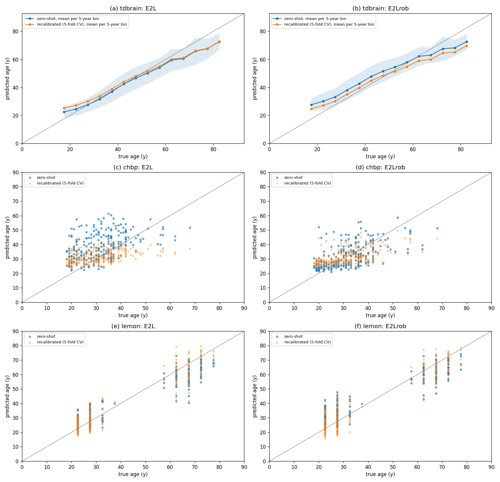
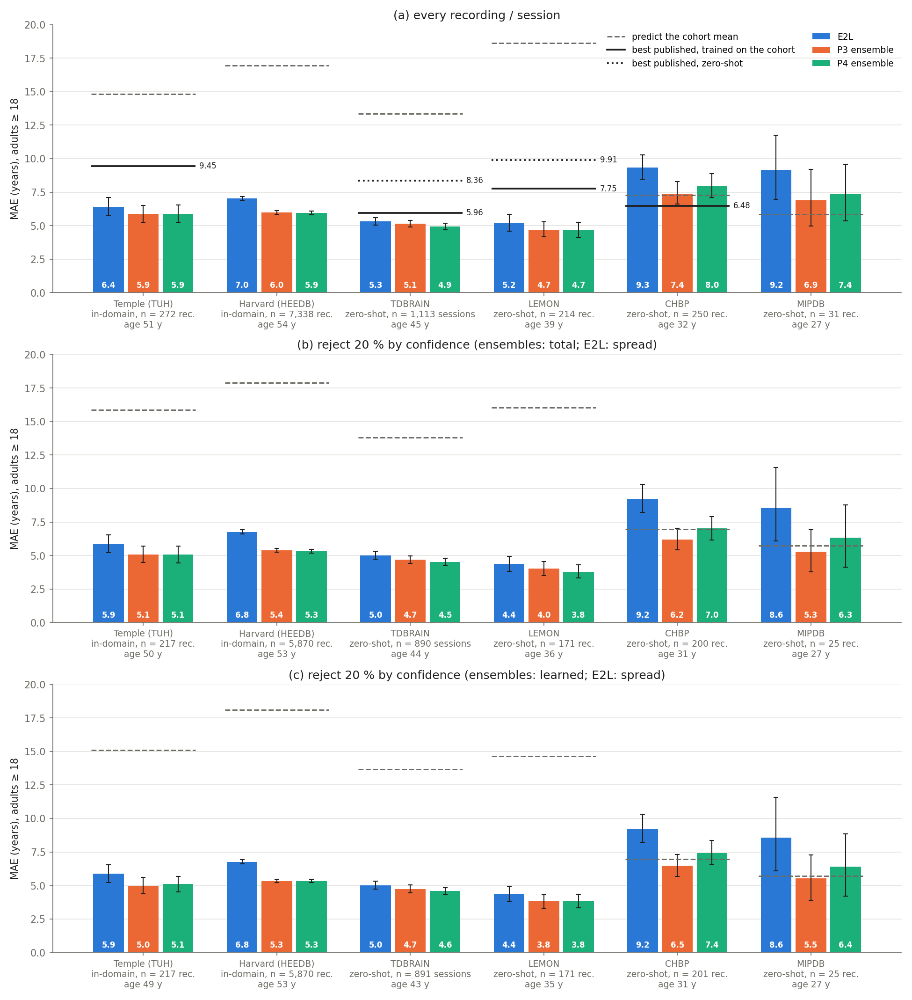
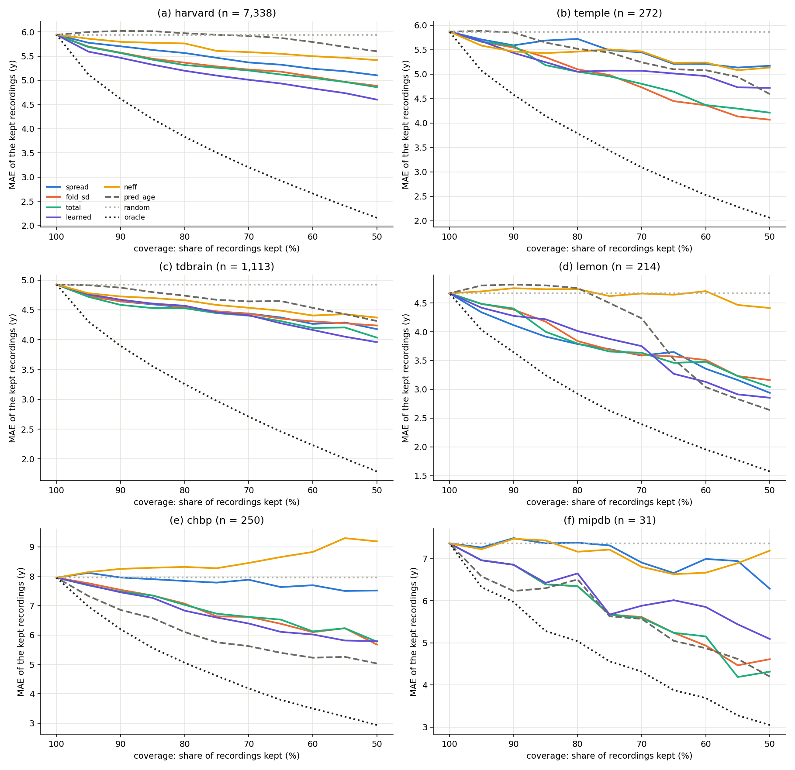
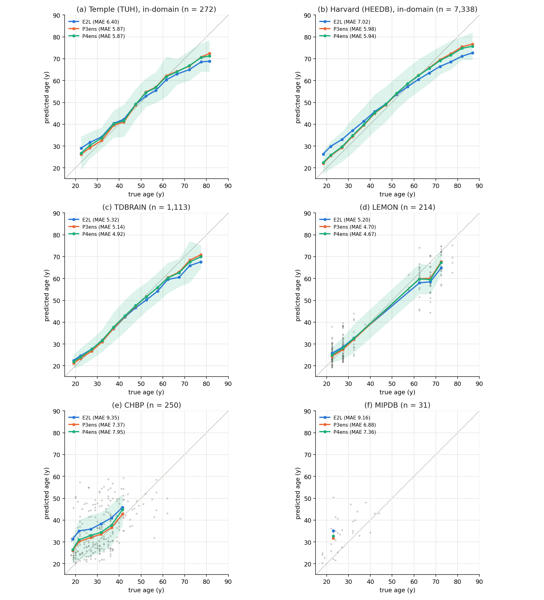
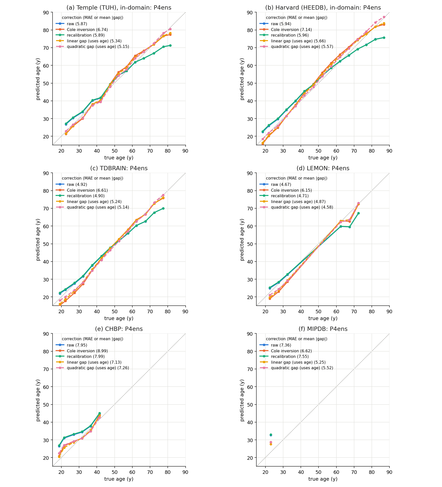
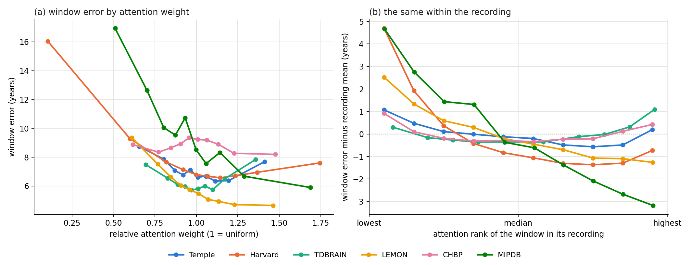
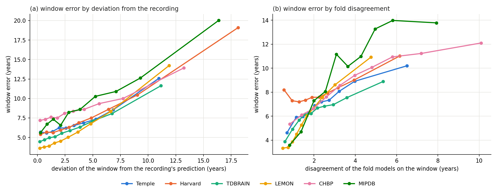
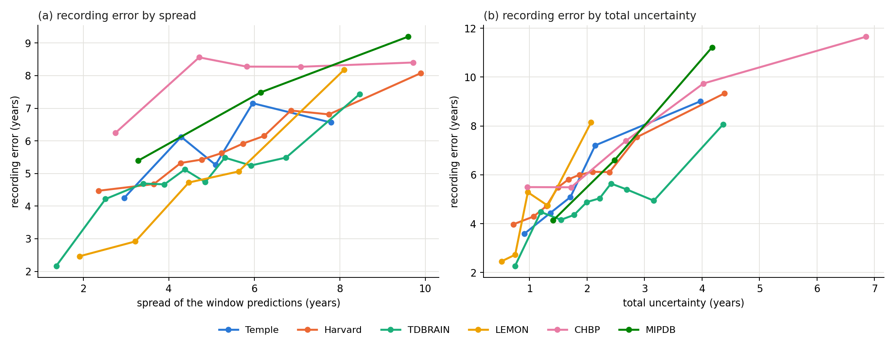
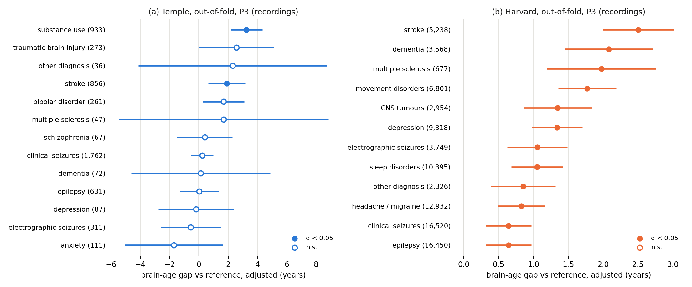

# TDBRAIN onboarding: external test set for brain age, with clinical labels

Status 2026-11-15: release 3.1 downloaded, QC-checked (Section 7), converted and scored zero-shot
(Section 8), relabelled with the participants table `TDBRAIN_participants_V3.1_2.xlsx`; adult results
in Section 9, data analytics in Section 10, P3 / P4 CV models and their 5-fold ensembles in Section 11 (best:
P4 ensemble, 4.93 y per adult session). TDBRAIN is a standing test set of the age configs (`evaluation.test_sets`, Section 9.4).

TDBRAIN (Two Decades-Brainclinics Research Archive for Insights in Neurophysiology,
van Dijk et al. 2022, *Sci Data* 9:333, [doi:10.1038/s41597-022-01409-z](https://doi.org/10.1038/s41597-022-01409-z))
is a single-site clinical EEG archive from Nijmegen (NL), recorded 2001–2021. It is
onboarded the way LaBraM evaluates LEMON, MIPDB and CHBP (`docs/external_eval_results.md`,
`docs/chbp_onboarding.md`): as a **test-only external cohort** that the brain-age models
trained on TUH + HEEDB (`tuh_heedb_v1`) score without retraining. Unlike those healthy-volunteer
corpora it is mostly **psychiatric patients**, and it carries the clinical labels, so the
brain-age gap can be read per diagnosis.

Code:
- `dataset_maker/make_external_npy.py --dataset tdbrain`: BIDS BrainVision to the npy cohort
  format through the training pipeline (`make_TUH_npy.preprocess_raw`). It also writes the
  clinical table `clinical.parquet` (`tdbrain_clinical_table`) and puts the clinical flags in
  the manifest;
- `scripts/external_runs/tdbrain.sh`: fetch, unpack, private S3 mirror, convert, score, report;
- `scripts/eval_age_by_cohort.py --trim-start-sec / --trim-end-sec`: trim overrides. A
  TDBRAIN file is 2 min long, and the training trims (60 s at each end) would drop all of it;
- `scripts/external_eval_report.py`: TDBRAIN subgroups (age bands, diagnoses, eyes closed / open);
- `tests/test_tdbrain.py`: a synthetic BIDS tree (BrainVision, participants.tsv with decimal
  commas, a blinded `sub-19*` subject, a derivatives copy) converted end to end.

## 1. The dataset

### Table 1.1. TDBRAIN as published (van Dijk et al. 2022, via PubMed Central PMC9198070)

| | |
|---|---|
| participants / sessions | 1,274 / 1,346 (some participants have several sessions, e.g. before and after treatment) |
| age, sex | 5–88 y (abstract: 5–89), mean 38.7 ± 19.2; 620 female |
| main indications | MDD 426, ADHD 271, SMC (subjective memory complaints) 119, OCD 75; also healthy controls and smaller groups |
| diagnosis status | `formal_status`: a DSM-5 diagnosis (clinician and/or structured interview above a clinical cut-off) **or** a referral indication (unofficial, from a GP / psychologist); `UNKNOWN` where missing, which "does not mean these are healthy participants" |
| blinded replication set | 30 % of the MDD / ADHD / OCD diagnostic and outcome labels are withheld: `participant_id` starting with `sub-19`, `REPLICATION` in participants.tsv |
| protocol | 2 min eyes open (`restEO`), then 2 min eyes closed (`restEC`); then an auditory oddball and a visual 1-back task (only behavioural data released for those) |
| EEG | 26 channels, 10-10 (Compumedics Quickcap / ANT Waveguard, Ag/AgCl), 500 Hz, low-pass 100 Hz before digitisation, DC-coupled, 24 bit; virtual ground, re-referenced offline to averaged mastoids (A1/A2), ground AFz, < 10 kΩ |
| other channels | vertical + horizontal EOG, ECG (Erb's point), EMG (right masseter) |
| line frequency | 50 Hz (the Netherlands) |
| format | BIDS, BrainVision (`.vhdr/.vmrk/.eeg`) per session and task + `.json` / `channels.tsv`; a `derivatives/` copy as `.csv`; `participants.tsv` + `.json` in both trees |
| other data | gender, age, height, weight, sleep, education, alcohol and drug use, NEO-FFI item scores, day-of-measurement questions; for the published treatment studies, primary outcomes (e.g. rTMS in MDD n = 176, neurofeedback in ADHD n = 102, SMA-rTMS in OCD n = 17) |
| medication | allowed and **not** systematically tracked; short half-life drugs (methylphenidate) skipped on the morning of the EEG |
| size | "15 GB" (brainclinics.com), split zip files |

## 2. Access, DUA and storage

### Table 2.1. How the data can be obtained (checked 2026-11-12)

| route | result |
|---|---|
| brainclinics.com/resources | ORCID login, then the DUA, then the download page with the split zips. **The only working route.** It has to be done by a person, in a browser |
| Synapse `syn25671079` | Our Synapse account (`BenningerLab`) can list the files (`TD-BRAIN-DATASET.zip` syn26253372, `TD-BRAIN-SAMPLE.zip` syn26241849, `TD_BRAIN_code.zip` syn26241847, `participants.tsv` syn26468893) but `canDownload` is false. Only the authors and their 2021 review team have DOWNLOAD in the ACL. The project wiki says to download from brainclinics.com while the Synapse terms are being set up |

The DUA text (`/data/datasets/EEG-public/TDBRAIN/meta/TD_BRAIN-DataUseAgreement.pdf`, from
the Synapse wiki) sets these rules:

### Table 2.2. DUA terms and what they mean here

| DUA clause | our handling |
|---|---|
| 1. comply with institutional / ethics rules | IRB / ethics cover for the secondary use is the user's call |
| 2. no re-identification, no linkage to other databases that could identify | nothing is joined to TDBRAIN except our own model predictions |
| 3. no redistribution, **not even within the research group**, unless each person has accepted the DUA themselves | the copy sits in the private `s3://eeg-data-public/TDBRAIN/v1/` (same rule as HEEDB: `check_private` before every sync, never public). Only people who have accepted the TDBRAIN DUA themselves may read it. Notebooks and docs show aggregates only |
| 4. no changes to the raw data | the zips and the extracted files stay as downloaded; conversion only reads them |
| 5. credit: link to brainclinics.com/resources and cite van Dijk et al. | in every result note or figure using TDBRAIN |
| 6. the code is MIT-licensed, with the same credit | applies if we reuse their preprocessing code |

| | local | S3 (private) |
|---|---|---|
| zips as downloaded | `/data/datasets/EEG-public/TDBRAIN/zips` | `s3://eeg-data-public/TDBRAIN/v1/zips` |
| extracted BIDS tree | `/data/datasets/EEG-public/TDBRAIN/raw` | `s3://eeg-data-public/TDBRAIN/v1/raw` |
| paper + DUA PDFs | `/data/datasets/EEG-public/TDBRAIN/meta` (downloaded) | `s3://eeg-data-public/TDBRAIN/v1/meta` |
| cohort | `/data/datasets/EEG-public/TDBRAIN/cohorts/tdbrain_v1` | `s3://eeg-data-public/TDBRAIN/v1/cohorts/tdbrain_v1` |

## 3. What a recording carries: EEG, annotations, "report", health record

TDBRAIN has no clinical EEG report and no medical record. In the per-recording tables
we use for TUH and HEEDB (`labram/eval/clinical_analytics.py`), its fields map as follows:

### Table 3.1. TDBRAIN fields against the TUH / HEEDB per-recording schema

| our field | TUH / HEEDB source | TDBRAIN |
|---|---|---|
| signal | EDF | BrainVision `restEC` and `restEO`, 2 min each, converted as **two recordings per session** (`sub-<id>_ses-<n>_<task>_tdbrain`) |
| annotations | EDF annotations / HEEDB `annotations.csv` | BrainVision markers (`.vmrk`). The converter counts them per file (`annotations` in the manifest): a mid-file `New Segment` would mean a discontinuity. The eyes-open / eyes-closed split is in the file names (`task`). No artifact marks are shipped; the authors' preprocessing code (`TD_BRAIN_code.zip`) detects EMG, jumps, kurtosis, voltage swings, blinks, bridging and extreme correlations, if we want them |
| report verdict (`label`, `abnormal_report`) | NEDC sheet / HEEDB findings | **none**: no EEG was read clinically. `label` is `normal` for healthy controls only, and patients stay unlabelled (`unlabelled_*` in the per-cohort metrics). A psychiatric indication is not an EEG finding |
| diagnosis groups (`dx_*`) | ICD-10 (HEEDB), free text (TUH) | `indication`, split on `/ , ; + &`, gives `dx_mdd`, `dx_adhd`, `dx_ocd`, `dx_smc` and `dx_other` (anything else, e.g. tinnitus, burnout), plus `healthy`, `blinded` (sub-19* / REPLICATION) and `unknown`. `formal_status` says whether a diagnosis is formal (DSM) or a referral |
| medication (`med_*`) | ATC (HEEDB), NEDC drug classes (TUH) | not recorded |
| demographics | age, sex | age **with decimals** (per session), sex (decoded through the `participants.json` levels), plus education, height, weight, sleep, alcohol and drug use, all kept in `clinical.parquet` |
| questionnaires, outcomes | none | NEO-FFI items, day-of-measurement questions and treatment outcomes where published. Every participants.tsv column is kept unchanged in `clinical.parquet` |

## 4. Conversion

The signal path is the one every training and external cohort went through
(`make_TUH_npy.preprocess_raw`): 0.1–75 Hz band-pass, spectrum-interpolation line removal at
50 and 60 Hz, resampling to 200 Hz, µV, float16, the 23 TUH channels in model order. The
reference is kept as recorded (averaged mastoids), because the models apply a common average
reference at their input. TDBRAIN-specific choices:

- **19 of 23 channels.** All 19 10-20 positions exist (T7/T8/P7/P8 → T3/T4/T5/T6). A1/A2 are
  the reference and T1/T2 are not recorded; these four are zero-filled and flagged in
  `channel_mask`, as for CHBP and HEEDB.
- **DC offset removed first.** The recording is DC-coupled, so each channel's mean is
  subtracted before the 0.1 Hz high-pass. Otherwise a large offset leaves a filter transient
  over the first seconds of a 2-minute file. The synthetic test puts a 20 mV offset on every
  channel and checks that the output stays within ±200 µV.
- **Eyes closed and eyes open are separate recordings**, 12 whole 10 s windows each (120 s).
  They are scored separately and can be pooled per session afterwards. They are not
  concatenated: the files are separate acquisitions, and joining them would add a step.
- **Scoring windows.** The models were trained with a 60 s trim at each end and a 5-minute
  evaluation budget. Here every window is scored (`--trim-start-sec 0 --trim-end-sec 0
  --eval-minutes 0`). A second pass drops 10 s at each end (`inner`, 10 windows) to check
  that filter edges do not matter.
- **Age.** The age comes from the participants.tsv row of the same session
  (`age_session_matched`). It falls back to the subject's first row when the file has no
  session column. Rows without an age are dropped.

## 5. Evaluation plan

1. **QC against the training data**, as in `docs/chbp_onboarding.md` Table 2.1: channel std,
   alpha peak, relative band powers and PSD against the TUH / HEEDB normal references, eyes
   closed and eyes open separately. CHBP lost 1–2 years of MAE to an amplitude / spectral
   shift, so check first whether TDBRAIN (DC–100 Hz, mastoid reference, short files) shifts too.
2. **Zero-shot brain age** of E2, E2L, W4, L1, W7, X1, X3 (and the device-robust E2L from
   `scripts/external_runs/e2l_robust_full.sh`), with the metrics of `docs/chbp_onboarding.md`
   Eqs. (3.1)–(3.6). Groups: 5–17 / 18–44 / 45–88 years, healthy, MDD, ADHD, OCD, SMC,
   eyes closed vs open. The 5–17 group lies outside the training ages (MIPDB showed the models
   fail on children), so the headline numbers are for adults.
3. **Brain-age gap by diagnosis.** Bias-corrected gap (`brain_age_bias_correction.md`; the
   correction is fitted on the training model's own validation predictions, not on TDBRAIN)
   for MDD, ADHD, OCD and SMC against the healthy controls, adults only, one session per
   subject. Subjects with several sessions are grouped (cross-fitted recalibration folds
   already group by `subject`).
4. **Within-subject repeatability**: participants with two or more sessions give a test–retest
   check of predicted age, net of the true age change between the sessions.
5. Optionally, add `tdbrain=<cohort>` to `evaluation.test_sets`. For SageMaker that needs an
   entry in `DEFAULT_SAGEMAKER_DATA_S3_URIS` once the cohort is on S3.

## 6. Checklist

| step | status |
|---|---|
| paper + DUA read, access routes checked | done 2026-11-12 |
| converter, clinical table, report groups, eval trim overrides, tests | done, synthetic data only |
| ORCID login + DUA on brainclinics.com | done 2026-11-12 (zip password received) |
| zips on the server (`zips/`), extracted, zip mirrored to `s3://…/TDBRAIN/v1/zips/` | done 2026-11-14 (release 3.1, Section 7) |
| real tree checked: BDF, tasks, channels, units; reader adapted (BDF, end pad); signal QC on 80 files | done 2026-11-14 (Section 7) |
| participants table (age, sex, indication): not in the zip | **waiting for the user** (separate download) |
| `convert` (placeholder ages) + cohort to S3; E2L / robust scoring; cohort comparison; literature | done 2026-11-14 (Section 8) |
| `relabel` with the participants table, adults-only `compare` + `tdbrain_brain_age.py` (MAE, R², per-indication gap) | done 2026-11-15 (Section 9) |
| TDBRAIN as a standing test set (data loader + S3 channel) | done 2026-11-15 (Section 9.4) |
| replication zip `TDBRAIN_MDD_Dx_ReplicationV3_1_Encr.zip` | not downloaded yet (Section 9.5) |

### Things to verify on the real files

The code reads the formats published in the paper. These details were not visible before
download:

- the exact `participants.tsv` column names. The reader accepts `participants_ID` /
  `participant_id`, `sessID` / `session`, `gender` / `sex`, `indication`, `formal_status`,
  `DISC/REP`, and stops with the list of columns found if the id or age column is missing;
- whether `participants.json` gives the gender levels (otherwise `sex` stays None; it is not guessed);
- the BrainVision unit and resolution (MNE scales them). Check that the channel std is in
  the expected 5–20 µV range;
- the indication vocabulary (combined labels, spelling) for the keyword map
  `TDBRAIN_INDICATIONS`;
- the zip layout. The EEG zip is **password protected**: Brainclinics e-mails the password after the DUA. It is kept in `/data/datasets/EEG-public/TDBRAIN/.zip_password` (mode 600, never in git or on S3) or `$TDBRAIN_ZIP_PASSWORD`. `tdbrain.sh unpack` extracts with 7z (`p7zip-full`), which handles ZipCrypto, AES, `.z01` and `.zip.001` splits and nested zips.

## 7. Release 3.1 as received (2026-11-14)

The download is `TDBRAIN_Dataset_V3_1_Encr.zip` (15.5 GB, stored, AES-encrypted entries).
It extracts to `raw/TDBRAIN_Dataset_V3_1/` (19.5 GB, 9,128 files, macOS `.DS_Store` files
skipped). This release differs from the paper's (Section 1) as follows:

### Table 7.1. Contents of release 3.1

| | |
|---|---|
| subjects / folders | 1,300 subjects (`sub-87*` 284, `sub-88*` 1,016); **no `sub-19*`**, so this release holds no blinded replication subjects |
| sessions | 1,391 `restEC` and 1,387 `restEO` session files, plus `oddball` in 162 sessions (with `events.tsv`; not resting, not converted) |
| format | **BDF** (24 bit) + `_eeg.json` + `_channels.tsv`, BIDS 1.9.0; no BrainVision, no `derivatives/` |
| channels | 26 EEG (10-10) + VPVA, VNVB, HPHL, HNHR (EOG), Erbs (ECG), Mass (EMG) + BDF `Status` (all zero); all 19 of the 10-20 channels map |
| recording | 500 Hz, "linked mastoids (A1A2)", power line 50 Hz, Neuroscan NuAmps, DC-coupled (high-pass 0, low-pass 100 Hz in the header), µV |
| length | 120.0–121.0 s per file, of which about 1 s at the end is a **constant pad** (digital zero) up to the next whole 1-s BDF record |
| markers | none (`Status` channel all zero, no BDF annotations) |
| demographics | **none in the zip**: no `participants.tsv`, and the BDF patient field and date are anonymised (`<id> X X X`, `01.01.85`). Age, sex and indication have to come from a separately downloaded participants table |

**End pad.** The signal sits at a DC offset of several mV, so the pad, a step to 0, would
ring through the band-pass into the last two windows. In 79 of 80 sampled files, the last
10 s window had a median 78 times the channel std of the others and the one before it 3 times.
`open_tdbrain` therefore cuts the samples where no 10-20 channel changes, at both ends, before
removing the mean. `tests/test_tdbrain.py` pads its synthetic files in the same way and fails
without the cut.

### Table 7.2. Signal QC after the training pipeline, 80 random resting files vs 60 normal recordings per reference

For window $k$ of a recording (10 s, the 19 EEG channels $c$, first and last window of a
TDBRAIN file left out; windows 6–35 of a reference recording), the channel std is
$s_{k,c} = \operatorname{std}_t x_{k,c}(t)$, and the table gives the median over windows,
channels and recordings (7.1). For the band shares, the per-window Welch PSD $P(f)$
(5 s segments, mean removed per window) is medianed over windows and channels, and
$\rho_{[a,b)} = \sum_{a \le f < b} P(f) / \sum_{0 < f < 45} P(f)$ (7.2). The alpha peak is the
argmax of the O1/O2 PSD in 6–14 Hz (7.3).

$$ \tilde s = \operatorname{median}_{k,c,\text{rec}}\ s_{k,c} \tag{7.1} $$

$$ \rho_{[a,b)} = \frac{\sum_{a \le f < b} P(f)}{\sum_{0 < f < 45} P(f)} \tag{7.2} $$

| source | n | channel std (µV) (7.1) | after CAR (µV) | ρ below 1 Hz (7.2) | ρ 1–4 Hz | ρ 8–13 Hz | alpha peak (Hz) (7.3) | share of samples > 300 µV |
|---|---|---|---|---|---|---|---|---|
| TUH normal (training) | 60 | 12.3 | 9.9 | 0.45 | 0.16 | 0.09 | 8.8 | 0.001 |
| HEEDB normal (training) | 60 | 22.7 | 12.6 | 0.62 | 0.15 | 0.06 | 8.6 | 0.056 |
| TDBRAIN eyes closed | 45 | 15.4 | 10.1 | 0.36 | 0.15 | 0.20 | 9.6 | 0.000 |
| TDBRAIN eyes open | 35 | 11.8 | 8.2 | 0.36 | 0.23 | 0.11 | 9.4 | 0.000 |

**What Table 7.2 shows:** unlike CHBP (`docs/chbp_onboarding.md` Table 2.1, std 5.9 µV),
TDBRAIN arrives at the models' input with a training-like amplitude. Its median channel std
of 15.4 / 11.8 µV lies between TUH and HEEDB. The DC-coupled recording does not leave more
slow power than the training data after the 0.1 Hz high-pass: the share below 1 Hz is 0.36
against 0.45 / 0.62. Eyes closed shows the expected alpha (ρ 0.20, peak 9.6 Hz), about twice
the eyes-open share, as the paper reports. No sampled file had a sample above 300 µV. After
the cut, the first and last windows match the inner ones: median std ratio 1.00 / 1.07, 95th
percentile 1.43 / 1.51. 72 of the 80 files give 12 windows and 8 give 11.

## 8. Preprocessing and zero-shot scoring of release 3.1 (2026-11-14)

All 2,778 resting files were converted (`make_external_npy --dataset tdbrain`, no errors):
32,913 windows, 19 of 23 channels in every file, 12 windows in 2,348 files and 11 in 428
(one file has 20, one 9). The participants table is not in the zip, so the cohort
`tdbrain_v1` carries a flagged placeholder age (`age_placeholder`, 50 y). Once the table
arrives, `make_external_npy --relabel --meta <table>` writes the real ages and clinical flags
without converting again (tested in `tests/test_tdbrain.py`), and the metrics below are
computed from the saved predictions. Cohort on S3: `s3://eeg-data-public/TDBRAIN/v1/cohorts/tdbrain_v1`.
Predictions: `/data/runs/heedb/external_eval/tdbrain_{all,inner}.json`.

Scored: E2L and the two device-robust E2L models of `docs/chbp_domain_shift.md` §10 (band
1–45 Hz + per-window amplitude normalisation; `E2Lrob` fine-tuned from E2L for 4 + 6 epochs,
`E2LrobF` trained from scratch with the E2L recipe), every window
(`--trim-start-sec 0 --trim-end-sec 0 --eval-minutes 0`). The same models were scored on
LEMON, MIPDB and CHBP with every window (after the training trims of 60 s). The metrics are
those of `docs/chbp_onboarding.md`: MAE (3.1), bias (3.2), R² (3.3), Pearson r (3.4) and
predict-the-cohort-mean MAE (3.5). Two label-free quantities are added. The **EC–EO
agreement** is the Pearson correlation, over sessions, of the predictions for the eyes-closed
and eyes-open file of the same session (8.1). The **session repeatability** is the Pearson
correlation, over subjects with sessions 1 and 2, of the session-mean predictions (8.2).

$$ r_{\mathrm{EC,EO}} = \operatorname{corr}_{s}\big(\hat y_{s,\mathrm{EC}},\ \hat y_{s,\mathrm{EO}}\big) \tag{8.1} $$

$$ r_{1,2} = \operatorname{corr}_{j}\big(\bar{\hat y}_{j,1},\ \bar{\hat y}_{j,2}\big) \tag{8.2} $$

### Table 8.1. Zero-shot brain age per cohort, every window (`docs/data/external_eval/tdbrain/cohort_comparison_all_windows.csv`)

MAE / bias / r / R², years. In-domain = the `tuh_heedb_v1` test split (E2L only scored with
every window; the robust models' 5-min in-domain MAE is 8.04 / 7.73 against E2L's 7.00,
`docs/chbp_domain_shift.md` Table 10.3).

| cohort | n | age, mean ± sd | predict-the-mean MAE (3.5) | E2L | E2Lrob | E2LrobF |
|---|---|---|---|---|---|---|
| in-domain test (TUH + HEEDB) | 7,612 | 53.9 ± 19.8 | 16.89 | 6.13 / −0.5 / 0.92 / 0.84 | — | — |
| LEMON | 214 | 39.2 ± 20.2 (bins) | 18.60 | **5.20** / −0.8 / 0.95 / 0.88 | 6.33 / +1.8 / 0.94 / 0.85 | 6.07 / +2.2 / 0.94 / 0.85 |
| CHBP | 250 | 31.7 ± 9.3 | 7.28 | 9.35 / +7.0 / 0.45 / −0.64 | 6.14 / +0.2 / 0.58 / 0.25 | **5.90** / −0.5 / 0.61 / 0.33 |
| MIPDB, all | 116 | 15.8 ± 8.2 | 6.32 | 12.65 / +12.4 / 0.59 / −2.07 | 17.03 / +16.9 / 0.46 / −4.23 | 15.14 / +15.0 / 0.56 / −3.15 |
| MIPDB, adults | 31 | 27.5 ± 7.0 | 5.85 | 9.16 / +8.2 / 0.45 / −1.66 | 12.03 / +11.4 / 0.51 / −2.89 | 10.56 / +10.2 / 0.62 / −2.07 |
| **TDBRAIN** | 2,778 files | ages pending (published release: 38.7 ± 19.2) | — | pending | pending | pending |

### Table 8.2. TDBRAIN predictions without ages (2,778 files, 1,391 sessions)

| model | predicted age, mean ± sd | 5th–95th percentile | EC − EO, mean (y) | $r_{\mathrm{EC,EO}}$ (8.1) | $r_{1,2}$ (8.2), n = 74 | session 2 − 1, mean (y) |
|---|---|---|---|---|---|---|
| E2L | 39.6 ± 16.3 | 19.1–67.2 | −0.9 | 0.960 | 0.978 | −0.3 |
| E2Lrob | 44.2 ± 15.4 | 22.6–68.2 | −0.4 | 0.956 | 0.975 | −0.5 |
| E2LrobF | 44.5 ± 16.0 | 22.3–70.0 | −1.0 | 0.959 | 0.966 | −0.9 |
| *reference: E2L, in-domain test* | 53.4 ± 16.7 (true 53.9 ± 19.8) | — | — | — | 0.929 (n = 703) | +1.3 |

**What Tables 8.1 and 8.2 show:**
- **E2L's predicted-age distribution on TDBRAIN is close to the published age distribution**:
  mean 39.6 against 38.7, sd 16.3 against 19.2. The robust models predict about 5 years
  older. That fits their LEMON bias (+1.8 / +2.2 against E2L's −0.8) and their in-domain cost.
  The 5–17-year-olds lie outside the training ages (MIPDB shows the bias there), and they
  compress the spread. Whether the means match per subject only the ages can tell.
- **The predictions are stable within a subject.** The eyes-closed and eyes-open files of a
  session agree at r = 0.96, with eyes closed predicted 0.4–1.0 y younger. The 74 subjects
  with two sessions repeat at r = 0.97–0.98, more than the in-domain repeat recordings
  (0.93). TDBRAIN's repeat sessions are probably weeks apart, around a treatment course; the
  interval is in the participants table.
- **Scoring every window or only the inner 10 is the same** (difference ≤ 0.1 y in every
  statistic). The cut end pad (Section 7) leaves no edge effect.
- **The device-robust models are not a free win.** They fix CHBP (MAE 9.35 → 5.90–6.14), but
  cost 0.9–1.1 y on LEMON and 2–4 y on MIPDB. TDBRAIN's amplitude is training-like
  (Section 7), so E2L is the primary model and the robust models are the check.

### Table 8.3. Published brain-age results on TDBRAIN (literature search 2026-11-14)

Verified from the full text unless marked. Every study used the first public release
(1,274 subjects), not release 3.1. None reports a bias-corrected metric or a brain-age gap
per diagnosis.

| paper | protocol | subset | model | MAE | R² / r |
|---|---|---|---|---|---|
| Khayretdinova et al. 2022, *Front. Aging Neurosci.* 14:1019869 | within TDBRAIN, 10-fold subject-grouped CV ×10 | 1,335 sessions, 5–88 y, EO + EC | DCNN on raw EEG | 5.96 ± 0.33 (EO 6.39, EC 6.33) | 0.81 / 0.90 |
| Hu et al. 2025 (NEOBA), *Front. Aging Neurosci.* doi:10.3389/fnagi.2025.1559067 | "validation in TDBRAIN", CV protocol not stated for TDBRAIN | 1,274 subjects | oscillatory + coupling features → MLP | 4.95 (EO 5.62, EC 5.24) | not reported |
| Bomatter et al. 2024, *eBioMedicine* 106:105259 | within TDBRAIN, 10×10-fold CV | first sessions, n = 1,134, 5–89 y | Riemannian / filter-bank + ridge | not reported | ≈ 0.8 (from text; exact values in figures) |
| Bikki & Zeng 2026, BDIMed (ACM) doi:10.1145/3816325.3843614 (abstract only) | within TDBRAIN; zero-shot TUABX → TDBRAIN | unknown | CNN | 5.83 ± 0.66 (within) | 0.84 (within); **0.83 zero-shot** |
| Tveitstøl et al. 2025, *IEEE TBME* doi:10.1109/TBME.2025.3639477 | cross-dataset, leave one dataset out | EC, n = 1,273 | Inception / Deep4 / Shallow | figures only | abstract suggests r 0.63, R² −0.01 with TDBRAIN as target (unverified mapping) |
| Hajhassani et al. 2026, arXiv:2609.31195 (preprint) | **zero-shot**, trained on TUEG | "healthy" 20–90 y, n in a figure | GEDAI + CTNet | **8.36** | **0.59** |

The like-for-like comparison for our numbers is the zero-shot rows: MAE 8.36 / R² 0.59
(adults only) verified, R² 0.83 (abstract only). Within-dataset results (MAE 5–6, R² ≈ 0.8)
are an upper reference, because those models saw TDBRAIN's own devices and population. R²
near 0.8 there also relies on the 5–88 y range, children included. REVE, SPERA, PhysioWave-T
and Brain-OF list TDBRAIN in their pretraining data, so their TDBRAIN numbers are not zero-shot.
E2L was fine-tuned only on TUH + HEEDB. LaBraM's pretraining list should be checked for
TDBRAIN before calling our result zero-shot in a paper.

## 9. Zero-shot brain age on TDBRAIN adults (2026-11-15)

### 9.1. Participants table and the analysed set

`TDBRAIN_participants_V3.1_2.xlsx` (separate download; one sheet `TDBRAIN-V3.1`, 1,363 rows ×
106 columns, kept in `meta/` and on S3) is read by `tdbrain_clinical_table`. It has one row per
subject and session (`TDBRAIN_ID`, `sessID`), age with two decimals (5.04–87.89 y, one row
without an age), `gender` 0 / 1, `indication`, `formal_status` (a diagnosis, `HEALTHY` or
`UNKNOWN`), the treatment-study fields (`Dataset`, `Responder`, `Remitter`, BDI / ADHD-RS /
Y-BOCS before and after), the oddball and 1-back task scores, NEO-FFI items and the
day-of-measurement questions. Every row is `DISCOVERY`: the release holds no blinded subjects.
**Gender 0 = female**: in this table, adults coded 0 have a median height and weight of 168 cm and
65 kg, against 183 cm and 79 kg for code 1, and 0 is 47 % of the subjects (the paper: 49 %
female). `TDBRAIN_GENDER_LEVELS` holds this mapping.

1,357 of the 1,391 EEG sessions have their own row. In the other 34 (66 files, mostly second
sessions), the age falls back to the subject's first row. Those files stay in the manifest but
not in the scored split (`age_session_matched`). **The analysis covers adults only**
(`--min-age 18` in every script), because the 5–17-year-olds lie outside the training ages
(2 TUH recordings under 18, none in HEEDB). That leaves 2,222 files = 1,113 sessions = 1,062
subjects, 18–88 y, mean 45.3 ± 15.9. The children's recordings stay in the cohort.

### Table 9.1. E2L on TDBRAIN adults (`docs/data/external_eval/tdbrain/tdbrain_accuracy.csv`)

Metrics (3.1)–(3.5) of `docs/chbp_onboarding.md`. MAE with a 95 % interval from 2,000 bootstrap
resamples of subjects. *Session* = mean of the session's eyes-closed and eyes-open
predictions, the unit of the published within-TDBRAIN results. *Subject* = the first session.

| unit / subset | n | age, mean ± sd | MAE [95 % CI] | bias | r | R² | predict-the-mean MAE |
|---|---|---|---|---|---|---|---|
| file, all | 2,222 | 45.3 ± 15.9 | 5.65 [5.39, 5.93] | −1.5 | 0.889 | 0.778 | 13.35 |
| file, eyes closed | 1,113 | 45.2 ± 15.9 | 5.60 [5.30, 5.89] | −2.0 | 0.894 | 0.783 | 13.35 |
| file, eyes open | 1,109 | 45.3 ± 15.9 | 5.71 [5.41, 6.01] | −1.1 | 0.885 | 0.772 | 13.36 |
| **session, all** | 1,113 | 45.2 ± 15.9 | **5.32 [5.05, 5.60]** | −1.5 | **0.902** | **0.803** | 13.35 |
| session, 18–29 | 238 | 23.6 ± 3.3 | 3.27 | +1.7 | 0.46 | — | 2.88 |
| session, 30–44 | 296 | 37.6 ± 4.4 | 5.06 | −0.5 | 0.57 | — | 3.70 |
| session, 45–64 | 455 | 54.3 ± 5.5 | 5.81 | −2.3 | 0.58 | — | 4.82 |
| session, 65+ | 124 | 72.0 ± 4.9 | 8.07 | −7.5 | 0.48 | — | 3.98 |
| session, healthy controls | 179 | 40.3 ± 17.1 | 5.28 [4.55, 6.10] | −1.0 | 0.900 | 0.806 | 14.65 |
| subject (first session) | 1,062 | 44.8 ± 15.7 | 5.31 [5.04, 5.60] | −1.5 | 0.899 | 0.799 | 13.20 |
| session, recalibrated (10-fold CV, uses TDBRAIN ages) | 1,113 | 45.2 ± 15.9 | 5.25 | 0.0 | 0.902 | 0.813 | 13.35 |

Within an age band, R² is negative because the band's own age variance is small; MAE and bias
are the meaningful numbers there.

### Table 9.2. Zero-shot brain age per cohort, adults, every window (`docs/data/external_eval/tdbrain/cohort_comparison_all_windows.csv`)

MAE / bias / r / R², per file, years. In-domain test of `tuh_heedb_v1` for E2L only.

| cohort | n | age, mean ± sd | predict-the-mean MAE | E2L | E2Lrob | E2LrobF |
|---|---|---|---|---|---|---|
| in-domain test (TUH + HEEDB) | 7,610 | 53.9 ± 19.8 | 16.89 | 6.12 / −0.5 / 0.92 / 0.84 | — | — |
| LEMON | 214 | 39.2 ± 20.2 (bins) | 18.60 | **5.20** / −0.8 / 0.95 / 0.88 | 6.33 / +1.8 / 0.94 / 0.85 | 6.07 / +2.2 / 0.94 / 0.85 |
| **TDBRAIN** | 2,222 | 45.3 ± 15.9 | 13.35 | **5.65** / −1.5 / 0.89 / 0.78 | 6.50 / +3.0 / 0.87 / 0.72 | 6.64 / +3.4 / 0.87 / 0.72 |
| CHBP | 250 | 31.7 ± 9.3 | 7.28 | 9.35 / +7.0 / 0.45 / −0.64 | 6.14 / +0.2 / 0.58 / 0.25 | **5.90** / −0.5 / 0.61 / 0.33 |
| MIPDB adults | 31 | 27.5 ± 7.0 | 5.85 | 9.16 / +8.2 / 0.45 / −1.66 | 12.03 / +11.4 / 0.51 / −2.89 | 10.56 / +10.2 / 0.62 / −2.07 |

**What Tables 9.1 and 9.2 show:**
- **E2L transfers to TDBRAIN almost without loss.** Per session it reaches MAE 5.32 y, r 0.90,
  R² 0.80 on 1,113 adult sessions, below its own in-domain test MAE (6.12, older and wider ages)
  and close to LEMON (5.20). Recalibrating on TDBRAIN's own ages (10-fold CV) gains only
  0.07 y, so the zero-shot predictions are already calibrated for this cohort.
- **Pooling eyes closed and eyes open helps:** per file 5.60 (EC) / 5.71 (EO), per session 5.32.
- **The error grows with age, and so does the underestimate:** 3.3 y at 18–29, 8.1 y at 65+
  with bias −7.5. This is the usual regression to the mean, and it also shows on the
  in-domain test. The bias correction of `brain_age_bias_correction.md` addresses it.
- **Healthy controls (5.28) score like the patients.** The psychiatric indication does not
  degrade the prediction.
- **The device-robust models are worse here** (6.50 / 6.64, bias +3). TDBRAIN needs no device
  fix (Section 7), so E2L stays the model for TDBRAIN.

### Table 9.3. Brain-age gap per indication, adults, first session (`docs/data/external_eval/tdbrain/tdbrain_gap_by_indication.csv`)

Gap $g = \hat y - y$ per subject. Zero-shot correction (9.1): the age trend of E2L's own
validation gap (normal-report recordings of `tuh_heedb_v1`), $\hat y - y = a\,y + b$ with
$a = -0.254$, $b = 11.90$, is removed: $g_c = g - (a\,y + b)$. Comparison with the healthy
controls: Cohen's d and Welch t-test on $g_c$, and the coefficient $\beta$ of the group
indicator in the OLS (9.2), age centred, male = 1. Indications are not exclusive (an
`MDD/ADHD` row counts in both).

$$ g_c = g - (a\,y + b) \tag{9.1} $$

$$ g_c = \beta_0 + \beta\,\mathbb{1}[\text{group}] + \beta_1\,y + \beta_2\,y^2 + \beta_3\,\mathbb{1}[\text{male}] + \varepsilon \tag{9.2} $$

| indication | n | age, mean | gap, raw | gap, corrected (9.1) | vs healthy, d (Welch p) | β adjusted for age, age², sex (t) (9.2) |
|---|---|---|---|---|---|---|
| healthy | 179 | 40.3 | −1.0 | −2.6 | — | — |
| MDD | 351 | 45.7 | −1.6 | −1.8 | 0.12 (0.21) | +0.06 (0.10) |
| ADHD | 116 | 35.7 | −0.3 | −3.2 | −0.08 (0.46) | −0.29 (−0.38) |
| OCD | 54 | 33.9 | −0.6 | −3.9 | −0.19 (0.18) | −0.86 (−0.81) |
| SMC | 89 | 65.4 | −5.2 | −0.4 | 0.33 (0.009) | +0.87 (0.78) |
| other indication | 169 | 49.4 | −1.6 | −0.9 | 0.25 (0.02) | +0.80 (1.03) |
| unknown | 156 | 40.3 | −0.4 | −2.0 | 0.09 (0.42) | +0.49 (0.67) |

**What Table 9.3 shows:** **no indication has a brain-age gap that differs from the healthy
controls** once age and sex are accounted for. Every adjusted β is under 1 y and every |t| is
1.03 or less. The two raw Welch differences, SMC (p 0.009) and "other" (p 0.02), come from
age. SMC subjects are 65 on average, where the trend correction (9.1), fitted on the training
data, does not fully remove TDBRAIN's age dependence of the gap. With age in the model (9.2)
they disappear. The robust models agree (|t| ≤ 1.6, `tdbrain_gap_by_indication.csv`). With
n = 351 MDD against 179 controls, the study can detect an adjusted difference of about 0.26 SD
(about 1.7 y at 80 % power, two-sided α 0.05), so a large MDD gap is unlikely. A small one
cannot be excluded.

### 9.3. Against the published TDBRAIN results (Table 8.3)

| | protocol | ages | unit | MAE | R² |
|---|---|---|---|---|---|
| **ours, E2L** | **zero-shot** (TUH + HEEDB) | adults 18–88 | session (EC + EO) | **5.32** | **0.80** |
| ours, E2L, healthy | zero-shot | adults | session | 5.28 | 0.81 |
| Hajhassani et al. 2026 (preprint) | zero-shot (TUEG) | healthy 20–90 | recording | 8.36 | 0.59 |
| Bikki & Zeng 2026 (abstract) | zero-shot (TUABX) | unknown | unknown | — | 0.83 |
| Khayretdinova et al. 2022 | within TDBRAIN, 10-fold CV | 5–88 | session (EO + EC) | 5.96 | 0.81 |
| Hu et al. 2025 (NEOBA) | "validation in TDBRAIN" | 5–89 | session | 4.95 | — |
| Bomatter et al. 2024 | within TDBRAIN, 10×10-fold CV | 5–89 | first session | — | ≈ 0.8 |

Zero-shot, E2L is 3 y more accurate than the only verified zero-shot result (8.36 / R² 0.59),
and it matches the within-TDBRAIN models that were trained on this cohort (5.96 / R² 0.81).
Their R² comes from a wider range, 5–88 y; adults only, the same model would score a lower
R² with a similar MAE. Our cohort is release 3.1 (1,300 subjects, 183 healthy), theirs the
2022 release (1,274, 47 healthy), so the subsets differ.

### 9.4. TDBRAIN as a standing test set

The four age configs (`finetune_tuab_age*.json`) list TDBRAIN in `evaluation.test_sets`:

    tdbrain=/data/datasets/EEG-public/TDBRAIN/cohorts/tdbrain_v1?trim_start_sec=0&trim_end_sec=0&eval_minutes=0&age_min=18

The options after `?` are new (`labram/data/test_sets.py`). They give this set its own window
selection: no trims (the training 60 s + 60 s would empty a 2-min file), every window, adults
only. A selection that leaves a set empty skips it with a warning instead of stopping the run.
With the age config, the set holds 26,291 samples from 2,222 adult recordings. On SageMaker the
cohort becomes the input channel `test_tdbrain` from `s3://eeg-data-public/TDBRAIN/v1/cohorts/tdbrain_v1`
(added to `sagemaker.data_s3_uris` in every config, with CHBP), and the options travel with the
mount.

### 9.5. The replication zip

`TDBRAIN_MDD_Dx_ReplicationV3_1_Encr.zip` (offered next to the dataset) is not downloaded yet.
By its name it holds the blinded MDD diagnosis-replication set. Its EEG and ages would add
recordings to the age evaluation; its withheld diagnoses cannot enter Table 9.3.

## 10. Data analytics: TDBRAIN next to CHBP, LEMON and the training data (2026-11-15)

**Preprocessing is the training pipeline.** TDBRAIN goes through
`make_TUH_npy.preprocess_raw`, the function that prepared the Temple (TUH) and Harvard
training cohorts and CHBP / LEMON / MIPDB: 0.1–75 Hz band-pass, spectrum-interpolation line
removal at 50 and 60 Hz, resampling to 200 Hz, µV, float16, the 23 TUH channels in model order
(missing ones zero and masked), the recorded reference kept and the common average reference
applied in the model. Only two TDBRAIN-specific steps come before it, both needed for these
files: cutting the constant end pad (Section 7) and removing each channel's DC offset. There is
nothing to choose between "like Temple" and "like CHBP": they are the same pipeline.

`tdbrain.sh report` runs `scripts/external_eval_report.py` on TDBRAIN (adults,
`--min-age tdbrain=18`), CHBP and LEMON with E2L and E2Lrob. TDBRAIN's QC windows are each
file's windows 1 to n − 2 (`QC_WINDOWS`), and eyes closed and eyes open are summarised
separately. The other cohorts use the first 5 minutes after the 60 s trim. Band shares are
relative to 1–45 Hz power after CAR, as in `docs/chbp_onboarding.md` Table 2.1.

### Table 10.1. Signal QC, median over recordings (`docs/data/external_eval/tdbrain/qc_summary.csv`)

| source | n | channel std after CAR (µV) | alpha peak O1/O2 (Hz) | delta | theta | alpha | beta | share > 300 µV |
|---|---|---|---|---|---|---|---|---|
| TUH normal (training) | 100 | 9.96 | 9.00 | 0.495 | 0.124 | 0.136 | 0.131 | 0.000 |
| HEEDB normal (training) | 100 | 13.01 | 9.00 | 0.527 | 0.125 | 0.156 | 0.123 | 0.025 |
| LEMON | 215 | 8.98 | 9.75 | 0.452 | 0.130 | 0.183 | 0.139 | 0.000 |
| CHBP | 250 | **5.89** | 10.00 | 0.257 | 0.121 | **0.457** | 0.115 | 0.000 |
| **TDBRAIN eyes closed** | 1,113 | **9.62** | 9.50 | 0.262 | 0.127 | **0.354** | 0.159 | 0.000 |
| **TDBRAIN eyes open** | 1,109 | 8.45 | 9.00 | 0.446 | 0.142 | 0.147 | 0.155 | 0.000 |

### Figure 10.1. Median power spectrum per source

Median PSD (µV²/Hz, log scale) over recordings and channels, 1–45 Hz, CAR. Solid: TDBRAIN
eyes closed / eyes open, CHBP, LEMON. Dashed: the TUH and HEEDB normal references.

### Table 10.2. E2L per group, adults (`docs/data/external_eval/tdbrain/metrics.csv`)

Per file. MAE / bias / r; "recal." = MAE after a 5-fold subject-grouped linear recalibration
on the cohort's own ages (not zero-shot).

| cohort / group | n | age, mean | E2L MAE / bias / r | E2L recal. | E2Lrob MAE / bias |
|---|---|---|---|---|---|
| TDBRAIN, all adults | 2,222 | 45.3 | 5.65 / −1.5 / 0.89 | 5.60 | 6.48 / +3.1 |
| **TDBRAIN, healthy 18–68 (CHBP-like)** | 326 | 37.4 | **5.18 / −0.2 / 0.88** | 5.46 | 6.63 / +4.5 |
| TDBRAIN, healthy, all ages ≥ 18 | 354 | 40.3 | 5.53 / −0.9 / 0.89 | 5.76 | 6.84 / +3.5 |
| TDBRAIN, MDD | 718 | 45.4 | 5.70 / −1.5 / 0.85 | 5.61 | 6.71 / +3.6 |
| TDBRAIN, ADHD | 242 | 35.6 | 4.78 / −0.3 / 0.85 | 4.91 | 6.20 / +5.0 |
| TDBRAIN, OCD | 112 | 34.3 | 4.79 / −0.8 / 0.85 | 4.88 | 6.52 / +5.1 |
| TDBRAIN, SMC | 236 | 65.6 | 6.89 / −5.3 / 0.68 | 6.46 | 5.55 / −3.6 |
| TDBRAIN, eyes closed / eyes open | 1,113 / 1,109 | 45.2 | 5.60 / −2.0 · 5.71 / −1.1 | 5.48 · 5.71 | 6.34 · 6.63 |
| **CHBP (healthy, 18–68)** | 250 | 31.7 | **9.35 / +7.0 / 0.45** | 6.59 | 6.14 / +0.2 |
| LEMON (healthy, 20–80) | 214 | 39.2 | 5.20 / −0.8 / 0.95 | 4.83 | 6.33 / +1.8 |

### Figure 10.2. Predicted vs true age

(a, c, e) E2L, (b, d, f) E2Lrob. Blue: zero-shot; orange: recalibrated (5-fold CV, uses the cohort's ages).
CHBP and LEMON: one point per recording. TDBRAIN: mean per 5-year age bin (at least 10 files) with a ±1 SD band
for the zero-shot prediction; no per-subject points are drawn for this cohort (data use agreement).

**What Tables 10.1–10.2 and Figures 10.1–10.2 show:**
- **TDBRAIN looks like the training data where it matters for the model.** The amplitude after
  CAR (9.6 / 8.4 µV) lies between TUH (10.0) and LEMON (9.0), not near CHBP (5.9). Above
  12 Hz the spectra sit on top of the references; eyes open is slightly higher above 30 Hz
  (muscle tone with the eyes open).
- **Eyes closed has CHBP's spectral shape, but not CHBP's problem.** TDBRAIN eyes closed is
  alpha-dominated like CHBP (alpha share 0.35 against 0.46, delta 0.26 against 0.26). Yet E2L
  scores eyes closed as well as eyes open (5.60 against 5.71).
- **The healthy 18–68 subgroup answers "like CHBP".** The same population as CHBP (healthy
  adults of the same age range) gives E2L MAE 5.18, bias −0.2, r 0.88 on TDBRAIN, against
  9.35, bias +7.0, r 0.45 on CHBP. CHBP's failure is therefore the recording, not the
  population: its amplitude is 40 % lower and its spectrum falls off above 20 Hz (0.5–50 Hz
  acquisition filter). The amplitude rescaling and the device-robust model fixed CHBP for the
  same reason (`docs/chbp_domain_shift.md`).
- **The device-robust model costs on TDBRAIN** (+3 to +5 y bias in every group except SMC).
  Its band-limit and amplitude normalisation remove information TDBRAIN does not need removed.
  For data like TDBRAIN, E2L is the model. E2Lrob is for CHBP-like acquisitions.
- **Within TDBRAIN, the error follows age, not diagnosis.** ADHD and OCD (mean age 35) score
  4.8, MDD (45) 5.7 and SMC (66) 6.9 with bias −5.3, which is the age trend of Table 9.1.
  Section 9.2 shows that adjusting for age removes the group differences.

## 11. P3 / P4 cross-validation models and their 5-fold ensembles (2026-11-15)

P3_L1 and P4_L1 are the phased one-run MIL recipes of `docs/mil_stage1_results.md` §13
(branch `feat/global-pool`), 5-fold subject-grouped CV over `tuh_heedb_v1` train + val, with
a held-out test split. Their checkpoints are `/data/runs/heedb/mil_phased_cv/P{3,4}_L1/fold_k/cv/fold_k/checkpoint-best.pth`.
`tdbrain.sh score_cv` scores all ten fold models with every window (TDBRAIN with no trims,
LEMON / CHBP / MIPDB after the training trims). Each fold is de-normalised with the target
stats of its own training subset (`--pred-stats-from-log`, means 53.46–53.57, sd
19.26–19.30). P4 fold 3 has no `run.log`; it uses the CV split of P3 fold 3 (identical
`cross_validation` and data sections), hence 53.55 / 19.29. `tdbrain.sh ensemble`
(`scripts/ensemble_predictions.py`) forms the ensembles of Eq. (13.1) of the MIL doc: the
mean of the member models' recording predictions, $\hat y_r = \frac{1}{K}\sum_k \hat y_{r,k}$
(11.1). `P3ens` and `P4ens` have K = 5, `P34ens` has K = 10.

### Table 11.1. TDBRAIN adults per session, E2L vs the CV models (`docs/data/external_eval/tdbrain/tdbrain_accuracy.csv`)

MAE [95 % subject-bootstrap CI] / bias / r / R², 1,113 sessions of 1,062 adults. Fold rows
are the mean ± SD of the five fold models' session MAE.

| model | MAE | bias | r | R² | 18–29 MAE | 65+ MAE / bias | healthy (179) MAE |
|---|---|---|---|---|---|---|---|
| E2L | 5.32 [5.05, 5.60] | −1.5 | 0.902 | 0.803 | 3.27 | 8.07 / −7.5 | 5.28 |
| P3, 5 folds | 5.26 ± 0.07 | | | | | | |
| P4, 5 folds | 5.06 ± 0.09 | | | | | | |
| P3 ensemble | 5.14 [4.89, 5.41] | −1.0 | 0.911 | 0.817 | 2.99 | 6.74 / −4.8 | 5.15 |
| **P4 ensemble** | **4.93 [4.68, 5.19]** | −0.8 | **0.914** | **0.831** | 2.98 | 6.77 / −5.4 | **4.96** |
| P3 + P4 ensemble | 5.01 [4.76, 5.28] | −0.9 | 0.913 | 0.826 | 2.95 | 6.75 / −5.1 | 5.03 |

### Table 11.2. Paired differences on the same sessions (subject-cluster bootstrap, 5,000 resamples)

ΔMAE = MAE(A) − MAE(B) on the 1,113 adult sessions; the interval resamples whole subjects.

| A − B | ΔMAE (y) | 95 % CI |
|---|---|---|
| P4 ensemble − E2L | **−0.40** | [−0.53, −0.27] |
| P3 + P4 ensemble − E2L | −0.31 | [−0.45, −0.17] |
| P3 ensemble − E2L | −0.18 | [−0.34, −0.03] |
| P4 ensemble − P3 ensemble | −0.22 | [−0.29, −0.14] |
| P4 ensemble − P3 + P4 ensemble | −0.09 | [−0.13, −0.05] |

### Table 11.3. Zero-shot per cohort, adults, per file / recording, every window (`docs/data/external_eval/tdbrain/cohort_comparison_all_windows.csv`)

MAE / bias. In-domain test (5-min protocol, all ages, from the MIL doc Table 13.15): P3
ensemble 5.98, P4 ensemble 5.94, E2L 7.00.

| cohort (n) | E2L | E2Lrob | P3 ens. | P4 ens. | P3 + P4 ens. |
|---|---|---|---|---|---|
| TDBRAIN (2,222 files) | 5.65 / −1.5 | 6.50 / +3.0 | 5.65 / −1.0 | **5.36 / −0.7** | 5.47 / −0.9 |
| LEMON (214) | 5.20 / −0.8 | 6.33 / +1.8 | 4.70 / −1.0 | 4.67 / −0.8 | **4.66 / −0.9** |
| CHBP (250) | 9.35 / +7.0 | **6.14 / +0.2** | 7.37 / +2.7 | 7.95 / +3.8 | 7.60 / +3.2 |
| MIPDB adults (31) | 9.16 / +8.2 | 12.03 / +11.4 | **6.88 / +5.6** | 7.36 / +6.6 | 7.11 / +6.1 |

### Table 11.4. Brain-age gap per indication with the ensembles (`docs/data/external_eval/tdbrain/tdbrain_gap_by_indication.csv`)

Adults, first session; β and t of the group indicator in OLS (9.2) on the raw gap (the CV
models have no validation predictions for the trend correction (9.1); age and age² in (9.2)
take its place).

| indication (n) | P3 ens. β (t) | P4 ens. β (t) | P3 + P4 ens. β (t) | E2L β (t) |
|---|---|---|---|---|
| MDD (351) | +0.01 (0.02) | −0.06 (−0.09) | −0.02 (−0.04) | +0.06 (0.10) |
| ADHD (116) | −0.27 (−0.33) | −0.15 (−0.20) | −0.21 (−0.27) | −0.29 (−0.38) |
| OCD (54) | −0.84 (−0.75) | −0.82 (−0.77) | −0.83 (−0.76) | −0.86 (−0.81) |
| SMC (89) | +0.47 (0.39) | +0.57 (0.51) | +0.52 (0.45) | +0.87 (0.78) |
| other (169) | +0.79 (0.97) | +0.62 (0.80) | +0.71 (0.89) | +0.80 (1.03) |

**What Tables 11.1–11.4 show:**
- **The P4 5-fold ensemble is the best model on TDBRAIN**: MAE 4.93 y per session (R² 0.83,
  r 0.91), 0.40 y better than E2L (CI −0.53 to −0.27). It is also 0.22 y better than the P3
  ensemble and 0.09 y better than pooling both. This follows the in-domain ranking (5.94 vs
  5.98 vs 7.00 for E2L).
- **Ensembling helps on top of the recipe.** The P4 ensemble beats its average fold by
  0.14 y (5.06 ± 0.09 → 4.93), and P3 by 0.12 y.
- **The CV models compress less toward the mean.** The old-age underestimate shrinks from
  −7.5 y (E2L) to −4.8 / −5.4 y at 65+, and the bias over all adults from −1.5 to −0.8 y.
  The young adults gain too (3.27 → 2.98).
- **Across cohorts the CV ensembles win wherever the recording resembles the training data**
  (TDBRAIN, LEMON 4.66–4.70). CHBP stays the device-robust model's case (6.14 against
  7.4–8.0). On MIPDB's 31 adults the ensembles roughly halve E2L's excess error (6.9–7.4 against 9.2).
- **The indication result does not depend on the model:** every adjusted β is under 1 y and
  every |t| under 1. No psychiatric indication shows an EEG brain-age gap against the
  healthy controls in TDBRAIN adults.
- **Against the literature (Section 9.3)**, the P4 ensemble's zero-shot 4.93 y / R² 0.83 on
  adults is about 1 y better than the within-TDBRAIN DCNN (5.96 / R² 0.81, all ages 5–88), and
  3.4 y better than the best verified zero-shot result (8.36 / R² 0.59).

## 12. Summary table: TDBRAIN adults, ours with 20 % confidence rejection, and published results (2026-11-15)

Ours: 1,062 adults, 1,113 sessions, 18–88 y (mean 45.2 ± 15.9). Each session's prediction is
the mean of its eyes-closed and eyes-open files, zero-shot (trained on TUH + HEEDB only). **Reject
20 %** is the label-free `keep80r` rule of `scripts/eval_strategies_table.py`: the 20 % of sessions
with the largest attention-weighted spread of their window predictions get no prediction
(an ensemble's spread is the mean of its members'). The rule uses no ages
(`tdbrain_brain_age.py --windows --reject 0.2`). The kept sessions are slightly younger
(44.1–44.3 y), but their predict-the-mean MAE is higher (13.9–14.1 vs 13.35), so the kept set
is not easier. MAE with a 95 % subject-bootstrap interval.

### Table 12.1. Brain age on TDBRAIN, adults only (1,062 subjects, 1,113 sessions, 18–88 y; healthy 179 subjects / 179 sessions, pathological 883 / 934): ours and published results

MAE in years, with [95 % subject-bootstrap CI] for all sessions. R²/r per column. Methods: *window mean* = recording age is the mean of the 10 s window predictions; *ABMIL* = attention-based multiple-instance pooling over the windows; *5-fold ens.* = mean of the five cross-validation fold models; *spread reject* = the 20 % of sessions with the widest spread of window predictions get no prediction (label-free). **Healthy** =
`indication` HEALTHY (179 adults). **Pathological** = every other adult session (883 subjects /
934 sessions): a formal or referral diagnosis, another indication, or none recorded
(van Dijk et al.: "UNKNOWN" is not healthy). Table 12.2 splits it by group. With rejection, the
20 % threshold is set over all sessions and the kept sessions are then split (kept share ≈ 80 %
in both groups).

| model / study | method | protocol | MAE, all | R²/r, all | MAE, healthy | R²/r, healthy | MAE, pathological | R²/r, pathological |
|---|---|---|---|---|---|---|---|---|
| ours, E2L | LaBraM, window mean | zero-shot | 5.32 [5.04, 5.60] | 0.80 / 0.90 | 5.28 | 0.81 / 0.90 | 5.33 | 0.80 / 0.90 |
| ours, E2L, reject 20 % | E2L + spread reject | zero-shot | 5.02 [4.72, 5.31] | 0.83 / 0.92 | 4.49 | 0.85 / 0.93 | 5.12 | 0.82 / 0.91 |
| ours, P3 ensemble | LaBraM + ABMIL, 5-fold ens. | zero-shot | 5.14 [4.89, 5.41] | 0.82 / 0.91 | 5.15 | 0.81 / 0.91 | 5.14 | 0.81 / 0.91 |
| ours, P3 ensemble, reject 20 % | P3 + spread reject | zero-shot | 4.83 [4.56, 5.12] | 0.85 / 0.93 | 4.65 | 0.85 / 0.92 | 4.87 | 0.84 / 0.93 |
| **ours, P4 ensemble** | LaBraM + ABMIL (+ window loss), 5-fold ens. | zero-shot | **4.92 [4.68, 5.19]** | **0.83 / 0.91** | **4.96** | **0.82 / 0.91** | **4.92** | **0.83 / 0.91** |
| **ours, P4 ensemble, reject 20 %** | P4 + spread reject | zero-shot | **4.54 [4.27, 4.81]** | **0.86 / 0.93** | **4.32** | **0.87 / 0.93** | **4.58** | **0.86 / 0.93** |
| Hajhassani et al. 2026 (preprint) | CNN-transformer | zero-shot, trained on TUEG | — | — | 8.36 | 0.59 / — | — | — |
| Bikki & Zeng 2026 (abstract only, unverified) | CNN | zero-shot, trained on TUABX | — | 0.83 / — | — | — | — | — |
| Tveitstøl et al. 2025 (from the abstract, unverified) | CNN | leave one dataset out | — | −0.01 / 0.63 | — | — | — | — |
| Khayretdinova et al. 2022 | CNN | **within** TDBRAIN, 10-fold subject CV | 5.96 ± 0.33 | 0.81 / 0.90 | — | — | — | — |
| Bikki & Zeng 2026 (abstract only, unverified) | CNN | **within** TDBRAIN | 5.83 ± 0.66 | 0.84 / — | — | — | — | — |
| Hu et al. 2025 (NEOBA) | features + MLP | "validation in TDBRAIN", protocol unclear | 4.95 | — | — | — | — | — |
| Bomatter et al. 2024 | Riemannian + ridge | **within** TDBRAIN, 10×10-fold CV | — | ≈ 0.8 / — | — | — | — | — |

### Table 12.2. The pathological sessions by indication group (adults, per session)

MAE / R² / r. Groups overlap: an `MDD/ADHD` row counts in both, so the n do not add up to 934.
**MDD**: major depressive disorder. **ADHD**: attention-deficit/hyperactivity disorder (incl. ADD).
**OCD**: obsessive-compulsive disorder. **SMC**: subjective memory complaints (older adults
worried about their memory, mean age 66). **Other**: the remaining indications: tinnitus, insomnia,
Parkinson's disease, dyslexia, chronic pain, burnout, anxiety, depersonalisation, bipolar disorder,
whiplash, autism spectrum / PDD-NOS, migraine, TBI and others. **Unknown**: no indication recorded.

| group | n (subjects / sessions) | age, mean | E2L | P3 ensemble | P4 ensemble | P4 ensemble, reject 20 % (kept share) |
|---|---|---|---|---|---|---|
| healthy (reference) | 179 / 179 | 40.3 | 5.28 / 0.81 / 0.90 | 5.15 / 0.81 / 0.91 | 4.96 / 0.82 / 0.91 | 4.32 / 0.87 / 0.93 (80 %) |
| MDD | 351 / 359 | 45.4 | 5.36 / 0.73 / 0.87 | 5.28 / 0.75 / 0.88 | 5.11 / 0.77 / 0.88 | 4.95 / 0.79 / 0.90 (79 %) |
| ADHD | 116 / 121 | 35.6 | 4.34 / 0.75 / 0.87 | 4.10 / 0.76 / 0.89 | 3.93 / 0.78 / 0.89 | 3.69 / 0.79 / 0.90 (86 %) |
| OCD | 54 / 56 | 34.3 | 4.54 / 0.73 / 0.87 | 4.24 / 0.75 / 0.89 | 4.15 / 0.76 / 0.88 | 3.30 / 0.86 / 0.94 (88 %) |
| SMC | 89 / 118 | 65.6 | 6.60 / −0.04 / 0.70 | 6.07 / 0.14 / 0.70 | 5.73 / 0.23 / 0.72 | 5.10 / 0.42 / 0.74 (78 %) |
| other indication | 170 / 175 | 49.4 | 5.28 / 0.75 / 0.88 | 5.21 / 0.76 / 0.89 | 4.94 / 0.78 / 0.89 | 4.76 / 0.81 / 0.91 (77 %) |
| unknown | 156 / 157 | 40.3 | 5.05 / 0.78 / 0.89 | 4.81 / 0.80 / 0.90 | 4.62 / 0.81 / 0.91 | 4.21 / 0.86 / 0.93 (80 %) |

**What Tables 12.1 and 12.2 show:**
- **Healthy and pathological score the same.** With every model the two MAEs differ by
  ≤ 0.05 y without rejection (P4 ensemble 4.96 vs 4.92), so a psychiatric indication does not
  make the brain age harder to predict.
- **The group differences follow age, not diagnosis.** ADHD and OCD (mean age 35) have the
  lowest MAE (3.9–4.2 with P4), MDD and "other" (45–49) sit near the overall value, and SMC (66)
  is highest (5.7) with an underestimate (bias −3.4). That is the age trend of Table 9.1. SMC's
  low R² reflects its narrow age range, not poor ranking (r 0.72). Adjusted for age and sex, no
  group's gap differs from the healthy controls (Tables 9.3, 11.4).
- **Rejection helps every group about equally** (≈ 0.4 y with P4) and keeps about 80 % of each.
  It is not disproportionately dropping one diagnosis. OCD (88 % kept) and ADHD (86 %) are slightly
  more often confident than SMC (78 %) and "other" (77 %).
- **The ranking holds in every group:** P4 ensemble < P3 ensemble < E2L.
The published rows use the 2022 release (1,274 subjects, 47 healthy) and, except Hajhassani, include
children (5–17 y). Including them widens the age range, which raises R² and lowers MAE for the
same model, because children's ages are compact and well predicted by within-dataset models.
Our rows are adults only on release 3.1. **Within** = trained and tested on TDBRAIN
(cross-validated). It is not zero-shot and is an upper reference for a model that never saw
TDBRAIN. Unverified numbers were read from an abstract or inferred from one; see Section 8.

## 13. The same table for the other external test cohorts (2026-11-15)

`scripts/external_cohort_table.py` builds Table 12.1's columns for any cohort: MAE [95 %
subject-bootstrap CI], R²/r, healthy and pathological, with and without the label-free 20 %
rejection by window-prediction spread. It reads the per-recording predictions with the
ensembles (`*_all_models.json`) and the `--save-windows` parquets of E2L and the ten P3 / P4
fold models (`/data/runs/heedb/external_eval/windows/<cohort>_all_models`). Adults only, every
window after the training trims. Healthy = TDBRAIN `healthy`, MIPDB `DX_Status` 0, LEMON / CHBP
everyone (healthy-volunteer corpora). Numbers: `docs/data/external_eval/tdbrain/external_cohort_table.csv`.
HBN adults is left out: its onboarding marks it reference-only, and its adults span only 18–22 y.

### Figure 13.1. Brain-age MAE per cohort, adults: in-domain (Temple, Harvard) and zero-shot

(a) every recording (TDBRAIN: session); (b) and (c) after rejecting the 20 % least certain units,
by `total` and by `learned` for the ensembles (E2L: `spread`; Section 16). Bars: E2L, P3 ensemble, P4 ensemble; whiskers: 95 % subject-bootstrap
interval; dashed grey: the predict-the-cohort-mean MAE. The two hatched bars are the best published
MAE per cohort, in their own colours: yellow for a model trained on that cohort, pink for a zero-shot
model. They are on all recordings of their cohort, also in panels (b) and (c), so the like-for-like
comparison is panel (a). Sources: Temple, Gemein et al. 2024 on TUAB (9.45 = their normal 6.60 and
abnormal 12.85 weighted by the 150 / 126 recordings of the TUAB evaluation set); TDBRAIN, Khayretdinova
2022 (ages 5–88) and Hajhassani 2026 (healthy only); LEMON, Engemann 2022 and Hajhassani 2026; CHBP,
Engemann 2022; none for Harvard and MIPDB.
Temple and Harvard are scored with the training protocol (first 5 minutes after a 60 s trim), the
external cohorts with every window. `scripts/external_cohort_bars.py`.

### Table 13.1. LEMON, adults (214 subjects, 20–80 y, ages in 5-year bins; all healthy volunteers)

| model / study | method | protocol | MAE, all | R²/r, all | MAE, healthy | R²/r, healthy | MAE, pathological | R²/r, pathological |
|---|---|---|---|---|---|---|---|---|
| ours, E2L | LaBraM, window mean | zero-shot | 5.20 [4.60, 5.84] | 0.88 / 0.95 | 5.20 | 0.88 / 0.95 | — | — |
| ours, E2L, reject 20 % | E2L + spread reject | zero-shot | 4.37 [3.81, 4.93] | 0.90 / 0.96 | 4.37 | 0.90 / 0.96 | — | — |
| ours, P3 ensemble | LaBraM + ABMIL, 5-fold ens. | zero-shot | 4.70 [4.17, 5.29] | 0.90 / 0.95 | 4.70 | 0.90 / 0.95 | — | — |
| ours, P3 ensemble, reject 20 % | P3 + spread reject | zero-shot | 3.86 [3.34, 4.38] | 0.92 / 0.96 | 3.86 | 0.92 / 0.96 | — | — |
| **ours, P4 ensemble** | LaBraM + ABMIL (+ window loss), 5-fold ens. | zero-shot | **4.67 [4.11, 5.24]** | **0.90 / 0.95** | **4.67** | **0.90 / 0.95** | — | — |
| **ours, P4 ensemble, reject 20 %** | P4 + spread reject | zero-shot | **3.79 [3.28, 4.30]** | **0.93 / 0.97** | **3.79** | **0.93 / 0.97** | — | — |
| Hajhassani et al. 2026 (preprint) | CNN-transformer | zero-shot (TUEG) | 9.91 | 0.63 / — | 9.91 | 0.63 / — | — | — |
| Mellot et al. 2023 | Riemannian, without / with re-centring | cross (TUAB normal) | — | 0.26 / 0.44 | — | — | — | — |
| Engemann et al. 2022 | Deep4Net CNN | trained on LEMON, 10-fold CV | 7.75 ± 1.78 | 0.69 / — | 7.75 | 0.69 / — | — | — |
| Engemann et al. 2022 | ShallowNet / filter-bank + source | trained on LEMON | 8.67 / 8.67 | 0.69 / 0.67 | — | — | — | — |

Engemann et al. had exact ages; our LEMON ages are bin midpoints, which add about 1.25 y of MAE
(`docs/external_eval_results.md` §4). LEMON's ages fall in two clusters (20–40 and 55–80), and the
rejection drops mostly old subjects there (kept mean age 36.1 vs 39.2). Part of LEMON's rejection
gain is therefore the age mix.

### Table 13.2. CHBP, adults (250 subjects, 18–68 y; all healthy volunteers)

| model / study | method | protocol | MAE, all | R²/r, all | MAE, healthy | R²/r, healthy | MAE, pathological | R²/r, pathological |
|---|---|---|---|---|---|---|---|---|
| ours, E2L | LaBraM, window mean | zero-shot | 9.35 [8.45, 10.27] | −0.64 / 0.45 | 9.35 | −0.64 / 0.45 | — | — |
| ours, E2L, reject 20 % | E2L + spread reject | zero-shot | 9.23 [8.20, 10.30] | −0.87 / 0.42 | 9.23 | −0.87 / 0.42 | — | — |
| **ours, P3 ensemble** | LaBraM + ABMIL, 5-fold ens. | zero-shot | **7.37 [6.60, 8.28]** | −0.14 / 0.48 | **7.37** | −0.14 / 0.48 | — | — |
| **ours, P3 ensemble, reject 20 %** | P3 + spread reject | zero-shot | **7.02 [6.13, 7.94]** | −0.17 / 0.47 | **7.02** | −0.17 / 0.47 | — | — |
| ours, P4 ensemble | LaBraM + ABMIL (+ window loss), 5-fold ens. | zero-shot | 7.95 [7.11, 8.87] | −0.28 / 0.49 | 7.95 | −0.28 / 0.49 | — | — |
| ours, P4 ensemble, reject 20 % | P4 + spread reject | zero-shot | 7.84 [6.91, 8.83] | −0.42 / 0.48 | 7.84 | −0.42 / 0.48 | — | — |
| *ours, device-robust E2L (reference)* | LaBraM, 1–45 Hz + amplitude norm | zero-shot | *6.14* | *0.25 / 0.58* | *6.14* | *0.25 / 0.58* | — | — |
| Engemann et al. 2022 | handcrafted features + random forest | trained on CHBP, 10-fold CV | 6.48 | 0.18 / — | 6.48 | 0.18 / — | — | — |
| Engemann et al. 2022 | ShallowNet / Deep4Net CNN | trained on CHBP | 6.65 / 6.89 | — | — | — | — | — |

Predict-the-mean MAE on CHBP is 7.28. The narrow age range (31.7 ± 9.3 y) leaves little variance,
so even the published within-CHBP models reach only R² 0.18. Every model without device
robustness stays above or near that floor, because CHBP's recording (0.5–50 Hz, 40 % lower
amplitude) differs from the training data (`docs/chbp_domain_shift.md`). The spread rejection
does not help here: the error is a device shift common to every recording, not noisy windows.

### Table 13.3. MIPDB, adults (31 subjects, 18–44 y; 30 healthy controls, 1 with a diagnosis)

| model / study | method | protocol | MAE, all | R²/r, all | MAE, healthy | R²/r, healthy | MAE, pathological | R²/r, pathological |
|---|---|---|---|---|---|---|---|---|
| ours, E2L | LaBraM, window mean | zero-shot | 9.16 [6.95, 11.75] | −1.66 / 0.45 | 9.15 | −1.60 / 0.45 | — (n = 1) | — |
| ours, E2L, reject 20 % | E2L + spread reject | zero-shot | 8.58 [6.10, 11.57] | −1.28 / 0.47 | 8.54 | −1.21 / 0.47 | — (n = 1) | — |
| **ours, P3 ensemble** | LaBraM + ABMIL, 5-fold ens. | zero-shot | **6.88 [4.96, 9.20]** | −0.71 / 0.59 | **6.93** | −0.69 / 0.59 | — (n = 1) | — |
| **ours, P3 ensemble, reject 20 %** | P3 + spread reject | zero-shot | **5.88 [3.85, 8.37]** | −0.53 / 0.53 | **5.90** | −0.51 / 0.53 | — (n = 1) | — |
| ours, P4 ensemble | LaBraM + ABMIL (+ window loss), 5-fold ens. | zero-shot | 7.36 [5.35, 9.59] | −0.84 / 0.61 | 7.33 | −0.80 / 0.61 | — (n = 1) | — |
| ours, P4 ensemble, reject 20 % | P4 + spread reject | zero-shot | 7.38 [4.98, 9.97] | −1.17 / 0.53 | 7.34 | −1.11 / 0.53 | — (n = 1) | — |
| published | — | — | none found | — | — | — | — | — |

MIPDB's adults are young (27.5 ± 7.0 y) and few (31), so the intervals are wide (±2–3 y). Every
model overestimates them (bias +5.6 to +8.2 y), and predict-the-mean (5.85) beats all of them.
The cohort is mostly children (85 of 116 recordings, not scored here), recorded on a 128-channel
EGI net mapped to 19 positions.

**What Tables 12.1, 13.1–13.3 and Figure 13.1 show:**
- **TDBRAIN and LEMON, recorded like the training data, give the best numbers.** P4 ensemble
  4.92 / 4.67 y, R² 0.83 / 0.90, far below their predict-the-mean floors (13.3 / 18.6). They beat
  every published result, including models trained on those cohorts.
- **CHBP and MIPDB are device / population shifts.** There the CV ensembles cut E2L's error by
  1.5–2.3 y, but stay at or above the predict-the-mean floor (R² ≤ 0). Only the device-robust model
  gets below the floor on CHBP (6.14).
- **The P3 ensemble generalises better under shift** (CHBP 7.37, MIPDB 6.88 vs P4 7.95 / 7.36),
  and P4 is better in-distribution (TDBRAIN, LEMON). This fits P3's smaller train / val gap in the
  MIL doc (2.33 vs 2.96 y).
- **The spread rejection helps where the error is noisy recordings** (TDBRAIN −0.4, LEMON −0.9 y),
  but not where it is a shift shared by every recording (CHBP −0.1 to −0.4 y).

## 14. The same table for the in-domain test cohorts: Temple (TUH) and Harvard (HEEDB) (2026-11-16)

The held-out test split of `tuh_heedb_v1` (7,612 recordings, never used for training or model
selection by any fold), split by source dataset (manifest `corpus`: `heedb` = Harvard, TUH =
Temple). The models were trained on the other recordings of the same two corpora, so these
cohorts are **in-domain**, not zero-shot. They are scored with the training protocol, the first
5 minutes after a 60 s trim. That is the protocol of every in-domain number in the MIL doc, and
the per-fold MAE reproduces its Table 13.14 exactly. All 11 models were re-scored with
`--save-windows` (`/data/runs/heedb/external_eval/windows/own_5min_models`) for the rejection.
Here **healthy** = a normal EEG report, **pathological** = an abnormal report, **unlabelled** = no
report verdict (Harvard sessions whose report was not classified). This is the EEG reading, not a
clinical diagnosis as in TDBRAIN.

### Table 14.1. Temple (TUH), adults (249 subjects, 272 recordings; normal report 149, abnormal 123)

| model / study | method | protocol | MAE, all | R²/r, all | MAE, normal report | R²/r, normal | MAE, abnormal report | R²/r, abnormal |
|---|---|---|---|---|---|---|---|---|
| ours, E2L | LaBraM, window mean | in-domain | 6.40 [5.75, 7.09] | 0.78 / 0.89 | 4.91 | 0.85 / 0.93 | 8.21 | 0.62 / 0.79 |
| ours, E2L, reject 20 % | E2L + spread reject | in-domain | 5.87 [5.23, 6.54] | 0.83 / 0.92 | 4.88 | 0.85 / 0.93 | 7.25 | 0.70 / 0.84 |
| ours, P3 ensemble | LaBraM + ABMIL, 5-fold ens. | in-domain | 5.87 [5.24, 6.52] | 0.81 / 0.90 | 4.61 | 0.87 / 0.93 | 7.39 | 0.67 / 0.82 |
| **ours, P3 ensemble, reject 20 %** | P3 + spread reject | in-domain | **5.44 [4.84, 6.09]** | **0.85 / 0.92** | 4.64 | 0.86 / 0.93 | **6.59** | **0.76 / 0.87** |
| **ours, P4 ensemble** | LaBraM + ABMIL (+ window loss), 5-fold ens. | in-domain | **5.87 [5.25, 6.54]** | **0.81 / 0.90** | **4.52** | **0.87 / 0.93** | 7.50 | 0.67 / 0.82 |
| ours, P4 ensemble, reject 20 % | P4 + spread reject | in-domain | 5.69 [5.02, 6.42] | 0.84 / 0.92 | 4.62 | 0.87 / 0.93 | 7.26 | 0.72 / 0.85 |
| Gemein et al. 2024 | TCN, trained on normal recordings only | within TUAB (train / eval) | 9.45 (weighted) | — | 6.60 | — | 12.85 | — |

Gemein et al. trained on normal recordings only, so their abnormal MAE includes the brain-age gap
of pathology by design. Their normal MAE (6.60) is the like-for-like comparison: ours is 4.52–4.91.
The evaluation sets are close but not identical (TUAB eval 150 / 126 recordings; ours 149 / 123
adults).

### Table 14.2. Harvard (HEEDB), adults (5,884 subjects, 7,338 recordings; normal report 1,518, abnormal 2,253, unlabelled 3,567)

| model | method | protocol | MAE, all | R²/r, all | MAE, normal | R²/r, normal | MAE, abnormal | R²/r, abnormal | MAE, unlabelled | R²/r, unlabelled |
|---|---|---|---|---|---|---|---|---|---|---|
| ours, E2L | LaBraM, window mean | in-domain | 7.02 [6.88, 7.16] | 0.79 / 0.90 | 7.12 | 0.78 / 0.89 | 7.56 | 0.75 / 0.87 | 6.64 | 0.81 / 0.91 |
| ours, E2L, reject 20 % | E2L + spread reject | in-domain | 6.76 [6.60, 6.93] | 0.77 / 0.88 | 6.71 | 0.75 / 0.87 | 7.33 | 0.69 / 0.84 | 6.45 | 0.81 / 0.90 |
| ours, P3 ensemble | LaBraM + ABMIL, 5-fold ens. | in-domain | 5.98 [5.86, 6.12] | 0.84 / 0.91 | 5.73 | 0.84 / 0.92 | 6.52 | 0.80 / 0.89 | 5.74 | 0.85 / 0.92 |
| ours, P3 ensemble, reject 20 % | P3 + spread reject | in-domain | 5.61 [5.46, 5.75] | 0.86 / 0.93 | 5.27 | 0.87 / 0.93 | 6.13 | 0.83 / 0.91 | 5.42 | 0.87 / 0.94 |
| **ours, P4 ensemble** | LaBraM + ABMIL (+ window loss), 5-fold ens. | in-domain | **5.94 [5.82, 6.07]** | **0.84 / 0.92** | **5.69** | **0.84 / 0.92** | **6.49** | **0.80 / 0.89** | **5.70** | **0.85 / 0.92** |
| **ours, P4 ensemble, reject 20 %** | P4 + spread reject | in-domain | **5.56 [5.42, 5.71]** | **0.87 / 0.93** | **5.27** | **0.87 / 0.93** | **6.09** | **0.83 / 0.91** | **5.36** | **0.88 / 0.94** |
| published | — | — | none known for HEEDB | — | — | — | — | — | — | — |

**What Tables 14.1–14.2 show:**
- **In-domain, the CV ensembles beat E2L by about 1 y on Harvard** (5.94–5.98 vs 7.02) and 0.5 y on
  Temple. This is the gain the MIL doc reported (5-fold ensembles 5.94 / 5.98 vs 7.00 on the whole
  test split).
- **Here an abnormal report does cost accuracy** (Temple 7.5 vs 4.5, Harvard 6.5 vs 5.7 with P4),
  unlike TDBRAIN's psychiatric indications (Table 12.1). An abnormal EEG (slowing, epileptiform
  activity, encephalopathy) changes the signal the age is read from. Part of the gap is age:
  abnormal-report patients are 9–13 y older (58–60 vs 45–49 y).
- **Our zero-shot TDBRAIN / LEMON numbers (4.67–4.92) are better than in-domain Harvard (5.94)**.
  Healthy-volunteer or outpatient recordings are easier than clinical hospital EEG, even for a
  model trained on the latter.
- **The spread rejection helps in-domain too** (Harvard −0.38 y with P4, every report group),
  except E2L on Temple normal (4.91 → 4.88, no change).
- **Against the published TUAB result**, normal-report Temple MAE is 4.52 (P4) against 6.60
  (Gemein 2024), and abnormal 7.50 against 12.85.

## 15. Which confidence score to reject by? Attention-based scores compared (2026-11-16)

Sections 12–14 reject by the attention-weighted spread of the window predictions. This section
compares it with other label-free scores computed from the saved windows of the P3 / P4 fold models
(`scripts/rejection_scores.py`; numbers in `docs/data/external_eval/tdbrain/rejection_scores.csv`).
For fold model $k$ and a recording with windows $i = 1..n$, window prediction $p_i$ and attention
weight $a_i$ ($\sum_i a_i = 1$), with $\hat y = \sum_i a_i p_i$:

$$ \text{spread} = \sqrt{\textstyle\sum_i a_i (p_i - \hat y)^2} \tag{15.1} $$

$$ \text{sem} = \text{spread}\cdot\sqrt{\textstyle\sum_i a_i^2} \tag{15.2} $$

$$ \text{neff} = \frac{1}{n \sum_i a_i^2},\qquad \text{entropy} = \frac{-\sum_i a_i \log a_i}{\log n},\qquad \text{amax} = n \max_i a_i \tag{15.3} $$

$$ \text{shift} = \Big\lvert \hat y - \tfrac{1}{n}\textstyle\sum_i p_i \Big\rvert \tag{15.4} $$

$$ \text{fold\_sd} = \operatorname{sd}_k\big(\hat y_k\big),\qquad \text{total} = \sqrt{\operatorname{mean}_k \text{sem}_k^2 + \text{fold\_sd}^2} \tag{15.5} $$

(15.1) is the rule used so far and `spread_unw` is the same with uniform weights. (15.2) is the SD
of the pooled prediction if windows were independent. (15.3) are **attention-shape** scores that
ignore the predictions: the effective share of windows used, the entropy of the weights and the
largest relative weight. (15.4) is how far attention moves the answer away from the plain mean.
(15.5) are ensemble scores: the disagreement of the five fold models, and its combination with the
within-recording uncertainty. Scores (15.1)–(15.4) are averaged over the folds. Also compared:
`pred_age` (reject the oldest predictions, the age confound to beat), `X|age` (score X ranked within
deciles of the predicted age, i.e. what X knows beyond the predicted age) and `learned` (a
gradient-boosted regressor of |error| on all scores, fitted on Temple + Harvard, cross-fitted there
by subject and applied unchanged to the external cohorts). The uncertain direction of each score is
fixed on Temple + Harvard. On TDBRAIN the unit is the session (mean over its two files).

### Table 15.1. P4 ensemble, MAE (y) of the 80 % kept, adults

| score | Harvard (7,338) | Temple (272) | TDBRAIN (1,113) | LEMON (214) | CHBP (250) | MIPDB (31) |
|---|---|---|---|---|---|---|
| no rejection | 5.94 | 5.87 | 4.92 | 4.67 | 7.95 | 7.36 |
| spread (15.1), used so far | 5.56 | 5.72 | 4.54 | **3.79** | 7.84 | 7.38 |
| spread, unweighted | 6.02 | 5.59 | 4.58 | 3.90 | 7.88 | 7.64 |
| sem (15.2) | 5.56 | 5.61 | **4.53** | **3.79** | 7.79 | 6.86 |
| neff (15.3), low = unsure | 5.76 | 5.46 | 4.66 | 4.74 | 8.32 | 7.16 |
| entropy (15.3), low = unsure | 5.70 | 5.47 | 4.69 | 4.73 | 8.21 | 7.16 |
| amax (15.3) | 5.61 | 5.54 | 4.61 | 4.47 | 8.53 | 6.73 |
| shift (15.4) | 6.08 | 5.30 | 4.60 | 4.71 | 7.97 | 7.16 |
| fold_sd (15.5) | 5.36 | 5.10 | 4.55 | 3.84 | 7.07 | **6.35** |
| **total (15.5)** | **5.32** | **5.05** | **4.53** | 3.80 | 7.03 | **6.35** |
| learned (fitted in-domain) | **5.20** | **5.05** | 4.57 | 4.01 | 6.83 | 6.65 |
| pred_age (reject the oldest predictions) | 5.97 | 5.52 | 4.74 | 4.76 | **6.10** | 6.51 |
| spread \| age | 5.67 | 5.62 | 4.61 | 4.51 | 8.21 | 7.60 |
| total \| age | 5.49 | 5.36 | 4.61 | 4.66 | 7.94 | 7.29 |
| oracle (reject the largest true errors) | 3.83 | 3.78 | 3.25 | 2.92 | 5.06 | 5.04 |

### Table 15.2. P4 ensemble, kept-80 % MAE minus that of `spread`, with a 95 % bootstrap interval

500 paired resamples of the units; the rejection threshold is re-set in each. Negative = better than `spread`.

| score | Harvard | Temple | TDBRAIN | LEMON | CHBP | MIPDB |
|---|---|---|---|---|---|---|
| total | **−0.25 [−0.32, −0.18]** | **−0.67 [−0.97, −0.24]** | −0.01 [−0.12, 0.09] | 0.01 [−0.31, 0.32] | **−0.81 [−1.29, −0.24]** | −1.03 [−2.33, 0.24] |
| fold_sd | **−0.20 [−0.29, −0.13]** | **−0.62 [−0.97, −0.14]** | 0.01 [−0.13, 0.14] | 0.05 [−0.24, 0.47] | **−0.77 [−1.29, −0.24]** | −1.03 [−2.33, 0.24] |
| learned | **−0.37 [−0.45, −0.28]** | **−0.67 [−0.93, −0.17]** | 0.03 [−0.08, 0.14] | 0.23 [−0.11, 0.60] | **−1.01 [−1.51, −0.37]** | −0.73 [−2.23, 0.45] |
| neff | +0.20 [0.07, 0.27] | −0.26 [−0.61, 0.24] | +0.12 [0.01, 0.27] | +0.96 [0.49, 1.32] | +0.48 [0.03, 0.87] | −0.21 [−1.10, 1.08] |
| amax | 0.04 [−0.03, 0.11] | −0.18 [−0.52, 0.31] | 0.07 [−0.06, 0.20] | +0.68 [0.29, 1.07] | +0.69 [0.23, 1.13] | −0.65 [−1.50, 0.51] |

### Table 15.3. P4 ensemble, MAE (y) of the 80 % kept, split by cohort (`rejection_scores_by_group.csv`)

The 20 % threshold is set over the whole dataset, then the kept recordings are split. Harvard /
Temple: normal / abnormal / no EEG report; TDBRAIN: healthy / any indication. LEMON and CHBP are all
healthy; MIPDB has one adult with a diagnosis. The last two rows give the share of each cohort kept.

| | Harvard, all | Harvard, normal | Harvard, abnormal | Harvard, unlabelled | Temple, all | Temple, normal | Temple, abnormal | TDBRAIN, all | TDBRAIN, healthy | TDBRAIN, pathological | LEMON | CHBP | MIPDB |
|---|---|---|---|---|---|---|---|---|---|---|---|---|---|
| **n (recordings; TDBRAIN: sessions)** | 7,338 | 1,518 | 2,253 | 3,567 | 272 | 149 | 123 | 1,113 | 179 | 934 | 214 | 250 | 31 |
| **mean age (y)** | 54.1 | 48.8 | 58.8 | 53.3 | 50.7 | 44.6 | 58.0 | 45.2 | 40.3 | 46.2 | 39.2 | 31.7 | 27.5 |
| no rejection | 5.94 | 5.69 | 6.49 | 5.70 | 5.87 | 4.52 | 7.50 | 4.92 | 4.96 | 4.92 | 4.67 | 7.95 | 7.36 |
| spread (15.1), used so far | 5.56 | 5.27 | 6.09 | 5.36 | 5.72 | 4.62 | 7.31 | 4.54 | 4.32 | **4.58** | **3.79** | 7.84 | 7.38 |
| spread, unweighted | 6.02 | 5.98 | 6.57 | 5.70 | 5.59 | 4.56 | 7.07 | 4.58 | 4.34 | 4.62 | 3.90 | 7.88 | 7.64 |
| neff (15.3) | 5.76 | 5.61 | 6.32 | 5.51 | 5.46 | 4.56 | 6.90 | 4.66 | 4.50 | 4.69 | 4.74 | 8.32 | 7.16 |
| entropy (15.3) | 5.70 | 5.29 | 6.25 | 5.54 | 5.47 | 4.58 | 6.92 | 4.69 | 4.47 | 4.72 | 4.73 | 8.21 | 7.16 |
| amax (15.3) | 5.61 | 5.27 | 6.18 | 5.41 | 5.54 | 4.52 | 7.20 | 4.61 | 4.44 | 4.64 | 4.47 | 8.53 | 6.73 |
| fold_sd (15.5) | 5.36 | 5.28 | 5.81 | 5.15 | 5.10 | 4.42 | 6.35 | 4.55 | 4.39 | **4.58** | 3.84 | 7.07 | **6.35** |
| **total (15.5)** | 5.32 | 5.23 | 5.75 | **5.11** | **5.05** | 4.40 | 6.24 | **4.53** | **4.24** | **4.58** | 3.80 | 7.03 | **6.35** |
| learned (fitted in-domain) | **5.20** | **4.90** | **5.60** | **5.11** | **5.05** | **4.38** | **6.23** | 4.57 | 4.33 | 4.61 | 4.01 | 6.83 | 6.65 |
| pred_age | 5.97 | 5.70 | 6.75 | 5.66 | 5.52 | 4.47 | 7.32 | 4.74 | 4.80 | 4.73 | 4.76 | **6.10** | 6.51 |
| oracle | 3.83 | 3.72 | 4.01 | 3.78 | 3.78 | 3.56 | 4.14 | 3.25 | 3.35 | 3.24 | 2.92 | 5.06 | 5.04 |
| share kept, spread | 80 % | 78 % | 80 % | 81 % | 80 % | 87 % | 72 % | 80 % | 80 % | 80 % | 80 % | 80 % | 81 % |
| share kept, total | 80 % | 88 % | 74 % | 81 % | 80 % | 95 % | 63 % | 80 % | 77 % | 81 % | 80 % | 80 % | 81 % |

**What Table 15.3 shows:** `total`'s in-domain advantage over `spread` is largest on the
abnormal-report recordings (Harvard 5.75 vs 6.09, Temple 6.24 vs 7.31). It also rejects them more
often: it keeps 74 % of Harvard's and 63 % of Temple's abnormal recordings against 88 % and 95 % of the
normal ones, where `spread` keeps the groups about evenly. The fold models disagree most on
pathological EEG. On TDBRAIN, where the "pathology" is a psychiatric indication, both scores keep
healthy and pathological sessions equally (77–81 %) and give the same MAE.

### Figure 15.1. Risk–coverage curves, P4 ensemble

MAE of the kept units against the share kept (100 % → 50 %), per cohort (a)–(f). Solid: spread,
fold_sd, total, learned, neff. Dashed: pred_age. Dotted: no information (flat) and the oracle.

**What Tables 15.1–15.2 and Figure 15.1 show:**
- **The attention weights alone are a weak confidence signal.** neff, entropy and amax (15.3)
  correlate with |error| at |ρ| of about 0.1–0.25 on the large cohorts. neff is significantly worse
  than `spread` on Harvard, TDBRAIN, LEMON and CHBP; entropy behaves the same and amax is worse on
  LEMON and CHBP. Their direction is as expected in-domain (attention concentrated on few windows →
  larger error), but it flips on CHBP (ρ +0.16 for neff), so they are not safe under shift. `shift`
  (15.4) is no better.
- **Attention does help as a weight on the spread.** On Harvard the unweighted spread is useless
  (6.02, worse than no rejection; ρ 0.03), while the attention-weighted one works (5.56; ρ 0.21):
  attention down-weights the windows whose outlying predictions say nothing about the recording.
  On the short, clean external recordings the two are equal.
- **The disagreement between the fold models is the stronger signal.** `fold_sd` is as good as
  `spread` where `spread` works (TDBRAIN, LEMON) and significantly better in-domain (−0.20 /
  −0.62 y) and on CHBP (−0.77 y), where the error is a recording-level shift that the
  within-recording spread cannot see.
- **`total` (15.5) is the best label-free rule overall**: best or within 0.01 y of the best
  non-learned score on five of six cohorts, never significantly worse than `spread`, and significantly
  better on Harvard, Temple and CHBP. The P3 ensemble gives the same ranking (CSV).
- **The learned score wins in-domain only** (Harvard 5.20, cross-fitted) and transfers no better
  than `total` (TDBRAIN 4.57 vs 4.53, LEMON 4.01 vs 3.80). It is not worth its extra fitting step.
- **Part of every score is age.** Ranked within predicted-age deciles, `total` keeps 60–70 % of
  its gain on Harvard and Temple and 80 % on TDBRAIN, but nothing on LEMON, CHBP or MIPDB. On
  LEMON (two age clusters) the gain is rejecting the old cluster; on CHBP the best "confidence"
  is the predicted age itself (6.10), because CHBP's error is an over-prediction. The CHBP / MIPDB
  rejection gains are therefore not evidence of calibrated confidence.
- **All scores are far from the oracle** (3.25–3.83 on the large cohorts): at 80 % coverage the best
  rule recovers 20–30 % of the possible gain.

**Recommendation:** replace `spread` by `total` (15.5) as the ensembles' rejection score. It needs
no fitting and only the fold predictions and windows already saved. The tables of Sections 12–14 still use
`spread`; with `total`, the P4-ensemble rows would read Harvard 5.32, Temple 5.05, TDBRAIN 4.53,
LEMON 3.80, CHBP 7.03, MIPDB 6.35 (instead of 5.56, 5.69, 4.54, 3.79, 7.84, 7.38). A single
model such as E2L has no fold disagreement, so it keeps `spread` / `sem`.

## 16. Default rejection options: spread, total, learned (fitted on validation) (2026-11-16)

`scripts/external_cohort_table.py --reject-scores` now writes one set of "reject 20 %" rows per
confidence score, by default all three (`tdbrain.sh tables`):

- **spread**: the attention-weighted spread (15.1). Every model, including E2L.
- **total**: (15.5), within-recording standard error plus fold disagreement. Ensembles only.
- **learned**: a boosted regressor of |error|, rank-averaged with the fold disagreement. Ensembles only.

**Where the learned score is fitted.** The version of Section 15 (`learned_test` in the CSV) was
fitted on the **test** split of Temple + Harvard, cross-fitted by subject. The default is now fitted
on **validation only** (`learned_val`). For each fold model it uses the recordings of that model's own
validation fold at its best epoch (`analysis/val_bag_weights_epoch<best>.parquet`), which that model never
trained on: P4 folds 1, 2, 4 (57,111 recordings) and P3 folds 0–3 (75,880). The best-epoch file of the
other folds was lost to spot interruptions. The features are that model's window scores (15.1)–(15.4)
and its predicted age, and the target is its own |error|. At test time each fold model's features
give a predicted error; the ensemble's score is their mean (16.1), rank-averaged within the cohort
with `fold_sd` (16.2). The fold disagreement cannot be a feature of the fit, because every validation
recording was trained on by the other four folds.

$$ \hat e = \tfrac{1}{K}\textstyle\sum_k g\big(\text{scores}_k, \hat y_k\big) \tag{16.1} $$

$$ \text{learned} = \tfrac12\big(\operatorname{rank}(\hat e) + \operatorname{rank}(\text{fold\_sd})\big) \tag{16.2} $$

No test or external age enters the default learned score, so the in-domain rows need no cross-fitting.

### Table 16.1. Learned score: fitted on test (cross-fitted) vs on validation; P4 ensemble, MAE (y) of the 80 % kept

| score | Harvard | Temple | TDBRAIN | LEMON | CHBP | MIPDB |
|---|---|---|---|---|---|---|
| learned, fitted on test (Section 15) | 5.20 | 5.05 | 4.57 | 4.01 | 6.83 | 6.65 |
| learned, fitted on validation, $\hat e$ alone (16.1) | 5.28 | 5.45 | 4.58 | 3.82 | 7.77 | 7.09 |
| **learned, fitted on validation + fold disagreement (16.2), the default** | 5.34 | 5.16 | 4.58 | 3.81 | 7.37 | 6.40 |
| total, for reference | 5.32 | 5.05 | 4.53 | 3.80 | 7.03 | 6.35 |

Fitting on validation costs 0.1 y in-domain (5.34 vs 5.20 on Harvard), changes nothing on TDBRAIN
and is better on LEMON (3.81 vs 4.01). The test-fitted model's in-domain edge came from having seen
that distribution's age–error shape. The validation-fitted default is level with `total` everywhere
except CHBP (7.37 vs 7.03).

### Table 16.2. The three default options, MAE (y) of the 80 % kept, by cohort (`external_cohort_table.csv`)

The 20 % threshold is set over the whole dataset; n and mean age are before rejection.

| | Harvard, all | Harvard, normal | Harvard, abnormal | Harvard, unlabelled | Temple, all | Temple, normal | Temple, abnormal | TDBRAIN, all | TDBRAIN, healthy | TDBRAIN, pathological | LEMON | CHBP | MIPDB |
|---|---|---|---|---|---|---|---|---|---|---|---|---|---|
| **n** | 7,338 | 1,518 | 2,253 | 3,567 | 272 | 149 | 123 | 1,113 | 179 | 934 | 214 | 250 | 31 |
| **mean age (y)** | 54.1 | 48.8 | 58.8 | 53.3 | 50.7 | 44.6 | 58.0 | 45.2 | 40.3 | 46.2 | 39.2 | 31.7 | 27.5 |
| P4 ens., no rejection | 5.94 | 5.69 | 6.49 | 5.70 | 5.87 | 4.52 | 7.50 | 4.92 | 4.96 | 4.92 | 4.67 | 7.95 | 7.36 |
| P4 ens., spread | 5.56 | 5.27 | 6.09 | 5.36 | 5.69 | 4.62 | 7.26 | 4.54 | 4.32 | **4.58** | **3.79** | 7.84 | 7.38 |
| P4 ens., total | **5.32** | 5.23 | **5.75** | **5.11** | **5.07** | **4.40** | 6.32 | **4.53** | **4.24** | **4.58** | 3.80 | **7.03** | **6.35** |
| P4 ens., learned | 5.34 | **5.18** | 5.77 | 5.15 | 5.11 | 4.46 | **6.22** | 4.57 | 4.43 | 4.60 | 3.81 | 7.43 | 6.40 |
| P3 ens., no rejection | 5.98 | 5.73 | 6.52 | 5.74 | 5.87 | 4.61 | 7.39 | 5.14 | 5.15 | 5.14 | 4.70 | 7.37 | 6.88 |
| P3 ens., spread | 5.61 | 5.27 | 6.13 | 5.42 | 5.44 | 4.64 | 6.59 | 4.83 | 4.65 | 4.87 | 3.86 | 7.02 | 5.88 |
| P3 ens., total | 5.39 | 5.27 | 5.84 | 5.19 | 5.07 | 4.44 | 6.20 | **4.69** | **4.50** | **4.72** | 4.02 | **6.18** | **5.27** |
| P3 ens., learned | **5.33** | **5.13** | **5.82** | **5.12** | **4.97** | **4.29** | **6.15** | 4.74 | 4.63 | 4.76 | **3.80** | 6.49 | 5.52 |

Bold: the best of the three options per ensemble. The "reject 20 %" rows of Sections 12–14 are
the **spread** option. Figure 13.1(b) now shows `total` for the ensembles and `spread` for E2L. Small
differences from Table 15.3 (≤ 0.08 y, Temple) come from this table using the stored ensemble
predictions and a quantile threshold instead of the window-recomputed ones and a top-k cut.

### 16.1. Audit: do test ages enter the learned rejection? (2026-11-16)

Checked on the data (P3 and P4 ensembles):

| check | result |
|---|---|
| recordings used to fit `learned_val` that are in the `tuh_heedb_v1` test split | 0 of 57,380 (P4) / 76,371 (P3); all are in the train + val pool |
| subjects shared between those recordings and the test split | 0 (and 0 between the official train + val and test splits) |
| external-cohort recordings among them | 0 |
| the test window files hold exactly the official test split | yes (7,612) |
| CV configuration of the fold runs | `pool: train_val`, `test_set: held_out` |
| scores and kept 80 % after replacing the scored cohort's ages by permuted, shifted ones (Harvard, Temple, TDBRAIN; spread, total, learned) | identical in every case |

The last check is also a unit test (`tests/test_rejection_scores.py`). So no test or external age
enters the fold models, the learned regressor, the scores or the rejection decisions. Test ages are
used only (a) to define the evaluated population (adults ≥ 18; TDBRAIN sessions with their own
participants row) and (b) to compute the reported MAE / R² / r.

Three things do rest on test results, and should be stated when these numbers are reported:
- **The choice of the three default scores** (and of adding fold disagreement to the learned score,
  Eq. (16.2)) was made after comparing nine scores on these same test cohorts (Section 15). No
  parameter was fitted there, but picking the best of several rules on the test data is a mild selection bias.
- **The 20 % threshold is the cohort's own score quantile**, so the rule needs the unlabelled test
  cohort as a batch (no ages). `confidence_thresholds.py` fits fixed thresholds on validation instead.
- **`rejection_scores.py` (Section 15 tables) sets each score's direction from Temple + Harvard test
  errors.** This matters only for the attention-shape scores (neff, entropy). For spread, total and
  learned, the direction is fixed in code ("high = uncertain") in `external_cohort_table.py`, with no labels.

## 17. All cohorts: results with the three rejection options and published results (2026-11-16)

One table per cohort, from `docs/data/external_eval/tdbrain/external_cohort_table.csv` (`scripts/external_cohort_markdown.py`
prints the rows of our models). MAE in years with a [95 % subject-bootstrap interval] for all units; R²/r per group.
Rejection options (Section 16): **spread** (15.1), **total** (15.5), **learned** (16.2, fitted on validation folds only). Each
sets aside the 20 % least certain units of the whole cohort, which are then split by group. E2L is a single model and has only `spread`.
These tables supersede Tables 12.1, 13.1–13.3 and 14.1–14.2, whose "reject 20 %" rows are the `spread` rows here.

### Table 17.1. TDBRAIN, adults, zero-shot (1,062 subjects, 1,113 sessions, mean age 45.2; healthy 179 sessions, 40.3 y; pathological 934, 46.2 y)

| model | method | protocol | MAE, all | R²/r, all | MAE, healthy | R²/r, healthy | MAE, pathological | R²/r, pathological |
|---|---|---|---|---|---|---|---|---|
| ours, E2L | LaBraM, window mean | zero-shot | 5.32 [5.04, 5.60] | 0.80 / 0.90 | 5.28 | 0.81 / 0.90 | 5.33 | 0.80 / 0.90 |
| ours, E2L, reject 20 % (spread) | E2L + spread reject | zero-shot | 5.02 [4.72, 5.31] | 0.83 / 0.92 | 4.49 | 0.85 / 0.93 | 5.12 | 0.82 / 0.91 |
| ours, P3 ensemble | LaBraM + ABMIL, 5-fold ens. | zero-shot | 5.14 [4.89, 5.41] | 0.82 / 0.91 | 5.15 | 0.81 / 0.91 | 5.14 | 0.81 / 0.91 |
| ours, P3 ensemble, reject 20 % (spread) | P3 + spread reject | zero-shot | 4.83 [4.56, 5.12] | 0.85 / 0.93 | 4.65 | 0.85 / 0.92 | 4.87 | 0.84 / 0.93 |
| ours, P3 ensemble, reject 20 % (total) | P3 + total reject | zero-shot | 4.69 [4.43, 4.97] | 0.85 / 0.93 | 4.50 | 0.84 / 0.92 | 4.72 | 0.85 / 0.93 |
| ours, P3 ensemble, reject 20 % (learned) | P3 + learned reject | zero-shot | 4.74 [4.46, 5.04] | 0.84 / 0.92 | 4.63 | 0.82 / 0.91 | 4.76 | 0.84 / 0.92 |
| ours, P4 ensemble | LaBraM + ABMIL (+ window loss), 5-fold ens. | zero-shot | 4.92 [4.68, 5.19] | 0.83 / 0.91 | 4.96 | 0.82 / 0.91 | 4.92 | 0.83 / 0.91 |
| ours, P4 ensemble, reject 20 % (spread) | P4 + spread reject | zero-shot | 4.54 [4.27, 4.81] | 0.86 / 0.93 | 4.32 | 0.87 / 0.93 | 4.58 | 0.86 / 0.93 |
| ours, P4 ensemble, reject 20 % (total) | P4 + total reject | zero-shot | 4.53 [4.26, 4.81] | 0.86 / 0.93 | 4.24 | 0.86 / 0.93 | 4.58 | 0.86 / 0.93 |
| ours, P4 ensemble, reject 20 % (learned) | P4 + learned reject | zero-shot | 4.57 [4.30, 4.85] | 0.86 / 0.93 | 4.43 | 0.84 / 0.92 | 4.60 | 0.86 / 0.93 |
| Hajhassani et al. 2026 (preprint) | CNN-transformer | zero-shot (TUEG), healthy 20–90 | — | — | 8.36 | 0.59 / — | — | — |
| Bikki & Zeng 2026 (abstract, unverified) | CNN | zero-shot (TUABX) | — | 0.83 / — | — | — | — | — |
| Tveitstøl et al. 2025 (abstract, unverified) | CNN | leave one dataset out, 5–88 y | — | −0.01 / 0.63 | — | — | — | — |
| Khayretdinova et al. 2022 | CNN | trained on TDBRAIN, 5–88 y | 5.96 ± 0.33 | 0.81 / 0.90 | — | — | — | — |
| Bikki & Zeng 2026 (abstract, unverified) | CNN | trained on TDBRAIN | 5.83 ± 0.66 | 0.84 / — | — | — | — | — |
| Hu et al. 2025 (NEOBA) | features + MLP | protocol unclear, 5–89 y | 4.95 | — | — | — | — | — |
| Bomatter et al. 2024 | Riemannian + ridge | trained on TDBRAIN, 5–89 y | — | ≈ 0.8 / — | — | — | — | — |

### Table 17.2. LEMON, adults, zero-shot (214 subjects, 20–80 y in 5-year bins, mean age 39.2; all healthy volunteers)

| model | method | protocol | MAE, all | R²/r, all | MAE, healthy | R²/r, healthy |
|---|---|---|---|---|---|---|
| ours, E2L | LaBraM, window mean | zero-shot | 5.20 [4.60, 5.84] | 0.88 / 0.95 | 5.20 | 0.88 / 0.95 |
| ours, E2L, reject 20 % (spread) | E2L + spread reject | zero-shot | 4.37 [3.81, 4.93] | 0.90 / 0.96 | 4.37 | 0.90 / 0.96 |
| ours, P3 ensemble | LaBraM + ABMIL, 5-fold ens. | zero-shot | 4.70 [4.17, 5.29] | 0.90 / 0.95 | 4.70 | 0.90 / 0.95 |
| ours, P3 ensemble, reject 20 % (spread) | P3 + spread reject | zero-shot | 3.86 [3.34, 4.38] | 0.92 / 0.96 | 3.86 | 0.92 / 0.96 |
| ours, P3 ensemble, reject 20 % (total) | P3 + total reject | zero-shot | 4.02 [3.50, 4.57] | 0.92 / 0.96 | 4.02 | 0.92 / 0.96 |
| ours, P3 ensemble, reject 20 % (learned) | P3 + learned reject | zero-shot | 3.80 [3.31, 4.32] | 0.92 / 0.96 | 3.80 | 0.92 / 0.96 |
| ours, P4 ensemble | LaBraM + ABMIL (+ window loss), 5-fold ens. | zero-shot | 4.67 [4.11, 5.24] | 0.90 / 0.95 | 4.67 | 0.90 / 0.95 |
| ours, P4 ensemble, reject 20 % (spread) | P4 + spread reject | zero-shot | 3.79 [3.28, 4.30] | 0.93 / 0.97 | 3.79 | 0.93 / 0.97 |
| ours, P4 ensemble, reject 20 % (total) | P4 + total reject | zero-shot | 3.80 [3.32, 4.30] | 0.93 / 0.96 | 3.80 | 0.93 / 0.96 |
| ours, P4 ensemble, reject 20 % (learned) | P4 + learned reject | zero-shot | 3.81 [3.32, 4.34] | 0.92 / 0.96 | 3.81 | 0.92 / 0.96 |
| Hajhassani et al. 2026 (preprint) | CNN-transformer | zero-shot (TUEG) | 9.91 | 0.63 / — | 9.91 | 0.63 / — |
| Mellot et al. 2023 | Riemannian, without / with re-centring | cross (TUAB normal) | — | 0.26 / 0.44 | — | — |
| Engemann et al. 2022 | Deep4Net CNN | trained on LEMON | 7.75 ± 1.78 | 0.69 / — | 7.75 | 0.69 / — |
| Engemann et al. 2022 | ShallowNet / filter-bank | trained on LEMON | 8.67 / 8.67 | 0.69 / 0.67 | — | — |

### Table 17.3. CHBP, adults, zero-shot (250 subjects, 18–68 y, mean age 31.7; all healthy volunteers)

| model | method | protocol | MAE, all | R²/r, all | MAE, healthy | R²/r, healthy |
|---|---|---|---|---|---|---|
| ours, E2L | LaBraM, window mean | zero-shot | 9.35 [8.45, 10.27] | −0.64 / 0.45 | 9.35 | −0.64 / 0.45 |
| ours, E2L, reject 20 % (spread) | E2L + spread reject | zero-shot | 9.23 [8.20, 10.30] | −0.87 / 0.42 | 9.23 | −0.87 / 0.42 |
| ours, P3 ensemble | LaBraM + ABMIL, 5-fold ens. | zero-shot | 7.37 [6.60, 8.28] | −0.14 / 0.48 | 7.37 | −0.14 / 0.48 |
| ours, P3 ensemble, reject 20 % (spread) | P3 + spread reject | zero-shot | 7.02 [6.13, 7.94] | −0.17 / 0.47 | 7.02 | −0.17 / 0.47 |
| ours, P3 ensemble, reject 20 % (total) | P3 + total reject | zero-shot | 6.18 [5.43, 7.03] | 0.00 / 0.49 | 6.18 | 0.00 / 0.49 |
| ours, P3 ensemble, reject 20 % (learned) | P3 + learned reject | zero-shot | 6.49 [5.67, 7.30] | −0.01 / 0.51 | 6.49 | −0.01 / 0.51 |
| ours, P4 ensemble | LaBraM + ABMIL (+ window loss), 5-fold ens. | zero-shot | 7.95 [7.11, 8.87] | −0.28 / 0.49 | 7.95 | −0.28 / 0.49 |
| ours, P4 ensemble, reject 20 % (spread) | P4 + spread reject | zero-shot | 7.84 [6.91, 8.83] | −0.42 / 0.48 | 7.84 | −0.42 / 0.48 |
| ours, P4 ensemble, reject 20 % (total) | P4 + total reject | zero-shot | 7.03 [6.17, 7.89] | −0.11 / 0.52 | 7.03 | −0.11 / 0.52 |
| ours, P4 ensemble, reject 20 % (learned) | P4 + learned reject | zero-shot | 7.43 [6.53, 8.37] | −0.29 / 0.47 | 7.43 | −0.29 / 0.47 |
| ours, device-robust E2L (reference) | LaBraM, 1–45 Hz + amplitude norm | zero-shot | 6.14 | 0.25 / 0.58 | 6.14 | 0.25 / 0.58 |
| Engemann et al. 2022 | features + random forest | trained on CHBP | 6.48 | 0.18 / — | 6.48 | 0.18 / — |
| Engemann et al. 2022 | ShallowNet / Deep4Net CNN | trained on CHBP | 6.65 / 6.89 | — | — | — |

### Table 17.4. MIPDB, adults, zero-shot (31 subjects, 18–44 y, mean age 27.5; 30 healthy controls, 1 with a diagnosis)

| model | method | protocol | MAE, all | R²/r, all | MAE, healthy | R²/r, healthy |
|---|---|---|---|---|---|---|
| ours, E2L | LaBraM, window mean | zero-shot | 9.16 [6.95, 11.75] | −1.66 / 0.45 | 9.15 | −1.60 / 0.45 |
| ours, E2L, reject 20 % (spread) | E2L + spread reject | zero-shot | 8.58 [6.10, 11.57] | −1.28 / 0.47 | 8.54 | −1.21 / 0.47 |
| ours, P3 ensemble | LaBraM + ABMIL, 5-fold ens. | zero-shot | 6.88 [4.96, 9.20] | −0.71 / 0.59 | 6.93 | −0.69 / 0.59 |
| ours, P3 ensemble, reject 20 % (spread) | P3 + spread reject | zero-shot | 5.88 [3.85, 8.37] | −0.53 / 0.53 | 5.90 | −0.51 / 0.53 |
| ours, P3 ensemble, reject 20 % (total) | P3 + total reject | zero-shot | 5.27 [3.77, 6.94] | −0.03 / 0.70 | 5.26 | −0.01 / 0.70 |
| ours, P3 ensemble, reject 20 % (learned) | P3 + learned reject | zero-shot | 5.52 [3.90, 7.27] | −0.09 / 0.63 | 5.52 | −0.06 / 0.63 |
| ours, P4 ensemble | LaBraM + ABMIL (+ window loss), 5-fold ens. | zero-shot | 7.36 [5.35, 9.59] | −0.84 / 0.61 | 7.33 | −0.80 / 0.61 |
| ours, P4 ensemble, reject 20 % (spread) | P4 + spread reject | zero-shot | 7.38 [4.98, 9.97] | −1.17 / 0.53 | 7.34 | −1.11 / 0.53 |
| ours, P4 ensemble, reject 20 % (total) | P4 + total reject | zero-shot | 6.35 [4.12, 8.79] | −0.46 / 0.57 | 6.35 | −0.46 / 0.57 |
| ours, P4 ensemble, reject 20 % (learned) | P4 + learned reject | zero-shot | 6.40 [4.19, 8.83] | −0.49 / 0.57 | 6.32 | −0.44 / 0.57 |
| published | — | — | none found | — | — | — |

### Table 17.5. Temple (TUH), adults, in-domain test (249 subjects, 272 recordings, mean age 50.7; healthy = normal EEG report 149, 44.6 y; pathological = abnormal report 123, 58.0 y)

| model | method | protocol | MAE, all | R²/r, all | MAE, healthy | R²/r, healthy | MAE, pathological | R²/r, pathological |
|---|---|---|---|---|---|---|---|---|
| ours, E2L | LaBraM, window mean | in-domain | 6.40 [5.75, 7.09] | 0.78 / 0.89 | 4.91 | 0.85 / 0.93 | 8.21 | 0.62 / 0.79 |
| ours, E2L, reject 20 % (spread) | E2L + spread reject | in-domain | 5.87 [5.23, 6.54] | 0.83 / 0.92 | 4.88 | 0.85 / 0.93 | 7.25 | 0.70 / 0.84 |
| ours, P3 ensemble | LaBraM + ABMIL, 5-fold ens. | in-domain | 5.87 [5.24, 6.52] | 0.81 / 0.90 | 4.61 | 0.87 / 0.93 | 7.39 | 0.67 / 0.82 |
| ours, P3 ensemble, reject 20 % (spread) | P3 + spread reject | in-domain | 5.44 [4.84, 6.09] | 0.85 / 0.92 | 4.64 | 0.86 / 0.93 | 6.59 | 0.76 / 0.87 |
| ours, P3 ensemble, reject 20 % (total) | P3 + total reject | in-domain | 5.07 [4.47, 5.69] | 0.86 / 0.93 | 4.44 | 0.88 / 0.94 | 6.20 | 0.75 / 0.87 |
| ours, P3 ensemble, reject 20 % (learned) | P3 + learned reject | in-domain | 4.97 [4.38, 5.60] | 0.87 / 0.93 | 4.29 | 0.88 / 0.94 | 6.15 | 0.78 / 0.88 |
| ours, P4 ensemble | LaBraM + ABMIL (+ window loss), 5-fold ens. | in-domain | 5.87 [5.25, 6.54] | 0.81 / 0.90 | 4.52 | 0.87 / 0.93 | 7.50 | 0.67 / 0.82 |
| ours, P4 ensemble, reject 20 % (spread) | P4 + spread reject | in-domain | 5.69 [5.02, 6.42] | 0.84 / 0.92 | 4.62 | 0.87 / 0.93 | 7.26 | 0.72 / 0.85 |
| ours, P4 ensemble, reject 20 % (total) | P4 + total reject | in-domain | 5.07 [4.44, 5.69] | 0.87 / 0.93 | 4.40 | 0.87 / 0.94 | 6.32 | 0.78 / 0.89 |
| ours, P4 ensemble, reject 20 % (learned) | P4 + learned reject | in-domain | 5.11 [4.52, 5.68] | 0.86 / 0.93 | 4.46 | 0.87 / 0.93 | 6.22 | 0.78 / 0.88 |
| Gemein et al. 2024 | TCN, trained on normal recordings only | within TUAB (train / eval) | 9.45 (weighted) | — | 6.60 | — | 12.85 | — |

### Table 17.6. Harvard (HEEDB), adults, in-domain test (5,884 subjects, 7,338 recordings, mean age 54.1; healthy = normal report 1,518, 48.8 y; pathological = abnormal report 2,253, 58.8 y; unlabelled 3,567, 53.3 y)

| model | method | protocol | MAE, all | R²/r, all | MAE, healthy | R²/r, healthy | MAE, pathological | R²/r, pathological | MAE, unlabelled | R²/r, unlabelled |
|---|---|---|---|---|---|---|---|---|---|---|
| ours, E2L | LaBraM, window mean | in-domain | 7.02 [6.88, 7.16] | 0.79 / 0.90 | 7.12 | 0.78 / 0.89 | 7.56 | 0.75 / 0.87 | 6.64 | 0.81 / 0.91 |
| ours, E2L, reject 20 % (spread) | E2L + spread reject | in-domain | 6.76 [6.60, 6.93] | 0.77 / 0.88 | 6.71 | 0.75 / 0.87 | 7.33 | 0.69 / 0.84 | 6.45 | 0.81 / 0.90 |
| ours, P3 ensemble | LaBraM + ABMIL, 5-fold ens. | in-domain | 5.98 [5.86, 6.12] | 0.84 / 0.91 | 5.73 | 0.84 / 0.92 | 6.52 | 0.80 / 0.89 | 5.74 | 0.85 / 0.92 |
| ours, P3 ensemble, reject 20 % (spread) | P3 + spread reject | in-domain | 5.61 [5.46, 5.75] | 0.86 / 0.93 | 5.27 | 0.87 / 0.93 | 6.13 | 0.83 / 0.91 | 5.42 | 0.87 / 0.94 |
| ours, P3 ensemble, reject 20 % (total) | P3 + total reject | in-domain | 5.39 [5.25, 5.53] | 0.88 / 0.94 | 5.27 | 0.87 / 0.93 | 5.84 | 0.85 / 0.92 | 5.19 | 0.89 / 0.94 |
| ours, P3 ensemble, reject 20 % (learned) | P3 + learned reject | in-domain | 5.33 [5.20, 5.46] | 0.88 / 0.94 | 5.13 | 0.88 / 0.94 | 5.82 | 0.86 / 0.93 | 5.12 | 0.89 / 0.95 |
| ours, P4 ensemble | LaBraM + ABMIL (+ window loss), 5-fold ens. | in-domain | 5.94 [5.82, 6.07] | 0.84 / 0.92 | 5.69 | 0.84 / 0.92 | 6.49 | 0.80 / 0.89 | 5.70 | 0.85 / 0.92 |
| ours, P4 ensemble, reject 20 % (spread) | P4 + spread reject | in-domain | 5.56 [5.42, 5.71] | 0.87 / 0.93 | 5.27 | 0.87 / 0.93 | 6.09 | 0.83 / 0.91 | 5.36 | 0.88 / 0.94 |
| ours, P4 ensemble, reject 20 % (total) | P4 + total reject | in-domain | 5.32 [5.19, 5.45] | 0.88 / 0.94 | 5.23 | 0.87 / 0.93 | 5.75 | 0.85 / 0.92 | 5.11 | 0.89 / 0.94 |
| ours, P4 ensemble, reject 20 % (learned) | P4 + learned reject | in-domain | 5.34 [5.20, 5.47] | 0.88 / 0.94 | 5.18 | 0.88 / 0.94 | 5.77 | 0.86 / 0.93 | 5.15 | 0.89 / 0.94 |
| published | — | — | none known for HEEDB | — | — | — | — | — | — | — |

**What Tables 17.1–17.6 show:**
- **Without rejection**, the P4 ensemble is the best model on TDBRAIN (4.92), LEMON (4.67) and Harvard (5.94), and the P3 ensemble on
  CHBP (7.37) and MIPDB (6.88); they tie on Temple (5.87).
- **`total` or `learned` beats `spread` wherever the cohorts differ from clean volunteer data**: Temple (5.07 / 4.97 vs 5.44–5.69),
  Harvard (5.32–5.39 vs 5.56–5.61), CHBP (6.18–7.03 vs 7.02–7.84), MIPDB. On TDBRAIN and LEMON the three options are within
  0.15 y of each other, except P3 `total` on LEMON (4.02 against 3.80–3.86).
- **Against the published results**, every zero-shot row of ours on LEMON is below the best published MAE, including models
  trained on LEMON (7.75). On TDBRAIN every row is below the verified within-TDBRAIN result (Khayretdinova, 5.96) and the best
  verified zero-shot one (8.36); Hu et al.'s 4.95 (protocol unclear, children included) is matched without rejection only by the
  P4 ensemble (4.92). On CHBP only the device-robust model (6.14) and the P3 ensemble with `total` rejection (6.18,
  on 80 % of the recordings) are below Engemann's within-CHBP 6.48. A rejection row covers 80 % of the cohort, the published rows
  100 %, so the like-for-like comparison is the rows without rejection.

## 18. Short tables: E2L, P3 ensemble and the published results (2026-11-16)

The rows of Section 17 for E2L (no rejection; spread rejection) and the P3 ensemble (no rejection; learned rejection),
with the best published results per cohort. Figure 13.1 (`figures/tdbrain/cohort_mae_bars.png`) now has three panels:
(a) every recording, (b) `total` rejection and (c) `learned` rejection for the ensembles (E2L: `spread` in both).

### Table 18.1. TDBRAIN, adults, zero-shot (1,113 sessions, mean age 45.2; healthy 179, pathological 934)

| model | method | protocol | MAE, all | R²/r, all | MAE, healthy | R²/r, healthy | MAE, pathological | R²/r, pathological |
|---|---|---|---|---|---|---|---|---|
| ours, E2L | LaBraM, window mean | zero-shot | 5.32 [5.04, 5.60] | 0.80 / 0.90 | 5.28 | 0.81 / 0.90 | 5.33 | 0.80 / 0.90 |
| ours, E2L, reject 20 % (spread) | E2L + spread reject | zero-shot | 5.02 [4.72, 5.31] | 0.83 / 0.92 | 4.49 | 0.85 / 0.93 | 5.12 | 0.82 / 0.91 |
| ours, P3 ensemble | LaBraM + ABMIL, 5-fold ens. | zero-shot | 5.14 [4.89, 5.41] | 0.82 / 0.91 | 5.15 | 0.81 / 0.91 | 5.14 | 0.81 / 0.91 |
| ours, P3 ensemble, reject 20 % (learned) | P3 + learned reject | zero-shot | 4.74 [4.46, 5.04] | 0.84 / 0.92 | 4.63 | 0.82 / 0.91 | 4.76 | 0.84 / 0.92 |
| Hajhassani et al. 2026 (preprint) | CNN-transformer | zero-shot (TUEG), healthy 20–90 | — | — | 8.36 | 0.59 / — | — | — |
| Bikki & Zeng 2026 (abstract, unverified) | CNN | zero-shot (TUABX) | — | 0.83 / — | — | — | — | — |
| Khayretdinova et al. 2022 | CNN | trained on TDBRAIN, 5–88 y | 5.96 ± 0.33 | 0.81 / 0.90 | — | — | — | — |
| Bikki & Zeng 2026 (abstract, unverified) | CNN | trained on TDBRAIN | 5.83 ± 0.66 | 0.84 / — | — | — | — | — |
| Hu et al. 2025 (NEOBA) | features + MLP | protocol unclear, 5–89 y | 4.95 | — | — | — | — | — |
| Bomatter et al. 2024 | Riemannian + ridge | trained on TDBRAIN, 5–89 y | — | ≈ 0.8 / — | — | — | — | — |

### Table 18.2. LEMON, adults, zero-shot (214 subjects, mean age 39.2; all healthy volunteers)

| model | method | protocol | MAE, all | R²/r, all | MAE, healthy | R²/r, healthy |
|---|---|---|---|---|---|---|
| ours, E2L | LaBraM, window mean | zero-shot | 5.20 [4.60, 5.84] | 0.88 / 0.95 | 5.20 | 0.88 / 0.95 |
| ours, E2L, reject 20 % (spread) | E2L + spread reject | zero-shot | 4.37 [3.81, 4.93] | 0.90 / 0.96 | 4.37 | 0.90 / 0.96 |
| ours, P3 ensemble | LaBraM + ABMIL, 5-fold ens. | zero-shot | 4.70 [4.17, 5.29] | 0.90 / 0.95 | 4.70 | 0.90 / 0.95 |
| ours, P3 ensemble, reject 20 % (learned) | P3 + learned reject | zero-shot | 3.80 [3.31, 4.32] | 0.92 / 0.96 | 3.80 | 0.92 / 0.96 |
| Hajhassani et al. 2026 (preprint) | CNN-transformer | zero-shot (TUEG) | 9.91 | 0.63 / — | 9.91 | 0.63 / — |
| Engemann et al. 2022 | Deep4Net CNN | trained on LEMON | 7.75 ± 1.78 | 0.69 / — | 7.75 | 0.69 / — |

### Table 18.3. CHBP, adults, zero-shot (250 subjects, mean age 31.7; all healthy volunteers)

| model | method | protocol | MAE, all | R²/r, all | MAE, healthy | R²/r, healthy |
|---|---|---|---|---|---|---|
| ours, E2L | LaBraM, window mean | zero-shot | 9.35 [8.45, 10.27] | −0.64 / 0.45 | 9.35 | −0.64 / 0.45 |
| ours, E2L, reject 20 % (spread) | E2L + spread reject | zero-shot | 9.23 [8.20, 10.30] | −0.87 / 0.42 | 9.23 | −0.87 / 0.42 |
| ours, P3 ensemble | LaBraM + ABMIL, 5-fold ens. | zero-shot | 7.37 [6.60, 8.28] | −0.14 / 0.48 | 7.37 | −0.14 / 0.48 |
| ours, P3 ensemble, reject 20 % (learned) | P3 + learned reject | zero-shot | 6.49 [5.67, 7.30] | −0.01 / 0.51 | 6.49 | −0.01 / 0.51 |
| Engemann et al. 2022 | features + random forest | trained on CHBP | 6.48 | 0.18 / — | 6.48 | 0.18 / — |

### Table 18.4. MIPDB, adults, zero-shot (31 subjects, mean age 27.5; 30 healthy controls)

| model | method | protocol | MAE, all | R²/r, all | MAE, healthy | R²/r, healthy |
|---|---|---|---|---|---|---|
| ours, E2L | LaBraM, window mean | zero-shot | 9.16 [6.95, 11.75] | −1.66 / 0.45 | 9.15 | −1.60 / 0.45 |
| ours, E2L, reject 20 % (spread) | E2L + spread reject | zero-shot | 8.58 [6.10, 11.57] | −1.28 / 0.47 | 8.54 | −1.21 / 0.47 |
| ours, P3 ensemble | LaBraM + ABMIL, 5-fold ens. | zero-shot | 6.88 [4.96, 9.20] | −0.71 / 0.59 | 6.93 | −0.69 / 0.59 |
| ours, P3 ensemble, reject 20 % (learned) | P3 + learned reject | zero-shot | 5.52 [3.90, 7.27] | −0.09 / 0.63 | 5.52 | −0.06 / 0.63 |
| published | — | — | none found | — | — | — |

### Table 18.5. Temple (TUH), adults, in-domain test (272 recordings, mean age 50.7; normal report 149, abnormal 123)

| model | method | protocol | MAE, all | R²/r, all | MAE, healthy | R²/r, healthy | MAE, pathological | R²/r, pathological |
|---|---|---|---|---|---|---|---|---|
| ours, E2L | LaBraM, window mean | in-domain | 6.40 [5.75, 7.09] | 0.78 / 0.89 | 4.91 | 0.85 / 0.93 | 8.21 | 0.62 / 0.79 |
| ours, E2L, reject 20 % (spread) | E2L + spread reject | in-domain | 5.87 [5.23, 6.54] | 0.83 / 0.92 | 4.88 | 0.85 / 0.93 | 7.25 | 0.70 / 0.84 |
| ours, P3 ensemble | LaBraM + ABMIL, 5-fold ens. | in-domain | 5.87 [5.24, 6.52] | 0.81 / 0.90 | 4.61 | 0.87 / 0.93 | 7.39 | 0.67 / 0.82 |
| ours, P3 ensemble, reject 20 % (learned) | P3 + learned reject | in-domain | 4.97 [4.38, 5.60] | 0.87 / 0.93 | 4.29 | 0.88 / 0.94 | 6.15 | 0.78 / 0.88 |
| Gemein et al. 2024 | TCN, trained on normal recordings only | within TUAB | 9.45 (weighted) | — | 6.60 | — | 12.85 | — |

### Table 18.6. Harvard (HEEDB), adults, in-domain test (7,338 recordings, mean age 54.1; normal 1,518, abnormal 2,253, unlabelled 3,567)

| model | method | protocol | MAE, all | R²/r, all | MAE, healthy | R²/r, healthy | MAE, pathological | R²/r, pathological | MAE, unlabelled | R²/r, unlabelled |
|---|---|---|---|---|---|---|---|---|---|---|
| ours, E2L | LaBraM, window mean | in-domain | 7.02 [6.88, 7.16] | 0.79 / 0.90 | 7.12 | 0.78 / 0.89 | 7.56 | 0.75 / 0.87 | 6.64 | 0.81 / 0.91 |
| ours, E2L, reject 20 % (spread) | E2L + spread reject | in-domain | 6.76 [6.60, 6.93] | 0.77 / 0.88 | 6.71 | 0.75 / 0.87 | 7.33 | 0.69 / 0.84 | 6.45 | 0.81 / 0.90 |
| ours, P3 ensemble | LaBraM + ABMIL, 5-fold ens. | in-domain | 5.98 [5.86, 6.12] | 0.84 / 0.91 | 5.73 | 0.84 / 0.92 | 6.52 | 0.80 / 0.89 | 5.74 | 0.85 / 0.92 |
| ours, P3 ensemble, reject 20 % (learned) | P3 + learned reject | in-domain | 5.33 [5.20, 5.46] | 0.88 / 0.94 | 5.13 | 0.88 / 0.94 | 5.82 | 0.86 / 0.93 | 5.12 | 0.89 / 0.95 |
| published | — | — | none known for HEEDB | — | — | — | — | — | — | — |

## 19. Age-bias correction on every cohort, and predicted vs true age (2026-11-16)

Every model under-predicts the old and over-predicts the young (regression toward the mean). `scripts/bias_correction_cohorts.py`
applies the corrections of `docs/brain_age_bias_correction.md` (`labram/eval/age_analysis.py`) to all six cohorts. The correction
is fitted on **validation recordings with a normal EEG report** of the training cohort, adults, never on the scored cohort: for E2L
its saved validation predictions (2,881 recordings), for the ensembles each fold model's predictions on its own validation fold
(P3: 20,030 recordings of 4 folds; P4: 15,157 of 3 folds). With prediction $\hat y$ and age $y$, OLS on the calibration set gives

$$ \hat y \approx a\,y + b, \qquad y \approx c\,\hat y + d, \qquad \hat y - y \approx c_0 + c_1 y + c_2 y^2 \tag{19.1} $$

and the corrected values are

$$ \hat y^{\text{cole}} = \frac{\hat y - b}{a}, \qquad \hat y^{\text{recal}} = c\,\hat y + d \tag{19.2} $$

$$ \hat y^{\text{lin}} = \hat y - \big((a-1)\,y + b\big), \qquad \hat y^{\text{quad}} = \hat y - \big(c_0 + c_1 y + c_2 y^2\big) \tag{19.3} $$

(19.2) needs no true age: Cole inversion (Cole et al. 2018) and OLS recalibration give a new age estimate, so their MAE is an
accuracy. (19.3) uses the true age (Beheshti et al. 2019; de Lange & Cole 2020; quadratic: Gemein et al. 2024): they give a
corrected brain-age gap for group comparisons, and their "MAE" is the mean absolute corrected gap. Fitted lines:
E2L $\hat y = 0.746\,y + 11.90$, P3 $0.813\,y + 8.86$, P4 $0.793\,y + 9.89$.

### Table 19.1. P4 ensemble under each correction, adults (`docs/data/external_eval/tdbrain/bias_correction.csv`)

MAE (y) / slope of $\hat y$ on $y$ (1 = no compression) / Pearson r of the gap with age (0 = no age bias).

| correction | Temple | Harvard | TDBRAIN | LEMON | CHBP | MIPDB |
|---|---|---|---|---|---|---|
| none | 5.87 / 0.79 / −0.48 | 5.94 / 0.83 / −0.43 | 4.92 / 0.89 / −0.28 | 4.67 / 0.83 / −0.55 | 7.95 / 0.53 / −0.44 | 7.36 / 0.71 / −0.29 |
| Cole inversion (19.2) | 6.74 / 1.00 / 0.00 | 7.14 / 1.04 / 0.09 | 6.61 / 1.12 / 0.23 | 6.15 / 1.05 / 0.14 | 8.99 / 0.67 / −0.26 | 6.62 / 0.90 / −0.09 |
| recalibration (19.2) | 5.89 / 0.78 / −0.49 | 5.96 / 0.82 / −0.45 | 4.90 / 0.88 / −0.30 | 4.71 / 0.82 / −0.57 | 7.99 / 0.53 / −0.45 | 7.55 / 0.71 / −0.30 |
| linear gap (19.3), uses age | 5.34 / 1.00 / 0.00 | 5.66 / 1.03 / 0.09 | 5.24 / 1.09 / 0.23 | 4.87 / 1.04 / 0.14 | 7.13 / 0.74 / −0.26 | 5.25 / 0.92 / −0.09 |
| quadratic gap (19.3), uses age | 5.15 / 1.02 / 0.05 | 5.57 / 1.05 / 0.14 | 5.14 / 1.07 / 0.18 | 4.58 / 1.02 / 0.07 | 7.26 / 0.65 / −0.35 | 5.52 / 0.79 / −0.22 |

### Table 19.2. Corrected gap, pathological − healthy (y), with Welch p

Temple / Harvard: abnormal − normal EEG report. TDBRAIN: any indication − healthy controls.

| model, correction | Temple | Harvard | TDBRAIN |
|---|---|---|---|
| E2L, none | −0.29 (0.8) | −0.89 (0.005) | −0.66 (0.3) |
| E2L, Cole | +4.15 (3e-4) | +2.23 (1e-12) | +1.13 (0.1) |
| E2L, quadratic gap | +3.22 (1e-4) | +1.80 (6e-15) | +0.59 (0.3) |
| P3 ens., none | +0.56 (0.6) | +0.08 (0.8) | −0.27 (0.6) |
| P3 ens., Cole | +3.76 (7e-4) | +2.41 (7e-15) | +1.03 (0.2) |
| P3 ens., quadratic gap | +3.24 (2e-4) | +2.18 (2e-18) | +0.43 (0.5) |
| P4 ens., none | −0.05 (1) | −0.09 (0.7) | −0.37 (0.5) |
| P4 ens., Cole | +3.41 (0.002) | +2.50 (6e-16) | +1.08 (0.1) |
| P4 ens., quadratic gap | +2.89 (7e-4) | +2.20 (7e-20) | +0.43 (0.4) |

### Figure 19.1. Predicted vs true age per cohort, by model

Mean predicted age per 5-year bin of true age (bins with at least 10 units) for E2L, the P3 and the P4 ensemble; the band is ±1 SD
of the P4 ensemble's predictions; dotted: identity. Points are drawn only for the open cohorts (LEMON, CHBP, MIPDB).

### Figure 19.2. Predicted vs true age per cohort, P4 ensemble under each correction

Same bins. Solid: corrections that need no true age; dashed: corrections that use it. The legend gives the MAE (solid) or the mean
absolute corrected gap (dashed).

**What Tables 19.1–19.2 and Figures 19.1–19.2 show:**
- **The ensembles compress less than E2L.** In-domain slopes are 0.79–0.84 against 0.70–0.72, and the gap–age correlation is
  −0.38 to −0.48 against −0.59 to −0.65 (Figure 19.1(a, b): E2L bends away from the identity at both ends).
- **The validation-fitted correction transfers.** After Cole inversion or the linear gap correction the slope is 1.00–1.05
  in-domain and on LEMON, and 1.09–1.12 on TDBRAIN (slightly over-corrected, because TDBRAIN is less compressed to begin with:
  raw slope 0.89). On CHBP and MIPDB the residual trend remains (slope 0.67–0.92): their error is a shift, not the training
  cohort's regression to the mean.
- **Removing the bias without the true age costs accuracy.** Cole inversion raises the MAE by 0.9–1.7 y on every cohort but
  MIPDB, because it scales the prediction noise by $1/a$. Recalibration changes nothing (≤ 0.05 y): the models are already calibrated
  in the least-squares sense. For a deployable age estimate the raw prediction is the best; the corrections serve gap analysis.
- **The corrected gap separates abnormal from normal EEG, not psychiatric indication from healthy.** Raw, the difference is ≈ 0
  (the age confound). After correction, abnormal-report recordings look 1.8–4.2 y older in Temple and Harvard (p ≤ 0.002 for every
  model). In TDBRAIN the corrected difference is +0.4 to +1.1 y and not significant (p ≥ 0.1), in line with Sections 9.2 and 11.

## 20. Technical report (2026-11-16)

`docs/tech_report/` holds a paper-style summary of the whole brain-age work (classical LaBraM against our recipe, the
ablations, the six-cohort results, selective prediction, bias correction, the comparison with published methods, limits and
planned work), with every formula numbered and every reference checked against PubMed, Crossref or arXiv:

- `brain_age_tech_report.src.md`: the one source that is edited;
- `brain_age_tech_report.tex` + `refs.bib`: LaTeX (article, natbib, booktabs), generated;
- `brain_age_tech_report.md`: the same text with numbered citations and a reference list, generated;
- `brain_age_tech_report.pdf`: generated from the Markdown by `scripts/md_to_pdf.py`.

`scripts/build_tech_report.py` regenerates the three outputs. Since Sections 21–23 the report also holds the window-level
figures, the per-pathology table and figure (its Eqs. (15)–(17), Table 7, Figures 3, 5, 6) and the candidate cohorts. The PDF is typeset without TeX (this machine has none: the
root disk is too full to install it), so its layout differs from what `pdflatex` + `bibtex` will give on the `.tex`; the
`.tex` has been checked for balanced environments but not compiled.

## 21. Window-level confidence against window error (2026-11-16)

Sections 15–17 score a whole recording. `scripts/window_confidence_figures.py` asks the question one level down: inside
a recording, do the attention weight and the spread tell which **windows** are wrong? For recording $r$ with $n$ scored
windows and the fold models $k = 1..5$ of the P4 ensemble (window prediction $p_{ik}$, attention weight $\alpha_{ik}$ with
$\sum_i \alpha_{ik} = 1$):

$$ p_i = \frac{1}{5}\sum_k p_{ik}, \qquad e_i = \lvert p_i - y_r \rvert, \qquad w_i = \frac{n}{5}\sum_k \alpha_{ik} \tag{21.1} $$

$$ \hat y_r = \frac{1}{5}\sum_k \sum_i \alpha_{ik}\,p_{ik}, \qquad d_i = \lvert p_i - \hat y_r \rvert, \qquad s_i = \operatorname{sd}_k(p_{ik}) \tag{21.2} $$

$e_i$ is the window error (the only place the age $y_r$ is used), $w_i$ the relative attention weight (1 = the uniform
weight), $d_i$ the window's deviation from the recording's answer (its share of the `spread` score) and $s_i$ the
disagreement of the fold models on the window. Adults; Temple and Harvard are the test split (first 5 minutes), the
external cohorts every window; TDBRAIN recordings are its 2-minute files (2,222), not sessions.

### Table 21.1. Window-level statistics, P4 ensemble (`docs/data/external_eval/tdbrain/window_confidence.csv`)

"within" = Spearman $\rho$ computed inside each recording, then the median over recordings (share of recordings with
$\rho < 0$ in brackets).

| | Temple | Harvard | TDBRAIN | LEMON | CHBP | MIPDB |
|---|---|---|---|---|---|---|
| windows / recordings | 8,160 / 272 | 220,091 / 7,338 | 26,291 / 2,222 | 19,770 / 214 | 24,803 / 250 | 914 / 31 |
| window MAE (y) | 7.13 | 8.15 | 6.38 | 6.02 | 8.80 | 9.69 |
| recording MAE, attention pooling (y) | 5.87 | 5.94 | 5.36 | 4.67 | 7.95 | 7.36 |
| recording MAE, plain mean of the windows (y) | 6.04 | 6.60 | 5.32 | 5.06 | 7.92 | 8.61 |
| $\rho(w_i, e_i)$, all windows | −0.08 | −0.20 | −0.01 | −0.22 | −0.04 | −0.35 |
| $\rho(w_i, e_i)$, within | −0.08 (58 %) | −0.18 (62 %) | +0.09 (44 %) | −0.27 (67 %) | +0.09 (45 %) | −0.51 (84 %) |
| $\rho(d_i, e_i)$, all windows | 0.27 | 0.40 | 0.31 | 0.41 | 0.23 | 0.43 |
| $\rho(d_i, e_i)$, within | 0.29 | 0.44 | 0.21 | 0.31 | 0.23 | 0.43 |
| $\rho(s_i, e_i)$, all windows | 0.24 | 0.16 | 0.24 | 0.39 | 0.30 | 0.48 |
| $\rho(s_i, e_i)$, within | 0.01 | 0.00 | −0.01 | 0.14 | −0.02 | 0.41 |

### Figure 21.1. Window error against the attention weight

(a) Mean window error per decile of the relative attention weight $w_i$ of the cohort's windows. (b) The same inside the
recording: the window's error minus the mean window error of its recording, per decile of the window's attention rank
in the recording. Binned means only.

### Figure 21.2. Window error against the deviation from the recording and against fold disagreement

Mean window error per decile of (a) $d_i$ and (b) $s_i$.

### Figure 21.3. Recording error against the recording-level confidence

Mean recording error per quantile bin of (a) the spread and (b) the total uncertainty of Section 15 (10 bins from 1,000
recordings, 5 from 200, else 3; TDBRAIN: sessions).

What the window level shows:

- **The attention pool rejects bad windows more than it selects good ones.** The lowest-weight decile is far worse than
  the rest (Harvard: 16 y at a tenth of the uniform weight against about 7 y; Figure 21.1(a)), but above the median
  weight the error is flat, and in Temple, TDBRAIN and CHBP the highest-weight decile is worse again (Figure 21.1(b)).
- **Attention carries no window-level information on TDBRAIN and CHBP.** Within a recording the weight is not related
  to the error there (median $\rho$ +0.09, negative in only 44–45 % of recordings), and attention pooling does not beat
  the plain mean (5.36 against 5.32 y; 7.95 against 7.92 y). Where it works it is worth 0.17 y (Temple), 0.66 y
  (Harvard), 0.39 y (LEMON) and 1.24 y (MIPDB). The P3 ensemble shows the same pattern
  (`window_confidence_P3ens.csv`). A likely reason for TDBRAIN: its files are 2 minutes of clean rest, about 12 windows,
  with little artifact for the pool to remove.
- **Deviation from the recording's answer is the strongest window signal.** The windows that disagree with the pooled
  prediction are the wrong ones: $\rho$ 0.21 to 0.44 within the recording, and the error grows from 4–7 y for the tenth
  of the windows closest to the answer to 12–20 y for the most deviant tenth (Figure 21.2(a)). This is what makes the spread a usable
  recording score, and it favours robust pooling (median, trimming) over more attention capacity.
- **Fold disagreement is a recording-level signal.** Over all windows it tracks the error ($\rho$ 0.16 to 0.48), but
  inside a recording it does not (median $\rho$ about 0, except LEMON and MIPDB): the fold models disagree on whole
  recordings, not on single windows. That is the part the `total` score adds to the spread.
- **Recording level.** The error rises with the total uncertainty on every cohort (Figure 21.3(b)); with the spread
  alone it is flat on CHBP after the first bin (Figure 21.3(a)), as in Table 15.1.

## 22. Brain age per pathology group and report status (2026-11-16)

`scripts/pathology_brain_age.py` scores the training cohort's held-out recordings per EEG-report status and per pathology
group (`multitask_targets_v2.npz`: the NEDC sheet groups for Temple, ICD-10 groups of the health record for Harvard; a
patient can be in several groups). Two sources of predictions, both for recordings the scoring model never trained on:

- **test**: the shared test split, P4 ensemble (Temple 272 recordings, Harvard 7,338);
- **out-of-fold**: each P3 fold model on its own validation fold at its best epoch, 4 of the 5 folds pooled (Temple
  24,844 adults, Harvard 51,527). One model per recording, no ensemble; the fold picked that model's best epoch and
  nothing else. The Temple test split is too small for the pathology groups, so they are read from this source.

The **reference** group is a normal EEG report and a health record with none of the pathology groups (Temple 8,335
recordings, Harvard 2,248 out-of-fold and 331 in the test split). For a group $G$, with the gap $g_r = \hat y_r - y_r$,
the adjusted difference is $\beta$ of

$$ g_r = \beta\,\mathbb{1}[r \in G] + c_{b(r)} + \gamma_1\,y_r + \gamma_2\,\text{male}_r + \varepsilon_r \tag{22.1} $$

fitted on the group and the reference, with one intercept $c_b$ per 5-year age band (85+ is one band), and standard
errors clustered by patient. The same model with $\lvert g_r \rvert$ on the left gives the extra absolute error. $q$ is
the Benjamini-Hochberg adjusted p-value over the pathology groups of one dataset. Cells below 30 recordings or 10
patients are suppressed.

### Table 22.1. By EEG report (`docs/data/external_eval/tdbrain/pathology_brain_age.csv`)

MAE (y) with a 95 % interval; adjusted gap and extra absolute error (y) against the reference, Eq. (22.1), with 95 % intervals.

| dataset, source, model | group | n | mean age | MAE | adjusted gap | extra abs. error |
|---|---|---|---|---|---|---|
| Temple, test, P4 ens. | normal report | 149 | 44.6 | 4.52 [3.90, 5.17] | | |
| | abnormal report | 123 | 58.0 | 7.50 [6.43, 8.53] | +3.22 [1.11, 5.33] | +2.51 [1.00, 4.03] |
| Temple, out-of-fold, P3 | normal report | 9,669 | 48.0 | 6.75 [6.55, 6.96] | | |
| | abnormal report | 13,228 | 55.2 | 7.86 [7.68, 8.05] | +2.11 [1.71, 2.51] | +0.86 [0.58, 1.15] |
| | no report | 1,947 | 52.2 | 8.50 [7.81, 9.16] | +1.48 [0.59, 2.38] | +1.49 [0.82, 2.17] |
| Harvard, test, P4 ens. | normal report | 1,518 | 48.8 | 5.69 [5.41, 5.98] | | |
| | abnormal report | 2,253 | 58.8 | 6.49 [6.24, 6.76] | +1.96 [1.04, 2.89] | +0.95 [0.26, 1.64] |
| | no report | 3,567 | 53.3 | 5.70 [5.51, 5.88] | +0.42 [−0.43, 1.28] | −0.07 [−0.72, 0.57] |
| Harvard, out-of-fold, P3 | normal report | 10,361 | 47.9 | 5.74 [5.63, 5.85] | | |
| | abnormal report | 15,794 | 58.6 | 6.71 [6.61, 6.81] | +1.85 [1.51, 2.20] | +1.04 [0.78, 1.31] |
| | no report | 25,372 | 53.5 | 6.04 [5.97, 6.11] | +0.67 [0.36, 0.98] | +0.19 [−0.04, 0.42] |

The Temple out-of-fold MAE is higher than the Temple test MAE because the test split is the curated TUAB evaluation set
and the pool is all of TUEG, and because one fold model is scored, not the ensemble.

### Table 22.2. Harvard, per pathology group

Out-of-fold, P3 fold models: n, mean age, MAE, adjusted gap with 95 % interval (all with $q < 0.001$), and the same gap
for the group's recordings with a normal and with an abnormal report. Last column: the adjusted gap on the test split
with the P4 ensemble.

| group | n | mean age | MAE | adjusted gap | with normal report | with abnormal report | test, P4 ens. |
|---|---|---|---|---|---|---|---|
| stroke | 5,238 | 65.1 | 6.82 | +2.50 [2.00, 3.01] | +0.69 [0.03, 1.35] | +3.06 [2.47, 3.65] | +2.49 [1.29, 3.69] |
| dementia | 3,568 | 72.1 | 6.86 | +2.08 [1.46, 2.71] | −0.08 [−0.89, 0.73] | +2.62 [1.90, 3.33] | +2.97 [1.46, 4.47] |
| multiple sclerosis | 677 | 51.4 | 6.80 | +1.98 [1.19, 2.76] | +0.57 [−0.68, 1.81] | +3.47 [2.16, 4.78] | +2.68 [0.62, 4.74] |
| movement and cerebellar disorders | 6,801 | 58.7 | 6.58 | +1.77 [1.36, 2.19] | +0.50 [0.00, 1.01] | +2.69 [2.16, 3.21] | +1.86 [0.82, 2.91] |
| intracranial and spinal tumours | 2,954 | 57.3 | 6.67 | +1.35 [0.86, 1.84] | +0.23 [−0.53, 1.00] | +1.48 [0.89, 2.06] | +1.58 [0.35, 2.80] |
| depression | 9,318 | 55.4 | 6.28 | +1.34 [0.97, 1.70] | +0.45 [0.01, 0.89] | +2.23 [1.78, 2.68] | +1.46 [0.49, 2.42] |
| electrographic seizures | 3,749 | 54.1 | 6.56 | +1.05 [0.62, 1.49] | +0.17 [−0.35, 0.70] | +1.57 [1.05, 2.08] | +1.92 [0.79, 3.05] |
| sleep disorders | 10,395 | 57.5 | 6.28 | +1.05 [0.68, 1.42] | −0.16 [−0.59, 0.27] | +2.30 [1.81, 2.78] | +1.08 [0.11, 2.06] |
| other diagnosis | 2,326 | 52.6 | 6.06 | +0.85 [0.39, 1.32] | +0.22 [−0.39, 0.83] | +1.16 [0.48, 1.83] | +1.09 [−0.17, 2.34] |
| headache and migraine | 12,932 | 53.9 | 6.10 | +0.82 [0.48, 1.16] | −0.17 [−0.56, 0.23] | +1.86 [1.44, 2.29] | +1.05 [0.11, 1.99] |
| epilepsy / clinical seizures | 16,450 | 50.0 | 5.98 | +0.64 [0.32, 0.97] | +0.12 [−0.26, 0.50] | +1.36 [0.98, 1.74] | +0.67 [−0.23, 1.56] |
| reference | 2,248 | 45.0 | 5.44 | | | | |

Epilepsy and clinical seizures are the same ICD group in Harvard (16,450 and 16,520 recordings) and are shown once.

### Table 22.3. Temple, per pathology group (out-of-fold, P3 fold models)

| group | n | mean age | MAE | adjusted gap | q |
|---|---|---|---|---|---|
| substance use | 933 | 46.7 | 8.05 | +3.25 [2.17, 4.33] | < 0.001 |
| traumatic brain injury | 273 | 45.2 | 8.60 | +2.56 [0.01, 5.10] | 0.16 |
| stroke | 856 | 62.5 | 8.66 | +1.91 [0.64, 3.18] | 0.02 |
| bipolar disorder | 261 | 44.9 | 6.43 | +1.68 [0.27, 3.09] | 0.08 |
| multiple sclerosis | 47 | 46.1 | 9.55 | +1.68 [−5.49, 8.85] | 0.89 |
| schizophrenia | 67 | 49.0 | 5.75 | +0.39 [−1.51, 2.29] | 0.89 |
| clinical seizures | 1,762 | 47.6 | 6.68 | +0.22 [−0.55, 0.99] | 0.89 |
| dementia | 72 | 74.8 | 10.47 | +0.11 [−4.63, 4.86] | 0.98 |
| epilepsy | 631 | 49.3 | 7.18 | +0.01 [−1.31, 1.34] | 0.98 |
| depression | 87 | 44.8 | 5.88 | −0.20 [−2.77, 2.36] | 0.98 |
| electrographic seizures | 311 | 57.7 | 8.80 | −0.57 [−2.63, 1.48] | 0.89 |
| anxiety | 111 | 42.0 | 6.56 | −1.72 [−5.05, 1.61] | 0.81 |
| reference | 8,335 | 48.5 | 6.77 | | |

### Figure 22.1. Adjusted brain-age gap per pathology group

Adjusted gap against the reference with 95 % intervals, out-of-fold P3 predictions; (a) Temple, (b) Harvard. Filled:
$q < 0.05$. Recordings per group in brackets.

What it shows:

- **Accuracy is close to uniform across diagnoses.** In Harvard the MAE per group is 5.98 to 6.86 y against 5.44 y for
  the reference, and most of the difference is age: the extra absolute error at the same age and sex is 0.3 to 1.2 y.
  An abnormal EEG report costs about 1 y of absolute error in both datasets (Table 22.1).
- **Every Harvard pathology group looks older than the reference**, by 0.6 y (epilepsy) to 2.5 y (stroke), with dementia,
  multiple sclerosis and movement disorders at about 2 y. The ranking is the same on the test split with the P4
  ensemble (last column of Table 22.2).
- **The gap is carried by the abnormal EEG, not by the diagnosis.** A patient with a diagnosis but a normal EEG report
  has a gap within about 0.7 y of the reference in every group, most intervals covering 0; with an abnormal report the
  same group looks 1.2 to 3.5 y older. Checked directly on the out-of-fold Harvard recordings: among normal reports,
  any diagnosis against none gives −0.05 y [−0.38, 0.29]; an abnormal against a normal report gives +1.82 y
  [1.35, 2.28] without any diagnosis and +1.89 y [1.66, 2.13] with one. Temple agrees (+2.05 and +2.63 y; any
  diagnosis among normal reports −0.11 y [−0.92, 0.71]).
- **Temple** has fewer and smaller groups. Substance use (+3.3 y) and stroke (+1.9 y) are significant; seizures and
  epilepsy are at 0, as their Harvard estimate is the smallest.
- **TDBRAIN** (psychiatric indications, Section 10): no group differs from the healthy controls after the same kind of
  adjustment (major depression −0.06 y, ADHD −0.15 y, OCD −0.82 y, memory complaints +0.57 y, all $\lvert t \rvert < 0.8$
  with the P4 ensemble), and the session MAE is 3.93 to 5.73 y per indication against 4.96 y for the controls.

Cautions. (1) The estimate is an average over the group's ages: restricted to patients of 60 and over, the Harvard
gaps of stroke, dementia and movement disorders are about half as large (+1.16, +1.16 and +0.77 y, all still above 0).
Old-age compression of the predictions limits how much older an old patient can look. (2) Harvard diagnoses are ICD
codes anywhere in the patient's record, not the reason for this EEG, and the groups overlap (a recording with a
diagnosis is in 2.9 groups on average), so the rows are not independent effects. (3) The models were trained on these
patients' hospitals with age as the only target; nothing here is a diagnostic claim.

## 23. Datasets not used yet: candidates for testing and training (survey of 2026-11-16)

A web survey of public scalp-EEG datasets with a per-subject age that the project has not used (used so far: TUH, HEEDB,
LEMON, CHBP, MIPDB, TDBRAIN; HBN is paediatric and excluded; MNCS / HarMNqEEG holds cross-spectra only). Requirements:
raw continuous resting or routine EEG, the 19 channels of the 10-20 system, at least about 128 Hz, at least 1–2 minutes
of rest, adults. Nothing was downloaded. OpenNeuro facts were read from the dataset's README, `participants.tsv` and one
sidecar; "(u)" marks a fact that could not be read on a primary source. None of this has been checked against the
signals yet: the recording-chain audit of the `onboard-eeg-dataset` skill comes first for any of them.

### Table 23.1. Main candidates

| dataset (host) | subjects with raw EEG | age | health and labels | recording | access | main risk |
|---|---|---|---|---|---|---|
| Dortmund Vital Study (OpenNeuro ds005385) | 608; 208 with a follow-up after about 5 years | 20–70, mean 44.1, exact years | healthy | 64 channels, reference FCz, 1000 Hz, DC–250 Hz; 3 min eyes closed + 3 min eyes open, before and after a 2 h task block | open, CC0, 79.5 GB | 3-minute runs (no trims, as TDBRAIN); README warns that the EDF physical range may be invalid; post-task runs are another state |
| NMT Scalp EEG (Zenodo 10.5281/zenodo.21629135) | 2,417 recordings of unique patients | under 1 to 90, mean 24.6, exact | routine clinical EEG, Pakistan; 2,002 normal / 415 abnormal; no diagnoses | 19 channels + A1/A2, released average-referenced, 200 Hz, filters not stated; about 15 min | open, CC BY 4.0, 13.4 GB | young, with children (adult count not stated); already re-referenced; low-cost amplifier |
| NMT-4K-EEG (Zenodo concept 20757250) | 4,500 recordings of 4,500 subjects, two hospitals | age per recording, range not stated | 3,336 normal / 1,164 abnormal; reports and event annotations | 19 channels, 200 Hz, 12-bit | latest version behind a data usage agreement (an earlier version was open CC BY) | agreement; share of children unknown; overlap with NMT not stated |
| CAUEEG (github.com/ipis-mjkim/caueeg-dataset) | 1,388 EDF files; 1,155 patients (u) | age per recording; class means about 65 / 74 / 77 (u) | normal / mild cognitive impairment / dementia with subtypes | 19 channels, average-reference labels, 200 Hz (u); routine EEG with photic | request form, local ethics approval, academic use only | access delay and usage limits; mostly impaired patients |
| TUM chronic pain (OSF qgfma) | 266: 151 chronic pain, 115 healthy | exact years; distribution not read | pain subtypes against healthy | 64 channels, reference FCz, 1000 Hz, 0.016–250 Hz; 5 min eyes closed, most also eyes open | licence and size not verified | licence; patients on analgesics |
| SRM resting state (OpenNeuro ds003775) | 111 | 17–71, mean 37.6, exact | healthy | 64 channels (BioSemi), released average-referenced, 1024 Hz; 4 min eyes closed | open, CC0, 4.8 GB | small; 4 minutes; already re-referenced |
| AHEPA (OpenNeuro ds004504) | 88: 36 Alzheimer's, 23 frontotemporal dementia, 29 healthy | 44–79, mean 66.2 | diagnosis + MMSE | 19 channels, 500 Hz, 70 Hz high cut; reference stated as Cz in the README and A1/A2 in the sidecar | open, CC0, 2.8 GB | narrow old age range; 29 controls; reference unclear |
| Iowa Parkinson's rest (OpenNeuro ds004584) | 149: 100 Parkinson's, 49 controls | 48–86, mean 69.3 | diagnosis, MoCA, UPDRS | 63 channels, reference Pz (so Pz is not recorded), 500 Hz; eyes open, 2–5 min | open, CC0, 3.1 GB | Pz missing; eyes open only; old age only |
| Tel Aviv Parkinson's (OpenNeuro ds007526) | 144: 116 Parkinson's, 28 controls | 39–84, mean 65.1 | diagnosis, UPDRS, MoCA | 64 channels (EGI), vertex reference, 250 Hz; eyes open, about 4 min | open, CC0, 4.6 GB | Cz is the reference; 28 controls |

### Table 23.2. Age information and earlier use of the candidates (checked 2026-11-16)

Is there a per-subject age, and has the cohort already been used by other groups for age prediction or in an EEG
foundation model (pre-training, or downstream evaluation)? "none found" means the citation and full-text searches
returned nothing, not that the search was exhaustive; "(u)" marks what could not be read on a primary source.

| dataset | age information | age prediction by others | EEG foundation models | in LaBraM's pre-training |
|---|---|---|---|---|
| Dortmund Vital Study (ds005385) | exact whole years, `participants.tsv` | Azami & Zandbagleh 2025 (Alzheimer's & Dementia, abstract): trained and tested within the dataset, 10-fold CV, spectral features, MAE 2.24 y, R² 0.91 with eyes open + closed (2.92 eyes closed, 4.14 eyes open); subject-level folds not stated. No external or zero-shot test found | pre-training of LEAD (608 subjects); not in REVE, LaBraM++, CBraMod, NeuroLM, BIOT, EEGPT | no |
| NMT Scalp EEG (2,417) | exact per recording, `Labels.csv` | none found | pre-training of REVE; downstream abnormal-EEG test in Gijsen & Ritter 2025 (AUROC 89.8, linear probe) | no |
| NMT-4K-EEG | years and months per recording, `recordings.tsv`; range not stated | none found | none found | no |
| CAUEEG | per recording, `annotation.json` | Gemein, Engemann et al. 2026 (Alzheimer's & Dementia): ridge regression on power spectra **trained** on the controls of TUAB + CAUEEG (1,245 + 459), R² 0.61; **tested** on the clinical groups, mean gap about −6 y (CAUEEG MCI) to −10 y (TUAB abnormal) | pre-training of LEAD (1,379 subjects); downstream dementia classification with REVE, BIOT, CBraMod (Zare 2026, abstract) | no |
| TUM chronic pain (OSF qgfma) | years per participant (via the eLife paper; file not seen) | none found | none found | no |
| SRM resting state (ds003775) | exact, `participants.tsv`, 17–71 | Kounios et al. 2024 (Front. Neuroergonomics): subjects of 30+ as supplementary **training** data for a consumer-headset model, r = 0.58 on their own data. Role in Tveitstøl et al. 2026 not confirmed (u) | pre-training of REVE and of LEAD | no |
| AHEPA (ds004504) | exact, `participants.tsv`, 44–79 | none found (one study regresses MMSE, not age) | downstream only: LEAD (Alzheimer's / FTD), EEG-FM-Bench (BENDR, BIOT, LaBraM, EEGPT, CBraMod, REVE compared) | no |
| Iowa Parkinson's rest (ds004584) | exact, `participants.tsv`, 48–86 | none found | pre-training of LEAD (149 subjects) | no |
| Tel Aviv Parkinson's (ds007526) | exact, `participants.tsv`, 39–84 | none found | none found | no |

What it means for us:

- **Every candidate has a per-subject age, exact** (none is binned like LEMON).
- **None is in LaBraM's pre-training corpus** (Appendix D of the LaBraM paper: 16 sources, TUAR / TUEP / TUSZ / TUSL of
  TUH, public BCI and emotion sets, Siena, and the authors' own recordings; the one unspecified item is that
  self-collected set). A model fine-tuned from the LaBraM base checkpoint can therefore be called zero-shot on all of
  them. This would change with other initial weights: REVE was pre-trained on NMT and SRM, LEAD on Dortmund, CAUEEG,
  SRM and the Iowa set.
- **Published age results exist for three.** Dortmund has one within-dataset result (MAE 2.24 y), which is not
  comparable with a zero-shot score: it is trained on the cohort, over a 20–70 range, with folds that may share
  subjects' runs. CAUEEG and SRM were used as training data elsewhere. No zero-shot age result was found on any of the
  nine, so a zero-shot Dortmund score would be the first.

Checked and set aside:

- **BrainLat** (Synapse): 780 participants, but only about 157 with EEG; 128-channel radial BioSemi layout without 10-20
  names, and the shared EEG appears already filtered to 0.5–40 Hz and average-referenced.
- **PEARL-Neuro** (ds004796): 79 with EEG, ages 50–63 only.
- **Sapien Labs** (ds007358, 2,000 subjects): 128 Hz consumer headset, frontal channels, age bins only. Unusable.
- **Small young-adult sets** (ds005305, ds003478, ds004902, ds004148, ds007987): 43–165 subjects each, ages 17–36,
  so little age signal; useful only pooled, for hardware diversity.
- **Several Parkinson's sets without an age column** (ds008768, ds008875, ds007020) and other sets without ages.
- **Controlled access** (weeks to months): EMBARC (NIMH Data Archive, 327 with EEG), CAN-BIND, LIFE-Adult (u), MODMA (u).
- **Sleep PSG** (NSRR, BDSP sleep data, Sleep-EDF): out of scope for a routine-EEG model.

Recommendation:

- **Next external test cohort: Dortmund Vital Study** (onboarded on 2026-11-16: `docs/dortmund_onboarding.md`; P4
  ensemble 4.53 years per session, predicted age +4.3 years over the 5-year follow-up)**.** It is the only large, open, healthy cohort with exact ages spread
  evenly over 20–70 years, it has a research-grade recording chain with a wide band (unlike CHBP), and its 5-year
  follow-up of 208 people allows a test no current cohort allows: does the predicted age advance by 5 years in the same
  person? It should stay a test set.
- **Second: NMT (2,417)**, the only open routine clinical EEG outside the USA with normal / abnormal labels, as a test
  of Table 22.1 (abnormal reports look older) on another population. Its adults have to be counted first.
- **Disease-specific gap checks at old age:** AHEPA (dementia) and the two Parkinson's sets, to confirm rows of
  Table 22.2 with clinical diagnoses instead of record codes. Their control groups are small (28–49).
- **Training data:** nothing found comes near the 100,000 recordings already used. NMT-4K-EEG (4,500 subjects) and
  CAUEEG (about 1,150 patients) would add other populations and devices, both behind agreements. NMT and NMT-4K must
  not be split between testing and training before their subject overlap is known.

One published brain-age result was found on these candidates: on the Dortmund data an MAE of 2.24 years with spectral
features and 10-fold cross-validation is reported (Alzheimer's & Dementia 2025; read as an abstract only, and it does not
say whether the folds are split by subject).

## 24. Final-report rules and the CHBP section of the report (2026-11-16)

Two changes to the technical report (`docs/tech_report/`); the tables of this document are unchanged.

- **Test sets too small for a stable estimate are left out of the final report.** At present that is the adult part of
  MIPDB: 31 recordings, with a 95 % interval of the MAE more than 4 years wide (P4 ensemble 7.36 [5.35, 9.59]). The
  report now covers five cohorts (Temple, Harvard, TDBRAIN, LEMON, CHBP) and says in one sentence that MIPDB was scored
  and why it is not shown. Its figures are rebuilt from the five cohorts next to the report
  (`fig_cohort_mae.png`, `pred_vs_age_models.png`, `pred_vs_age_corrections.png`, `fig_rejection_curves.png`,
  `window_error_vs_attention.png`, `window_error_vs_spread.png`); the numbers of the five cohorts do not change, since
  every threshold and correction is per cohort or fitted on validation data. The Temple dementia row of the pathology
  table (72 recordings) is dropped for the same reason. MIPDB stays in Sections 13–22 here as a reference.
- **CHBP: where the signals differ and what corrects it** is now Section 6.5 of the report, taken from
  `docs/chbp_domain_shift.md` (branch `chbp-onboarding`, merged here): the signal comparison with age-matched Temple and
  Harvard recordings (amplitude 0.5–0.6×, 0.5–50 Hz recording band, two acquisition caps), the causal test on
  training-domain recordings, and the corrections: one gain, spectrum matching per cap, band-limited training,
  band + amplitude normalisation (device-robust), relative amplitude as a head input, and the fine-tune with gain and
  filter augmentation. `scripts/chbp_variant_bars.py` draws the report's Figure 9 from the CHBP result files. The
  report's device-robust numbers now refer to the full-recipe model (CHBP 6.19 on the first 5 minutes, 5.90 on every
  window; in-domain test 7.55), not the earlier 6-epoch fine-tune (6.14; 7.73).
