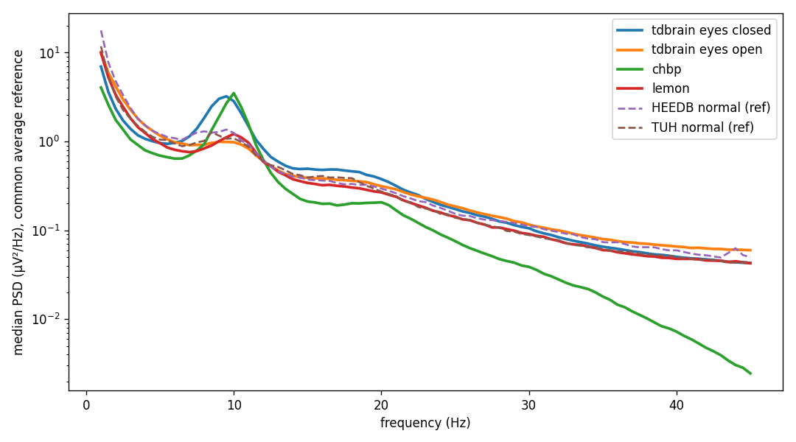

# TDBRAIN onboarding: external test set for brain age, with clinical labels

Status 2026-11-15: release 3.1 downloaded, QC-checked (Section 7), converted and scored zero-shot
(Section 8), relabelled with the participants table `TDBRAIN_participants_V3.1_2.xlsx`; adult results
in Section 9, data analytics in Section 10, P3 / P4 CV models and their 5-fold ensembles in Section 11 (best:
P4 ensemble, 4.93 y per adult session). TDBRAIN is a standing test set of the age configs (`evaluation.test_sets`, Section 9.4).

TDBRAIN (Two Decades-Brainclinics Research Archive for Insights in Neurophysiology,
van Dijk et al. 2022, *Sci Data* 9:333, [doi:10.1038/s41597-022-01409-z](https://doi.org/10.1038/s41597-022-01409-z))
is a single-site clinical EEG archive from Nijmegen (NL), recorded 2001–2021. It is
onboarded the way LaBraM evaluates LEMON, MIPDB and CHBP (`docs/external_eval_results.md`,
`docs/chbp_onboarding.md`): as a **test-only external cohort** that the brain-age models
trained on TUH + HEEDB (`tuh_heedb_v1`) score without retraining. Unlike those healthy-volunteer
corpora it is mostly **psychiatric patients**, and it carries the clinical labels, so the
brain-age gap can be read per diagnosis.

Code:
- `dataset_maker/make_external_npy.py --dataset tdbrain`: BIDS BrainVision to the npy cohort
  format through the training pipeline (`make_TUH_npy.preprocess_raw`). It also writes the
  clinical table `clinical.parquet` (`tdbrain_clinical_table`) and puts the clinical flags in
  the manifest;
- `scripts/external_runs/tdbrain.sh`: fetch, unpack, private S3 mirror, convert, score, report;
- `scripts/eval_age_by_cohort.py --trim-start-sec / --trim-end-sec`: trim overrides. A
  TDBRAIN file is 2 min long, and the training trims (60 s at each end) would drop all of it;
- `scripts/external_eval_report.py`: TDBRAIN subgroups (age bands, diagnoses, eyes closed / open);
- `tests/test_tdbrain.py`: a synthetic BIDS tree (BrainVision, participants.tsv with decimal
  commas, a blinded `sub-19*` subject, a derivatives copy) converted end to end.

## 1. The dataset

### Table 1.1. TDBRAIN as published (van Dijk et al. 2022, via PubMed Central PMC9198070)

| | |
|---|---|
| participants / sessions | 1,274 / 1,346 (some participants have several sessions, e.g. before and after treatment) |
| age, sex | 5–88 y (abstract: 5–89), mean 38.7 ± 19.2; 620 female |
| main indications | MDD 426, ADHD 271, SMC (subjective memory complaints) 119, OCD 75; also healthy controls and smaller groups |
| diagnosis status | `formal_status`: a DSM-5 diagnosis (clinician and/or structured interview above a clinical cut-off) **or** a referral indication (unofficial, from a GP / psychologist); `UNKNOWN` where missing, which "does not mean these are healthy participants" |
| blinded replication set | 30 % of the MDD / ADHD / OCD diagnostic and outcome labels are withheld: `participant_id` starting with `sub-19`, `REPLICATION` in participants.tsv |
| protocol | 2 min eyes open (`restEO`), then 2 min eyes closed (`restEC`); then an auditory oddball and a visual 1-back task (only behavioural data released for those) |
| EEG | 26 channels, 10-10 (Compumedics Quickcap / ANT Waveguard, Ag/AgCl), 500 Hz, low-pass 100 Hz before digitisation, DC-coupled, 24 bit; virtual ground, re-referenced offline to averaged mastoids (A1/A2), ground AFz, < 10 kΩ |
| other channels | vertical + horizontal EOG, ECG (Erb's point), EMG (right masseter) |
| line frequency | 50 Hz (the Netherlands) |
| format | BIDS, BrainVision (`.vhdr/.vmrk/.eeg`) per session and task + `.json` / `channels.tsv`; a `derivatives/` copy as `.csv`; `participants.tsv` + `.json` in both trees |
| other data | gender, age, height, weight, sleep, education, alcohol and drug use, NEO-FFI item scores, day-of-measurement questions; for the published treatment studies, primary outcomes (e.g. rTMS in MDD n = 176, neurofeedback in ADHD n = 102, SMA-rTMS in OCD n = 17) |
| medication | allowed and **not** systematically tracked; short half-life drugs (methylphenidate) skipped on the morning of the EEG |
| size | "15 GB" (brainclinics.com), split zip files |

## 2. Access, DUA and storage

### Table 2.1. How the data can be obtained (checked 2026-11-12)

| route | result |
|---|---|
| brainclinics.com/resources | ORCID login, then the DUA, then the download page with the split zips. **The only working route.** It has to be done by a person, in a browser |
| Synapse `syn25671079` | Our Synapse account (`BenningerLab`) can list the files (`TD-BRAIN-DATASET.zip` syn26253372, `TD-BRAIN-SAMPLE.zip` syn26241849, `TD_BRAIN_code.zip` syn26241847, `participants.tsv` syn26468893) but `canDownload` is false. Only the authors and their 2021 review team have DOWNLOAD in the ACL. The project wiki says to download from brainclinics.com while the Synapse terms are being set up |

The DUA text (`/data/datasets/EEG-public/TDBRAIN/meta/TD_BRAIN-DataUseAgreement.pdf`, from
the Synapse wiki) sets these rules:

### Table 2.2. DUA terms and what they mean here

| DUA clause | our handling |
|---|---|
| 1. comply with institutional / ethics rules | IRB / ethics cover for the secondary use is the user's call |
| 2. no re-identification, no linkage to other databases that could identify | nothing is joined to TDBRAIN except our own model predictions |
| 3. no redistribution, **not even within the research group**, unless each person has accepted the DUA themselves | the copy sits in the private `s3://eeg-data-public/TDBRAIN/v1/` (same rule as HEEDB: `check_private` before every sync, never public). Only people who have accepted the TDBRAIN DUA themselves may read it. Notebooks and docs show aggregates only |
| 4. no changes to the raw data | the zips and the extracted files stay as downloaded; conversion only reads them |
| 5. credit: link to brainclinics.com/resources and cite van Dijk et al. | in every result note or figure using TDBRAIN |
| 6. the code is MIT-licensed, with the same credit | applies if we reuse their preprocessing code |

| | local | S3 (private) |
|---|---|---|
| zips as downloaded | `/data/datasets/EEG-public/TDBRAIN/zips` | `s3://eeg-data-public/TDBRAIN/v1/zips` |
| extracted BIDS tree | `/data/datasets/EEG-public/TDBRAIN/raw` | `s3://eeg-data-public/TDBRAIN/v1/raw` |
| paper + DUA PDFs | `/data/datasets/EEG-public/TDBRAIN/meta` (downloaded) | `s3://eeg-data-public/TDBRAIN/v1/meta` |
| cohort | `/data/datasets/EEG-public/TDBRAIN/cohorts/tdbrain_v1` | `s3://eeg-data-public/TDBRAIN/v1/cohorts/tdbrain_v1` |

## 3. What a recording carries: EEG, annotations, "report", health record

TDBRAIN has no clinical EEG report and no medical record. In the per-recording tables
we use for TUH and HEEDB (`labram/eval/clinical_analytics.py`), its fields map as follows:

### Table 3.1. TDBRAIN fields against the TUH / HEEDB per-recording schema

| our field | TUH / HEEDB source | TDBRAIN |
|---|---|---|
| signal | EDF | BrainVision `restEC` and `restEO`, 2 min each, converted as **two recordings per session** (`sub-<id>_ses-<n>_<task>_tdbrain`) |
| annotations | EDF annotations / HEEDB `annotations.csv` | BrainVision markers (`.vmrk`). The converter counts them per file (`annotations` in the manifest): a mid-file `New Segment` would mean a discontinuity. The eyes-open / eyes-closed split is in the file names (`task`). No artifact marks are shipped; the authors' preprocessing code (`TD_BRAIN_code.zip`) detects EMG, jumps, kurtosis, voltage swings, blinks, bridging and extreme correlations, if we want them |
| report verdict (`label`, `abnormal_report`) | NEDC sheet / HEEDB findings | **none**: no EEG was read clinically. `label` is `normal` for healthy controls only, and patients stay unlabelled (`unlabelled_*` in the per-cohort metrics). A psychiatric indication is not an EEG finding |
| diagnosis groups (`dx_*`) | ICD-10 (HEEDB), free text (TUH) | `indication`, split on `/ , ; + &`, gives `dx_mdd`, `dx_adhd`, `dx_ocd`, `dx_smc` and `dx_other` (anything else, e.g. tinnitus, burnout), plus `healthy`, `blinded` (sub-19* / REPLICATION) and `unknown`. `formal_status` says whether a diagnosis is formal (DSM) or a referral |
| medication (`med_*`) | ATC (HEEDB), NEDC drug classes (TUH) | not recorded |
| demographics | age, sex | age **with decimals** (per session), sex (decoded through the `participants.json` levels), plus education, height, weight, sleep, alcohol and drug use, all kept in `clinical.parquet` |
| questionnaires, outcomes | none | NEO-FFI items, day-of-measurement questions and treatment outcomes where published. Every participants.tsv column is kept unchanged in `clinical.parquet` |

## 4. Conversion

The signal path is the one every training and external cohort went through
(`make_TUH_npy.preprocess_raw`): 0.1–75 Hz band-pass, spectrum-interpolation line removal at
50 and 60 Hz, resampling to 200 Hz, µV, float16, the 23 TUH channels in model order. The
reference is kept as recorded (averaged mastoids), because the models apply a common average
reference at their input. TDBRAIN-specific choices:

- **19 of 23 channels.** All 19 10-20 positions exist (T7/T8/P7/P8 → T3/T4/T5/T6). A1/A2 are
  the reference and T1/T2 are not recorded; these four are zero-filled and flagged in
  `channel_mask`, as for CHBP and HEEDB.
- **DC offset removed first.** The recording is DC-coupled, so each channel's mean is
  subtracted before the 0.1 Hz high-pass. Otherwise a large offset leaves a filter transient
  over the first seconds of a 2-minute file. The synthetic test puts a 20 mV offset on every
  channel and checks that the output stays within ±200 µV.
- **Eyes closed and eyes open are separate recordings**, 12 whole 10 s windows each (120 s).
  They are scored separately and can be pooled per session afterwards. They are not
  concatenated: the files are separate acquisitions, and joining them would add a step.
- **Scoring windows.** The models were trained with a 60 s trim at each end and a 5-minute
  evaluation budget. Here every window is scored (`--trim-start-sec 0 --trim-end-sec 0
  --eval-minutes 0`). A second pass drops 10 s at each end (`inner`, 10 windows) to check
  that filter edges do not matter.
- **Age.** The age comes from the participants.tsv row of the same session
  (`age_session_matched`). It falls back to the subject's first row when the file has no
  session column. Rows without an age are dropped.

## 5. Evaluation plan

1. **QC against the training data**, as in `docs/chbp_onboarding.md` Table 2.1: channel std,
   alpha peak, relative band powers and PSD against the TUH / HEEDB normal references, eyes
   closed and eyes open separately. CHBP lost 1–2 years of MAE to an amplitude / spectral
   shift, so check first whether TDBRAIN (DC–100 Hz, mastoid reference, short files) shifts too.
2. **Zero-shot brain age** of E2, E2L, W4, L1, W7, X1, X3 (and the device-robust E2L from
   `scripts/external_runs/e2l_robust_full.sh`), with the metrics of `docs/chbp_onboarding.md`
   Eqs. (3.1)–(3.6). Groups: 5–17 / 18–44 / 45–88 years, healthy, MDD, ADHD, OCD, SMC,
   eyes closed vs open. The 5–17 group lies outside the training ages (MIPDB showed the models
   fail on children), so the headline numbers are for adults.
3. **Brain-age gap by diagnosis.** Bias-corrected gap (`brain_age_bias_correction.md`; the
   correction is fitted on the training model's own validation predictions, not on TDBRAIN)
   for MDD, ADHD, OCD and SMC against the healthy controls, adults only, one session per
   subject. Subjects with several sessions are grouped (cross-fitted recalibration folds
   already group by `subject`).
4. **Within-subject repeatability**: participants with two or more sessions give a test–retest
   check of predicted age, net of the true age change between the sessions.
5. Optionally, add `tdbrain=<cohort>` to `evaluation.test_sets`. For SageMaker that needs an
   entry in `DEFAULT_SAGEMAKER_DATA_S3_URIS` once the cohort is on S3.

## 6. Checklist

| step | status |
|---|---|
| paper + DUA read, access routes checked | done 2026-11-12 |
| converter, clinical table, report groups, eval trim overrides, tests | done, synthetic data only |
| ORCID login + DUA on brainclinics.com | done 2026-11-12 (zip password received) |
| zips on the server (`zips/`), extracted, zip mirrored to `s3://…/TDBRAIN/v1/zips/` | done 2026-11-14 (release 3.1, Section 7) |
| real tree checked: BDF, tasks, channels, units; reader adapted (BDF, end pad); signal QC on 80 files | done 2026-11-14 (Section 7) |
| participants table (age, sex, indication): not in the zip | **waiting for the user** (separate download) |
| `convert` (placeholder ages) + cohort to S3; E2L / robust scoring; cohort comparison; literature | done 2026-11-14 (Section 8) |
| `relabel` with the participants table, adults-only `compare` + `tdbrain_brain_age.py` (MAE, R², per-indication gap) | done 2026-11-15 (Section 9) |
| TDBRAIN as a standing test set (data loader + S3 channel) | done 2026-11-15 (Section 9.4) |
| replication zip `TDBRAIN_MDD_Dx_ReplicationV3_1_Encr.zip` | not downloaded yet (Section 9.5) |

### Things to verify on the real files

The code reads the formats published in the paper. These details were not visible before
download:

- the exact `participants.tsv` column names. The reader accepts `participants_ID` /
  `participant_id`, `sessID` / `session`, `gender` / `sex`, `indication`, `formal_status`,
  `DISC/REP`, and stops with the list of columns found if the id or age column is missing;
- whether `participants.json` gives the gender levels (otherwise `sex` stays None; it is not guessed);
- the BrainVision unit and resolution (MNE scales them). Check that the channel std is in
  the expected 5–20 µV range;
- the indication vocabulary (combined labels, spelling) for the keyword map
  `TDBRAIN_INDICATIONS`;
- the zip layout. The EEG zip is **password protected**: Brainclinics e-mails the password after the DUA. It is kept in `/data/datasets/EEG-public/TDBRAIN/.zip_password` (mode 600, never in git or on S3) or `$TDBRAIN_ZIP_PASSWORD`. `tdbrain.sh unpack` extracts with 7z (`p7zip-full`), which handles ZipCrypto, AES, `.z01` and `.zip.001` splits and nested zips.

## 7. Release 3.1 as received (2026-11-14)

The download is `TDBRAIN_Dataset_V3_1_Encr.zip` (15.5 GB, stored, AES-encrypted entries).
It extracts to `raw/TDBRAIN_Dataset_V3_1/` (19.5 GB, 9,128 files, macOS `.DS_Store` files
skipped). This release differs from the paper's (Section 1) as follows:

### Table 7.1. Contents of release 3.1

| | |
|---|---|
| subjects / folders | 1,300 subjects (`sub-87*` 284, `sub-88*` 1,016); **no `sub-19*`**, so this release holds no blinded replication subjects |
| sessions | 1,391 `restEC` and 1,387 `restEO` session files, plus `oddball` in 162 sessions (with `events.tsv`; not resting, not converted) |
| format | **BDF** (24 bit) + `_eeg.json` + `_channels.tsv`, BIDS 1.9.0; no BrainVision, no `derivatives/` |
| channels | 26 EEG (10-10) + VPVA, VNVB, HPHL, HNHR (EOG), Erbs (ECG), Mass (EMG) + BDF `Status` (all zero); all 19 of the 10-20 channels map |
| recording | 500 Hz, "linked mastoids (A1A2)", power line 50 Hz, Neuroscan NuAmps, DC-coupled (high-pass 0, low-pass 100 Hz in the header), µV |
| length | 120.0–121.0 s per file, of which about 1 s at the end is a **constant pad** (digital zero) up to the next whole 1-s BDF record |
| markers | none (`Status` channel all zero, no BDF annotations) |
| demographics | **none in the zip**: no `participants.tsv`, and the BDF patient field and date are anonymised (`<id> X X X`, `01.01.85`). Age, sex and indication have to come from a separately downloaded participants table |

**End pad.** The signal sits at a DC offset of several mV, so the pad, a step to 0, would
ring through the band-pass into the last two windows. In 79 of 80 sampled files, the last
10 s window had a median 78 times the channel std of the others and the one before it 3 times.
`open_tdbrain` therefore cuts the samples where no 10-20 channel changes, at both ends, before
removing the mean. `tests/test_tdbrain.py` pads its synthetic files in the same way and fails
without the cut.

### Table 7.2. Signal QC after the training pipeline, 80 random resting files vs 60 normal recordings per reference

For window $k$ of a recording (10 s, the 19 EEG channels $c$, first and last window of a
TDBRAIN file left out; windows 6–35 of a reference recording), the channel std is
$s_{k,c} = \operatorname{std}_t x_{k,c}(t)$, and the table gives the median over windows,
channels and recordings (7.1). For the band shares, the per-window Welch PSD $P(f)$
(5 s segments, mean removed per window) is medianed over windows and channels, and
$\rho_{[a,b)} = \sum_{a \le f < b} P(f) / \sum_{0 < f < 45} P(f)$ (7.2). The alpha peak is the
argmax of the O1/O2 PSD in 6–14 Hz (7.3).

$$ \tilde s = \operatorname{median}_{k,c,\text{rec}}\ s_{k,c} \tag{7.1} $$

$$ \rho_{[a,b)} = \frac{\sum_{a \le f < b} P(f)}{\sum_{0 < f < 45} P(f)} \tag{7.2} $$

| source | n | channel std (µV) (7.1) | after CAR (µV) | ρ below 1 Hz (7.2) | ρ 1–4 Hz | ρ 8–13 Hz | alpha peak (Hz) (7.3) | share of samples > 300 µV |
|---|---|---|---|---|---|---|---|---|
| TUH normal (training) | 60 | 12.3 | 9.9 | 0.45 | 0.16 | 0.09 | 8.8 | 0.001 |
| HEEDB normal (training) | 60 | 22.7 | 12.6 | 0.62 | 0.15 | 0.06 | 8.6 | 0.056 |
| TDBRAIN eyes closed | 45 | 15.4 | 10.1 | 0.36 | 0.15 | 0.20 | 9.6 | 0.000 |
| TDBRAIN eyes open | 35 | 11.8 | 8.2 | 0.36 | 0.23 | 0.11 | 9.4 | 0.000 |

**What Table 7.2 shows:** unlike CHBP (`docs/chbp_onboarding.md` Table 2.1, std 5.9 µV),
TDBRAIN arrives at the models' input with a training-like amplitude. Its median channel std
of 15.4 / 11.8 µV lies between TUH and HEEDB. The DC-coupled recording does not leave more
slow power than the training data after the 0.1 Hz high-pass: the share below 1 Hz is 0.36
against 0.45 / 0.62. Eyes closed shows the expected alpha (ρ 0.20, peak 9.6 Hz), about twice
the eyes-open share, as the paper reports. No sampled file had a sample above 300 µV. After
the cut, the first and last windows match the inner ones: median std ratio 1.00 / 1.07, 95th
percentile 1.43 / 1.51. 72 of the 80 files give 12 windows and 8 give 11.

## 8. Preprocessing and zero-shot scoring of release 3.1 (2026-11-14)

All 2,778 resting files were converted (`make_external_npy --dataset tdbrain`, no errors):
32,913 windows, 19 of 23 channels in every file, 12 windows in 2,348 files and 11 in 428
(one file has 20, one 9). The participants table is not in the zip, so the cohort
`tdbrain_v1` carries a flagged placeholder age (`age_placeholder`, 50 y). Once the table
arrives, `make_external_npy --relabel --meta <table>` writes the real ages and clinical flags
without converting again (tested in `tests/test_tdbrain.py`), and the metrics below are
computed from the saved predictions. Cohort on S3: `s3://eeg-data-public/TDBRAIN/v1/cohorts/tdbrain_v1`.
Predictions: `/data/runs/heedb/external_eval/tdbrain_{all,inner}.json`.

Scored: E2L and the two device-robust E2L models of `docs/chbp_domain_shift.md` §10 (band
1–45 Hz + per-window amplitude normalisation; `E2Lrob` fine-tuned from E2L for 4 + 6 epochs,
`E2LrobF` trained from scratch with the E2L recipe), every window
(`--trim-start-sec 0 --trim-end-sec 0 --eval-minutes 0`). The same models were scored on
LEMON, MIPDB and CHBP with every window (after the training trims of 60 s). The metrics are
those of `docs/chbp_onboarding.md`: MAE (3.1), bias (3.2), R² (3.3), Pearson r (3.4) and
predict-the-cohort-mean MAE (3.5). Two label-free quantities are added. The **EC–EO
agreement** is the Pearson correlation, over sessions, of the predictions for the eyes-closed
and eyes-open file of the same session (8.1). The **session repeatability** is the Pearson
correlation, over subjects with sessions 1 and 2, of the session-mean predictions (8.2).

$$ r_{\mathrm{EC,EO}} = \operatorname{corr}_{s}\big(\hat y_{s,\mathrm{EC}},\ \hat y_{s,\mathrm{EO}}\big) \tag{8.1} $$

$$ r_{1,2} = \operatorname{corr}_{j}\big(\bar{\hat y}_{j,1},\ \bar{\hat y}_{j,2}\big) \tag{8.2} $$

### Table 8.1. Zero-shot brain age per cohort, every window (`docs/data/external_eval/tdbrain/cohort_comparison_all_windows.csv`)

MAE / bias / r / R², years. In-domain = the `tuh_heedb_v1` test split (E2L only scored with
every window; the robust models' 5-min in-domain MAE is 8.04 / 7.73 against E2L's 7.00,
`docs/chbp_domain_shift.md` Table 10.3).

| cohort | n | age, mean ± sd | predict-the-mean MAE (3.5) | E2L | E2Lrob | E2LrobF |
|---|---|---|---|---|---|---|
| in-domain test (TUH + HEEDB) | 7,612 | 53.9 ± 19.8 | 16.89 | 6.13 / −0.5 / 0.92 / 0.84 | — | — |
| LEMON | 214 | 39.2 ± 20.2 (bins) | 18.60 | **5.20** / −0.8 / 0.95 / 0.88 | 6.33 / +1.8 / 0.94 / 0.85 | 6.07 / +2.2 / 0.94 / 0.85 |
| CHBP | 250 | 31.7 ± 9.3 | 7.28 | 9.35 / +7.0 / 0.45 / −0.64 | 6.14 / +0.2 / 0.58 / 0.25 | **5.90** / −0.5 / 0.61 / 0.33 |
| MIPDB, all | 116 | 15.8 ± 8.2 | 6.32 | 12.65 / +12.4 / 0.59 / −2.07 | 17.03 / +16.9 / 0.46 / −4.23 | 15.14 / +15.0 / 0.56 / −3.15 |
| MIPDB, adults | 31 | 27.5 ± 7.0 | 5.85 | 9.16 / +8.2 / 0.45 / −1.66 | 12.03 / +11.4 / 0.51 / −2.89 | 10.56 / +10.2 / 0.62 / −2.07 |
| **TDBRAIN** | 2,778 files | ages pending (published release: 38.7 ± 19.2) | — | pending | pending | pending |

### Table 8.2. TDBRAIN predictions without ages (2,778 files, 1,391 sessions)

| model | predicted age, mean ± sd | 5th–95th percentile | EC − EO, mean (y) | $r_{\mathrm{EC,EO}}$ (8.1) | $r_{1,2}$ (8.2), n = 74 | session 2 − 1, mean (y) |
|---|---|---|---|---|---|---|
| E2L | 39.6 ± 16.3 | 19.1–67.2 | −0.9 | 0.960 | 0.978 | −0.3 |
| E2Lrob | 44.2 ± 15.4 | 22.6–68.2 | −0.4 | 0.956 | 0.975 | −0.5 |
| E2LrobF | 44.5 ± 16.0 | 22.3–70.0 | −1.0 | 0.959 | 0.966 | −0.9 |
| *reference: E2L, in-domain test* | 53.4 ± 16.7 (true 53.9 ± 19.8) | — | — | — | 0.929 (n = 703) | +1.3 |

**What Tables 8.1 and 8.2 show:**
- **E2L's predicted-age distribution on TDBRAIN is close to the published age distribution**:
  mean 39.6 against 38.7, sd 16.3 against 19.2. The robust models predict about 5 years
  older. That fits their LEMON bias (+1.8 / +2.2 against E2L's −0.8) and their in-domain cost.
  The 5–17-year-olds lie outside the training ages (MIPDB shows the bias there), and they
  compress the spread. Whether the means match per subject only the ages can tell.
- **The predictions are stable within a subject.** The eyes-closed and eyes-open files of a
  session agree at r = 0.96, with eyes closed predicted 0.4–1.0 y younger. The 74 subjects
  with two sessions repeat at r = 0.97–0.98, more than the in-domain repeat recordings
  (0.93). TDBRAIN's repeat sessions are probably weeks apart, around a treatment course; the
  interval is in the participants table.
- **Scoring every window or only the inner 10 is the same** (difference ≤ 0.1 y in every
  statistic). The cut end pad (Section 7) leaves no edge effect.
- **The device-robust models are not a free win.** They fix CHBP (MAE 9.35 → 5.90–6.14), but
  cost 0.9–1.1 y on LEMON and 2–4 y on MIPDB. TDBRAIN's amplitude is training-like
  (Section 7), so E2L is the primary model and the robust models are the check.

### Table 8.3. Published brain-age results on TDBRAIN (literature search 2026-11-14)

Verified from the full text unless marked. Every study used the first public release
(1,274 subjects), not release 3.1. None reports a bias-corrected metric or a brain-age gap
per diagnosis.

| paper | protocol | subset | model | MAE | R² / r |
|---|---|---|---|---|---|
| Khayretdinova et al. 2022, *Front. Aging Neurosci.* 14:1019869 | within TDBRAIN, 10-fold subject-grouped CV ×10 | 1,335 sessions, 5–88 y, EO + EC | DCNN on raw EEG | 5.96 ± 0.33 (EO 6.39, EC 6.33) | 0.81 / 0.90 |
| Hu et al. 2025 (NEOBA), *Front. Aging Neurosci.* doi:10.3389/fnagi.2025.1559067 | "validation in TDBRAIN", CV protocol not stated for TDBRAIN | 1,274 subjects | oscillatory + coupling features → MLP | 4.95 (EO 5.62, EC 5.24) | not reported |
| Bomatter et al. 2024, *eBioMedicine* 106:105259 | within TDBRAIN, 10×10-fold CV | first sessions, n = 1,134, 5–89 y | Riemannian / filter-bank + ridge | not reported | ≈ 0.8 (from text; exact values in figures) |
| Bikki & Zeng 2026, BDIMed (ACM) doi:10.1145/3816325.3843614 (abstract only) | within TDBRAIN; zero-shot TUABX → TDBRAIN | unknown | compact CNN | 5.83 ± 0.66 (within) | 0.84 (within); **0.83 zero-shot** |
| Tveitstøl et al. 2025, *IEEE TBME* doi:10.1109/TBME.2025.3639477 | cross-dataset, leave one dataset out | EC, n = 1,273 | Inception / Deep4 / Shallow | figures only | abstract suggests r 0.63, R² −0.01 with TDBRAIN as target (unverified mapping) |
| Hajhassani et al. 2026, arXiv:2609.31195 (preprint) | **zero-shot**, trained on TUEG | "healthy" 20–90 y, n in a figure | GEDAI + CTNet | **8.36** | **0.59** |

The like-for-like comparison for our numbers is the zero-shot rows: MAE 8.36 / R² 0.59
(adults only) verified, R² 0.83 (abstract only). Within-dataset results (MAE 5–6, R² ≈ 0.8)
are an upper reference, because those models saw TDBRAIN's own devices and population. R²
near 0.8 there also relies on the 5–88 y range, children included. REVE, SPERA, PhysioWave-T
and Brain-OF list TDBRAIN in their pretraining data, so their TDBRAIN numbers are not zero-shot.
E2L was fine-tuned only on TUH + HEEDB. LaBraM's pretraining list should be checked for
TDBRAIN before calling our result zero-shot in a paper.

## 9. Zero-shot brain age on TDBRAIN adults (2026-11-15)

### 9.1. Participants table and the analysed set

`TDBRAIN_participants_V3.1_2.xlsx` (separate download; one sheet `TDBRAIN-V3.1`, 1,363 rows ×
106 columns, kept in `meta/` and on S3) is read by `tdbrain_clinical_table`. It has one row per
subject and session (`TDBRAIN_ID`, `sessID`), age with two decimals (5.04–87.89 y, one row
without an age), `gender` 0 / 1, `indication`, `formal_status` (a diagnosis, `HEALTHY` or
`UNKNOWN`), the treatment-study fields (`Dataset`, `Responder`, `Remitter`, BDI / ADHD-RS /
Y-BOCS before and after), the oddball and 1-back task scores, NEO-FFI items and the
day-of-measurement questions. Every row is `DISCOVERY`: the release holds no blinded subjects.
**Gender 0 = female**: in this table, adults coded 0 have a median height and weight of 168 cm and
65 kg, against 183 cm and 79 kg for code 1, and 0 is 47 % of the subjects (the paper: 49 %
female). `TDBRAIN_GENDER_LEVELS` holds this mapping.

1,357 of the 1,391 EEG sessions have their own row. In the other 34 (66 files, mostly second
sessions), the age falls back to the subject's first row. Those files stay in the manifest but
not in the scored split (`age_session_matched`). **The analysis covers adults only**
(`--min-age 18` in every script), because the 5–17-year-olds lie outside the training ages
(2 TUH recordings under 18, none in HEEDB). That leaves 2,222 files = 1,113 sessions = 1,062
subjects, 18–88 y, mean 45.3 ± 15.9. The children's recordings stay in the cohort.

### Table 9.1. E2L on TDBRAIN adults (`docs/data/external_eval/tdbrain/tdbrain_accuracy.csv`)

Metrics (3.1)–(3.5) of `docs/chbp_onboarding.md`. MAE with a 95 % interval from 2,000 bootstrap
resamples of subjects. *Session* = mean of the session's eyes-closed and eyes-open
predictions, the unit of the published within-TDBRAIN results. *Subject* = the first session.

| unit / subset | n | age, mean ± sd | MAE [95 % CI] | bias | r | R² | predict-the-mean MAE |
|---|---|---|---|---|---|---|---|
| file, all | 2,222 | 45.3 ± 15.9 | 5.65 [5.39, 5.93] | −1.5 | 0.889 | 0.778 | 13.35 |
| file, eyes closed | 1,113 | 45.2 ± 15.9 | 5.60 [5.30, 5.89] | −2.0 | 0.894 | 0.783 | 13.35 |
| file, eyes open | 1,109 | 45.3 ± 15.9 | 5.71 [5.41, 6.01] | −1.1 | 0.885 | 0.772 | 13.36 |
| **session, all** | 1,113 | 45.2 ± 15.9 | **5.32 [5.05, 5.60]** | −1.5 | **0.902** | **0.803** | 13.35 |
| session, 18–29 | 238 | 23.6 ± 3.3 | 3.27 | +1.7 | 0.46 | — | 2.88 |
| session, 30–44 | 296 | 37.6 ± 4.4 | 5.06 | −0.5 | 0.57 | — | 3.70 |
| session, 45–64 | 455 | 54.3 ± 5.5 | 5.81 | −2.3 | 0.58 | — | 4.82 |
| session, 65+ | 124 | 72.0 ± 4.9 | 8.07 | −7.5 | 0.48 | — | 3.98 |
| session, healthy controls | 179 | 40.3 ± 17.1 | 5.28 [4.55, 6.10] | −1.0 | 0.900 | 0.806 | 14.65 |
| subject (first session) | 1,062 | 44.8 ± 15.7 | 5.31 [5.04, 5.60] | −1.5 | 0.899 | 0.799 | 13.20 |
| session, recalibrated (10-fold CV, uses TDBRAIN ages) | 1,113 | 45.2 ± 15.9 | 5.25 | 0.0 | 0.902 | 0.813 | 13.35 |

Within an age band, R² is negative because the band's own age variance is small; MAE and bias
are the meaningful numbers there.

### Table 9.2. Zero-shot brain age per cohort, adults, every window (`docs/data/external_eval/tdbrain/cohort_comparison_all_windows.csv`)

MAE / bias / r / R², per file, years. In-domain test of `tuh_heedb_v1` for E2L only.

| cohort | n | age, mean ± sd | predict-the-mean MAE | E2L | E2Lrob | E2LrobF |
|---|---|---|---|---|---|---|
| in-domain test (TUH + HEEDB) | 7,610 | 53.9 ± 19.8 | 16.89 | 6.12 / −0.5 / 0.92 / 0.84 | — | — |
| LEMON | 214 | 39.2 ± 20.2 (bins) | 18.60 | **5.20** / −0.8 / 0.95 / 0.88 | 6.33 / +1.8 / 0.94 / 0.85 | 6.07 / +2.2 / 0.94 / 0.85 |
| **TDBRAIN** | 2,222 | 45.3 ± 15.9 | 13.35 | **5.65** / −1.5 / 0.89 / 0.78 | 6.50 / +3.0 / 0.87 / 0.72 | 6.64 / +3.4 / 0.87 / 0.72 |
| CHBP | 250 | 31.7 ± 9.3 | 7.28 | 9.35 / +7.0 / 0.45 / −0.64 | 6.14 / +0.2 / 0.58 / 0.25 | **5.90** / −0.5 / 0.61 / 0.33 |
| MIPDB adults | 31 | 27.5 ± 7.0 | 5.85 | 9.16 / +8.2 / 0.45 / −1.66 | 12.03 / +11.4 / 0.51 / −2.89 | 10.56 / +10.2 / 0.62 / −2.07 |

**What Tables 9.1 and 9.2 show:**
- **E2L transfers to TDBRAIN almost without loss.** Per session it reaches MAE 5.32 y, r 0.90,
  R² 0.80 on 1,113 adult sessions, below its own in-domain test MAE (6.12, older and wider ages)
  and close to LEMON (5.20). Recalibrating on TDBRAIN's own ages (10-fold CV) gains only
  0.07 y, so the zero-shot predictions are already calibrated for this cohort.
- **Pooling eyes closed and eyes open helps:** per file 5.60 (EC) / 5.71 (EO), per session 5.32.
- **The error grows with age, and so does the underestimate:** 3.3 y at 18–29, 8.1 y at 65+
  with bias −7.5. This is the usual regression to the mean, and it also shows on the
  in-domain test. The bias correction of `brain_age_bias_correction.md` addresses it.
- **Healthy controls (5.28) score like the patients.** The psychiatric indication does not
  degrade the prediction.
- **The device-robust models are worse here** (6.50 / 6.64, bias +3). TDBRAIN needs no device
  fix (Section 7), so E2L stays the model for TDBRAIN.

### Table 9.3. Brain-age gap per indication, adults, first session (`docs/data/external_eval/tdbrain/tdbrain_gap_by_indication.csv`)

Gap $g = \hat y - y$ per subject. Zero-shot correction (9.1): the age trend of E2L's own
validation gap (normal-report recordings of `tuh_heedb_v1`), $\hat y - y = a\,y + b$ with
$a = -0.254$, $b = 11.90$, is removed: $g_c = g - (a\,y + b)$. Comparison with the healthy
controls: Cohen's d and Welch t-test on $g_c$, and the coefficient $\beta$ of the group
indicator in the OLS (9.2), age centred, male = 1. Indications are not exclusive (an
`MDD/ADHD` row counts in both).

$$ g_c = g - (a\,y + b) \tag{9.1} $$

$$ g_c = \beta_0 + \beta\,\mathbb{1}[\text{group}] + \beta_1\,y + \beta_2\,y^2 + \beta_3\,\mathbb{1}[\text{male}] + \varepsilon \tag{9.2} $$

| indication | n | age, mean | gap, raw | gap, corrected (9.1) | vs healthy, d (Welch p) | β adjusted for age, age², sex (t) (9.2) |
|---|---|---|---|---|---|---|
| healthy | 179 | 40.3 | −1.0 | −2.6 | — | — |
| MDD | 351 | 45.7 | −1.6 | −1.8 | 0.12 (0.21) | +0.06 (0.10) |
| ADHD | 116 | 35.7 | −0.3 | −3.2 | −0.08 (0.46) | −0.29 (−0.38) |
| OCD | 54 | 33.9 | −0.6 | −3.9 | −0.19 (0.18) | −0.86 (−0.81) |
| SMC | 89 | 65.4 | −5.2 | −0.4 | 0.33 (0.009) | +0.87 (0.78) |
| other indication | 169 | 49.4 | −1.6 | −0.9 | 0.25 (0.02) | +0.80 (1.03) |
| unknown | 156 | 40.3 | −0.4 | −2.0 | 0.09 (0.42) | +0.49 (0.67) |

**What Table 9.3 shows:** **no indication has a brain-age gap that differs from the healthy
controls** once age and sex are accounted for. Every adjusted β is under 1 y and every |t| is
1.03 or less. The two raw Welch differences, SMC (p 0.009) and "other" (p 0.02), come from
age. SMC subjects are 65 on average, where the trend correction (9.1), fitted on the training
data, does not fully remove TDBRAIN's age dependence of the gap. With age in the model (9.2)
they disappear. The robust models agree (|t| ≤ 1.6, `tdbrain_gap_by_indication.csv`). With
n = 351 MDD against 179 controls, the study can detect an adjusted difference of about 0.26 SD
(about 1.7 y at 80 % power, two-sided α 0.05), so a large MDD gap is unlikely. A small one
cannot be excluded.

### 9.3. Against the published TDBRAIN results (Table 8.3)

| | protocol | ages | unit | MAE | R² |
|---|---|---|---|---|---|
| **ours, E2L** | **zero-shot** (TUH + HEEDB) | adults 18–88 | session (EC + EO) | **5.32** | **0.80** |
| ours, E2L, healthy | zero-shot | adults | session | 5.28 | 0.81 |
| Hajhassani et al. 2026 (preprint) | zero-shot (TUEG) | healthy 20–90 | recording | 8.36 | 0.59 |
| Bikki & Zeng 2026 (abstract) | zero-shot (TUABX) | unknown | unknown | — | 0.83 |
| Khayretdinova et al. 2022 | within TDBRAIN, 10-fold CV | 5–88 | session (EO + EC) | 5.96 | 0.81 |
| Hu et al. 2025 (NEOBA) | "validation in TDBRAIN" | 5–89 | session | 4.95 | — |
| Bomatter et al. 2024 | within TDBRAIN, 10×10-fold CV | 5–89 | first session | — | ≈ 0.8 |

Zero-shot, E2L is 3 y more accurate than the only verified zero-shot result (8.36 / R² 0.59),
and it matches the within-TDBRAIN models that were trained on this cohort (5.96 / R² 0.81).
Their R² comes from a wider range, 5–88 y; adults only, the same model would score a lower
R² with a similar MAE. Our cohort is release 3.1 (1,300 subjects, 183 healthy), theirs the
2022 release (1,274, 47 healthy), so the subsets differ.

### 9.4. TDBRAIN as a standing test set

The four age configs (`finetune_tuab_age*.json`) list TDBRAIN in `evaluation.test_sets`:

    tdbrain=/data/datasets/EEG-public/TDBRAIN/cohorts/tdbrain_v1?trim_start_sec=0&trim_end_sec=0&eval_minutes=0&age_min=18

The options after `?` are new (`labram/data/test_sets.py`). They give this set its own window
selection: no trims (the training 60 s + 60 s would empty a 2-min file), every window, adults
only. A selection that leaves a set empty skips it with a warning instead of stopping the run.
With the age config, the set holds 26,291 samples from 2,222 adult recordings. On SageMaker the
cohort becomes the input channel `test_tdbrain` from `s3://eeg-data-public/TDBRAIN/v1/cohorts/tdbrain_v1`
(added to `sagemaker.data_s3_uris` in every config, with CHBP), and the options travel with the
mount.

### 9.5. The replication zip

`TDBRAIN_MDD_Dx_ReplicationV3_1_Encr.zip` (offered next to the dataset) is not downloaded yet.
By its name it holds the blinded MDD diagnosis-replication set. Its EEG and ages would add
recordings to the age evaluation; its withheld diagnoses cannot enter Table 9.3.

## 10. Data analytics: TDBRAIN next to CHBP, LEMON and the training data (2026-11-15)

**Preprocessing is the training pipeline.** TDBRAIN goes through
`make_TUH_npy.preprocess_raw`, the function that prepared the Temple (TUH) and Harvard
training cohorts and CHBP / LEMON / MIPDB: 0.1–75 Hz band-pass, spectrum-interpolation line
removal at 50 and 60 Hz, resampling to 200 Hz, µV, float16, the 23 TUH channels in model order
(missing ones zero and masked), the recorded reference kept and the common average reference
applied in the model. Only two TDBRAIN-specific steps come before it, both needed for these
files: cutting the constant end pad (Section 7) and removing each channel's DC offset. There is
nothing to choose between "like Temple" and "like CHBP": they are the same pipeline.

`tdbrain.sh report` runs `scripts/external_eval_report.py` on TDBRAIN (adults,
`--min-age tdbrain=18`), CHBP and LEMON with E2L and E2Lrob. TDBRAIN's QC windows are each
file's windows 1 to n − 2 (`QC_WINDOWS`), and eyes closed and eyes open are summarised
separately. The other cohorts use the first 5 minutes after the 60 s trim. Band shares are
relative to 1–45 Hz power after CAR, as in `docs/chbp_onboarding.md` Table 2.1.

### Table 10.1. Signal QC, median over recordings (`docs/data/external_eval/tdbrain/qc_summary.csv`)

| source | n | channel std after CAR (µV) | alpha peak O1/O2 (Hz) | delta | theta | alpha | beta | share > 300 µV |
|---|---|---|---|---|---|---|---|---|
| TUH normal (training) | 100 | 9.96 | 9.00 | 0.495 | 0.124 | 0.136 | 0.131 | 0.000 |
| HEEDB normal (training) | 100 | 13.01 | 9.00 | 0.527 | 0.125 | 0.156 | 0.123 | 0.025 |
| LEMON | 215 | 8.98 | 9.75 | 0.452 | 0.130 | 0.183 | 0.139 | 0.000 |
| CHBP | 250 | **5.89** | 10.00 | 0.257 | 0.121 | **0.457** | 0.115 | 0.000 |
| **TDBRAIN eyes closed** | 1,113 | **9.62** | 9.50 | 0.262 | 0.127 | **0.354** | 0.159 | 0.000 |
| **TDBRAIN eyes open** | 1,109 | 8.45 | 9.00 | 0.446 | 0.142 | 0.147 | 0.155 | 0.000 |

### Figure 10.1. Median power spectrum per source

Median PSD (µV²/Hz, log scale) over recordings and channels, 1–45 Hz, CAR. Solid: TDBRAIN
eyes closed / eyes open, CHBP, LEMON. Dashed: the TUH and HEEDB normal references.

### Table 10.2. E2L per group, adults (`docs/data/external_eval/tdbrain/metrics.csv`)

Per file. MAE / bias / r; "recal." = MAE after a 5-fold subject-grouped linear recalibration
on the cohort's own ages (not zero-shot).

| cohort / group | n | age, mean | E2L MAE / bias / r | E2L recal. | E2Lrob MAE / bias |
|---|---|---|---|---|---|
| TDBRAIN, all adults | 2,222 | 45.3 | 5.65 / −1.5 / 0.89 | 5.60 | 6.48 / +3.1 |
| **TDBRAIN, healthy 18–68 (CHBP-like)** | 326 | 37.4 | **5.18 / −0.2 / 0.88** | 5.46 | 6.63 / +4.5 |
| TDBRAIN, healthy, all ages ≥ 18 | 354 | 40.3 | 5.53 / −0.9 / 0.89 | 5.76 | 6.84 / +3.5 |
| TDBRAIN, MDD | 718 | 45.4 | 5.70 / −1.5 / 0.85 | 5.61 | 6.71 / +3.6 |
| TDBRAIN, ADHD | 242 | 35.6 | 4.78 / −0.3 / 0.85 | 4.91 | 6.20 / +5.0 |
| TDBRAIN, OCD | 112 | 34.3 | 4.79 / −0.8 / 0.85 | 4.88 | 6.52 / +5.1 |
| TDBRAIN, SMC | 236 | 65.6 | 6.89 / −5.3 / 0.68 | 6.46 | 5.55 / −3.6 |
| TDBRAIN, eyes closed / eyes open | 1,113 / 1,109 | 45.2 | 5.60 / −2.0 · 5.71 / −1.1 | 5.48 · 5.71 | 6.34 · 6.63 |
| **CHBP (healthy, 18–68)** | 250 | 31.7 | **9.35 / +7.0 / 0.45** | 6.59 | 6.14 / +0.2 |
| LEMON (healthy, 20–80) | 214 | 39.2 | 5.20 / −0.8 / 0.95 | 4.83 | 6.33 / +1.8 |

### Figure 10.2. Predicted vs true age

Per file (TDBRAIN) or recording (CHBP, LEMON): (a, c, e) E2L, (b, d, f) E2Lrob. Blue:
zero-shot; orange: recalibrated (5-fold CV, uses the cohort's ages).

**What Tables 10.1–10.2 and Figures 10.1–10.2 show:**
- **TDBRAIN looks like the training data where it matters for the model.** The amplitude after
  CAR (9.6 / 8.4 µV) lies between TUH (10.0) and LEMON (9.0), not near CHBP (5.9). Above
  12 Hz the spectra sit on top of the references; eyes open is slightly higher above 30 Hz
  (muscle tone with the eyes open).
- **Eyes closed has CHBP's spectral shape, but not CHBP's problem.** TDBRAIN eyes closed is
  alpha-dominated like CHBP (alpha share 0.35 against 0.46, delta 0.26 against 0.26). Yet E2L
  scores eyes closed as well as eyes open (5.60 against 5.71).
- **The healthy 18–68 subgroup answers "like CHBP".** The same population as CHBP (healthy
  adults of the same age range) gives E2L MAE 5.18, bias −0.2, r 0.88 on TDBRAIN, against
  9.35, bias +7.0, r 0.45 on CHBP. CHBP's failure is therefore the recording, not the
  population: its amplitude is 40 % lower and its spectrum falls off above 20 Hz (0.5–50 Hz
  acquisition filter). The amplitude rescaling and the device-robust model fixed CHBP for the
  same reason (`docs/chbp_domain_shift.md`).
- **The device-robust model costs on TDBRAIN** (+3 to +5 y bias in every group except SMC).
  Its band-limit and amplitude normalisation remove information TDBRAIN does not need removed.
  For data like TDBRAIN, E2L is the model. E2Lrob is for CHBP-like acquisitions.
- **Within TDBRAIN, the error follows age, not diagnosis.** ADHD and OCD (mean age 35) score
  4.8, MDD (45) 5.7 and SMC (66) 6.9 with bias −5.3, which is the age trend of Table 9.1.
  Section 9.2 shows that adjusting for age removes the group differences.

## 11. P3 / P4 cross-validation models and their 5-fold ensembles (2026-11-15)

P3_L1 and P4_L1 are the phased one-run MIL recipes of `docs/mil_stage1_results.md` §13
(branch `feat/global-pool`), 5-fold subject-grouped CV over `tuh_heedb_v1` train + val, with
a held-out test split. Their checkpoints are `/data/runs/heedb/mil_phased_cv/P{3,4}_L1/fold_k/cv/fold_k/checkpoint-best.pth`.
`tdbrain.sh score_cv` scores all ten fold models with every window (TDBRAIN with no trims,
LEMON / CHBP / MIPDB after the training trims). Each fold is de-normalised with the target
stats of its own training subset (`--pred-stats-from-log`, means 53.46–53.57, sd
19.26–19.30). P4 fold 3 has no `run.log`; it uses the CV split of P3 fold 3 (identical
`cross_validation` and data sections), hence 53.55 / 19.29. `tdbrain.sh ensemble`
(`scripts/ensemble_predictions.py`) forms the ensembles of Eq. (13.1) of the MIL doc: the
mean of the member models' recording predictions, $\hat y_r = \frac{1}{K}\sum_k \hat y_{r,k}$
(11.1). `P3ens` and `P4ens` have K = 5, `P34ens` has K = 10.

### Table 11.1. TDBRAIN adults per session, E2L vs the CV models (`docs/data/external_eval/tdbrain/tdbrain_accuracy.csv`)

MAE [95 % subject-bootstrap CI] / bias / r / R², 1,113 sessions of 1,062 adults. Fold rows
are the mean ± SD of the five fold models' session MAE.

| model | MAE | bias | r | R² | 18–29 MAE | 65+ MAE / bias | healthy (179) MAE |
|---|---|---|---|---|---|---|---|
| E2L | 5.32 [5.05, 5.60] | −1.5 | 0.902 | 0.803 | 3.27 | 8.07 / −7.5 | 5.28 |
| P3, 5 folds | 5.26 ± 0.07 | | | | | | |
| P4, 5 folds | 5.06 ± 0.09 | | | | | | |
| P3 ensemble | 5.14 [4.89, 5.41] | −1.0 | 0.911 | 0.817 | 2.99 | 6.74 / −4.8 | 5.15 |
| **P4 ensemble** | **4.93 [4.68, 5.19]** | −0.8 | **0.914** | **0.831** | 2.98 | 6.77 / −5.4 | **4.96** |
| P3 + P4 ensemble | 5.01 [4.76, 5.28] | −0.9 | 0.913 | 0.826 | 2.95 | 6.75 / −5.1 | 5.03 |

### Table 11.2. Paired differences on the same sessions (subject-cluster bootstrap, 5,000 resamples)

ΔMAE = MAE(A) − MAE(B) on the 1,113 adult sessions; the interval resamples whole subjects.

| A − B | ΔMAE (y) | 95 % CI |
|---|---|---|
| P4 ensemble − E2L | **−0.40** | [−0.53, −0.27] |
| P3 + P4 ensemble − E2L | −0.31 | [−0.45, −0.17] |
| P3 ensemble − E2L | −0.18 | [−0.34, −0.03] |
| P4 ensemble − P3 ensemble | −0.22 | [−0.29, −0.14] |
| P4 ensemble − P3 + P4 ensemble | −0.09 | [−0.13, −0.05] |

### Table 11.3. Zero-shot per cohort, adults, per file / recording, every window (`docs/data/external_eval/tdbrain/cohort_comparison_all_windows.csv`)

MAE / bias. In-domain test (5-min protocol, all ages, from the MIL doc Table 13.15): P3
ensemble 5.98, P4 ensemble 5.94, E2L 7.00.

| cohort (n) | E2L | E2Lrob | P3 ens. | P4 ens. | P3 + P4 ens. |
|---|---|---|---|---|---|
| TDBRAIN (2,222 files) | 5.65 / −1.5 | 6.50 / +3.0 | 5.65 / −1.0 | **5.36 / −0.7** | 5.47 / −0.9 |
| LEMON (214) | 5.20 / −0.8 | 6.33 / +1.8 | 4.70 / −1.0 | 4.67 / −0.8 | **4.66 / −0.9** |
| CHBP (250) | 9.35 / +7.0 | **6.14 / +0.2** | 7.37 / +2.7 | 7.95 / +3.8 | 7.60 / +3.2 |
| MIPDB adults (31) | 9.16 / +8.2 | 12.03 / +11.4 | **6.88 / +5.6** | 7.36 / +6.6 | 7.11 / +6.1 |

### Table 11.4. Brain-age gap per indication with the ensembles (`docs/data/external_eval/tdbrain/tdbrain_gap_by_indication.csv`)

Adults, first session; β and t of the group indicator in OLS (9.2) on the raw gap (the CV
models have no validation predictions for the trend correction (9.1); age and age² in (9.2)
take its place).

| indication (n) | P3 ens. β (t) | P4 ens. β (t) | P3 + P4 ens. β (t) | E2L β (t) |
|---|---|---|---|---|
| MDD (351) | +0.01 (0.02) | −0.06 (−0.09) | −0.02 (−0.04) | +0.06 (0.10) |
| ADHD (116) | −0.27 (−0.33) | −0.15 (−0.20) | −0.21 (−0.27) | −0.29 (−0.38) |
| OCD (54) | −0.84 (−0.75) | −0.82 (−0.77) | −0.83 (−0.76) | −0.86 (−0.81) |
| SMC (89) | +0.47 (0.39) | +0.57 (0.51) | +0.52 (0.45) | +0.87 (0.78) |
| other (169) | +0.79 (0.97) | +0.62 (0.80) | +0.71 (0.89) | +0.80 (1.03) |

**What Tables 11.1–11.4 show:**
- **The P4 5-fold ensemble is the best model on TDBRAIN**: MAE 4.93 y per session (R² 0.83,
  r 0.91), 0.40 y better than E2L (CI −0.53 to −0.27). It is also 0.22 y better than the P3
  ensemble and 0.09 y better than pooling both. This follows the in-domain ranking (5.94 vs
  5.98 vs 7.00 for E2L).
- **Ensembling helps on top of the recipe.** The P4 ensemble beats its average fold by
  0.14 y (5.06 ± 0.09 → 4.93), and P3 by 0.12 y.
- **The CV models compress less toward the mean.** The old-age underestimate shrinks from
  −7.5 y (E2L) to −4.8 / −5.4 y at 65+, and the bias over all adults from −1.5 to −0.8 y.
  The young adults gain too (3.27 → 2.98).
- **Across cohorts the CV ensembles win wherever the recording resembles the training data**
  (TDBRAIN, LEMON 4.66–4.70). CHBP stays the device-robust model's case (6.14 against
  7.4–8.0). On MIPDB's 31 adults the ensembles roughly halve E2L's excess error (6.9–7.4 against 9.2).
- **The indication result does not depend on the model:** every adjusted β is under 1 y and
  every |t| under 1. No psychiatric indication shows an EEG brain-age gap against the
  healthy controls in TDBRAIN adults.
- **Against the literature (Section 9.3)**, the P4 ensemble's zero-shot 4.93 y / R² 0.83 on
  adults is about 1 y better than the within-TDBRAIN DCNN (5.96 / R² 0.81, all ages 5–88), and
  3.4 y better than the best verified zero-shot result (8.36 / R² 0.59).
