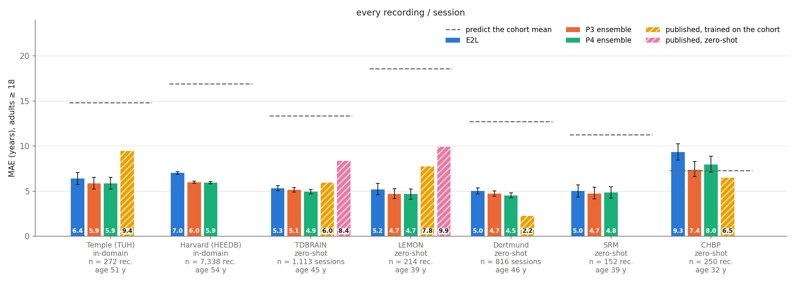
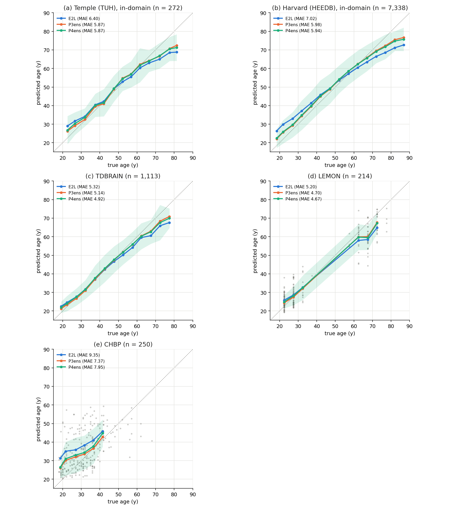
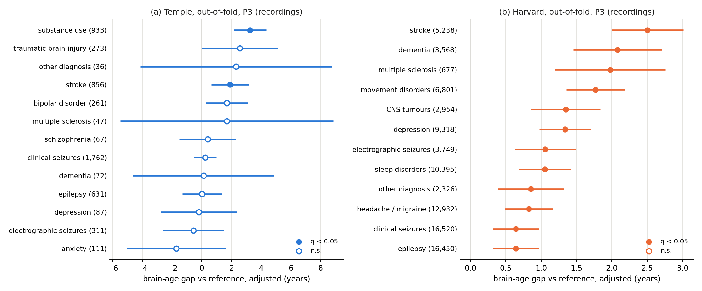
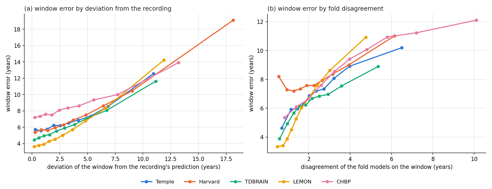
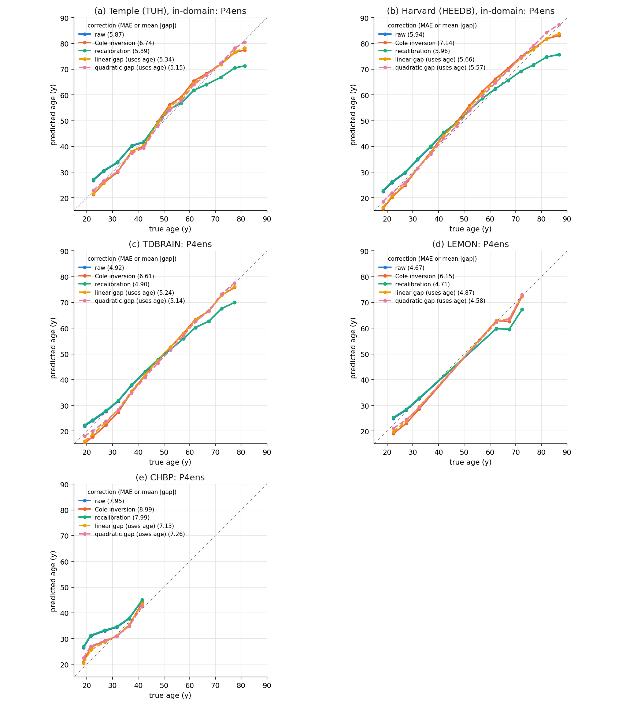
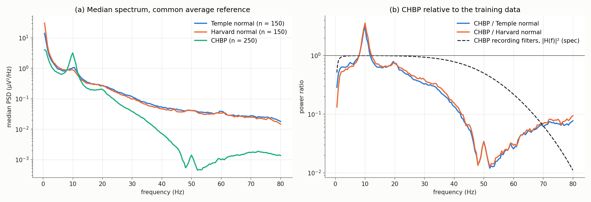
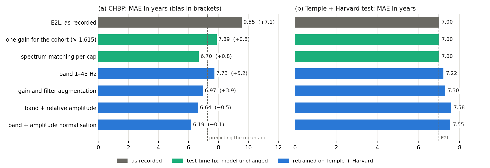

# Recording-level brain age from clinical EEG with a LaBraM encoder: attention pooling, cross-validation ensembles and confidence-aware evaluation on five cohorts

Technical report, working draft of 2026-11-16. It describes what has been built and measured so far, and what is planned, as the basis of a future paper. Every number comes from the project's result files (`docs/data/external_eval/tdbrain/`) or its result notes (`docs/`); published numbers are quoted from the cited papers.

## 1. Summary

**Goal.** Predict a person's age from a routine resting EEG recording (the "brain age"), with an error small and stable enough to study the brain-age gap in clinical cohorts, and with a per-recording confidence.

**Approach.** We fine-tune the LaBraM EEG foundation model [1] for age regression on two hospital corpora, Temple (TUH) [2] and Harvard (HEEDB) [3], 103,117 recordings of 71,656 patients in total. On top of the classical LaBraM fine-tuning recipe we change five things:

- a recording-level objective with attention pooling over 10 s windows (multiple-instance learning, ABMIL [4]) in place of a window-level objective;
- one phased training run from the pre-trained encoder (window phase, attention-only phase, joint phase);
- 5-fold subject-grouped cross-validation, with the five fold models used as an ensemble [5];
- a label-free confidence per recording, used for selective prediction [6];
- an evaluation on five cohorts: the held-out test recordings of the two training corpora and three external cohorts scored without any adaptation (zero-shot): TDBRAIN [7], LEMON [8] and CHBP [9].

**Main results (adults).** The best ensemble reaches a mean absolute error (MAE) of 5.9 years on the held-out Temple and Harvard recordings, and zero-shot 4.9 years on TDBRAIN (1,113 sessions, $R^2 = 0.83$) and 4.7 years on LEMON ($R^2 = 0.90$). Both zero-shot results are below the best published results of models trained on those cohorts (5.96 years on TDBRAIN [10], 7.75 years on LEMON [11]). Rejecting the 20 % least confident recordings lowers the MAE by 0.4 to 0.9 years on these two cohorts. One cohort remains hard: on CHBP, recorded with a narrower band and a lower amplitude, the models are no better than predicting the mean age; a model trained on band-limited, amplitude-normalised input brings CHBP to 5.9 years at an in-domain cost of 0.55 years (Section 6.5). In TDBRAIN, no psychiatric indication shows a brain-age gap against healthy controls after adjusting for age and sex. In the two hospital cohorts every neurological diagnosis group looks 0.6 to 2.5 years older than patients with a normal EEG and no diagnosis, and this gap goes with an abnormal EEG report, not with the diagnosis itself.

## 2. Background: the classical LaBraM recipe and its limits for brain age

LaBraM [1] pre-trains a transformer encoder on unlabelled EEG in two steps. A neural tokenizer learns a vector-quantised codebook by reconstructing the Fourier amplitude and phase of 1 s patches. The encoder then learns by masked modelling to predict the codes of masked patches, in the manner of BEiT v2 [12]. For a downstream task the encoder is fine-tuned with a linear head. The published recipe for the Temple abnormal corpus (TUAB), as shipped in our repository (`finetune_tuab_paper.json`), is: the base model (12 blocks, width 200, 10 heads, 5.8 M parameters), 10 s windows of 23 channels at 200 Hz cut into 1 s patches, AdamW [13] with learning rate $5 \times 10^{-4}$, batch 64, 50 epochs, layer-wise learning-rate decay 0.65, weight decay 0.05, mean pooling of the patch tokens and a binary cross-entropy loss. The unit of training and of evaluation is the 10 s window.

For brain age this recipe has four limits. (i) Age is a property of the recording, but the loss and the metric are per window. (ii) The shipped TUAB split shares 16 subjects between train and validation. (iii) TUAB has about 2,100 training recordings, and a model of this size memorises them (Section 5). (iv) The input is used as recorded, in whatever reference the amplifier used.

**Table 1.** The classical LaBraM fine-tuning recipe and this work.

| aspect | classical LaBraM (TUAB) | this work |
|---|---|---|
| target | normal / abnormal, per window | age in years, per recording, z-scored |
| training data | TUAB, about 2,100 recordings | Temple + Harvard, 84,891 training recordings |
| split | shipped split (16 subjects shared) | patient-level, seeded; 5-fold subject-grouped CV |
| line removal | 50 Hz notch | spectrum interpolation at 50 and 60 Hz |
| input | as recorded, 23 channels | common average reference, 19 channels, missing channels left out |
| training unit | one 10 s window | a bag of eight windows of one recording |
| readout | mean of patch tokens, linear head | attention pooling over windows, linear head |
| loss | binary cross-entropy | Huber on the z-scored age, plus attention-entropy, per-window and retention terms |
| schedule | 50 epochs, one phase | 17 epochs in three phases (window, attention only, joint) |
| prediction | one model, per window | mean of five fold models, per recording |
| confidence | none | window spread, fold disagreement, learned score |
| evaluation | TUAB test, window accuracy | five cohorts, MAE per recording with a subject bootstrap |

## 3. Data

**Training cohort.** `tuh_heedb_v1` joins routine recordings of the Temple University Hospital corpus [2] (31,312 recordings) and of the Harvard Electroencephalography Database [3] (71,805 recordings): 103,117 recordings of 71,656 patients, age 53.5 ± 19.2 years. Patients are split once into training, validation and test (84,891 / 10,614 / 7,612 recordings); no patient is in two splits. Every recording goes through one pipeline: 0.1–75 Hz band-pass, line removal by spectrum interpolation at 50 and 60 Hz, resampling to 200 Hz, µV, 10 s windows. Models read the first minutes after a 60 s trim at each end. Age comes from the EDF header (Temple) or the visit record (Harvard). The EEG report verdict (normal, abnormal, or none) is known for a part of the recordings and is used only for analysis.

**Test cohorts.** Table 2 lists the five cohorts. The three external cohorts are converted with the same pipeline and are never used for training, model selection or calibration. Results are for adults (18 years or older): the training data has almost no younger patients. Test sets that are too small for a stable estimate are left out of this report: the adults of the developmental cohort MIPDB [14] were scored as well, but with 31 recordings the 95 % interval of the MAE is more than 4 years wide.

**Table 2.** Test cohorts (adults). Temple and Harvard are the held-out test split of the training cohort; the others are external.

| cohort | role | n (subjects) | age, mean | population | recording |
|---|---|---|---|---|---|
| Temple (TUH) [2] | in-domain test | 272 recordings (249) | 50.7 | hospital, routine EEG; 149 normal and 123 abnormal reports | about 20 min |
| Harvard (HEEDB) [3] | in-domain test | 7,338 recordings (5,884) | 54.1 | hospital, routine EEG; 1,518 normal, 2,253 abnormal, 3,567 without verdict | about 30 min |
| TDBRAIN [7] | zero-shot | 1,113 sessions (1,062) | 45.2 | psychiatric outpatients (MDD, ADHD, OCD, memory complaints) and 179 healthy controls | 2 min eyes closed + 2 min eyes open |
| LEMON [8] | zero-shot | 214 recordings (214) | 39.2 | healthy volunteers, 20–80 years, ages in 5-year bins | 16 min, eyes closed / open |
| CHBP [9] | zero-shot | 250 recordings (250) | 31.7 | healthy volunteers, 18–68 years | about 19 min resting, recorded 0.5–50 Hz |

## 4. Method

### 4.1. Input and encoder

A recording $r$ is a set of windows $x_{r,i} \in \mathbb{R}^{C \times T}$ with $T = 2000$ samples (10 s at 200 Hz) and the $C \le 19$ channels of the 10–20 system that the recording has. Each window is re-referenced to the common average, $x_{c,t} \leftarrow x_{c,t} - \frac{1}{C}\sum_{c'} x_{c',t}$, the input variant of LaBraM++ [15] without its per-patch z-scoring. Missing channels are left out of the token sequence. The LaBraM base encoder $f_\theta$ maps a window to an embedding $h_{r,i} = f_\theta(x_{r,i}) \in \mathbb{R}^{200}$, and a linear head $g$ maps an embedding to a scalar.

### 4.2. Window model (E2L)

The target is the age $y_r$ z-scored with the training mean and standard deviation ($\mu = 53.52$, $\sigma = 19.29$ years):

$$ z_r = \frac{y_r - \mu}{\sigma}, \qquad \hat z_{r,i} = g(h_{r,i}) \tag{1} $$

The loss is the Huber loss [16] with $\delta = 1$ between each window's prediction and its recording's target:

$$ \ell_\delta(u) = \begin{cases} \frac{1}{2} u^2, & \lvert u \rvert \le \delta \\ \delta \big(\lvert u \rvert - \frac{1}{2}\delta\big), & \text{otherwise} \end{cases} \tag{2} $$

Training uses mixup [17] on inputs and targets, with one $\lambda$ per batch:

$$ \tilde x = \lambda x_a + (1-\lambda)\,x_b, \qquad \tilde z = \lambda z_a + (1-\lambda)\,z_b, \qquad \lambda \sim \mathrm{Beta}(0.4,\,0.4) \tag{3} $$

The recording's age is the de-normalised mean over its $n$ windows:

$$ \hat y_r = \mu + \sigma \, \frac{1}{n} \sum_{i=1}^{n} \hat z_{r,i} \tag{4} $$

E2L is trained for 16 epochs with AdamW [13] (weight decay 0.05, layer-wise decay 0.65, cosine schedule with 4 warm-up epochs; batch 512 at learning rate $4 \times 10^{-4}$ for the first six epochs, then batch 256 at $2.8 \times 10^{-4}$), on 5 minutes of every recording per epoch. It is the window-level baseline of this report.

### 4.3. Attention pooling over windows (P3, P4)

A bag is $K = 8$ windows of one recording. An attention pool [4] weights the window embeddings, and the head predicts from the pooled embedding:

$$ \alpha_i = \operatorname{softmax}_i \big( \mathbf{w}^\top \tanh(\mathbf{V} h_{r,i}) \big), \qquad \hat z_r = g\Big( \sum_{i=1}^{K} \alpha_i \, h_{r,i} \Big) \tag{5} $$

with $\mathbf{V} \in \mathbb{R}^{128 \times 200}$ and $\mathbf{w} \in \mathbb{R}^{128}$. The loss of a bag is

$$ \mathcal{L}_r = \ell_\delta(\hat z_r - z_r) + \lambda_H \big( \log K - H(\alpha) \big) + \lambda_w \, \frac{1}{K} \sum_{i=1}^{K} \ell_\delta\big( g(h_{r,i}) - z_r \big) + \lambda_{ret} \, \frac{1}{200\,K} \sum_{i=1}^{K} \lVert h_{r,i} - h_{r,i}^{ref} \rVert_2^2 \tag{6} $$

The first term is the recording-level Huber loss. The second, with $H(\alpha) = -\sum_i \alpha_i \log \alpha_i$ and $\lambda_H = 0.01$, keeps the attention from collapsing onto one window. The third is a per-window loss through the same head. The fourth is a retention term: it keeps the window embeddings close to those of a frozen copy $f^{ref}$ of the encoder taken at the end of the window phase. At test time a recording is one bag of all its scored windows.

Training is one run of 17 epochs from the pre-trained encoder, in three phases (Table 3). The two recipes differ in the schedule and in the regulariser of the joint phase: P3 restarts the learning rate and uses retention; P4 keeps one cosine schedule and adds the per-window loss.

**Table 3.** The phased recipes. Batches are 32 recordings × 8 windows; peak learning rate $2.8 \times 10^{-4}$; the pool and the head use a 5 times higher learning rate from the attention-only phase on.

| phase | what trains | P3 | P4 |
|---|---|---|---|
| window | encoder and head, window loss of Eq. (2) | epochs 0–9, own cosine schedule ending near 0 | epochs 0–7 |
| attention only | the pool; encoder and head frozen | epoch 10, warm-up to $10^{-4}$ | epoch 8 |
| joint | pool, encoder and head, Eq. (6) | epochs 11–16, cosine from $10^{-4}$; $\lambda_{ret} = 0.1$, $\lambda_w = 0$ | epochs 9–16 on one cosine over all 17 epochs; $\lambda_w = 0.5$, $\lambda_{ret} = 0$; every recording drawn twice per epoch |

### 4.4. Cross-validation ensemble

The training and validation patients are divided into five folds, no patient in two folds. Fold model $k$ validates on fold $k$, which selects its best epoch, and trains on the other four. The test split is the same for every fold and is never seen. The ensemble prediction is the mean of the five fold models [5]:

$$ \hat y_r = \frac{1}{5} \sum_{k=1}^{5} \hat y_{r,k} \tag{7} $$

### 4.5. Confidence and selective prediction

For fold model $k$, with window predictions $p_i = \mu_k + \sigma_k \, g(h_{r,i})$ and attention weights $\alpha_i$, the within-recording spread and the standard error of the pooled prediction are

$$ s_{r,k} = \sqrt{ \sum_i \alpha_i \, (p_i - \hat y_{r,k})^2 }, \qquad e_{r,k} = s_{r,k} \sqrt{ \sum_i \alpha_i^2 } \tag{8} $$

The disagreement of the fold models and a combined uncertainty are

$$ d_r = \operatorname{sd}_k\big( \hat y_{r,k} \big), \qquad u_r = \sqrt{ \frac{1}{5}\sum_{k} e_{r,k}^2 + d_r^2 } \tag{9} $$

We compare three rejection scores: **spread**, the fold mean of $s_{r,k}$ (for the single model E2L, the plain standard deviation of its window predictions); **total**, $u_r$; and **learned**, a gradient-boosted regressor of the absolute error on the window scores and the predicted age, fitted on each fold model's own validation fold and rank-averaged with $d_r$. None uses the age of a scored recording. In selective prediction [6] the fraction $1 - c$ of a cohort with the highest score gets no prediction, and the risk at coverage $c$ is the MAE of the rest:

$$ \mathrm{MAE}(c) = \frac{1}{\lvert S_c \rvert} \sum_{r \in S_c} \lvert \hat y_r - y_r \rvert, \qquad S_c = \{\, r : \text{score}_r \le q_c \,\} \tag{10} $$

where $q_c$ is the $c$-quantile of the score in the cohort.

### 4.6. Age-bias correction

Brain-age models predict toward the mean age: the gap $\hat y - y$ falls with age [18]. On validation recordings with a normal EEG report we fit by least squares

$$ \hat y \approx a\,y + b, \qquad y \approx c\,\hat y + d, \qquad \hat y - y \approx c_0 + c_1 y + c_2 y^2 \tag{11} $$

and compare four corrections. Two need no true age and give a new age estimate, the inversion of Cole et al. [19] and a recalibration:

$$ \hat y^{cole} = \frac{\hat y - b}{a}, \qquad \hat y^{recal} = c\,\hat y + d \tag{12} $$

Two remove the age trend of the gap using the true age [20, 21], linearly or quadratically as in Gemein et al. [22]:

$$ \hat y^{lin} = \hat y - \big( (a-1)\,y + b \big), \qquad \hat y^{quad} = \hat y - \big( c_0 + c_1 y + c_2 y^2 \big) \tag{13} $$

Eq. (13) gives a corrected gap for group comparisons, not a deployable age estimate.

### 4.7. Metrics

For a group of $N$ recordings we report the MAE, the mean gap (bias), the Pearson correlation $r$ of $\hat y$ and $y$, and

$$ \mathrm{MAE} = \frac{1}{N} \sum_r \lvert \hat y_r - y_r \rvert, \qquad R^2 = 1 - \frac{\sum_r (\hat y_r - y_r)^2}{\sum_r (y_r - \bar y)^2} \tag{14} $$

with $\bar y$ the group's own mean age, so that $R^2 \le 0$ means no better than predicting that mean. Intervals are 95 % percentile intervals over 2,000 bootstrap resamples of subjects. In-domain cohorts are scored on the first 5 minutes after the trim, the training protocol; external cohorts on every window.

### 4.8. Window-level diagnostics and group comparisons

To see what the confidence measures at the level of a window, we compare, for window $i$ of a recording with $n$ scored windows, its error with three label-free quantities of the ensemble:

$$ p_i = \frac{1}{5}\sum_k p_{ik}, \qquad e_i = \lvert p_i - y_r \rvert, \qquad w_i = \frac{n}{5}\sum_k \alpha_{ik} \tag{15} $$

$$ d_i = \lvert p_i - \hat y_r \rvert, \qquad s_i = \operatorname{sd}_k\big( p_{ik} \big) \tag{16} $$

$e_i$ is the window error, $w_i$ the relative attention weight (1 is the uniform weight), $d_i$ the deviation of the window from the recording's prediction (its share of the spread of Eq. (8)) and $s_i$ the disagreement of the fold models on the window.

A clinical group $G$ is compared with a reference group through the gap $g_r = \hat y_r - y_r$. With $x_r = 1$ for the recordings of $G$ and 0 for the reference, we fit

$$ g_r = \beta\,x_r + c_{b(r)} + \gamma_1\,y_r + \gamma_2\,m_r + \varepsilon_r \tag{17} $$

where $c_b$ is one intercept per 5-year age band, $m_r$ is 1 for men, and the standard error of $\beta$ is clustered by patient. $\beta$ is how much older the group looks at the same age and sex. The age terms take the place of the corrections of Eq. (13), as recommended when the gap is compared between groups [21]. The same model with $\lvert g_r \rvert$ on the left gives the group's extra absolute error. P-values over several groups are adjusted for the false discovery rate [23].

## 5. What we learned on the way

Table 4 collects the steps from the classical recipe to the present models, each with its measured effect. Early steps were measured on the TUAB test set (274 recordings), later ones on the test split of `tuh_heedb_v1` (7,612 recordings).

**Table 4.** Ablations. MAE in years; "n.s." means within the run-to-run noise (seed standard deviation 0.14 years on TUAB).

| change | measured on | MAE before → after |
|---|---|---|
| common average reference at the input | TUAB test | 8.91 → 8.30 |
| pre-trained encoder instead of training from scratch | TUAB test | 9.42 → 8.30 |
| more data: TUAB (2,145 recordings) → full Temple (about 20,000) → Temple + Harvard | TUAB test | 8.23 → 7.26 → 6.70 |
| longer training on Temple + Harvard (8 → 16 epochs, E2L) | Temple + Harvard test | 7.25 → 7.00 |
| 60 Hz line removal for Temple (US mains) | TUAB test | −0.23 |
| recording-level loss with attention pooling (two-step, from E2L) | Temple + Harvard test | 7.00 → 6.09 |
| one phased run from the pre-trained encoder (P3, P4) instead of two steps | Temple + Harvard test | 6.09 → 6.11 / 6.09 (5-fold mean), at 12.5 vs 27.7 GPU hours |
| 5-fold ensemble instead of one fold model | Temple + Harvard test | P3 6.11 → 5.98; P4 6.09 → 5.94 |
| scoring every window instead of the first 5 minutes | Temple + Harvard test | 6.09 → 5.46 (two-step model) |
| band-limited (1–45 Hz), amplitude-normalised input (device-robust E2L, Section 6.5) | CHBP / Temple + Harvard test | 9.35 → 5.90 / 7.00 → 7.55 |

What the ablations show:

- **Data and the training objective matter most.** Going from 2,145 to about 100,000 training recordings is worth 1.5 years on the same test set, and the recording-level objective another 0.9 years. In a controlled comparison from the pre-trained encoder at equal budget, the window model reaches 7.64, a bag with mean pooling 6.98 and a bag with attention 6.69: about 70 % of the gain comes from the recording-level loss and 30 % from attention.
- **The small corpus is memorised.** On TUAB alone the training MAE falls from 7.2 to 1.2 years while the validation MAE stays at 7.8. Of 51 changes tested on TUAB, 7 improved, 7 hurt and 37 were within noise.
- **What did not help:** an L1 loss (+0.41), longer windows of 30 s (+0.44), low-rank adaptation of the encoder (+0.99), classical features as extra tokens (+0.76), other heads, a multi-task normal / abnormal head, window-quality rejection and artifact-aware pooling (all n.s.). Dropout of 0.1 in the encoder made the model collapse. Mixup alone is not significant on TUAB and is kept as a regulariser.
- **Longer bag training does not help.** 20 joint epochs tie 4; only the retention term lowered the gap between training and validation error.
- **Robustness to the recording chain costs in-domain accuracy.** The band-limited, amplitude-normalised model fixes CHBP but loses 0.55 years in-domain and 0.9 years on LEMON (5.20 → 6.07), so it is not a free default (Section 6.5).

## 6. Results

### 6.1. Accuracy on five cohorts

**Table 5.** MAE in years with a 95 % interval, and $R^2$. Adults. Best published values with their protocol are in the last column (Section 7).

| cohort | E2L (window model) | P3 ensemble | P4 ensemble | best published |
|---|---|---|---|---|
| Temple, in-domain (272) | 6.40 [5.75, 7.09], 0.78 | 5.87 [5.24, 6.52], 0.81 | 5.87 [5.25, 6.54], 0.81 | 6.60 normal / 12.85 abnormal, trained on TUAB [22] |
| Harvard, in-domain (7,338) | 7.02 [6.88, 7.16], 0.79 | 5.98 [5.86, 6.12], 0.84 | **5.94 [5.82, 6.07], 0.84** | none found |
| TDBRAIN, zero-shot (1,113) | 5.32 [5.04, 5.60], 0.80 | 5.14 [4.89, 5.41], 0.82 | **4.92 [4.68, 5.19], 0.83** | 5.96 trained on TDBRAIN [10]; 8.36 zero-shot [24] |
| LEMON, zero-shot (214) | 5.20 [4.60, 5.84], 0.88 | 4.70 [4.17, 5.29], 0.90 | **4.67 [4.11, 5.24], 0.90** | 7.75 trained on LEMON [11]; 9.91 zero-shot [24] |
| CHBP, zero-shot (250) | 9.35 [8.45, 10.27], −0.64 | **7.37 [6.60, 8.28], −0.14** | 7.95 [7.11, 8.87], −0.28 | 6.48 trained on CHBP [11] |

The ensembles improve on the window model on every cohort, by about 1 year on Harvard and 0.4 to 2.0 years on the external cohorts. P4 is the better recipe where the recording resembles the training data (Harvard, TDBRAIN, LEMON) and P3 under shift (CHBP), which fits P3's smaller gap between training and validation error (2.33 against 2.96 years). On CHBP every model is at or above the MAE of predicting the cohort's mean age ($R^2 \le 0$). A healthy TDBRAIN subgroup of the same age range (18–68 years) is predicted with an MAE of 5.18 years by E2L, so CHBP's error comes from the recording chain, not the population; Section 6.5 measures where the signals differ and what corrects it.

### 6.2. Report status and pathology groups

**Table 6.** P4 ensemble, MAE in years. Temple and Harvard: EEG report normal or abnormal. TDBRAIN: healthy controls or any indication.

| cohort | healthy / normal report | pathological / abnormal report |
|---|---|---|
| Temple | 4.52 (n = 149, mean age 44.6) | 7.50 (n = 123, mean age 58.0) |
| Harvard | 5.69 (n = 1,518, mean age 48.8) | 6.49 (n = 2,253, mean age 58.8) |
| TDBRAIN | 4.96 (n = 179, mean age 40.3) | 4.92 (n = 934, mean age 46.2) |

An abnormal EEG report costs accuracy (and those patients are about 10 years older), while a psychiatric indication does not. In TDBRAIN the brain-age gap of major depression (n = 351), ADHD (116), OCD (54) and subjective memory complaints (89) does not differ from that of the healthy controls (179) after adjusting for age, age squared and sex: every adjusted difference is below 1 year, $\lvert t \rvert < 1.1$, with all three models. With these group sizes a difference of about 1.7 years would have been detected for depression (80 % power).

For the diagnosis groups of the two hospital cohorts we use Eq. (17). The reference is a normal EEG report and a health record with none of the groups. Temple's groups come from the corpus's clinical sheet and Harvard's from the ICD-10 codes of the patient's record; a patient can be in several. The Temple test split is too small for this (272 recordings), so the table uses out-of-fold predictions: each P3 fold model on its own validation fold, which it did not train on (4 of the 5 folds; 24,844 Temple and 51,527 Harvard recordings of adults; one model per recording, no ensemble).

**Table 7.** Brain age per diagnosis group, out-of-fold predictions of the P3 fold models. MAE in years; adjusted gap $\beta$ of Eq. (17) in years with a 95 % interval, for all recordings of the group and for those with a normal and with an abnormal EEG report. Groups overlap. "s." = fewer than 30 recordings, suppressed.

| cohort, group | recordings | mean age | MAE | adjusted gap | gap, normal report | gap, abnormal report |
|---|---|---|---|---|---|---|
| Harvard, reference | 2,248 | 45.0 | 5.44 | | | |
| Harvard, stroke | 5,238 | 65.1 | 6.82 | +2.5 [2.0, 3.0] | +0.7 [0.0, 1.4] | +3.1 [2.5, 3.7] |
| Harvard, dementia | 3,568 | 72.1 | 6.86 | +2.1 [1.5, 2.7] | −0.1 [−0.9, 0.7] | +2.6 [1.9, 3.3] |
| Harvard, multiple sclerosis | 677 | 51.4 | 6.80 | +2.0 [1.2, 2.8] | +0.6 [−0.7, 1.8] | +3.5 [2.2, 4.8] |
| Harvard, movement disorders | 6,801 | 58.7 | 6.58 | +1.8 [1.4, 2.2] | +0.5 [0.0, 1.0] | +2.7 [2.2, 3.2] |
| Harvard, CNS tumours | 2,954 | 57.3 | 6.67 | +1.4 [0.9, 1.8] | +0.2 [−0.5, 1.0] | +1.5 [0.9, 2.1] |
| Harvard, depression | 9,318 | 55.4 | 6.28 | +1.3 [1.0, 1.7] | +0.5 [0.0, 0.9] | +2.2 [1.8, 2.7] |
| Harvard, electrographic seizures | 3,749 | 54.1 | 6.56 | +1.1 [0.6, 1.5] | +0.2 [−0.4, 0.7] | +1.6 [1.1, 2.1] |
| Harvard, sleep disorders | 10,395 | 57.5 | 6.28 | +1.1 [0.7, 1.4] | −0.2 [−0.6, 0.3] | +2.3 [1.8, 2.8] |
| Harvard, headache and migraine | 12,932 | 53.9 | 6.10 | +0.8 [0.5, 1.2] | −0.2 [−0.6, 0.2] | +1.9 [1.4, 2.3] |
| Harvard, epilepsy | 16,450 | 50.0 | 5.98 | +0.6 [0.3, 1.0] | +0.1 [−0.3, 0.5] | +1.4 [1.0, 1.7] |
| Temple, reference | 8,335 | 48.5 | 6.77 | | | |
| Temple, substance use | 933 | 46.7 | 8.05 | +3.3 [2.2, 4.3] | +1.5 [0.2, 2.7] | +3.9 [2.6, 5.3] |
| Temple, traumatic brain injury | 273 | 45.2 | 8.60 | +2.6 [0.0, 5.1] | +3.8 [−0.2, 7.9] | +2.0 [−1.2, 5.2] |
| Temple, stroke | 856 | 62.5 | 8.66 | +1.9 [0.6, 3.2] | −0.5 [−3.5, 2.4] | +2.3 [1.0, 3.7] |
| Temple, bipolar disorder | 261 | 44.9 | 6.43 | +1.7 [0.3, 3.1] | +1.0 [−1.1, 3.0] | +2.1 [0.3, 4.0] |
| Temple, clinical seizures | 1,762 | 47.6 | 6.68 | +0.2 [−0.6, 1.0] | −0.7 [−1.6, 0.3] | +0.8 [−0.2, 1.9] |
| Temple, epilepsy | 631 | 49.3 | 7.18 | +0.0 [−1.3, 1.3] | −0.2 [−2.1, 1.8] | +0.2 [−1.5, 1.9] |

Three results stand out (Table 7, Figure 3).

- **Accuracy is close to uniform across diagnoses.** The MAE per Harvard group is 6.0 to 6.9 years against 5.4 for the reference, and most of that is age: at the same age and sex the extra absolute error is 0.3 to 1.2 years. An abnormal report costs about 1 year of absolute error in both cohorts.
- **Every Harvard diagnosis group looks older than the reference,** from 0.6 years for epilepsy to 2.5 years for stroke; all are significant after the false-discovery adjustment. The held-out test split with the P4 ensemble gives the same order (stroke +2.5, dementia +3.0, epilepsy +0.7 years). In Temple, substance use (+3.3) and stroke (+1.9) are significant.
- **The gap goes with the abnormal EEG, not with the diagnosis.** A patient with a diagnosis and a normal EEG report is within about 0.7 years of the reference in every Harvard group of Table 7; with an abnormal report the same group looks 1.4 to 3.5 years older. Among Harvard recordings with a normal report, any diagnosis against none gives −0.05 years [−0.38, 0.29]. An abnormal against a normal report gives +1.8 years [1.4, 2.3] without any diagnosis and +1.9 years [1.7, 2.1] with one; in Temple +2.1 and +2.6 years.

Two cautions. The estimate averages over the ages of a group: among patients of 60 and over, the Harvard gaps of stroke, dementia and movement disorders are about half as large (+1.2, +1.2 and +0.8 years, all above 0), because the compression of the predictions limits how much older an old patient can look. And Harvard's diagnoses are codes anywhere in the patient's record, not the reason for the EEG.

Published work points the same way with other signals. In sleep EEG, patients with neurological or psychiatric disease had a mean excess brain age of 4 years [25], and structural MRI shows apparent brain ageing in several brain disorders [26]. For routine EEG, Gemein et al. [22] report a lower gap in pathological than in non-pathological TUAB recordings (the age is under-estimated by 5 against 1 years) with a model trained on normal recordings only. Our raw difference between abnormal and normal reports is between −0.9 and +0.6 years depending on the model and cohort, and it becomes about +2 years once age is adjusted for, so the sign of this comparison depends on how the age bias is treated.

### 6.3. Selective prediction

**Table 8.** P4 ensemble, MAE in years of the 80 % most confident recordings of each cohort, by rejection score, and the MAE an oracle would reach by rejecting the largest true errors.

| score | Temple | Harvard | TDBRAIN | LEMON | CHBP |
|---|---|---|---|---|---|
| no rejection | 5.87 | 5.94 | 4.92 | 4.67 | 7.95 |
| spread, Eq. (8) | 5.69 | 5.56 | 4.54 | **3.79** | 7.84 |
| total, Eq. (9) | **5.07** | **5.32** | **4.53** | 3.80 | **7.03** |
| learned | 5.11 | 5.34 | 4.57 | 3.81 | 7.43 |
| oracle | 3.78 | 3.83 | 3.25 | 2.92 | 5.06 |

Rejection by the combined score lowers the MAE on every cohort. It is never significantly worse than the spread and is significantly better on Temple, Harvard and CHBP (paired bootstrap), because the disagreement of the fold models sees errors that are shared by all windows of a recording. Scores built from the attention weights alone are weak and change sign on CHBP. Two cautions apply. The scores were compared on the test cohorts, so the choice among them is not independent of these data. And part of every score is age: within deciles of the predicted age, the combined score keeps 60 to 80 % of its gain on Temple, Harvard and TDBRAIN, but nothing on LEMON and CHBP. All scores recover only 20 to 30 % of what the oracle would.

**Inside the recording.** Figures 5 and 6 relate the error of single windows to the quantities of Eqs. (15) and (16) for the P4 ensemble.

- **Attention removes bad windows more than it selects good ones.** The windows with the lowest weight are much worse than the rest (Harvard: 16 years at a tenth of the uniform weight against about 7), but above the median weight the error is flat, and in Temple, TDBRAIN and CHBP the highest-weight windows are worse again.
- **On TDBRAIN and CHBP the weight carries no information about the window.** Inside a recording its rank correlation with the window error has a median of +0.09 there, against −0.08 to −0.27 on the other cohorts, and attention pooling does not beat the plain mean of the window predictions (5.36 against 5.32 years per TDBRAIN file). Where it works it is worth 0.2 years on Temple, 0.7 on Harvard and 0.4 on LEMON.
- **Deviation from the recording's prediction is the strongest window signal.** Inside a recording its rank correlation with the window error is 0.21 to 0.44, and the error grows from 4 to 7 years for the tenth of the windows closest to the recording's prediction to 12 to 19 years for the most deviant tenth. This is what makes the spread usable, and it favours robust pooling over more attention capacity.
- **Fold disagreement is a recording-level signal.** Over all windows it follows the error (rank correlation 0.16 to 0.39), but inside a recording it does not (median about 0 on four of the five cohorts, 0.14 on LEMON): the fold models disagree on whole recordings, which is the part the combined score adds to the spread.

### 6.4. Age bias and its correction

**Table 9.** P4 ensemble under each correction: MAE in years / slope of the prediction on age (1 = no compression). For the two corrections that use the true age the first number is the mean absolute corrected gap.

| correction | Temple | Harvard | TDBRAIN | LEMON | CHBP |
|---|---|---|---|---|---|
| none | 5.87 / 0.79 | 5.94 / 0.83 | 4.92 / 0.89 | 4.67 / 0.83 | 7.95 / 0.53 |
| Cole inversion, Eq. (12) | 6.74 / 1.00 | 7.14 / 1.04 | 6.61 / 1.12 | 6.15 / 1.05 | 8.99 / 0.67 |
| recalibration, Eq. (12) | 5.89 / 0.78 | 5.96 / 0.82 | 4.90 / 0.88 | 4.71 / 0.82 | 7.99 / 0.53 |
| linear gap, Eq. (13) | 5.34 / 1.00 | 5.66 / 1.03 | 5.24 / 1.09 | 4.87 / 1.04 | 7.13 / 0.74 |
| quadratic gap, Eq. (13) | 5.15 / 1.02 | 5.57 / 1.05 | 5.14 / 1.07 | 4.58 / 1.02 | 7.26 / 0.65 |

The ensembles compress less than the window model: in-domain slopes are 0.79 to 0.84 against 0.70 to 0.72 for E2L. A correction fitted on validation data transfers to the external cohorts that resemble the training data (slope 1.00 to 1.12 after correction) but not to CHBP. Removing the bias without the true age costs accuracy: Cole inversion raises the MAE by 0.9 to 1.7 years, because it scales the prediction noise by $1/a$, and recalibration changes nothing. The raw prediction is therefore the best age estimate, and the corrections serve the analysis of the gap. After correction, recordings with an abnormal report look 1.8 to 4.2 years older than those with a normal report in Temple and Harvard ($p \le 0.002$ with every model); before correction the difference is hidden by the age confound. In TDBRAIN the corrected difference between patients and controls is 0.4 to 1.1 years and not significant.

### 6.5. A recording-chain shift and its correction: CHBP

CHBP is the one cohort on which every model fails. This section locates the difference in the signal, tests it causally on training-domain recordings, and compares corrections. The numbers here are for the window model E2L and its retrained variants on the first 5 minutes of each recording, the training protocol, so E2L on CHBP reads 9.55 years here and 9.35 in Table 5 (every window). No CHBP age is used anywhere.

**Where the signals differ.** Table 10 and Figure 8 compare CHBP with healthy Temple and Harvard recordings weighted to CHBP's age distribution. Two properties of the recording chain stand out. The amplitude is 0.5 to 0.6 times that of the training data. And the band is narrower: CHBP was recorded with a 0.5 Hz high-pass and a 50 Hz low-pass [9], so its power below 1 Hz is 6 to 12 % and its power at 45–70 Hz 4 to 5 % of the training data's. The alpha rhythm, in contrast, is stronger: CHBP is alert, eyes-closed, artifact-free research EEG, which should read as younger, not older. The age range is not the cause either: at CHBP's ages E2L reaches a correlation of 0.66 with age on its own domain, against 0.44 on CHBP. CHBP also holds two acquisition groups, a 64-channel cap (161 recordings; E2L MAE 7.58, r 0.55) and a 120-channel cap (89 recordings; 13.10, r 0.27) with a different spectrum.

**Table 10.** CHBP against healthy Temple and Harvard recordings of the same ages (150 each, normal EEG report). Medians over recordings; power in µV²/Hz, common average reference.

| signal feature | CHBP | Temple | Harvard |
|---|---|---|---|
| channel standard deviation (µV) | 5.8 | 9.9 | 12.8 |
| share of windows with a channel above 100 µV | 0.00 | 0.03 | 0.20 |
| power 0.1–1 Hz | 5.0 | 43.2 | 90.5 |
| power 1–4 Hz (delta) | 1.86 | 3.86 | 4.36 |
| power 8–13 Hz (alpha) | 1.98 | 1.05 | 0.92 |
| power 13–30 Hz (beta) | 0.159 | 0.266 | 0.244 |
| power 30–45 Hz | 0.017 | 0.069 | 0.056 |
| power 45–70 Hz | 0.001 | 0.036 | 0.028 |
| relative alpha power | 0.44 | 0.17 | 0.15 |
| aperiodic exponent | 1.70 | 1.33 | 1.42 |

**Causal test.** The two differences are imposed on 300 healthy Temple and Harvard recordings of CHBP's ages, with a gain $k$ and zero-phase Butterworth filters $h$:

$$ x' = k\,x, \qquad x' = h_{LP} * h_{HP} * x \tag{18} $$

**Table 11.** E2L on 300 training-domain recordings made CHBP-like with Eq. (18). The sample is young, so E2L over-predicts it even without a transform.

| transform | MAE | bias | r |
|---|---|---|---|
| none | 7.02 | +5.1 | 0.66 |
| amplitude × 0.62 | 11.34 | +10.9 | 0.66 |
| high-pass 0.5 Hz | 7.71 | +6.0 | 0.63 |
| low-pass 50 Hz | 8.04 | +3.8 | 0.40 |
| amplitude × 0.62 and band 0.5–50 Hz | 13.71 | +12.6 | 0.37 |

The two effects are separate (Table 11). The lower amplitude adds an offset of about 6 years and leaves the ranking intact: the model has learned that low amplitude means old. The 50 Hz low-pass leaves the offset and destroys the ranking: the model uses content above 50 Hz that CHBP does not have. Together they reproduce CHBP's result (13.7 years, r 0.37) on recordings the model otherwise predicts well.

**Corrections.** We compare two that change only the test data and four that change the training. At test time, one gain for the cohort, or spectrum matching: every channel of CHBP is filtered so that the cohort's median spectrum $\bar P$ equals that of a label-free training reference, per cap, an idea used for sleep staging [27]:

$$ X'(f) = X(f)\,\operatorname{clip}\Big( \sqrt{ \bar P_{ref}(f) / \bar P_{CHBP}(f) },\ 0.1,\ 10 \Big) \tag{19} $$

In training, the model input is band-limited to 1–45 Hz with order-8 zero-phase Butterworth responses and, optionally, every 10 s window is scaled to a fixed amplitude:

$$ X'(f) = X(f)\,\frac{(f/f_{lo})^{16}}{1 + (f/f_{lo})^{16}}\,\frac{1}{1 + (f/f_{hi})^{16}}, \qquad f_{lo} = 1, \quad f_{hi} = 45 \tag{20} $$

$$ x' = \frac{a}{s}\,x, \qquad s = \operatorname{median}_c\ \operatorname{sd}_t(x_c), \qquad a = 10 \tag{21} $$

with $s$ the median over channels $c$ of the standard deviation over time, in µV. These are applied in training and at test time alike. The alternative keeps the raw input and varies it during training only (augmentation): each window gets, with probability 0.5, a random gain, with probability 0.5 a low-pass and with probability 0.3 a high-pass of the form of Eq. (20), with

$$ \log g \sim \mathcal{U}(\log 0.55,\ \log 1.8), \qquad f_{hi} \sim \mathcal{U}(40,\ 75), \qquad f_{lo} \sim \mathcal{U}(0.1,\ 1) \tag{22} $$

All four training variants use the E2L recipe on Temple and Harvard (up to 16 epochs with early stopping), selected on the in-domain validation error.

**Table 12.** Corrections for CHBP. MAE in years; CHBP: MAE / bias / r, and MAE on the 64- and the 120-channel cap. Predicting CHBP's mean age gives 7.27.

| model | Temple + Harvard test | Harvard test, ages 18–29 | LEMON | CHBP | CHBP by cap |
|---|---|---|---|---|---|
| E2L, raw input | 7.00 | 7.47 | 5.22 | 9.55 / +7.1 / 0.44 | 7.58 / 13.10 |
| E2L, one gain for CHBP (test time) | 7.00 | 7.47 | 5.22 | 7.89 / +0.8 / 0.44 | 6.89 / 9.69 |
| E2L, spectrum matching per cap, Eq. (19) (test time) | 7.00 | 7.47 | 5.22 | 6.70 / +0.8 / 0.52 | 6.23 / 7.55 |
| band 1–45 Hz, Eq. (20) | 7.22 | 7.74 | 5.33 | 7.73 / +5.2 / 0.55 | 6.91 / 9.22 |
| gain and filter augmentation, Eq. (22) | 7.30 | 9.12 | 6.18 | 6.97 / +3.9 / 0.60 | 6.42 / 7.96 |
| band + amplitude normalisation + relative amplitude as a head input | 7.58 | 9.49 | 6.12 | 6.64 / −0.5 / 0.56 | 6.24 / 7.37 |
| band + amplitude normalisation, Eqs. (20), (21) (device-robust) | 7.55 | 9.53 | 6.08 | **6.19 / −0.1 / 0.59** | **5.92 / 6.67** |

What Table 12 and Figure 9 show:

- **The band limit restores the ranking, the amplitude sets the bias.** Band-limited training alone raises the correlation with age on CHBP from 0.44 to 0.55 but keeps an offset of +5 years; only a model that does not see the absolute amplitude removes the offset.
- **The device-robust model is the best single correction.** It scores CHBP as recorded at 6.19 years (5.90 over every window, $R^2 = 0.33$), level with the best published result of a model trained on CHBP: 6.19 ± 1.10 against 6.48 ± 0.60 over the same ten folds [11]. The 120-channel cap gains most (13.10 → 6.67). The same model is unaffected by the transform of Eq. (18) (7.69 → 7.33 years).
- **Augmentation teaches tolerance, not invariance.** The augmented model has the best ranking on CHBP (r 0.60) and stays closest to E2L in-domain among the amplitude-robust models (7.30), but it keeps a bias of +3.9 years: CHBP's gain of 0.6 sits at the edge of the range seen in training. Its training curves look like E2L's, with the gap between validation and clean training error growing to 2.6 years (E2L 2.85) and validation flat from epoch 11, so it overfits mildly and more epochs would not help; a wider gain range is the change to try.
- **Robustness has a price.** Every variant that hides the absolute amplitude loses 1.6 to 2.1 years on young Harvard adults and about 0.9 years on LEMON: amplitude is a cue for young age. Giving it back as one number per recording does not recover the loss. No single retrained model matches E2L in-domain and corrects CHBP.
- **Without retraining,** spectrum matching per cap takes E2L to 6.70 years, under the predict-the-mean level, at no in-domain cost; it needs a batch of unlabelled recordings of the new device.

The practical rule at present is two models and a label-free choice per cohort: E2L (or the ensembles of Section 4) for recordings inside the training range of amplitude and band, the device-robust model outside it. The attention ensembles were not retrained with these inputs; as recorded they reach 7.37 (P3) and 7.95 years (P4) on CHBP.

## 7. Comparison with published work

**Table 13.** Published EEG brain-age results on the test cohorts, and ours. "within" = trained and tested on the cohort with cross-validation; "zero-shot" = trained elsewhere and applied unchanged. MAE in years.

| cohort | study | method | protocol | MAE | $R^2$ |
|---|---|---|---|---|---|
| TUAB | Gemein et al. [22] | temporal convolutional network trained on normal recordings | within (train / eval) | 6.60 normal, 12.85 abnormal | not reported |
| TUAB | ours, P4 ensemble | Section 4 | in-domain, Temple test | 4.52 normal, 7.50 abnormal | 0.87, 0.67 |
| TDBRAIN | Khayretdinova et al. [10] | deep convolutional network on raw EEG | within, ages 5–88 | 5.96 | 0.81 |
| TDBRAIN | Hu et al. [28] | oscillatory features, sparse group lasso | protocol not stated for TDBRAIN, ages 5–89 | 4.95 | not reported |
| TDBRAIN | Bomatter et al. [29] | wavelet covariances, Riemannian / ridge models | within, ages 5–89 | not reported | about 0.8 |
| TDBRAIN | Hajhassani et al. [24] | CNN-transformer with artifact removal, trained on Temple | zero-shot, healthy 20–90 | 8.36 | 0.59 |
| TDBRAIN | ours, P4 ensemble | Section 4 | zero-shot, adults 18–88 | 4.92 | 0.83 |
| LEMON | Engemann et al. [11] | Deep4Net (best of the benchmark) | within | 7.75 | 0.69 |
| LEMON | Mellot et al. [30] | Riemannian model, without / with re-centring | trained on TUAB normals | not reported | 0.26 / 0.44 |
| LEMON | Hajhassani et al. [24] | as above | zero-shot | 9.91 | 0.63 |
| LEMON | ours, P4 ensemble | Section 4 | zero-shot | 4.67 | 0.90 |
| CHBP | Engemann et al. [11] | handcrafted features, random forest (best of the benchmark) | within | 6.48 | 0.18 |
| CHBP | ours, P3 ensemble / device-robust E2L | Section 4 / Section 6.5 | zero-shot | 7.37 / 5.90 | −0.14 / 0.33 |

How our approach differs from these studies:

- **Benchmark models** [11] and the TUAB network of Gemein et al. [22] are trained within one cohort of a few hundred to a few thousand recordings, on cropped windows, with features or convolutional networks. We start from a self-supervised foundation encoder and train on about 100,000 hospital recordings, with a recording-level objective. Gemein et al. train on normal recordings only, which makes their abnormal error large by design; we train on all recordings and report both groups.
- **TDBRAIN studies** [10, 28, 29] train on TDBRAIN itself and include children, whose ages widen the range and raise $R^2$. Our model never saw TDBRAIN and is scored on adults.
- **Cross-dataset studies.** Tveitstøl et al. [31] train convolutional networks on four EEG datasets and test on a fifth, TDBRAIN and LEMON among them, and conclude that their models did not reach state-of-the-art performance across datasets. Hajhassani et al. [24] train on Temple and test zero-shot with automated artifact removal; Mellot et al. [30] need an unsupervised re-centring of the target cohort to transfer from TUAB to LEMON. Bikki and Zeng [32] report an $R^2$ of 0.83 for a compact network applied zero-shot to TDBRAIN; only their abstract was available to us. We apply no alignment and no artifact removal to the target cohort.
- **Confidence.** None of these studies reports a per-recording confidence or selective prediction.
- **Psychiatric brain-age gap.** Structural MRI finds a small gap in major depression, +1.08 years (Cohen's d = 0.14) in the ENIGMA consortium [33]. Our EEG result in TDBRAIN, no gap and a detectable difference of about 1.7 years, is compatible with an effect of that size.

Three cautions for these comparisons. The published studies use other subsets, age ranges and releases of the cohorts (for TDBRAIN the 2022 release, ours is release 3.1). LEMON's public ages are 5-year bins, which adds about 1.25 years to our MAE there. And whether the LaBraM pre-training corpus contains any recording of the external cohorts has to be checked before the term zero-shot is used in a paper; our fine-tuning used Temple and Harvard only.

## 8. Limitations

- **Old age and children.** Predictions are compressed toward the mean: for adults over 65 in TDBRAIN the P4 ensemble under-predicts by 5.4 years. Children are outside the training range and are over-predicted by 10 years or more (measured on a developmental cohort that is not part of this report).
- **Recording chain.** CHBP shows that a narrower acquisition band and a lower amplitude are enough to bring the models to the predict-the-mean level. The robust variant fixes it at an in-domain cost; no single model does both, and it has been tested on one shifted cohort only. Whether CHBP's low amplitude comes from the amplifier gain, the electrodes or the export cannot be settled from the released data.
- **Selection on test data.** The three rejection scores were chosen after comparing nine on the test cohorts, and the early ablations of Table 4 were selected on the TUAB test set. The rejection threshold is the cohort's own score quantile, so it needs a batch of unlabelled recordings.
- **Single runs.** E2L and each fold model are one seed. Differences between recipes below about 0.2 years (P3 against P4 in-domain) are within the fold-to-fold spread.
- **Labels.** "Normal" and "abnormal" are EEG report verdicts, available for half of the Harvard recordings; TDBRAIN has indications but no EEG reports and no medication record. Harvard diagnoses are ICD-10 codes of the whole patient record and overlap (2.9 groups per diagnosed recording), so the rows of Table 7 are not independent effects, and they come from single fold models, not the ensemble.
- **Data governance.** Harvard and TDBRAIN are under data use agreements without redistribution. Only aggregates are reported.

## 9. Planned work

- Fix the protocol before a paper: rejection score and threshold fitted on validation only, a fixed evaluation window for every cohort, three seeds for the final recipe.
- Reduce the old-age compression in training (age-balanced sampling or loss) instead of after the fact.
- One model for both recording chains: the band limit and a wider gain augmentation (beyond the 0.55 to 1.8 range of Eq. (22)) in the phased ensemble training, checked on CHBP and on a further external cohort.
- A dedicated abnormal / pathology head trained with the age head, to separate "older-looking" from "abnormal"; Table 7 says that the abnormal EEG, not the diagnosis, carries the gap.
- Robust pooling of the window predictions (median or trimming by the deviation of Eq. (16)), since attention adds nothing on TDBRAIN and CHBP.
- Add the TDBRAIN replication subjects and a paediatric cohort, to extend the test to the blinded diagnoses and to children.
- Add the Dortmund Vital Study (OpenNeuro ds005385; 608 healthy adults of 20 to 70 years with exact ages, 208 of them recorded again after about 5 years) as a sixth cohort of this report. It has been converted and scored after this report's tables were fixed: the P4 ensemble reaches 4.53 years per session zero-shot ($R^2 = 0.85$), the level of healthy in-domain recordings of the same ages, and the predicted age of the same person rises by 4.3 years over 5.2 years. Two findings there need a protocol decision: a session after 2 hours of cognitive tasks looks 1.5 to 1.7 years older than before them, and the gap of a person is stable over 5 years (r = 0.77).
- Further external cohorts from a survey of public data: the NMT routine clinical EEG from Pakistan (2,417 recordings with normal / abnormal labels) and small open cohorts with clinical dementia and Parkinson's diagnoses to check Table 7. None of these has been audited or scored yet.
- Verify the pre-training corpus of the LaBraM checkpoint against all test cohorts.
- Study the brain-age gap against clinical covariates in Harvard (diagnosis codes, medication), with the bias corrections of Section 4.6.

## References

[1] Wei-Bang Jiang, Li-Ming Zhao, Bao-Liang Lu. Large Brain Model for Learning Generic Representations with Tremendous EEG Data in BCI. The Twelfth International Conference on Learning Representations (ICLR), 2024. arXiv:2405.18765.

[2] Iyad Obeid, Joseph Picone. The Temple University Hospital EEG Data Corpus. Frontiers in Neuroscience 10:196, 2016. doi:10.3389/fnins.2016.00196.

[3] Harvard Electroencephalography Database (HEEDB), version 4.1. Brain Data Science Platform (BDSP), credentialed access, 2025. data set; the citation requested by its data use agreement is to be added.

[4] Maximilian Ilse, Jakub M. Tomczak, Max Welling. Attention-based Deep Multiple Instance Learning. Proceedings of the 35th International Conference on Machine Learning (ICML), 2018. arXiv:1802.04712.

[5] Balaji Lakshminarayanan, Alexander Pritzel, Charles Blundell. Simple and Scalable Predictive Uncertainty Estimation using Deep Ensembles. Advances in Neural Information Processing Systems (NIPS), 2017. arXiv:1612.01474.

[6] Yonatan Geifman, Ran El-Yaniv. Selective Classification for Deep Neural Networks. 2017. arXiv:1705.08500.

[7] Hanneke van Dijk, Guido van Wingen, Damiaan Denys, Sebastian Olbrich, Rosalinde van Ruth, Martijn Arns. The two decades brainclinics research archive for insights in neurophysiology (TDBRAIN) database. Scientific Data 9(1):333, 2022. doi:10.1038/s41597-022-01409-z.

[8] Anahit Babayan, Miray Erbey, Deniz Kumral, Janis D. Reinelt, Andrea M. F. Reiter, Josefin Röbbig, et al. A mind-brain-body dataset of MRI, EEG, cognition, emotion, and peripheral physiology in young and old adults. Scientific Data 6:180308, 2019. doi:10.1038/sdata.2018.308.

[9] Pedro A. Valdes-Sosa, Lidice Galan-Garcia, Jorge Bosch-Bayard, Maria L. Bringas-Vega, Eduardo Aubert-Vazquez, Iris Rodriguez-Gil, et al. The Cuban Human Brain Mapping Project, a young and middle age population-based EEG, MRI, and cognition dataset. Scientific Data 8(1):45, 2021. doi:10.1038/s41597-021-00829-7.

[10] Mariam Khayretdinova, Alexey Shovkun, Vladislav Degtyarev, Andrey Kiryasov, Polina Pshonkovskaya, Ilya Zakharov. Predicting age from resting-state scalp EEG signals with deep convolutional neural networks on TD-brain dataset. Frontiers in Aging Neuroscience 14:1019869, 2022. doi:10.3389/fnagi.2022.1019869.

[11] Denis A. Engemann, Apolline Mellot, Richard Höchenberger, Hubert Banville, David Sabbagh, Lukas Gemein, Tonio Ball, Alexandre Gramfort. A reusable benchmark of brain-age prediction from M/EEG resting-state signals. NeuroImage 262:119521, 2022. doi:10.1016/j.neuroimage.2022.119521.

[12] Zhiliang Peng, Li Dong, Hangbo Bao, Qixiang Ye, Furu Wei. BEiT v2: Masked Image Modeling with Vector-Quantized Visual Tokenizers. 2022. arXiv:2208.06366.

[13] Ilya Loshchilov, Frank Hutter. Decoupled Weight Decay Regularization. International Conference on Learning Representations (ICLR), 2019. arXiv:1711.05101.

[14] Nicolas Langer, Erica J. Ho, Lindsay M. Alexander, Helen Y. Xu, Renee K. Jozanovic, Simon Henin, et al. A resource for assessing information processing in the developing brain using EEG and eye tracking. Scientific Data 4:170040, 2017. doi:10.1038/sdata.2017.40.

[15] Konstantinos Barmpas, Na Lee, Yannis Panagakis, Dimitrios A. Adamos, Nikolaos Laskaris, Stefanos Zafeiriou. Advancing Brainwave Modeling with a Codebook-Based Foundation Model. 2025. arXiv:2505.16724 (introduces LaBraM++).

[16] Peter J. Huber. Robust Estimation of a Location Parameter. The Annals of Mathematical Statistics 35(1):73–101, 1964. not re-checked against a database.

[17] Hongyi Zhang, Moustapha Cisse, Yann N. Dauphin, David Lopez-Paz. mixup: Beyond Empirical Risk Minimization. 2017. arXiv:1710.09412.

[18] Stephen M. Smith, Diego Vidaurre, Fidel Alfaro-Almagro, Thomas E. Nichols, Karla L. Miller. Estimation of brain age delta from brain imaging. NeuroImage 200:528–539, 2019. doi:10.1016/j.neuroimage.2019.06.017.

[19] J. H. Cole, S. J. Ritchie, M. E. Bastin, M. C. Valdés Hernández, S. Muñoz Maniega, N. Royle, et al. Brain age predicts mortality. Molecular Psychiatry 23(5):1385–1392, 2018. doi:10.1038/mp.2017.62.

[20] Iman Beheshti, Scott Nugent, Olivier Potvin, Simon Duchesne. Bias-adjustment in neuroimaging-based brain age frameworks: A robust scheme. NeuroImage: Clinical 24:102063, 2019. doi:10.1016/j.nicl.2019.102063.

[21] Ann-Marie G. de Lange, James H. Cole. Commentary: Correction procedures in brain-age prediction. NeuroImage: Clinical 26:102229, 2020. doi:10.1016/j.nicl.2020.102229.

[22] Lukas A. W. Gemein, Robin T. Schirrmeister, Joschka Boedecker, Tonio Ball. Brain age revisited: Investigating the state vs. trait hypotheses of EEG-derived brain-age dynamics with deep learning. Imaging Neuroscience 2, 2024. doi:10.1162/imag_a_00210.

[23] Yoav Benjamini, Yosef Hochberg. Controlling the false discovery rate: a practical and powerful approach to multiple testing. Journal of the Royal Statistical Society: Series B 57(1):289–300, 1995. doi:10.1111/j.2517-6161.1995.tb02031.x.

[24] Davoud Hajhassani, Paul-Adrien Graignic, Bruno Aristimunha, Apolline Mellot, Tom Mariani, Clément Nober, Bruna J. Lopes, Léo Burgund, Lionel Kusch, Thomas Semah, Arnault H. Caillet. Automated Artifact Removal in EEG Age Prediction: A systematic comparison. 2026. arXiv:2609.31195 (preprint).

[25] Haoqi Sun, Luis Paixao, Jefferson T. Oliva, Balaji Goparaju, Diego Z. Carvalho, Kicky G. van Leeuwen, Oluwaseun Akeju, Robert J. Thomas, Sydney S. Cash, Matt T. Bianchi, M. Brandon Westover. Brain age from the electroencephalogram of sleep. Neurobiology of Aging 74:112–120, 2019. doi:10.1016/j.neurobiolaging.2018.10.016.

[26] Tobias Kaufmann, Dennis van der Meer, Nhat Trung Doan, Emanuel Schwarz, Martina J. Lund, et al. Common brain disorders are associated with heritable patterns of apparent aging of the brain. Nature Neuroscience 22(10):1617–1623, 2019. doi:10.1038/s41593-019-0471-7.

[27] Théo Gnassounou, Rémi Flamary, Alexandre Gramfort. Convolutional Monge mapping normalization for learning on sleep data. Advances in Neural Information Processing Systems 36, 2023. arXiv:2305.18831.

[28] Shiang Hu, Xue Xiang, Xiaolong Huang, Yan Lu, Xulai Zhang, Dezhong Yao, Pedro A. Valdes-Sosa. Lifespan brain age prediction based on multiple EEG oscillatory features and sparse group lasso. Frontiers in Aging Neuroscience 17:1559067, 2025. doi:10.3389/fnagi.2025.1559067.

[29] Philipp Bomatter, Joseph Paillard, Pilar Garces, Jörg Hipp, Denis-Alexander Engemann. Machine learning of brain-specific biomarkers from EEG. EBioMedicine 106:105259, 2024. doi:10.1016/j.ebiom.2024.105259.

[30] Apolline Mellot, Antoine Collas, Pedro L. C. Rodrigues, Denis Engemann, Alexandre Gramfort. Harmonizing and aligning M/EEG datasets with covariance-based techniques to enhance predictive regression modeling. Imaging Neuroscience 1, 2023. doi:10.1162/imag_a_00040.

[31] Thomas Tveitstøl, Mats Tveter, Christoffer Hatlestad-Hall, Hugo L. Hammer, Denis A. Engemann, Ira R. J. Hebold Haraldsen. Assessing the Robustness of Deep Learning Based Brain Age Prediction Models Across Multiple EEG Datasets. IEEE Transactions on Biomedical Engineering 73(7):2582–2601, 2026. doi:10.1109/TBME.2025.3639477.

[32] Taha Bikki, Hong Zeng. Cross-Dataset Generalization of Compact Deep Learning Models for EEG-Based Brain-Age Prediction. Proceedings of the 2026 2nd International Conference on Big Data and Intelligent Medicine, pp. 108–115, 2026. doi:10.1145/3816325.3843614. only the abstract was read.

[33] Laura K. M. Han, Richard Dinga, Tim Hahn, Christopher R. K. Ching, Lisa T. Eyler, Lyubomir Aftanas, et al. Brain aging in major depressive disorder: results from the ENIGMA major depressive disorder working group. Molecular Psychiatry 26(9):5124–5139, 2021. doi:10.1038/s41380-020-0754-0.
