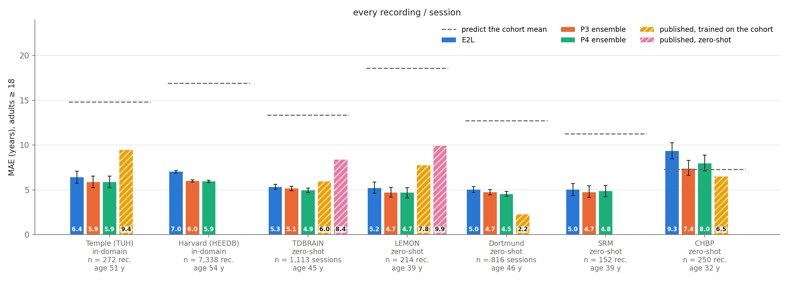
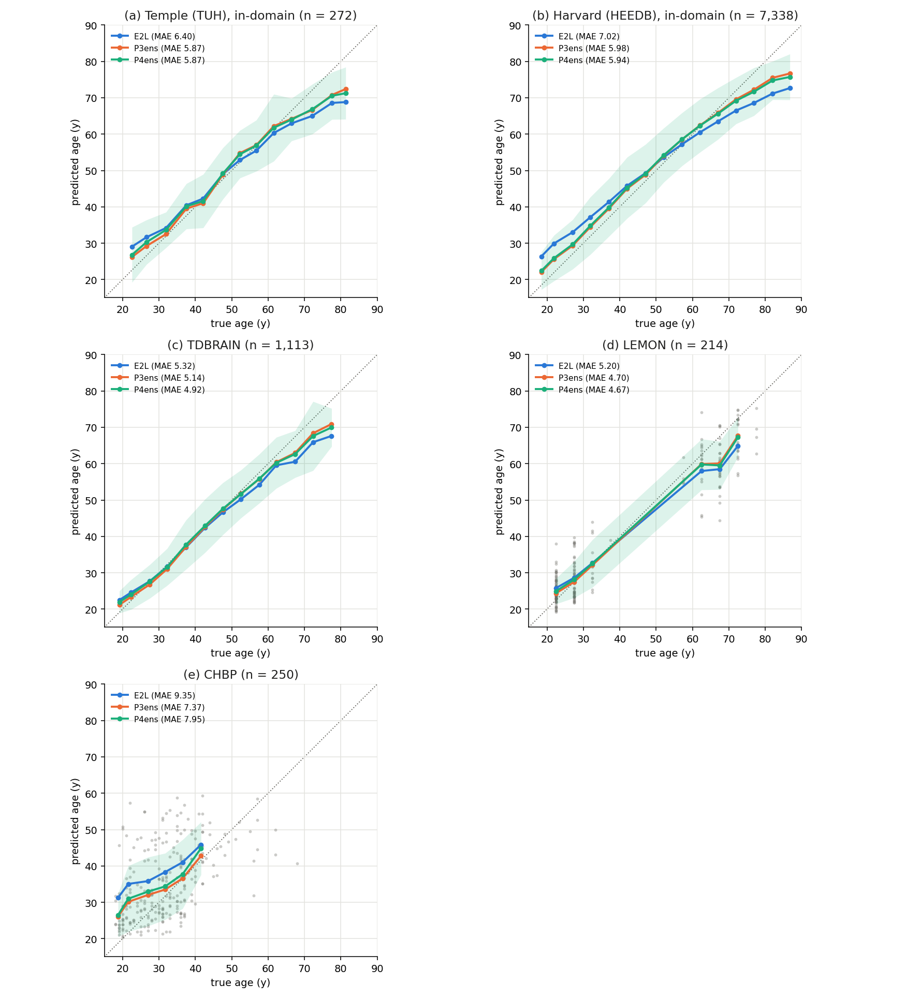
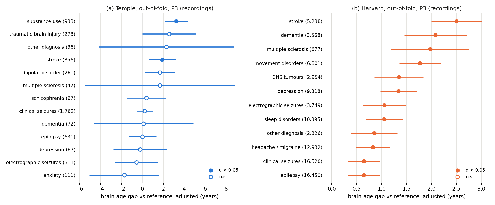
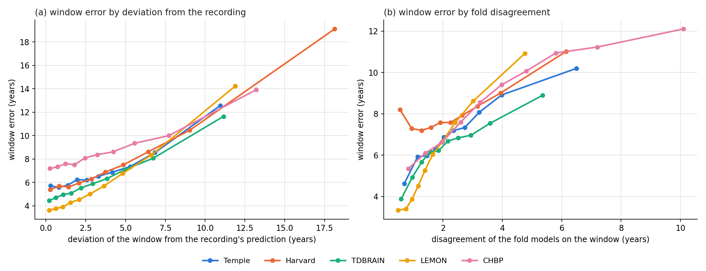
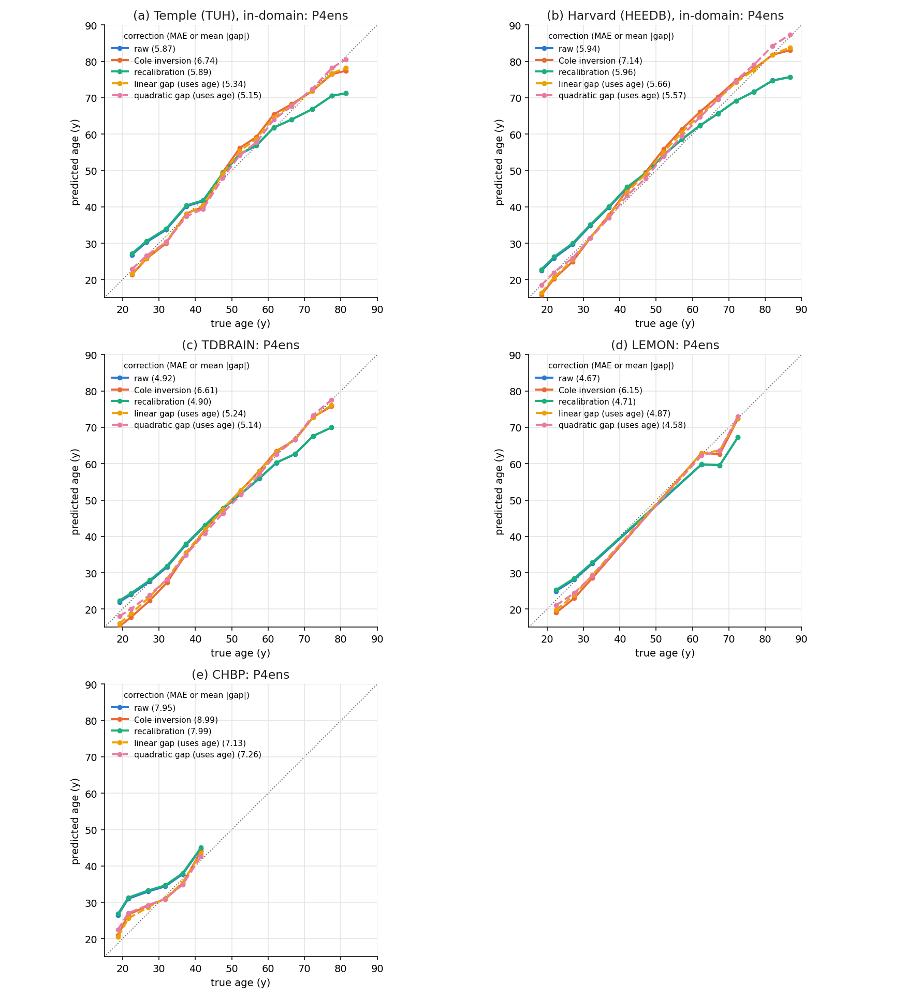
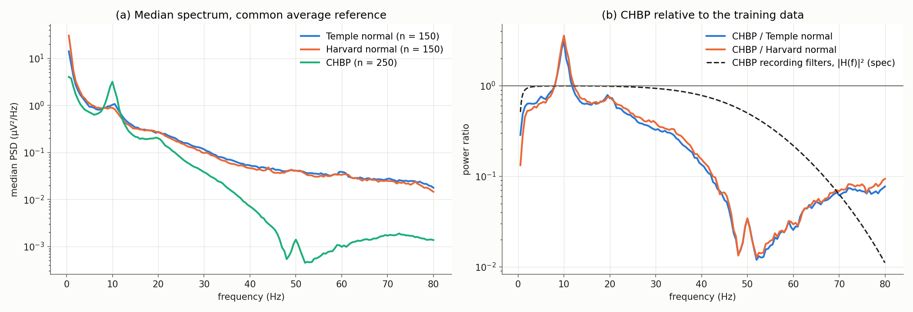
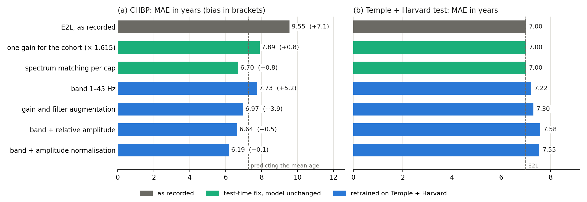
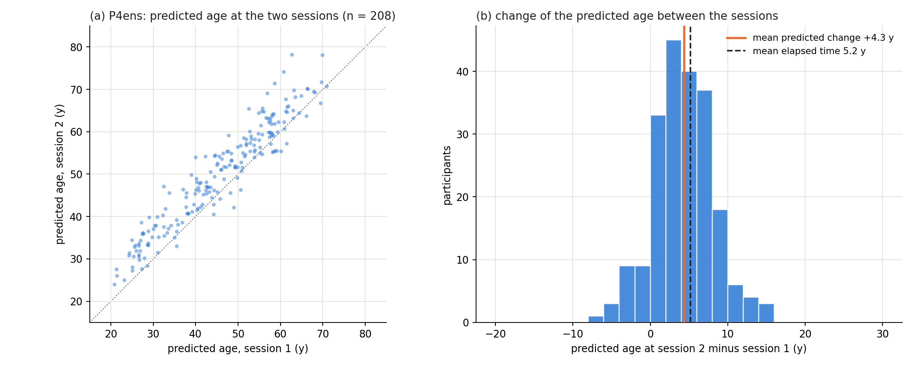

# Recording-level brain age from clinical EEG with a LaBraM encoder: attention pooling, cross-validation ensembles and confidence-aware evaluation on seven cohorts

Technical report, working draft of 2026-11-19. It describes what has been built and measured so far, and what is planned, as the basis of a future paper. Every number comes from the project's result files (`docs/data/external_eval/tech_report/`, built by `scripts/external_runs/tech_report.sh`; per-cohort details in `docs/data/external_eval/<cohort>/`) or its result notes (`docs/`); published numbers are quoted from the cited papers.

## 1. Summary

**Goal.** Predict a person's age from a routine resting EEG recording (the "brain age"), with an error small and stable enough to study the brain-age gap in clinical cohorts, and with a per-recording confidence.

**Approach.** We fine-tune the LaBraM EEG foundation model [@jiang2024labram] for age regression on two hospital corpora, Temple (TUH) [@obeid2016tuh] and Harvard (HEEDB) [@heedb], 103,117 recordings of 71,656 patients in total. On top of the classical LaBraM fine-tuning recipe we change five things:

- a recording-level objective with attention pooling over 10 s windows (multiple-instance learning, ABMIL [@ilse2018abmil]) in place of a window-level objective;
- one phased training run from the pre-trained encoder (window phase, attention-only phase, joint phase);
- 5-fold subject-grouped cross-validation, with the five fold models used as an ensemble [@lakshminarayanan2017ensembles];
- a label-free confidence per recording, used for selective prediction [@geifman2017selective];
- an evaluation on seven cohorts: the held-out test recordings of the two training corpora and five external cohorts scored without any adaptation (zero-shot): TDBRAIN [@vandijk2022tdbrain], LEMON [@babayan2019lemon], the Dortmund Vital Study [@wascher2025dortmund], SRM [@hatlestadhall2021srm] and CHBP [@valdessosa2021chbp].

**Main results (adults).** The best ensemble reaches a mean absolute error (MAE) of 5.9 years on the held-out Temple and Harvard recordings, and zero-shot 4.5 to 4.9 years on four external cohorts of healthy volunteers or outpatients: TDBRAIN (1,113 sessions, $R^2 = 0.83$), LEMON ($R^2 = 0.90$), Dortmund (816 sessions, 4.53 years, $R^2 = 0.85$) and SRM (152 recordings, 4.8 years). The TDBRAIN and LEMON results are below the best published results of models trained on those cohorts (5.96 years on TDBRAIN [@khayretdinova2022tdbrain], 7.75 years on LEMON [@engemann2022benchmark]). Rejecting the 20 % least confident recordings lowers the MAE by 0.2 to 0.9 years on the external cohorts. One cohort remains hard: on CHBP, recorded with a narrower band and a lower amplitude, the models are no better than predicting the mean age; a model trained on band-limited, amplitude-normalised input brings CHBP to 5.9 years at an in-domain cost of 0.55 years (Section 6.5). In TDBRAIN, no psychiatric indication shows a brain-age gap against healthy controls after adjusting for age and sex. In the two hospital cohorts every neurological diagnosis group looks 0.6 to 2.5 years older than patients with a normal EEG and no diagnosis, and this gap goes with an abnormal EEG report, not with the diagnosis itself. In three small clinic cohorts that are not accuracy benchmarks, patients with Alzheimer's disease look about 6 years and patients with Parkinson's disease about 3 years older than the controls of the same clinic (Section 6.6). In Dortmund the predicted age of the same 208 people rises by 4.3 years over 5.2 years, and a person's gap is stable over that time (r = 0.77; Section 6.7). With the evaluation window and the rejection thresholds fixed on the training domain, the accuracy changes by at most 0.4 years, and the confidence keeps 80 % of the in-domain recordings but does not flag the shifted cohort CHBP (Section 10.4). None of the external cohorts is in LaBraM's pre-training data.

## 2. Background: the classical LaBraM recipe and its limits for brain age

LaBraM [@jiang2024labram] pre-trains a transformer encoder on unlabelled EEG in two steps. A neural tokenizer learns a vector-quantised codebook by reconstructing the Fourier amplitude and phase of 1 s patches. The encoder then learns by masked modelling to predict the codes of masked patches, in the manner of BEiT v2 [@peng2022beitv2]. For a downstream task the encoder is fine-tuned with a linear head. The published recipe for the Temple abnormal corpus (TUAB), as shipped in our repository (`finetune_tuab_paper.json`), is: the base model (12 blocks, width 200, 10 heads, 5.8 M parameters), 10 s windows of 23 channels at 200 Hz cut into 1 s patches, AdamW [@loshchilov2019adamw] with learning rate $5 \times 10^{-4}$, batch 64, 50 epochs, layer-wise learning-rate decay 0.65, weight decay 0.05, mean pooling of the patch tokens and a binary cross-entropy loss. The unit of training and of evaluation is the 10 s window.

For brain age this recipe has four limits. (i) Age is a property of the recording, but the loss and the metric are per window. (ii) The shipped TUAB split shares 16 subjects between train and validation. (iii) TUAB has about 2,100 training recordings, and a model of this size memorises them (Section 5). (iv) The input is used as recorded, in whatever reference the amplifier used.

**Table 1.** The classical LaBraM fine-tuning recipe and this work.

| aspect | classical LaBraM (TUAB) | this work |
|---|---|---|
| target | normal / abnormal, per window | age in years, per recording, z-scored |
| training data | TUAB, about 2,100 recordings | Temple + Harvard, 84,891 training recordings |
| split | shipped split (16 subjects shared) | patient-level, seeded; 5-fold subject-grouped CV |
| line removal | 50 Hz notch | spectrum interpolation at 50 and 60 Hz |
| input | as recorded, 23 channels | common average reference, 19 channels, missing channels left out |
| training unit | one 10 s window | a bag of eight windows of one recording |
| readout | mean of patch tokens, linear head | attention pooling over windows, linear head |
| loss | binary cross-entropy | Huber on the z-scored age, plus attention-entropy, per-window and retention terms |
| schedule | 50 epochs, one phase | 17 epochs in three phases (window, attention only, joint) |
| prediction | one model, per window | mean of five fold models, per recording |
| confidence | none | window spread, fold disagreement, learned score |
| evaluation | TUAB test, window accuracy | five cohorts, MAE per recording with a subject bootstrap |

## 3. Data

**Training cohort.** `tuh_heedb_v1` joins routine recordings of the Temple University Hospital corpus [@obeid2016tuh] (31,312 recordings) and of the Harvard Electroencephalography Database [@heedb] (71,805 recordings): 103,117 recordings of 71,656 patients, age 53.5 ± 19.2 years. Patients are split once into training, validation and test (84,891 / 10,614 / 7,612 recordings); no patient is in two splits. Every recording goes through one pipeline: 0.1–75 Hz band-pass, line removal by spectrum interpolation at 50 and 60 Hz, resampling to 200 Hz, µV, 10 s windows. Models read the first minutes after a 60 s trim at each end. Age comes from the EDF header (Temple) or the visit record (Harvard). The EEG report verdict (normal, abnormal, or none) is known for a part of the recordings and is used only for analysis.

**Test cohorts.** Table 2 lists the seven cohorts. The five external cohorts are converted with the same pipeline and are never used for training, model selection or calibration, and none of them is in the pre-training data of the LaBraM encoder (Section 10.4). Results are for adults (18 years or older): the training data has almost no younger patients. Test sets that are too small for a stable estimate are left out of this report: the adults of the developmental cohort MIPDB [@langer2017mipdb] were scored as well, but with 31 recordings the 95 % interval of the MAE is more than 4 years wide. Four further cohorts were scored and rejected as age benchmarks: NMT [@khan2022nmt], released band-limited, and three clinic cohorts of dementia and Parkinson's disease [@miltiadous2023ahepa; @singh2023iowapd; @katzir2026telavivpd] whose healthy controls are predicted 7 to 11 years too young; the clinic cohorts serve only for comparisons of patients and controls inside a cohort (Section 6.6). Section 10.2 lists every cohort that was scored, with the rejected ones and the reason, and Section 10.3 gives the full table of each cohort.

**Table 2.** Test cohorts (adults). Temple and Harvard are the held-out test split of the training cohort; the others are external.

| cohort | role | n (subjects) | age, mean | population | recording |
|---|---|---|---|---|---|
| Temple (TUH) [@obeid2016tuh] | in-domain test | 272 recordings (249) | 50.7 | hospital, routine EEG; 149 normal and 123 abnormal reports | about 20 min |
| Harvard (HEEDB) [@heedb] | in-domain test | 7,338 recordings (5,884) | 54.1 | hospital, routine EEG; 1,518 normal, 2,253 abnormal, 3,567 without verdict | about 30 min |
| TDBRAIN [@vandijk2022tdbrain] | zero-shot | 1,113 sessions (1,062) | 45.2 | psychiatric outpatients (MDD, ADHD, OCD, memory complaints) and 179 healthy controls | 2 min eyes closed + 2 min eyes open |
| LEMON [@babayan2019lemon] | zero-shot | 214 recordings (214) | 39.2 | healthy volunteers, 20–80 years, ages in 5-year bins | 16 min, eyes closed / open |
| Dortmund Vital Study [@wascher2025dortmund; @gajewski2022dortmund] | zero-shot | 816 sessions (608) | 46.1 | healthy volunteers, 20–70 years, exact ages; 208 recorded again after about 5 years | four 3-min runs per session: eyes closed and open, before and after a 2-hour block of cognitive tasks |
| SRM [@hatlestadhall2021srm] | zero-shot | 152 recordings (110) | 38.8 | healthy volunteers, adults to 71 years; 42 with a second session | 4 min eyes closed |
| CHBP [@valdessosa2021chbp] | zero-shot | 250 recordings (250) | 31.7 | healthy volunteers, 18–68 years | about 19 min resting, recorded 0.5–50 Hz |

## 4. Method

Figure 1 shows the whole pipeline. The encoder and its pre-training are LaBraM's [@jiang2024labram] and are reused unchanged (Figure 1(a)). Everything after the pre-trained weights is ours (Figure 1(b)): one preprocessing for every cohort, the common average reference, the recording-level objective with attention pooling over 10 s windows, the cross-validation ensemble and the confidence. Sections 4.1 to 4.5 define each step.

![**Figure 1.** The pipeline. (a) LaBraM pre-training [@jiang2024labram], reused as published: unlabelled EEG is cut into 1 s patches, a neural tokenizer learns a codebook by reconstructing each patch's Fourier amplitude and phase, and the encoder learns by predicting the codes of masked patches. (b) This work: a routine recording is preprocessed once, cut into 10 s windows with a common average reference, and every window is embedded by the fine-tuned encoder; attention pooling turns the window embeddings into one prediction per recording and fold model, and five fold models give the ensemble age and its confidence. Blue: LaBraM's architecture and weights; orange: this work; grey: data; dashed: the training schedule.](fig_pipeline.png)

### 4.1. Input and encoder

A recording $r$ is a set of windows $x_{r,i} \in \mathbb{R}^{C \times T}$ with $T = 2000$ samples (10 s at 200 Hz) and the $C \le 19$ channels of the 10–20 system that the recording has. Each window is re-referenced to the common average, $x_{c,t} \leftarrow x_{c,t} - \frac{1}{C}\sum_{c'} x_{c',t}$, the input variant of LaBraM++ [@barmpas2025labrampp] without its per-patch z-scoring. Missing channels are left out of the token sequence. The LaBraM base encoder $f_\theta$ maps a window to an embedding $h_{r,i} = f_\theta(x_{r,i}) \in \mathbb{R}^{200}$, and a linear head $g$ maps an embedding to a scalar.

### 4.2. Window model (E2L)

The target is the age $y_r$ z-scored with the training mean and standard deviation ($\mu = 53.52$, $\sigma = 19.29$ years):

$$ z_r = \frac{y_r - \mu}{\sigma}, \qquad \hat z_{r,i} = g(h_{r,i}) \tag{1} $$

The loss is the Huber loss [@huber1964robust] with $\delta = 1$ between each window's prediction and its recording's target:

$$ \ell_\delta(u) = \begin{cases} \frac{1}{2} u^2, & \lvert u \rvert \le \delta \\ \delta \big(\lvert u \rvert - \frac{1}{2}\delta\big), & \text{otherwise} \end{cases} \tag{2} $$

Training uses mixup [@zhang2017mixup] on inputs and targets, with one $\lambda$ per batch:

$$ \tilde x = \lambda x_a + (1-\lambda)\,x_b, \qquad \tilde z = \lambda z_a + (1-\lambda)\,z_b, \qquad \lambda \sim \mathrm{Beta}(0.4,\,0.4) \tag{3} $$

The recording's age is the de-normalised mean over its $n$ windows:

$$ \hat y_r = \mu + \sigma \, \frac{1}{n} \sum_{i=1}^{n} \hat z_{r,i} \tag{4} $$

E2L is trained for 16 epochs with AdamW [@loshchilov2019adamw] (weight decay 0.05, layer-wise decay 0.65, cosine schedule with 4 warm-up epochs; batch 512 at learning rate $4 \times 10^{-4}$ for the first six epochs, then batch 256 at $2.8 \times 10^{-4}$), on 5 minutes of every recording per epoch. It is the window-level baseline of this report.

### 4.3. Attention pooling over windows (P3, P4)

A bag is $K = 8$ windows of one recording. An attention pool [@ilse2018abmil] weights the window embeddings, and the head predicts from the pooled embedding:

$$ \alpha_i = \operatorname{softmax}_i \big( \mathbf{w}^\top \tanh(\mathbf{V} h_{r,i}) \big), \qquad \hat z_r = g\Big( \sum_{i=1}^{K} \alpha_i \, h_{r,i} \Big) \tag{5} $$

with $\mathbf{V} \in \mathbb{R}^{128 \times 200}$ and $\mathbf{w} \in \mathbb{R}^{128}$. The loss of a bag is

$$ \mathcal{L}_r = \ell_\delta(\hat z_r - z_r) + \lambda_H \big( \log K - H(\alpha) \big) + \lambda_w \, \frac{1}{K} \sum_{i=1}^{K} \ell_\delta\big( g(h_{r,i}) - z_r \big) + \lambda_{ret} \, \frac{1}{200\,K} \sum_{i=1}^{K} \lVert h_{r,i} - h_{r,i}^{ref} \rVert_2^2 \tag{6} $$

The first term is the recording-level Huber loss. The second, with $H(\alpha) = -\sum_i \alpha_i \log \alpha_i$ and $\lambda_H = 0.01$, keeps the attention from collapsing onto one window. The third is a per-window loss through the same head. The fourth is a retention term: it keeps the window embeddings close to those of a frozen copy $f^{ref}$ of the encoder taken at the end of the window phase. At test time a recording is one bag of all its scored windows.

Figure 2 shows the pooling on one recording of an external cohort. Window predictions spread over about 25 years within the recording; the attention weights vary about sixfold (0.40 to 2.28), and the lowest weights go to windows far from the pooled answer, among them a large movement artifact (Figure 2(e)). The highest-weighted window is ordinary resting EEG but not the most accurate one (Figure 2(d)): attention mainly removes bad windows, as Section 6.3 measures over whole cohorts. Here that moves the prediction from 68.1 (plain mean of the windows) to 70.7 years, for a true age in the 70–75 bin.

![**Figure 2.** Attention pooling over the windows of one recording: LEMON participant aged 70–75, 98 windows of 10 s after the 60 s trims, P4 ensemble ($p_i$ and $w_i$ of Eq. (15)). (a) Window predictions over time, coloured and sized by the relative attention weight $w_i$ (1 = uniform); lines: the true age (bin midpoint), the attention-pooled prediction of Eq. (7) and the plain mean of the windows. (b) The weight per window. (c) Weight against the window's deviation from the pooled prediction, Eq. (16). (d), (e) The EEG of the highest- and the lowest-weighted window, 12 of 19 channels after the common average reference, traces 80 µV apart and clipped at ±40 µV. The recording was chosen to illustrate the mechanism; over all LEMON recordings attention improves on the plain mean by 0.4 years (Section 6.3). `scripts/tech_report_figures.py`.](fig_attention_example.png)

Training is one run of 17 epochs from the pre-trained encoder, in three phases (Table 3). The two recipes differ in the schedule and in the regulariser of the joint phase: P3 restarts the learning rate and uses retention; P4 keeps one cosine schedule and adds the per-window loss.

**Table 3.** The phased recipes. Batches are 32 recordings × 8 windows; peak learning rate $2.8 \times 10^{-4}$; the pool and the head use a 5 times higher learning rate from the attention-only phase on.

| phase | what trains | P3 | P4 |
|---|---|---|---|
| window | encoder and head, window loss of Eq. (2) | epochs 0–9, own cosine schedule ending near 0 | epochs 0–7 |
| attention only | the pool; encoder and head frozen | epoch 10, warm-up to $10^{-4}$ | epoch 8 |
| joint | pool, encoder and head, Eq. (6) | epochs 11–16, cosine from $10^{-4}$; $\lambda_{ret} = 0.1$, $\lambda_w = 0$ | epochs 9–16 on one cosine over all 17 epochs; $\lambda_w = 0.5$, $\lambda_{ret} = 0$; every recording drawn twice per epoch |

### 4.4. Cross-validation ensemble

The training and validation patients are divided into five folds, no patient in two folds. Fold model $k$ validates on fold $k$, which selects its best epoch, and trains on the other four. The test split is the same for every fold and is never seen. The ensemble prediction is the mean of the five fold models [@lakshminarayanan2017ensembles]:

$$ \hat y_r = \frac{1}{5} \sum_{k=1}^{5} \hat y_{r,k} \tag{7} $$

### 4.5. Confidence and selective prediction

For fold model $k$, with window predictions $p_i = \mu_k + \sigma_k \, g(h_{r,i})$ and attention weights $\alpha_i$, the within-recording spread and the standard error of the pooled prediction are

$$ s_{r,k} = \sqrt{ \sum_i \alpha_i \, (p_i - \hat y_{r,k})^2 }, \qquad e_{r,k} = s_{r,k} \sqrt{ \sum_i \alpha_i^2 } \tag{8} $$

The disagreement of the fold models and a combined uncertainty are

$$ d_r = \operatorname{sd}_k\big( \hat y_{r,k} \big), \qquad u_r = \sqrt{ \frac{1}{5}\sum_{k} e_{r,k}^2 + d_r^2 } \tag{9} $$

We compare three rejection scores: **spread**, the fold mean of $s_{r,k}$ (for the single model E2L, the plain standard deviation of its window predictions); **total**, $u_r$; and **learned**, a gradient-boosted regressor of the absolute error on the window scores and the predicted age, fitted on each fold model's own validation fold and rank-averaged with $d_r$. None uses the age of a scored recording. In selective prediction [@geifman2017selective] the fraction $1 - c$ of a cohort with the highest score gets no prediction, and the risk at coverage $c$ is the MAE of the rest:

$$ \mathrm{MAE}(c) = \frac{1}{\lvert S_c \rvert} \sum_{r \in S_c} \lvert \hat y_r - y_r \rvert, \qquad S_c = \{\, r : \text{score}_r \le q_c \,\} \tag{10} $$

where $q_c$ is the $c$-quantile of the score in the cohort.

### 4.6. Age-bias correction

Brain-age models predict toward the mean age: the gap $\hat y - y$ falls with age [@smith2019delta]. On validation recordings with a normal EEG report we fit by least squares

$$ \hat y \approx a\,y + b, \qquad y \approx c\,\hat y + d, \qquad \hat y - y \approx c_0 + c_1 y + c_2 y^2 \tag{11} $$

and compare four corrections. Two need no true age and give a new age estimate, the inversion of Cole et al. [@cole2018mortality] and a recalibration:

$$ \hat y^{cole} = \frac{\hat y - b}{a}, \qquad \hat y^{recal} = c\,\hat y + d \tag{12} $$

Two remove the age trend of the gap using the true age [@beheshti2019bias; @delange2020commentary], linearly or quadratically as in Gemein et al. [@gemein2024revisited]:

$$ \hat y^{lin} = \hat y - \big( (a-1)\,y + b \big), \qquad \hat y^{quad} = \hat y - \big( c_0 + c_1 y + c_2 y^2 \big) \tag{13} $$

Eq. (13) gives a corrected gap for group comparisons, not a deployable age estimate. Section 10.1 gives the fit, the fitted coefficients and the consequences of using the true age.

### 4.7. Metrics

For a group of $N$ recordings we report the MAE, the mean gap (bias), the Pearson correlation $r$ of $\hat y$ and $y$, and

$$ \mathrm{MAE} = \frac{1}{N} \sum_r \lvert \hat y_r - y_r \rvert, \qquad R^2 = 1 - \frac{\sum_r (\hat y_r - y_r)^2}{\sum_r (y_r - \bar y)^2} \tag{14} $$

with $\bar y$ the group's own mean age, so that $R^2 \le 0$ means no better than predicting that mean. Intervals are 95 % percentile intervals over 2,000 bootstrap resamples of subjects. In-domain cohorts are scored on the first 5 minutes after the trim, the training protocol; external cohorts on every window. A TDBRAIN or Dortmund session is the mean of the predictions of its runs. Section 10.4 scores every cohort on one fixed window instead.

### 4.8. Window-level diagnostics and group comparisons

To see what the confidence measures at the level of a window, we compare, for window $i$ of a recording with $n$ scored windows, its error with three label-free quantities of the ensemble:

$$ p_i = \frac{1}{5}\sum_k p_{ik}, \qquad e_i = \lvert p_i - y_r \rvert, \qquad w_i = \frac{n}{5}\sum_k \alpha_{ik} \tag{15} $$

$$ d_i = \lvert p_i - \hat y_r \rvert, \qquad s_i = \operatorname{sd}_k\big( p_{ik} \big) \tag{16} $$

$e_i$ is the window error, $w_i$ the relative attention weight (1 is the uniform weight), $d_i$ the deviation of the window from the recording's prediction (its share of the spread of Eq. (8)) and $s_i$ the disagreement of the fold models on the window.

A clinical group $G$ is compared with a reference group through the gap $g_r = \hat y_r - y_r$. With $x_r = 1$ for the recordings of $G$ and 0 for the reference, we fit

$$ g_r = \beta\,x_r + c_{b(r)} + \gamma_1\,y_r + \gamma_2\,m_r + \varepsilon_r \tag{17} $$

where $c_b$ is one intercept per 5-year age band, $m_r$ is 1 for men, and the standard error of $\beta$ is clustered by patient. $\beta$ is how much older the group looks at the same age and sex. The age terms take the place of the corrections of Eq. (13), as recommended when the gap is compared between groups [@delange2020commentary]. The same model with $\lvert g_r \rvert$ on the left gives the group's extra absolute error. P-values over several groups are adjusted for the false discovery rate [@benjamini1995fdr].

## 5. What we learned on the way

Table 4 collects the steps from the classical recipe to the present models, each with its measured effect. Early steps were measured on the TUAB test set (274 recordings), later ones on the test split of `tuh_heedb_v1` (7,612 recordings).

**Table 4.** Ablations. MAE in years; "n.s." means within the run-to-run noise (seed standard deviation 0.14 years on TUAB).

| change | measured on | MAE before → after |
|---|---|---|
| common average reference at the input | TUAB test | 8.91 → 8.30 |
| pre-trained encoder instead of training from scratch | TUAB test | 9.42 → 8.30 |
| more data: TUAB (2,145 recordings) → full Temple (about 20,000) → Temple + Harvard | TUAB test | 8.23 → 7.26 → 6.70 |
| longer training on Temple + Harvard (8 → 16 epochs, E2L) | Temple + Harvard test | 7.25 → 7.00 |
| 60 Hz line removal for Temple (US mains) | TUAB test | −0.23 |
| recording-level loss with attention pooling (two-step, from E2L) | Temple + Harvard test | 7.00 → 6.09 |
| one phased run from the pre-trained encoder (P3, P4) instead of two steps | Temple + Harvard test | 6.09 → 6.11 / 6.09 (5-fold mean), at 12.5 vs 27.7 GPU hours |
| 5-fold ensemble instead of one fold model | Temple + Harvard test | P3 6.11 → 5.98; P4 6.09 → 5.94 |
| scoring every window instead of the first 5 minutes | Temple + Harvard test | 6.09 → 5.46 (two-step model) |
| band-limited (1–45 Hz), amplitude-normalised input (device-robust E2L, Section 6.5) | CHBP / Temple + Harvard test | 9.35 → 5.90 / 7.00 → 7.55 |

What the ablations show:

- **Data and the training objective matter most.** Going from 2,145 to about 100,000 training recordings is worth 1.5 years on the same test set, and the recording-level objective another 0.9 years. In a controlled comparison from the pre-trained encoder at equal budget, the window model reaches 7.64, a bag with mean pooling 6.98 and a bag with attention 6.69: about 70 % of the gain comes from the recording-level loss and 30 % from attention.
- **The small corpus is memorised.** On TUAB alone the training MAE falls from 7.2 to 1.2 years while the validation MAE stays at 7.8. Of 51 changes tested on TUAB, 7 improved, 7 hurt and 37 were within noise.
- **What did not help:** an L1 loss (+0.41), longer windows of 30 s (+0.44), low-rank adaptation of the encoder (+0.99), classical features as extra tokens (+0.76), other heads, a multi-task normal / abnormal head, window-quality rejection and artifact-aware pooling (all n.s.). Dropout of 0.1 in the encoder made the model collapse. Mixup alone is not significant on TUAB and is kept as a regulariser.
- **Longer bag training does not help.** 20 joint epochs tie 4; only the retention term lowered the gap between training and validation error.
- **Robustness to the recording chain costs in-domain accuracy.** The band-limited, amplitude-normalised model fixes CHBP but loses 0.55 years in-domain and 0.9 years on LEMON (5.20 → 6.07), so it is not a free default (Section 6.5).

## 6. Results

### 6.1. Accuracy on seven cohorts

**Table 5.** MAE in years with a 95 % interval, and $R^2$. Adults. Best published values with their protocol are in the last column (Section 7).

| cohort | E2L (window model) | P3 ensemble | P4 ensemble | best published |
|---|---|---|---|---|
| Temple, in-domain (272) | 6.40 [5.75, 7.09], 0.78 | 5.87 [5.24, 6.52], 0.81 | 5.87 [5.25, 6.54], 0.81 | 6.60 normal / 12.85 abnormal, trained on TUAB [@gemein2024revisited] |
| Harvard, in-domain (7,338) | 7.02 [6.88, 7.16], 0.79 | 5.98 [5.86, 6.12], 0.84 | **5.94 [5.82, 6.07], 0.84** | none found |
| TDBRAIN, zero-shot (1,113) | 5.32 [5.04, 5.60], 0.80 | 5.14 [4.89, 5.41], 0.82 | **4.92 [4.68, 5.19], 0.83** | 5.96 trained on TDBRAIN [@khayretdinova2022tdbrain]; 8.36 zero-shot [@hajhassani2026artifact] |
| LEMON, zero-shot (214) | 5.20 [4.60, 5.84], 0.88 | 4.70 [4.17, 5.29], 0.90 | **4.67 [4.11, 5.24], 0.90** | 7.75 trained on LEMON [@engemann2022benchmark]; 9.91 zero-shot [@hajhassani2026artifact] |
| Dortmund, zero-shot (816 sessions) | 5.01 [4.70, 5.36], 0.81 | 4.72 [4.45, 5.01], 0.83 | **4.53 [4.25, 4.82], 0.85** | 2.24 trained on Dortmund, abstract only [@azami2025dortmund] |
| SRM, zero-shot (152) | 5.01 [4.37, 5.70], 0.77 | **4.75 [4.13, 5.42], 0.79** | 4.84 [4.23, 5.50], 0.79 | none found |
| CHBP, zero-shot (250) | 9.35 [8.45, 10.27], −0.64 | **7.37 [6.60, 8.28], −0.14** | 7.95 [7.11, 8.87], −0.28 | 6.48 trained on CHBP [@engemann2022benchmark] |

The ensembles improve on the window model on every cohort, by about 1 year on Harvard and 0.2 to 2.0 years on the external cohorts. P4 is the better recipe where the recording resembles the training data (Harvard, TDBRAIN, LEMON, Dortmund) and P3 under shift (CHBP), which fits P3's smaller gap between training and validation error (2.33 against 2.96 years). On CHBP every model is at or above the MAE of predicting the cohort's mean age ($R^2 \le 0$). A healthy TDBRAIN subgroup of the same age range (18–68 years) is predicted with an MAE of 5.18 years by E2L, so CHBP's error comes from the recording chain, not the population; Section 6.5 measures where the signals differ and what corrects it.

Dortmund and SRM, two research cohorts of healthy volunteers with exact ages, land at the level of TDBRAIN and LEMON. Dortmund is the strongest test of the five: 608 people spread evenly over 20 to 70 years, recorded on a research amplifier. It is predicted as well as healthy Temple recordings of the same ages (P4 ensemble 4.53 against 4.54 years) and better than healthy Harvard ones (5.54), with recordings of the training domain weighted to Dortmund's age distribution (`docs/dortmund_onboarding.md` Table 6.4). On SRM, the smallest cohort, the three models are within their intervals of each other. The only published age result on Dortmund (2.24 years) is a conference abstract that trains and tests inside the cohort, without saying whether a person's runs stay in one fold; it is not comparable with a zero-shot score.

### 6.2. Report status and pathology groups

**Table 6.** P4 ensemble, MAE in years. Temple and Harvard: EEG report normal or abnormal. TDBRAIN: healthy controls or any indication.

| cohort | healthy / normal report | pathological / abnormal report |
|---|---|---|
| Temple | 4.52 (n = 149, mean age 44.6) | 7.50 (n = 123, mean age 58.0) |
| Harvard | 5.69 (n = 1,518, mean age 48.8) | 6.49 (n = 2,253, mean age 58.8) |
| TDBRAIN | 4.96 (n = 179, mean age 40.3) | 4.92 (n = 934, mean age 46.2) |
| Dortmund | 4.53 (n = 816 sessions, mean age 46.1) | no patients |
| SRM | 4.84 (n = 152, mean age 38.8) | no patients |

An abnormal EEG report costs accuracy (and those patients are about 10 years older), while a psychiatric indication does not. In TDBRAIN the brain-age gap of major depression (n = 351), ADHD (116), OCD (54) and subjective memory complaints (89) does not differ from that of the healthy controls (179) after adjusting for age, age squared and sex: every adjusted difference is below 1 year, $\lvert t \rvert < 1.1$, with all three models. With these group sizes a difference of about 1.7 years would have been detected for depression (80 % power).

For the diagnosis groups of the two hospital cohorts we use Eq. (17). The reference is a normal EEG report and a health record with none of the groups. Temple's groups come from the corpus's clinical sheet and Harvard's from the ICD-10 codes of the patient's record; a patient can be in several. The Temple test split is too small for this (272 recordings), so the table uses out-of-fold predictions: each P3 fold model on its own validation fold, which it did not train on (4 of the 5 folds; 24,844 Temple and 51,527 Harvard recordings of adults; one model per recording, no ensemble).

**Table 7.** Brain age per diagnosis group, out-of-fold predictions of the P3 fold models. MAE in years; adjusted gap $\beta$ of Eq. (17) in years with a 95 % interval, for all recordings of the group and for those with a normal and with an abnormal EEG report. Groups overlap. "s." = fewer than 30 recordings, suppressed.

| cohort, group | recordings | mean age | MAE | adjusted gap | gap, normal report | gap, abnormal report |
|---|---|---|---|---|---|---|
| Harvard, reference | 2,248 | 45.0 | 5.44 | | | |
| Harvard, stroke | 5,238 | 65.1 | 6.82 | +2.5 [2.0, 3.0] | +0.7 [0.0, 1.4] | +3.1 [2.5, 3.7] |
| Harvard, dementia | 3,568 | 72.1 | 6.86 | +2.1 [1.5, 2.7] | −0.1 [−0.9, 0.7] | +2.6 [1.9, 3.3] |
| Harvard, multiple sclerosis | 677 | 51.4 | 6.80 | +2.0 [1.2, 2.8] | +0.6 [−0.7, 1.8] | +3.5 [2.2, 4.8] |
| Harvard, movement disorders | 6,801 | 58.7 | 6.58 | +1.8 [1.4, 2.2] | +0.5 [0.0, 1.0] | +2.7 [2.2, 3.2] |
| Harvard, CNS tumours | 2,954 | 57.3 | 6.67 | +1.4 [0.9, 1.8] | +0.2 [−0.5, 1.0] | +1.5 [0.9, 2.1] |
| Harvard, depression | 9,318 | 55.4 | 6.28 | +1.3 [1.0, 1.7] | +0.5 [0.0, 0.9] | +2.2 [1.8, 2.7] |
| Harvard, electrographic seizures | 3,749 | 54.1 | 6.56 | +1.1 [0.6, 1.5] | +0.2 [−0.4, 0.7] | +1.6 [1.1, 2.1] |
| Harvard, sleep disorders | 10,395 | 57.5 | 6.28 | +1.1 [0.7, 1.4] | −0.2 [−0.6, 0.3] | +2.3 [1.8, 2.8] |
| Harvard, headache and migraine | 12,932 | 53.9 | 6.10 | +0.8 [0.5, 1.2] | −0.2 [−0.6, 0.2] | +1.9 [1.4, 2.3] |
| Harvard, epilepsy | 16,450 | 50.0 | 5.98 | +0.6 [0.3, 1.0] | +0.1 [−0.3, 0.5] | +1.4 [1.0, 1.7] |
| Temple, reference | 8,335 | 48.5 | 6.77 | | | |
| Temple, substance use | 933 | 46.7 | 8.05 | +3.3 [2.2, 4.3] | +1.5 [0.2, 2.7] | +3.9 [2.6, 5.3] |
| Temple, traumatic brain injury | 273 | 45.2 | 8.60 | +2.6 [0.0, 5.1] | +3.8 [−0.2, 7.9] | +2.0 [−1.2, 5.2] |
| Temple, stroke | 856 | 62.5 | 8.66 | +1.9 [0.6, 3.2] | −0.5 [−3.5, 2.4] | +2.3 [1.0, 3.7] |
| Temple, bipolar disorder | 261 | 44.9 | 6.43 | +1.7 [0.3, 3.1] | +1.0 [−1.1, 3.0] | +2.1 [0.3, 4.0] |
| Temple, clinical seizures | 1,762 | 47.6 | 6.68 | +0.2 [−0.6, 1.0] | −0.7 [−1.6, 0.3] | +0.8 [−0.2, 1.9] |
| Temple, epilepsy | 631 | 49.3 | 7.18 | +0.0 [−1.3, 1.3] | −0.2 [−2.1, 1.8] | +0.2 [−1.5, 1.9] |

Three results stand out (Table 7, Figure 5).

- **Accuracy is close to uniform across diagnoses.** The MAE per Harvard group is 6.0 to 6.9 years against 5.4 for the reference, and most of that is age: at the same age and sex the extra absolute error is 0.3 to 1.2 years. An abnormal report costs about 1 year of absolute error in both cohorts.
- **Every Harvard diagnosis group looks older than the reference,** from 0.6 years for epilepsy to 2.5 years for stroke; all are significant after the false-discovery adjustment. The held-out test split with the P4 ensemble gives the same order (stroke +2.5, dementia +3.0, epilepsy +0.7 years). In Temple, substance use (+3.3) and stroke (+1.9) are significant.
- **The gap goes with the abnormal EEG, not with the diagnosis.** A patient with a diagnosis and a normal EEG report is within about 0.7 years of the reference in every Harvard group of Table 7; with an abnormal report the same group looks 1.4 to 3.5 years older. Among Harvard recordings with a normal report, any diagnosis against none gives −0.05 years [−0.38, 0.29]. An abnormal against a normal report gives +1.8 years [1.4, 2.3] without any diagnosis and +1.9 years [1.7, 2.1] with one; in Temple +2.1 and +2.6 years.

Two cautions. The estimate averages over the ages of a group: among patients of 60 and over, the Harvard gaps of stroke, dementia and movement disorders are about half as large (+1.2, +1.2 and +0.8 years, all above 0), because the compression of the predictions limits how much older an old patient can look. And Harvard's diagnoses are codes anywhere in the patient's record, not the reason for the EEG.

Published work points the same way with other signals. In sleep EEG, patients with neurological or psychiatric disease had a mean excess brain age of 4 years [@sun2019sleep], and structural MRI shows apparent brain ageing in several brain disorders [@kaufmann2019common]. For routine EEG, Gemein et al. [@gemein2024revisited] report a lower gap in pathological than in non-pathological TUAB recordings (the age is under-estimated by 5 against 1 years) with a model trained on normal recordings only. Our raw difference between abnormal and normal reports is between −0.9 and +0.6 years depending on the model and cohort, and it becomes about +2 years once age is adjusted for, so the sign of this comparison depends on how the age bias is treated.

### 6.3. Selective prediction

**Table 8.** P4 ensemble, MAE in years of the 80 % most confident recordings of each cohort, by rejection score, and the MAE an oracle would reach by rejecting the largest true errors.

| score | Temple | Harvard | TDBRAIN | LEMON | Dortmund | SRM | CHBP |
|---|---|---|---|---|---|---|---|
| no rejection | 5.87 | 5.94 | 4.92 | 4.67 | 4.53 | 4.84 | 7.95 |
| spread, Eq. (8) | 5.69 | 5.56 | 4.54 | **3.79** | **4.24** | 4.60 | 7.84 |
| total, Eq. (9) | **5.07** | **5.32** | **4.53** | 3.80 | 4.32 | 4.60 | **7.03** |
| learned | 5.11 | 5.34 | 4.57 | 3.81 | 4.32 | **4.39** | 7.43 |
| oracle | 3.78 | 3.83 | 3.25 | 2.92 | 3.09 | 3.23 | 5.06 |

Rejection by the combined score lowers the MAE on every cohort, by 0.2 to 0.9 years on the external ones. It is never significantly worse than the spread and is significantly better on Temple, Harvard and CHBP (paired bootstrap), because the disagreement of the fold models sees errors that are shared by all windows of a recording. Scores built from the attention weights alone are weak and change sign on CHBP. Two cautions apply. The scores were compared on the test cohorts, so the choice among them is not independent of these data. And part of every score is age: within deciles of the predicted age, the combined score keeps 60 to 80 % of its gain on Temple, Harvard and TDBRAIN, about half on Dortmund, all of it on SRM, but nothing on LEMON and CHBP. The combined score recovers 15 to 50 % of what the oracle would (15 % on Dortmund and SRM, where the errors are small and even). On Dortmund the rejected sessions are the older ones, not the outliers: their mean age is 51 to 55 years against 44 to 45 for the kept ones (`docs/dortmund_onboarding.md` Table 6.5).

**Inside the recording.** Figures 7 and 8 relate the error of single windows to the quantities of Eqs. (15) and (16) for the P4 ensemble.

- **Attention removes bad windows more than it selects good ones.** The windows with the lowest weight are much worse than the rest (Harvard: 16 years at a tenth of the uniform weight against about 7), but above the median weight the error is flat, and in Temple, TDBRAIN and CHBP the highest-weight windows are worse again.
- **On the four short research recordings and CHBP the weight carries no information about the window.** Inside a recording its rank correlation with the window error has a median of +0.08 to +0.15 on TDBRAIN, Dortmund, SRM and CHBP, against −0.08 to −0.27 on Temple, Harvard and LEMON, and attention pooling does not beat the plain mean of the window predictions there (5.36 against 5.32 years per TDBRAIN file, 5.16 against 5.14 per Dortmund run, 4.84 against 4.65 on SRM). Where it works it is worth 0.2 years on Temple, 0.7 on Harvard and 0.4 on LEMON.
- **Deviation from the recording's prediction is the strongest window signal.** Inside a recording its rank correlation with the window error is 0.21 to 0.44, and the error grows from 4 to 7 years for the tenth of the windows closest to the recording's prediction to 12 to 19 years for the most deviant tenth. This is what makes the spread usable, and it favours robust pooling over more attention capacity.
- **Fold disagreement is a recording-level signal.** Over all windows it follows the error (rank correlation 0.16 to 0.39), but inside a recording it does not (median between −0.07 and +0.01 on six of the seven cohorts, 0.14 on LEMON): the fold models disagree on whole recordings, which is the part the combined score adds to the spread.

### 6.4. Age bias and its correction

**Table 9.** P4 ensemble under each correction: MAE in years / slope of the prediction on age (1 = no compression). For the two corrections that use the true age the first number is the mean absolute corrected gap.

| correction | Temple | Harvard | TDBRAIN | LEMON | Dortmund | SRM | CHBP |
|---|---|---|---|---|---|---|---|
| none | 5.87 / 0.79 | 5.94 / 0.83 | 4.92 / 0.89 | 4.67 / 0.83 | 4.53 / 0.85 | 4.84 / 0.88 | 7.95 / 0.53 |
| Cole inversion, Eq. (12) | 6.74 / 1.00 | 7.14 / 1.04 | 6.61 / 1.12 | 6.15 / 1.05 | 5.61 / 1.07 | 7.13 / 1.11 | 8.99 / 0.67 |
| recalibration, Eq. (12) | 5.89 / 0.78 | 5.96 / 0.82 | 4.90 / 0.88 | 4.71 / 0.82 | 4.50 / 0.84 | 4.81 / 0.87 | 7.99 / 0.53 |
| linear gap, Eq. (13) | 5.34 / 1.00 | 5.66 / 1.03 | 5.24 / 1.09 | 4.87 / 1.04 | 4.45 / 1.05 | 5.65 / 1.09 | 7.13 / 0.74 |
| quadratic gap, Eq. (13) | 5.15 / 1.02 | 5.57 / 1.05 | 5.14 / 1.07 | 4.58 / 1.02 | 4.45 / 1.03 | 5.53 / 1.03 | 7.26 / 0.65 |

The ensembles compress less than the window model: in-domain slopes are 0.79 to 0.84 against 0.70 to 0.72 for E2L. A correction fitted on validation data transfers to the external cohorts that resemble the training data (slope 1.00 to 1.12 after correction) but not to CHBP. Removing the bias without the true age costs accuracy: Cole inversion raises the MAE by 0.9 to 2.3 years, because it scales the prediction noise by $1/a$, and recalibration changes nothing. The raw prediction is therefore the best age estimate, and the corrections serve the analysis of the gap. After correction, recordings with an abnormal report look 1.8 to 4.2 years older than those with a normal report in Temple and Harvard ($p \le 0.002$ with every model); before correction the difference is hidden by the age confound. In TDBRAIN the corrected difference between patients and controls is 0.4 to 1.1 years and not significant.

### 6.5. A recording-chain shift and its correction: CHBP

CHBP is the one cohort on which every model fails. This section locates the difference in the signal, tests it causally on training-domain recordings, and compares corrections. The numbers here are for the window model E2L and its retrained variants on the first 5 minutes of each recording, the training protocol, so E2L on CHBP reads 9.55 years here and 9.35 in Table 5 (every window). No CHBP age is used anywhere.

**Where the signals differ.** Table 10 and Figure 10 compare CHBP with healthy Temple and Harvard recordings weighted to CHBP's age distribution. Two properties of the recording chain stand out. The amplitude is 0.5 to 0.6 times that of the training data. And the band is narrower: CHBP was recorded with a 0.5 Hz high-pass and a 50 Hz low-pass [@valdessosa2021chbp], so its power below 1 Hz is 6 to 12 % and its power at 45–70 Hz 4 to 5 % of the training data's. The alpha rhythm, in contrast, is stronger: CHBP is alert, eyes-closed, artifact-free research EEG, which should read as younger, not older. The age range is not the cause either: at CHBP's ages E2L reaches a correlation of 0.66 with age on its own domain, against 0.44 on CHBP. CHBP also holds two acquisition groups, a 64-channel cap (161 recordings; E2L MAE 7.58, r 0.55) and a 120-channel cap (89 recordings; 13.10, r 0.27) with a different spectrum.

**Table 10.** CHBP against healthy Temple and Harvard recordings of the same ages (150 each, normal EEG report). Medians over recordings; power in µV²/Hz, common average reference.

| signal feature | CHBP | Temple | Harvard |
|---|---|---|---|
| channel standard deviation (µV) | 5.8 | 9.9 | 12.8 |
| share of windows with a channel above 100 µV | 0.00 | 0.03 | 0.20 |
| power 0.1–1 Hz | 5.0 | 43.2 | 90.5 |
| power 1–4 Hz (delta) | 1.86 | 3.86 | 4.36 |
| power 8–13 Hz (alpha) | 1.98 | 1.05 | 0.92 |
| power 13–30 Hz (beta) | 0.159 | 0.266 | 0.244 |
| power 30–45 Hz | 0.017 | 0.069 | 0.056 |
| power 45–70 Hz | 0.001 | 0.036 | 0.028 |
| relative alpha power | 0.44 | 0.17 | 0.15 |
| aperiodic exponent | 1.70 | 1.33 | 1.42 |

**Causal test.** The two differences are imposed on 300 healthy Temple and Harvard recordings of CHBP's ages, with a gain $k$ and zero-phase Butterworth filters $h$:

$$ x' = k\,x, \qquad x' = h_{LP} * h_{HP} * x \tag{18} $$

**Table 11.** E2L on 300 training-domain recordings made CHBP-like with Eq. (18). The sample is young, so E2L over-predicts it even without a transform.

| transform | MAE | bias | r |
|---|---|---|---|
| none | 7.02 | +5.1 | 0.66 |
| amplitude × 0.62 | 11.34 | +10.9 | 0.66 |
| high-pass 0.5 Hz | 7.71 | +6.0 | 0.63 |
| low-pass 50 Hz | 8.04 | +3.8 | 0.40 |
| amplitude × 0.62 and band 0.5–50 Hz | 13.71 | +12.6 | 0.37 |

The two effects are separate (Table 11). The lower amplitude adds an offset of about 6 years and leaves the ranking intact: the model has learned that low amplitude means old. The 50 Hz low-pass leaves the offset and destroys the ranking: the model uses content above 50 Hz that CHBP does not have. Together they reproduce CHBP's result (13.7 years, r 0.37) on recordings the model otherwise predicts well.

**Corrections.** We compare two that change only the test data and four that change the training. At test time, one gain for the cohort, or spectrum matching: every channel of CHBP is filtered so that the cohort's median spectrum $\bar P$ equals that of a label-free training reference, per cap, an idea used for sleep staging [@gnassounou2023cmmn]:

$$ X'(f) = X(f)\,\operatorname{clip}\Big( \sqrt{ \bar P_{ref}(f) / \bar P_{CHBP}(f) },\ 0.1,\ 10 \Big) \tag{19} $$

In training, the model input is band-limited to 1–45 Hz with order-8 zero-phase Butterworth responses and, optionally, every 10 s window is scaled to a fixed amplitude:

$$ X'(f) = X(f)\,\frac{(f/f_{lo})^{16}}{1 + (f/f_{lo})^{16}}\,\frac{1}{1 + (f/f_{hi})^{16}}, \qquad f_{lo} = 1, \quad f_{hi} = 45 \tag{20} $$

$$ x' = \frac{a}{s}\,x, \qquad s = \operatorname{median}_c\ \operatorname{sd}_t(x_c), \qquad a = 10 \tag{21} $$

with $s$ the median over channels $c$ of the standard deviation over time, in µV. These are applied in training and at test time alike. The alternative keeps the raw input and varies it during training only (augmentation): each window gets, with probability 0.5, a random gain, with probability 0.5 a low-pass and with probability 0.3 a high-pass of the form of Eq. (20), with

$$ \log g \sim \mathcal{U}(\log 0.55,\ \log 1.8), \qquad f_{hi} \sim \mathcal{U}(40,\ 75), \qquad f_{lo} \sim \mathcal{U}(0.1,\ 1) \tag{22} $$

All four training variants use the E2L recipe on Temple and Harvard (up to 16 epochs with early stopping), selected on the in-domain validation error.

**Table 12.** Corrections for CHBP. MAE in years; CHBP: MAE / bias / r, and MAE on the 64- and the 120-channel cap. Predicting CHBP's mean age gives 7.27.

| model | Temple + Harvard test | Harvard test, ages 18–29 | LEMON | CHBP | CHBP by cap |
|---|---|---|---|---|---|
| E2L, raw input | 7.00 | 7.47 | 5.22 | 9.55 / +7.1 / 0.44 | 7.58 / 13.10 |
| E2L, one gain for CHBP (test time) | 7.00 | 7.47 | 5.22 | 7.89 / +0.8 / 0.44 | 6.89 / 9.69 |
| E2L, spectrum matching per cap, Eq. (19) (test time) | 7.00 | 7.47 | 5.22 | 6.70 / +0.8 / 0.52 | 6.23 / 7.55 |
| band 1–45 Hz, Eq. (20) | 7.22 | 7.74 | 5.33 | 7.73 / +5.2 / 0.55 | 6.91 / 9.22 |
| gain and filter augmentation, Eq. (22) | 7.30 | 9.12 | 6.18 | 6.97 / +3.9 / 0.60 | 6.42 / 7.96 |
| band + amplitude normalisation + relative amplitude as a head input | 7.58 | 9.49 | 6.12 | 6.64 / −0.5 / 0.56 | 6.24 / 7.37 |
| band + amplitude normalisation, Eqs. (20), (21) (device-robust) | 7.55 | 9.53 | 6.08 | **6.19 / −0.1 / 0.59** | **5.92 / 6.67** |

What Table 12 and Figure 11 show:

- **The band limit restores the ranking, the amplitude sets the bias.** Band-limited training alone raises the correlation with age on CHBP from 0.44 to 0.55 but keeps an offset of +5 years; only a model that does not see the absolute amplitude removes the offset.
- **The device-robust model is the best single correction.** It scores CHBP as recorded at 6.19 years (5.90 over every window, $R^2 = 0.33$), level with the best published result of a model trained on CHBP: 6.19 ± 1.10 against 6.48 ± 0.60 over the same ten folds [@engemann2022benchmark]. The 120-channel cap gains most (13.10 → 6.67). The same model is unaffected by the transform of Eq. (18) (7.69 → 7.33 years).
- **Augmentation teaches tolerance, not invariance.** The augmented model has the best ranking on CHBP (r 0.60) and stays closest to E2L in-domain among the amplitude-robust models (7.30), but it keeps a bias of +3.9 years: CHBP's gain of 0.6 sits at the edge of the range seen in training. Its training curves look like E2L's, with the gap between validation and clean training error growing to 2.6 years (E2L 2.85) and validation flat from epoch 11, so it overfits mildly and more epochs would not help; a wider gain range is the change to try.
- **Robustness has a price.** Every variant that hides the absolute amplitude loses 1.6 to 2.1 years on young Harvard adults and about 0.9 years on LEMON: amplitude is a cue for young age. Giving it back as one number per recording does not recover the loss. No single retrained model matches E2L in-domain and corrects CHBP.
- **Without retraining,** spectrum matching per cap takes E2L to 6.70 years, under the predict-the-mean level, at no in-domain cost; it needs a batch of unlabelled recordings of the new device.

The practical rule at present is two models and a label-free choice per cohort: E2L (or the ensembles of Section 4) for recordings inside the training range of amplitude and band, the device-robust model outside it. The attention ensembles were not retrained with these inputs; as recorded they reach 7.37 (P3) and 7.95 years (P4) on CHBP.

### 6.6. Patients against controls inside a clinic cohort

Three open clinic cohorts hold patients and healthy controls recorded in the same place: AHEPA [@miltiadous2023ahepa] (36 Alzheimer's disease, 23 frontotemporal dementia, 29 controls; eyes closed, clinical Nihon Kohden system), Iowa [@singh2023iowapd] (100 Parkinson's disease, 49 controls; eyes open, 2 to 6 minutes) and Tel Aviv [@katzir2026telavivpd] (116 Parkinson's disease, 28 controls; eyes open, about 4 minutes). They fail as age benchmarks (Table 19): their controls, 61 to 71 years old on average, are predicted 7 to 11 years too young. Recordings of the training domain at the same ages are under-predicted by 1 to 6 years (the compression of Section 6.4), so 4 to 7 years remain unexplained; a gain or a band limit, the two causes found for CHBP, are not visible in their spectra (`docs/open_cohorts_onboarding.md` Section 6). Inside one cohort, patients and controls share the recording chain, the protocol and the recruitment, so a difference between them removes a shift common to both groups. We fit Eq. (17) with one linear age term in place of the age bands and heteroscedasticity-robust (HC3) standard errors, one recording per person (`scripts/clinical_cohort_gap.py`); the pooled Parkinson's estimate is the inverse-variance weighted mean of the two cohorts.

**Table 13.** Adjusted gap of each patient group against the controls of its own cohort: $\beta$ of Eq. (17) in years with a 95 % interval, and p.

| cohort, group | patients / controls | E2L | device-robust E2L | P3 ensemble | P4 ensemble |
|---|---|---|---|---|---|
| AHEPA, Alzheimer's disease | 36 / 29 | +6.4 [1.1, 11.6], 0.02 | +7.5 [2.6, 12.3], 0.004 | +5.5 [−0.1, 11.1], 0.06 | +6.3 [1.0, 11.6], 0.02 |
| AHEPA, frontotemporal dementia | 23 / 29 | +5.3 [−0.8, 11.4], 0.09 | +5.0 [−0.5, 10.4], 0.08 | +4.3 [−2.0, 10.7], 0.19 | +4.8 [−1.2, 10.8], 0.13 |
| AHEPA, both | 59 / 29 | +5.7 [1.0, 10.3], 0.02 | +6.1 [1.9, 10.4], 0.006 | +4.7 [−0.2, 9.6], 0.06 | +5.4 [0.7, 10.0], 0.03 |
| Iowa, Parkinson's disease | 100 / 49 | +3.7 [0.0, 7.5], 0.05 | +1.8 [−1.1, 4.7], 0.24 | +3.2 [−0.6, 7.0], 0.10 | +3.0 [−0.4, 6.5], 0.09 |
| Tel Aviv, Parkinson's disease | 116 / 28 | +2.8 [−0.3, 5.9], 0.08 | +2.2 [−0.8, 5.2], 0.15 | +3.0 [−0.3, 6.3], 0.07 | +2.6 [−0.6, 5.8], 0.11 |
| Parkinson's disease, both cohorts pooled | 216 / 77 | +3.2 [0.8, 5.6] | +2.0 [−0.1, 4.1] | +3.1 [0.6, 5.6] | +2.8 [0.5, 5.2] |

What Table 13 shows:

- **Dementia patients look about 5 to 6 years older than the controls of the same clinic,** Alzheimer's disease 6.3 years with the P4 ensemble (p = 0.02); the direction and size are the same with all four models, and the interval is wide (1 to 12 years).
- **Parkinson's disease: about 3 years, the same in two independent cohorts.** Neither cohort alone is significant; pooled, the interval excludes 0 for the raw-input models (+2.8 years [0.5, 5.2] for the P4 ensemble).
- **The direction agrees with the hospital records of Table 7** (Harvard dementia +2.1 and movement disorders +1.8 years). The clinic estimates are larger, as expected for diagnosed, symptomatic patients (mean MMSE 18 and 22) against a diagnosis code anywhere in a hospital record.
- **The gap does not track severity inside a group:** its partial correlation, given age, with MMSE, MoCA or UPDRS is between −0.14 and +0.13 (P4 ensemble; all p > 0.1).
- **An abnormal EEG looks older in a third hospital too.** NMT [@khan2022nmt], routine clinical EEG released band-limited, is no age benchmark either (Table 19), but inside it the 145 adults with an abnormal report have a gap 3.1 years [1.8, 4.5] above that of the 1,217 with a normal report at the same age and sex (P4 ensemble; device-robust E2L +3.9 [2.3, 5.5]), against +1.8 to +2.6 in Temple and Harvard (Section 6.2).

Cautions. The groups are small, each estimate rests on one cohort's 28 to 49 controls, and the models are outside their reliable range on these cohorts: a contrast inside a cohort removes a shift common to both groups, not one that interacts with the disease. Medication is not controlled (the Parkinson's patients take levodopa). Nothing here is a diagnostic claim.

### 6.7. The same people five years later, and the state of a session: Dortmund

208 of the Dortmund participants were recorded again about 5 years later with the same setup, and every session holds four runs of the same person: eyes closed and eyes open, before and after a 2-hour block of cognitive tasks. With session predictions $\hat y_1, \hat y_2$ and ages $y_1, y_2$, the change of the prediction is $\Delta \hat y = \hat y_2 - \hat y_1$ against the elapsed time $\Delta y = y_2 - y_1$; for two run types of one session the paired difference of their predictions is defined the same way. The stability of the gap $g_j = \hat y_j - y_j$ is its Pearson correlation between the sessions and the intraclass correlation ICC(2,1) for absolute agreement.

**Table 14.** Paired differences of the predicted age in years, mean with a 95 % bootstrap interval over people. Follow-up: 208 people, mean elapsed time 5.17 years; within a session: 815 sessions.

| contrast | E2L | P3 ensemble | P4 ensemble |
|---|---|---|---|
| session 2 − session 1 (5.17 years apart) | +4.34 [3.78, 4.87] | +4.42 [3.84, 4.97] | +4.32 [3.79, 4.85] |
| share of people predicted older at session 2 | 90 % | 86 % | 89 % |
| after − before the task block, eyes closed | +1.61 [1.31, 1.88] | +1.11 [0.75, 1.46] | +1.47 [1.14, 1.79] |
| after − before the task block, eyes open | +2.20 [1.91, 2.48] | +1.72 [1.36, 2.05] | +1.72 [1.40, 2.01] |
| eyes open − eyes closed, before the tasks | −0.15 [−0.53, 0.23] | −0.44 [−0.91, 0.03] | −0.12 [−0.54, 0.29] |
| eyes open − eyes closed, after the tasks | +0.45 [0.13, 0.77] | +0.18 [−0.25, 0.57] | +0.14 [−0.23, 0.49] |

What Table 14 and Figure 12 show:

- **The models see people age.** The predicted age rises by 4.3 years over 5.2 years, and 89 % of the participants are predicted older at the second session. The shortfall is the compression: the cross-sectional slope of the P4 prediction on age is 0.85 in Dortmund (Table 9), which predicts $0.85 \times 5.17 = 4.4$ years, so the change over time agrees with the cross-sectional relation.
- **The gap is a property of the person.** Whoever looks older than their age at the first session still does 5 years later (P4 ensemble r = 0.77, ICC 0.77; E2L 0.79 and 0.78), almost as much as two parts of one visit 2 hours apart (r = 0.81). Gemein et al. [@gemein2024revisited] found the same for repeated clinical recordings and read it as a trait.
- **A single person's change is noisy.** The standard deviation of $\Delta \hat y$ is 3.9 years: the cohort ages visibly, but one person's 5-year change is within the noise of two 12-minute sessions.
- **The state of the session moves the prediction.** After the 2-hour task block people look 1.5 to 1.7 years older with the P4 ensemble; with the amplitude-normalised model of Section 6.5 the shift is about half (0.8 to 1.2 years), so part of it goes with the larger post-task amplitude. Eyes open or closed does not shift the predicted age (within ±0.5 years), although the two conditions differ strongly in alpha power, which supports pooling them as done for TDBRAIN.

The state shift is as large as many of the clinical effects of Tables 7 and 13, so a group comparison must fix the point of the session at which the EEG is recorded. Two cautions: the elapsed time is a difference of calendar years, known to ±1 year per person, and a drift of the hardware over the 5 years would add to $\Delta \hat y$ and cannot be told apart from ageing here.

## 7. Comparison with published work

**Table 15.** Published EEG brain-age results on the test cohorts, and ours. "within" = trained and tested on the cohort with cross-validation; "zero-shot" = trained elsewhere and applied unchanged. MAE in years.

| cohort | study | method | protocol | MAE | $R^2$ |
|---|---|---|---|---|---|
| TUAB | Gemein et al. [@gemein2024revisited] | temporal convolutional network trained on normal recordings | within (train / eval) | 6.60 normal, 12.85 abnormal | not reported |
| TUAB | ours, P4 ensemble | Section 4 | in-domain, Temple test | 4.52 normal, 7.50 abnormal | 0.87, 0.67 |
| TDBRAIN | Khayretdinova et al. [@khayretdinova2022tdbrain] | deep convolutional network on raw EEG | within, ages 5–88 | 5.96 | 0.81 |
| TDBRAIN | Hu et al. [@hu2025neoba] | oscillatory features, sparse group lasso | protocol not stated for TDBRAIN, ages 5–89 | 4.95 | not reported |
| TDBRAIN | Bomatter et al. [@bomatter2024biomarkers] | wavelet covariances, Riemannian / ridge models | within, ages 5–89 | not reported | about 0.8 |
| TDBRAIN | Hajhassani et al. [@hajhassani2026artifact] | CNN-transformer with artifact removal, trained on Temple | zero-shot, healthy 20–90 | 8.36 | 0.59 |
| TDBRAIN | ours, P4 ensemble | Section 4 | zero-shot, adults 18–88 | 4.92 | 0.83 |
| LEMON | Engemann et al. [@engemann2022benchmark] | Deep4Net (best of the benchmark) | within | 7.75 | 0.69 |
| LEMON | Mellot et al. [@mellot2023harmonizing] | Riemannian model, without / with re-centring | trained on TUAB normals | not reported | 0.26 / 0.44 |
| LEMON | Hajhassani et al. [@hajhassani2026artifact] | as above | zero-shot | 9.91 | 0.63 |
| LEMON | ours, P4 ensemble | Section 4 | zero-shot | 4.67 | 0.90 |
| Dortmund | Azami and Zandbagleh [@azami2025dortmund] | spectral features | within, 10-fold CV, eyes open + closed; conference abstract | 2.24 | 0.91 |
| Dortmund | ours, P4 ensemble | Section 4 | zero-shot, sessions, 20–70 years | 4.53 | 0.85 |
| SRM | none found | | | | |
| SRM | ours, P3 ensemble | Section 4 | zero-shot | 4.75 | 0.79 |
| CHBP | Engemann et al. [@engemann2022benchmark] | handcrafted features, random forest (best of the benchmark) | within | 6.48 | 0.18 |
| CHBP | ours, P3 ensemble / device-robust E2L | Section 4 / Section 6.5 | zero-shot | 7.37 / 5.90 | −0.14 / 0.33 |

How our approach differs from these studies:

- **Benchmark models** [@engemann2022benchmark] and the TUAB network of Gemein et al. [@gemein2024revisited] are trained within one cohort of a few hundred to a few thousand recordings, on cropped windows, with features or convolutional networks. We start from a self-supervised foundation encoder and train on about 100,000 hospital recordings, with a recording-level objective. Gemein et al. train on normal recordings only, which makes their abnormal error large by design; we train on all recordings and report both groups.
- **TDBRAIN studies** [@khayretdinova2022tdbrain; @hu2025neoba; @bomatter2024biomarkers] train on TDBRAIN itself and include children, whose ages widen the range and raise $R^2$. Our model never saw TDBRAIN and is scored on adults.
- **Dortmund.** The one published result [@azami2025dortmund] trains and tests inside the cohort; the abstract does not say whether a person's four runs stay in one fold, and with 3-minute runs of the same person in training and test folds a within-cohort MAE can be low for that reason alone. No zero-shot or cross-dataset age result on Dortmund or SRM was found.
- **Cross-dataset studies.** Tveitstøl et al. [@tveitstol2026robustness] train convolutional networks on four EEG datasets and test on a fifth, TDBRAIN and LEMON among them, and conclude that their models did not reach state-of-the-art performance across datasets. Hajhassani et al. [@hajhassani2026artifact] train on Temple and test zero-shot with automated artifact removal; Mellot et al. [@mellot2023harmonizing] need an unsupervised re-centring of the target cohort to transfer from TUAB to LEMON. Bikki and Zeng [@bikki2026crossdataset] report an $R^2$ of 0.83 for a compact network applied zero-shot to TDBRAIN; only their abstract was available to us. We apply no alignment and no artifact removal to the target cohort.
- **Confidence.** None of these studies reports a per-recording confidence or selective prediction.
- **Psychiatric brain-age gap.** Structural MRI finds a small gap in major depression, +1.08 years (Cohen's d = 0.14) in the ENIGMA consortium [@han2021enigma]. Our EEG result in TDBRAIN, no gap and a detectable difference of about 1.7 years, is compatible with an effect of that size.

Three cautions for these comparisons. The published studies use other subsets, age ranges and releases of the cohorts (for TDBRAIN the 2022 release, ours is release 3.1). LEMON's public ages are 5-year bins, which adds about 1.25 years to our MAE there. The term zero-shot is justified for the external cohorts: none of them is among the 16 pre-training sources of the LaBraM encoder, and our fine-tuning used Temple and Harvard only (Section 10.4).

## 8. Limitations

- **Old age and children.** Predictions are compressed toward the mean: for adults over 65 in TDBRAIN the P4 ensemble under-predicts by 5.4 years. Children are outside the training range and are over-predicted by 10 years or more (measured on a developmental cohort that is not part of this report).
- **Recording chain.** CHBP shows that a narrower acquisition band and a lower amplitude are enough to bring the models to the predict-the-mean level. The robust variant fixes it at an in-domain cost; no single model does both. On a second shifted cohort, NMT, released band-limited to about 1–35 Hz, the raw-input models collapse (MAE 14.7 years or more) and the robust variant keeps part of the ranking (10.6 years, r 0.61), so the fix does not extend to bands narrower than its own 1–45 Hz input.
- **Elderly controls of the clinic cohorts.** The healthy controls of AHEPA, Iowa and Tel Aviv are predicted 7 to 11 years too young, 4 to 7 years more than recordings of the training domain at the same ages, and the cause has not been found (population and state, eyes-open protocol and device are all possible). Healthy elderly volunteers of Dortmund do not show it.
- **State of the recording.** In Dortmund the same person looks 1.5 to 1.7 years older after a 2-hour task block (Section 6.7). Recordings made at different points of a session, or after different activities, are not comparable at the level of the clinical effects. Whether CHBP's low amplitude comes from the amplifier gain, the electrodes or the export cannot be settled from the released data.
- **Selection on test data.** The three rejection scores were chosen after comparing nine on the test cohorts, and the early ablations of Table 4 were selected on the TUAB test set. The rejection threshold of the main tables is the cohort's own score quantile, so it needs a batch of unlabelled recordings; thresholds fixed on validation (Section 10.4) keep 78 to 91 % of a cohort at a similar error, but the total score has no validation counterpart, and no score flags a shifted cohort as a whole.
- **Single runs.** E2L and each fold model are one seed. Differences between recipes below about 0.2 years (P3 against P4 in-domain) are within the fold-to-fold spread.
- **Labels.** "Normal" and "abnormal" are EEG report verdicts, available for half of the Harvard recordings; TDBRAIN has indications but no EEG reports and no medication record. Harvard diagnoses are ICD-10 codes of the whole patient record and overlap (2.9 groups per diagnosed recording), so the rows of Table 7 are not independent effects, and they come from single fold models, not the ensemble.
- **Data governance.** Harvard and TDBRAIN are under data use agreements without redistribution. Only aggregates are reported.

## 9. Planned work

- Fix the protocol before a paper: the validation-fixed thresholds of Section 10.4 as the rejection rule, the first 5 minutes of every recording as the evaluation window, a fixed point of the session (resting EEG before any task block), and three seeds for the final recipe.
- A cohort-level shift detector: Section 10.4 shows that the per-recording confidence keeps 80 % of CHBP; a label-free comparison of a new cohort's amplitude and spectrum with the training range (Section 6.5) has to decide between the standard and the device-robust model.
- Reduce the old-age compression in training (age-balanced sampling or loss) instead of after the fact.
- One model for both recording chains: the band limit and a wider gain augmentation (beyond the 0.55 to 1.8 range of Eq. (22)) in the phased ensemble training, checked on CHBP and NMT.
- A dedicated abnormal / pathology head trained with the age head, to separate "older-looking" from "abnormal"; Table 7 says that the abnormal EEG, not the diagnosis, carries the gap.
- Robust pooling of the window predictions (median or trimming by the deviation of Eq. (16)), since attention adds nothing on TDBRAIN, Dortmund, SRM and CHBP.
- Find the cause of the offset of the elderly clinic controls (Section 6.6), with forward tests on training recordings made eyes-open-only and short, and the clinics' raw exports.
- Add the TDBRAIN replication subjects and a paediatric cohort, to extend the test to the blinded diagnoses and to children.
- Study the brain-age gap against clinical covariates in Harvard (diagnosis codes, medication), with the bias corrections of Section 4.6, and the Dortmund gap against the study's cognitive and lifestyle measures [@gajewski2022dortmund], using its stability over 5 years.

## 10. Technical details and full tables

This section gives the details behind three parts of the report: the two age-bias corrections that use the true age (Section 10.1), every test dataset that was scored, with the ones that were rejected and why (Section 10.2), and the full performance table of each test cohort (Section 10.3).

### 10.1. Linear and quadratic gap correction (uses the true age)

**What is corrected.** The brain-age gap of recording $r$ is $\delta_r = \hat y_r - y_r$. A regression model shrinks its predictions toward the mean age of its training data, so on healthy people the prediction follows the age with a slope $a < 1$ and the gap falls with age:

$$ \hat y = a\,y + b + \varepsilon \quad \Rightarrow \quad \delta = (a - 1)\,y + b + \varepsilon, \qquad y^{*} = \frac{b}{1 - a} \tag{23} $$

Below the age $y^{*}$ the model over-predicts on average, above it the model under-predicts. Two groups of different ages therefore have different mean gaps even when their brains do not differ, and a raw gap cannot be compared between them.

**Fit.** The trend is estimated once per model by ordinary least squares on a reference set $V$: the adult validation recordings of the training cohort with a normal EEG report (`labram/eval/age_analysis.py::fit_bias_correction`). For E2L these are its validation predictions; for an ensemble, the predictions of the fold models on their own validation folds, pooled (four of the five fold models for P3, three for P4). No recording of a scored cohort enters the fit, and the same coefficients are applied to every cohort and subset.

$$ (a,\,b) = \arg\min \sum_{v \in V} \big( \hat y_v - a\,y_v - b \big)^2, \qquad (c_0,\,c_1,\,c_2) = \arg\min \sum_{v \in V} \big( \delta_v - c_0 - c_1 y_v - c_2 y_v^2 \big)^2 \tag{24} $$

**Correction.** The expected gap of a normal recording of the same age is subtracted from the gap. The linear form [@beheshti2019bias; @delange2020commentary] and the quadratic form of Gemein et al. [@gemein2024revisited] are

$$ \delta_r^{lin} = \delta_r - \big( (a - 1)\,y_r + b \big), \qquad \hat y_r^{lin} = y_r + \delta_r^{lin} \tag{25} $$

$$ \delta_r^{quad} = \delta_r - \big( c_0 + c_1 y_r + c_2 y_r^2 \big), \qquad \hat y_r^{quad} = y_r + \delta_r^{quad} \tag{26} $$

These are Eq. (13) written for the gap. The corrected gap is a residual: how much older or younger the recording looks than a normal-report recording of the same age. Its mean over the reference set is 0 by construction.

**Table 16.** Fitted coefficients of Eq. (24) per model. $n$: reference recordings; $y^{*}$ of Eq. (23) in years.

| model | n | a | b | $y^{*}$ | $c_0$ | $c_1$ | $c_2$ |
|---|---|---|---|---|---|---|---|
| E2L | 2,881 | 0.746 | 11.90 | 46.8 | 7.64 | −0.054 | −0.00204 |
| P3 ensemble | 20,030 | 0.813 | 8.86 | 47.3 | 2.02 | 0.135 | −0.00327 |
| P4 ensemble | 15,157 | 0.793 | 9.89 | 47.7 | 2.75 | 0.129 | −0.00339 |

**Table 17.** Expected gap of a normal-report recording at four ages, in years, from the coefficients of Table 16: the amount that Eqs. (25) and (26) subtract.

| model | form | age 20 | age 40 | age 60 | age 80 |
|---|---|---|---|---|---|
| E2L | linear | +6.8 | +1.7 | −3.4 | −8.5 |
|  | quadratic | +5.7 | +2.2 | −2.9 | −9.7 |
| P3 ensemble | linear | +5.1 | +1.4 | −2.4 | −6.1 |
|  | quadratic | +3.4 | +2.2 | −1.6 | −8.1 |
| P4 ensemble | linear | +5.7 | +1.6 | −2.5 | −6.7 |
|  | quadratic | +4.0 | +2.5 | −1.7 | −8.7 |

Table 17 shows the size of the effect: a normal 80-year-old is predicted 6 to 10 years too young and a normal 20-year-old 3 to 7 years too old, by a model whose overall bias is below 1 year. The quadratic term is negative for every model: the under-prediction grows faster in old age than a line allows, which is why the quadratic form leaves the smaller residual on the hospital cohorts.

**Why these two corrections need the true age, and what follows.** Eqs. (25) and (26) evaluate the trend at the true age $y_r$. Three consequences:

- They are not predictors. With the true age unknown they cannot be computed, so they cannot be used to estimate an age. Cole inversion and recalibration, Eq. (12), are the forms that need no age, and they cost accuracy (Table 9).
- Their "MAE" is the mean absolute corrected gap, not an accuracy. It is lower than the raw MAE on most cohorts because the age trend has been removed with the help of the label, and it must not be compared with a published MAE.
- The slope of the corrected prediction on age changes by a fixed amount. With $s$ the raw slope inside a cohort,

$$ s^{lin} = s + (1 - a) \tag{27} $$

so the correction gives slope 1 only where the cohort is compressed as much as the reference set ($s = a$). For the P4 ensemble $1 - a = 0.21$: Temple goes from 0.79 to 1.00, TDBRAIN from 0.89 to 1.09 (over-corrected) and CHBP from 0.53 to 0.74 (under-corrected), the values of Table 9.

**Use.** The corrected gap serves group comparisons. For two groups $A$ and $B$ of one cohort,

$$ \Delta_{A-B} = \frac{1}{\lvert A \rvert} \sum_{r \in A} \delta_r^{corr} - \frac{1}{\lvert B \rvert} \sum_{r \in B} \delta_r^{corr} \tag{28} $$

tested with Welch's t-test. Subtracting a fixed function of age from the gap is equivalent to using age as a covariate with coefficients fixed on the reference set, so it does not leak the group labels of the scored cohort.

**Table 18.** P4 ensemble, gap before and after the two corrections, by cohort and subset: mean gap in years / mean absolute gap in years / Pearson r of the gap with age (0 = no age trend left). Subsets: normal EEG report or healthy controls; abnormal report or patients.

| cohort | subset | n | raw | linear gap, Eq. (25) | quadratic gap, Eq. (26) |
|---|---|---|---|---|---|
| Temple | all | 272 | −0.4 / 5.87 / −0.48 | +0.3 / 5.34 / −0.00 | +0.2 / 5.15 / 0.05 |
|  | normal / healthy | 149 | −0.3 / 4.52 / −0.46 | −1.0 / 4.41 / 0.13 | −1.1 / 4.29 / 0.11 |
|  | abnormal / patients | 123 | −0.4 / 7.50 / −0.57 | +1.7 / 6.47 / −0.25 | +1.7 / 6.20 / −0.15 |
| Harvard | all | 7,338 | −0.1 / 5.94 / −0.43 | +1.2 / 5.66 / 0.09 | +1.4 / 5.57 / 0.14 |
|  | normal / healthy | 1,518 | +0.0 / 5.69 / −0.42 | +0.2 / 5.51 / 0.11 | +0.4 / 5.35 / 0.11 |
|  | abnormal / patients | 2,253 | −0.1 / 6.49 / −0.49 | +2.2 / 6.09 / −0.03 | +2.6 / 6.04 / 0.04 |
|  | no report | 3,567 | −0.2 / 5.70 / −0.42 | +0.9 / 5.45 / 0.13 | +1.1 / 5.36 / 0.18 |
| TDBRAIN | all | 1,113 | −0.8 / 4.92 / −0.28 | −1.3 / 5.24 / 0.23 | −1.5 / 5.14 / 0.18 |
|  | normal / healthy | 179 | −0.4 / 4.96 / −0.28 | −2.0 / 5.63 / 0.21 | −1.9 / 5.37 / 0.14 |
|  | abnormal / patients | 934 | −0.8 / 4.92 / −0.28 | −1.1 / 5.17 / 0.23 | −1.5 / 5.09 / 0.19 |
| LEMON | all | 214 | −0.8 / 4.67 / −0.55 | −2.5 / 4.87 / 0.14 | −2.0 / 4.58 / 0.07 |
| Dortmund | all (sessions) | 816 | −1.1 / 4.53 / −0.40 | −1.5 / 4.45 / 0.15 | −1.9 / 4.45 / 0.08 |
| SRM | all | 152 | −1.1 / 4.84 / −0.26 | −2.9 / 5.65 / 0.20 | −3.1 / 5.53 / 0.07 |
| CHBP | all | 250 | +3.8 / 7.95 / −0.44 | +0.4 / 7.13 / −0.26 | +0.6 / 7.26 / −0.35 |

Three things can be read from Table 18. First, the correction removes the trend where the models work: in the normal-report subsets of Temple and Harvard the correlation of the gap with age goes from −0.46 and −0.42 to +0.11 to +0.13. Second, it uncovers a group difference that the raw gap hides. Abnormal-report recordings are 10 to 13 years older than normal-report ones (58.0 against 44.6 years in Temple, 58.8 against 48.8 in Harvard), so their raw mean gaps are equal (−0.4 against −0.3, −0.1 against 0.0), while after the linear correction they look about 2.7 years older in Temple and 2.0 in Harvard (2.8 and 2.2 with the quadratic form). TDBRAIN patients and controls differ by 0.9 and 0.4 years, not significant. Third, the correction is one function of age and repairs nothing else: on TDBRAIN and SRM, which are less compressed than the reference set, it raises the mean absolute gap (TDBRAIN 4.92 to 5.24 years, SRM 4.84 to 5.65) and adds an offset of −1.3 and −2.9 years, and on CHBP the gap keeps a correlation of −0.26 with age.

### 10.2. Test datasets: used and rejected

Thirteen cohorts were converted with the training pipeline and scored. Cohorts were rejected as age benchmarks for three kinds of reason: (i) too few adult units for a stable estimate, (ii) a released signal whose band or scale differs from the training data in a way no model variant corrects, and (iii) healthy or normal-report subjects predicted with a cohort-wide offset of unknown cause. Table 19 lists every cohort with its status. Only adults are scored in every cohort: the training data has almost no patients under 18, and children are over-predicted by 10 years or more.

**Table 19.** Every scored cohort and its status. n: adult units (recordings, or sessions for TDBRAIN and Dortmund). MAE: P4 ensemble, years, all adults. The numbers of the rejected cohorts are given as the evidence for the rejection, not as results.

| cohort | n | age, mean | MAE | status | reason |
|---|---|---|---|---|---|
| Temple (TUH) | 272 | 50.7 | 5.87 | used (Table 23) | held-out patients of the training corpus |
| Harvard (HEEDB) | 7,338 | 54.1 | 5.94 | used (Table 24) | held-out patients of the training corpus |
| TDBRAIN | 1,113 | 45.2 | 4.92 | used (Table 20) | external, zero-shot |
| LEMON | 214 | 39.2 | 4.67 | used (Table 21) | external, zero-shot; ages public as 5-year bins |
| CHBP | 250 | 31.7 | 7.95 | used, as the recording-chain case (Table 22) | recorded 0.5–50 Hz at about 0.6 times the training amplitude; only the device-robust model works (5.90 years, Section 6.5) |
| Dortmund Vital Study | 816 | 46.1 | 4.53 | used (Table 25) | external, zero-shot; exact ages, 208 people with a 5-year follow-up (Section 6.7); kept test-only |
| SRM | 152 | 38.8 | 4.84 | used (Table 26) | external, zero-shot; the smallest cohort of the report |
| NMT | 1,362 | 38.0 | 14.70 | rejected as an age benchmark | released band-limited to about 1–35 Hz with an undocumented amplitude scale; bias +9.9 years, $R^2 = -0.11$; kept for the normal / abnormal contrast inside the cohort (Section 6.6) |
| AHEPA | 88 | 66.2 | 11.23 | rejected as an age benchmark | the 29 controls are predicted 9.6 years too young, cause unknown; fewer than 100 units; kept for the patient / control contrast (Table 13) |
| Iowa Parkinson's | 149 | 69.3 | 10.91 | rejected as an age benchmark | the 49 controls are predicted 10.9 years too young, cause unknown; kept for the patient / control contrast (Table 13) |
| Tel Aviv Parkinson's | 144 | 65.1 | 8.66 | rejected as an age benchmark | the 28 controls are predicted 7.0 years too young, cause unknown; kept for the patient / control contrast (Table 13) |
| MIPDB, adults | 31 | 27.5 | 7.36 | rejected | too few: the 95 % interval of the MAE is more than 4 years wide |
| HBN, adults | — | — | — | rejected | a paediatric study whose adults span only 18–22 years; kept out of every report |

The three elderly disease cohorts share one failure: their healthy controls, 65 to 69 years old on average, are predicted 7 to 11 years too young, more than the age compression of Table 17 explains at that age (about −4 years). The cause has not been found, so the cohorts cannot measure accuracy; the difference between patients and controls of one cohort is not affected by a cohort-wide offset and remains usable (Section 6.6). NMT fails for a known reason, the band limit of the release: the same 1–35 Hz limit applied to Temple and Harvard recordings takes E2L from 5.3 to 12.6 years. The public datasets that were surveyed but not downloaded are listed in the project notes (`docs/tdbrain_onboarding.md`, Section 23).

### 10.3. Main performance tables per test cohort

Tables 20 to 26 give, for each of the seven cohorts of this report, every model with and without rejection of the 20 % least confident units (Section 4.5; the three scores are spread, total and learned). The 20 % are set aside in the whole cohort and the kept units are then split by subset. MAE in years with a 95 % interval over 2,000 bootstrap resamples of subjects; $R^2$ and r of Eq. (14); bias is the mean gap in years; subset cells are MAE with $R^2$ in brackets. E2L is a single model and has only the spread score. The MAE of predicting the cohort's mean age is given in each caption as the reference. Published results on the same cohorts are in Table 15.

**Table 20.** TDBRAIN, adults, zero-shot: 1,113 sessions of 1,062 subjects, mean age 45.2 years; healthy controls 179 sessions (40.3 years), patients 934 (46.2 years). Predicting the mean age: 13.35 years.

| model | rejected | MAE, all [95 %] | $R^2$ / r | bias | healthy, MAE ($R^2$) | pathological, MAE ($R^2$) |
|---|---|---|---|---|---|---|
| E2L | none | 5.32 [5.04, 5.60] | 0.80 / 0.90 | −1.5 | 5.28 (0.81) | 5.33 (0.80) |
|  | 20 %, spread | 5.02 [4.72, 5.31] | 0.83 / 0.92 | −1.5 | 4.49 (0.85) | 5.12 (0.82) |
| P3 ensemble | none | 5.14 [4.89, 5.41] | 0.82 / 0.91 | −1.0 | 5.15 (0.81) | 5.14 (0.81) |
|  | 20 %, spread | 4.83 [4.56, 5.12] | 0.85 / 0.93 | −1.0 | 4.65 (0.85) | 4.87 (0.84) |
|  | 20 %, total | 4.69 [4.43, 4.97] | 0.85 / 0.93 | −1.1 | 4.50 (0.84) | 4.72 (0.85) |
|  | 20 %, learned | 4.74 [4.46, 5.04] | 0.84 / 0.92 | −1.1 | 4.63 (0.82) | 4.76 (0.84) |
| P4 ensemble | none | 4.92 [4.68, 5.19] | 0.83 / 0.91 | −0.8 | 4.96 (0.82) | 4.92 (0.83) |
|  | 20 %, spread | 4.54 [4.27, 4.81] | 0.86 / 0.93 | −0.7 | 4.32 (0.87) | 4.58 (0.86) |
|  | 20 %, total | 4.53 [4.26, 4.81] | 0.86 / 0.93 | −0.8 | 4.24 (0.86) | 4.58 (0.86) |
|  | 20 %, learned | 4.57 [4.30, 4.85] | 0.86 / 0.93 | −0.8 | 4.43 (0.84) | 4.60 (0.86) |

**Table 21.** LEMON, adults, zero-shot: 214 subjects, mean age 39.2 years, all healthy volunteers. Predicting the mean age: 18.60 years.

| model | rejected | MAE, all [95 %] | $R^2$ / r | bias |
|---|---|---|---|---|
| E2L | none | 5.20 [4.60, 5.84] | 0.88 / 0.95 | −0.8 |
|  | 20 %, spread | 4.37 [3.81, 4.93] | 0.90 / 0.96 | −0.5 |
| P3 ensemble | none | 4.70 [4.17, 5.29] | 0.90 / 0.95 | −1.0 |
|  | 20 %, spread | 3.86 [3.34, 4.38] | 0.92 / 0.96 | −1.0 |
|  | 20 %, total | 4.02 [3.50, 4.57] | 0.92 / 0.96 | −0.7 |
|  | 20 %, learned | 3.80 [3.31, 4.32] | 0.92 / 0.96 | −0.6 |
| P4 ensemble | none | 4.67 [4.11, 5.24] | 0.90 / 0.95 | −0.8 |
|  | 20 %, spread | 3.79 [3.28, 4.30] | 0.93 / 0.97 | −0.7 |
|  | 20 %, total | 3.80 [3.32, 4.30] | 0.93 / 0.96 | −0.4 |
|  | 20 %, learned | 3.81 [3.32, 4.34] | 0.92 / 0.96 | −0.4 |

**Table 22.** CHBP, adults, zero-shot: 250 subjects, mean age 31.7 years, all healthy volunteers. Predicting the mean age: 7.27 years.

| model | rejected | MAE, all [95 %] | $R^2$ / r | bias |
|---|---|---|---|---|
| E2L | none | 9.35 [8.45, 10.27] | −0.64 / 0.45 | +7.0 |
|  | 20 %, spread | 9.23 [8.20, 10.30] | −0.87 / 0.42 | +6.8 |
| P3 ensemble | none | 7.37 [6.60, 8.28] | −0.14 / 0.48 | +2.7 |
|  | 20 %, spread | 7.02 [6.13, 7.94] | −0.17 / 0.47 | +2.0 |
|  | 20 %, total | 6.18 [5.43, 7.03] | 0.00 / 0.49 | +1.2 |
|  | 20 %, learned | 6.49 [5.67, 7.30] | −0.01 / 0.51 | +1.5 |
| P4 ensemble | none | 7.95 [7.11, 8.87] | −0.28 / 0.49 | +3.8 |
|  | 20 %, spread | 7.84 [6.91, 8.83] | −0.42 / 0.48 | +3.3 |
|  | 20 %, total | 7.03 [6.17, 7.89] | −0.11 / 0.52 | +2.4 |
|  | 20 %, learned | 7.43 [6.53, 8.37] | −0.29 / 0.47 | +2.8 |

**Table 23.** Temple (TUH), adults, in-domain test: 272 recordings of 249 patients, mean age 50.7 years; normal EEG report 149 recordings (44.6 years), abnormal report 123 (58.0 years). Predicting the mean age: 14.83 years.

| model | rejected | MAE, all [95 %] | $R^2$ / r | bias | normal report, MAE ($R^2$) | abnormal report, MAE ($R^2$) |
|---|---|---|---|---|---|---|
| E2L | none | 6.40 [5.75, 7.09] | 0.78 / 0.89 | −0.8 | 4.91 (0.85) | 8.21 (0.62) |
|  | 20 %, spread | 5.87 [5.23, 6.54] | 0.83 / 0.92 | −1.1 | 4.88 (0.85) | 7.25 (0.70) |
| P3 ensemble | none | 5.87 [5.24, 6.52] | 0.81 / 0.90 | −0.5 | 4.61 (0.87) | 7.39 (0.67) |
|  | 20 %, spread | 5.44 [4.84, 6.09] | 0.85 / 0.92 | −0.7 | 4.64 (0.86) | 6.59 (0.76) |
|  | 20 %, total | 5.07 [4.47, 5.69] | 0.86 / 0.93 | −0.8 | 4.44 (0.88) | 6.20 (0.75) |
|  | 20 %, learned | 4.97 [4.38, 5.60] | 0.87 / 0.93 | −0.8 | 4.29 (0.88) | 6.15 (0.78) |
| P4 ensemble | none | 5.87 [5.25, 6.54] | 0.81 / 0.90 | −0.4 | 4.52 (0.87) | 7.50 (0.67) |
|  | 20 %, spread | 5.69 [5.02, 6.42] | 0.84 / 0.92 | −0.6 | 4.62 (0.87) | 7.26 (0.72) |
|  | 20 %, total | 5.07 [4.44, 5.69] | 0.87 / 0.93 | −0.8 | 4.40 (0.87) | 6.32 (0.78) |
|  | 20 %, learned | 5.11 [4.52, 5.68] | 0.86 / 0.93 | −0.7 | 4.46 (0.87) | 6.22 (0.78) |

**Table 24.** Harvard (HEEDB), adults, in-domain test: 7,338 recordings of 5,884 patients, mean age 54.1 years; normal EEG report 1,518 recordings (48.8 years), abnormal 2,253 (58.8 years), no report 3,567 (53.3 years). Predicting the mean age: 16.94 years.

| model | rejected | MAE, all [95 %] | $R^2$ / r | bias | normal, MAE ($R^2$) | abnormal, MAE ($R^2$) | no report, MAE ($R^2$) |
|---|---|---|---|---|---|---|---|
| E2L | none | 7.02 [6.88, 7.16] | 0.79 / 0.90 | −0.6 | 7.12 (0.78) | 7.56 (0.75) | 6.64 (0.81) |
|  | 20 %, spread | 6.76 [6.60, 6.93] | 0.77 / 0.88 | −1.2 | 6.71 (0.75) | 7.33 (0.69) | 6.45 (0.81) |
| P3 ensemble | none | 5.98 [5.86, 6.12] | 0.84 / 0.91 | −0.1 | 5.73 (0.84) | 6.52 (0.80) | 5.74 (0.85) |
|  | 20 %, spread | 5.61 [5.46, 5.75] | 0.86 / 0.93 | −0.1 | 5.27 (0.87) | 6.13 (0.83) | 5.42 (0.87) |
|  | 20 %, total | 5.39 [5.25, 5.53] | 0.88 / 0.94 | −0.1 | 5.27 (0.87) | 5.84 (0.85) | 5.19 (0.89) |
|  | 20 %, learned | 5.33 [5.20, 5.46] | 0.88 / 0.94 | −0.2 | 5.13 (0.88) | 5.82 (0.86) | 5.12 (0.89) |
| P4 ensemble | none | 5.94 [5.82, 6.07] | 0.84 / 0.92 | −0.1 | 5.69 (0.84) | 6.49 (0.80) | 5.70 (0.85) |
|  | 20 %, spread | 5.56 [5.42, 5.71] | 0.87 / 0.93 | −0.2 | 5.27 (0.87) | 6.09 (0.83) | 5.36 (0.88) |
|  | 20 %, total | 5.32 [5.19, 5.45] | 0.88 / 0.94 | −0.2 | 5.23 (0.87) | 5.75 (0.85) | 5.11 (0.89) |
|  | 20 %, learned | 5.34 [5.20, 5.47] | 0.88 / 0.94 | −0.3 | 5.18 (0.88) | 5.77 (0.86) | 5.15 (0.89) |

**Table 25.** Dortmund Vital Study, adults, zero-shot: 816 sessions of 608 people (four 3-minute runs each), mean age 46.1 years, all healthy volunteers. Predicting the mean age: 12.74 years.

| model | rejected | MAE, all [95 %] | $R^2$ / r | bias |
|---|---|---|---|---|
| E2L | none | 5.01 [4.70, 5.36] | 0.81 / 0.91 | −2.1 |
|  | 20 %, spread | 4.71 [4.40, 5.02] | 0.84 / 0.93 | −1.8 |
| P3 ensemble | none | 4.72 [4.45, 5.01] | 0.83 / 0.92 | −1.6 |
|  | 20 %, spread | 4.52 [4.23, 4.84] | 0.85 / 0.93 | −1.5 |
|  | 20 %, total | 4.45 [4.16, 4.75] | 0.86 / 0.93 | −1.5 |
|  | 20 %, learned | 4.50 [4.20, 4.81] | 0.85 / 0.93 | −1.4 |
| P4 ensemble | none | 4.53 [4.25, 4.82] | 0.85 / 0.92 | −1.1 |
|  | 20 %, spread | 4.24 [3.97, 4.54] | 0.87 / 0.94 | −0.9 |
|  | 20 %, total | 4.32 [4.03, 4.63] | 0.87 / 0.93 | −1.0 |
|  | 20 %, learned | 4.32 [4.03, 4.62] | 0.86 / 0.93 | −0.9 |

**Table 26.** SRM, adults, zero-shot: 152 recordings of 110 people, mean age 38.8 years, all healthy volunteers. Predicting the mean age: 11.27 years.

| model | rejected | MAE, all [95 %] | $R^2$ / r | bias |
|---|---|---|---|---|
| E2L | none | 5.01 [4.37, 5.70] | 0.77 / 0.88 | −0.1 |
|  | 20 %, spread | 4.66 [3.99, 5.38] | 0.82 / 0.91 | −0.2 |
| P3 ensemble | none | 4.75 [4.13, 5.42] | 0.79 / 0.90 | −1.3 |
|  | 20 %, spread | 4.57 [3.91, 5.29] | 0.81 / 0.91 | −1.8 |
|  | 20 %, total | 4.42 [3.74, 5.20] | 0.81 / 0.91 | −1.7 |
|  | 20 %, learned | 4.43 [3.74, 5.14] | 0.80 / 0.91 | −1.7 |
| P4 ensemble | none | 4.84 [4.23, 5.50] | 0.79 / 0.89 | −1.1 |
|  | 20 %, spread | 4.60 [3.89, 5.35] | 0.82 / 0.91 | −1.3 |
|  | 20 %, total | 4.60 [3.95, 5.30] | 0.81 / 0.91 | −1.1 |
|  | 20 %, learned | 4.39 [3.70, 5.07] | 0.81 / 0.91 | −1.0 |

What the seven tables show together:

- **Accuracy without rejection.** The P4 ensemble reaches 4.53 to 4.92 years zero-shot on LEMON, TDBRAIN, Dortmund and SRM and 5.87 to 5.94 years on the held-out hospital recordings; in every cohort but CHBP this is 25 to 43 % of the error of predicting the mean age.
- **Healthy against pathological.** In Temple an abnormal report raises the MAE from 4.52 to 7.50 years, in Harvard from 5.69 to 6.49; Harvard recordings without a report behave like the normal ones (5.70). In TDBRAIN patients and controls are predicted equally well (4.92 against 4.96).
- **Rejection.** Setting aside 20 % lowers the MAE of the P4 ensemble by 0.4 years on TDBRAIN, 0.9 on LEMON, 0.2 on Dortmund and SRM, 0.8 on Temple and 0.6 on Harvard with the total score; no score is best on every cohort.
- **CHBP.** Every model has $R^2 \le 0$ and a bias of +2.7 to +7.0 years; rejection lowers the MAE, but the best case (P3 ensemble, total score) only reaches $R^2 = 0.00$.

### 10.4. A fixed protocol: evaluation window, rejection thresholds and pre-training overlap

The main tables use two protocol choices that a paper should fix: in-domain cohorts are scored on their first 5 minutes and external cohorts on every window, and the rejection threshold is the cohort's own 80 % score quantile. This section scores every cohort under one window and with thresholds fixed on validation data, and checks the pre-training data of the encoder against every test cohort (`scripts/report_protocol.py`, `docs/data/external_eval/tech_report/protocol_*.csv`).

**Evaluation window.** The windows that start in the first $m$ minutes of a recording form the set $W_m$. Fold model $k$'s prediction from them is

$$ \hat y_{r,k}^{(m)} = \frac{\sum_{i \in W_m} \alpha_i \, p_i}{\sum_{i \in W_m} \alpha_i} \tag{29} $$

with $p_i$ and $\alpha_i$ the window predictions and attention weights saved when every window was scored. Eq. (29) is exact, not an approximation: the softmax of Eq. (5) renormalises over the kept windows, and the head is linear, so $g\big(\sum_i \alpha_i h_{r,i}\big) = \sum_i \alpha_i\, g(h_{r,i})$ when $\sum_i \alpha_i = 1$. It reproduces the stored predictions to within 0.01 years. For E2L the weights are uniform. The in-domain ensembles were saved for the first 5 minutes only; E2L was also scored on every window in-domain.

**Table 27.** MAE in years by evaluation window. In-domain: after the 60 s trims. "—": not saved. TDBRAIN, Dortmund and SRM runs are at most 5 minutes long, so their 5-minute window holds every window.

| cohort | E2L, 2 min | E2L, 5 min | E2L, every window | P4, 2 min | P4, 5 min | P4, every window |
|---|---|---|---|---|---|---|
| Temple | 6.33 | 6.40 | 6.35 | 5.96 | 5.87 | — |
| Harvard | 8.32 | 7.02 | 6.12 | 6.61 | 5.94 | — |
| TDBRAIN | 5.32 | 5.32 | 5.32 | 4.92 | 4.92 | 4.92 |
| LEMON | 5.33 | 5.22 | 5.20 | 4.85 | 4.80 | 4.67 |
| Dortmund | 5.00 | 5.01 | 5.01 | 4.52 | 4.53 | 4.53 |
| SRM | 5.12 | 5.01 | 5.01 | 4.80 | 4.84 | 4.84 |
| CHBP | 9.58 | 9.55 | 9.35 | 8.54 | 8.38 | 7.95 |

What Table 27 shows:

- **The main tables slightly favour the two long external recordings.** Scored on the first 5 minutes, as in-domain, the P4 ensemble gives 4.80 instead of 4.67 years on LEMON and 8.38 instead of 7.95 on CHBP; the three short cohorts do not change.
- **The in-domain numbers are conservative.** Every window of a Harvard recording (about 30 minutes) takes E2L from 7.02 to 6.12 years, more than the 0.1 to 0.4 years the long external recordings gain.
- **Two minutes are too few in-domain:** 6.61 instead of 5.94 years on Harvard (P4).

A fixed protocol of the first 5 minutes changes no external MAE of Table 5 by more than 0.43 years and keeps the order of the models on every cohort; it is the rule we propose for a paper.

**Rejection thresholds fixed on validation.** For a score with a single-model form, the threshold is the 80 % quantile over the validation recordings $V_k$ of each fold model $k$, on its own validation fold (adults, first 5 minutes; for the P4 ensemble 57,111 recordings of three fold models):

$$ \tau = Q_{0.8}\big\{\, c_{v,k} : v \in V_k,\ k \,\big\}, \qquad \text{keep } r \Leftrightarrow \frac{1}{K}\sum_{k} c_{r,k} \le \tau \tag{30} $$

$c$ is the spread of Eq. (8), or the learned score: the predicted absolute error of the gradient-boosted regressor of Section 4.5, without the rank average with $d_r$. On validation each fold model's recordings are predicted by a regressor fitted on the other fold models' validation folds, so the threshold is not set on fitted values. The combined score of Eq. (9) has no validation form, because on validation every recording is seen by one fold model only. The thresholds for the P4 ensemble are 7.23 years (spread) and 6.03 years (learned). On validation, keeping 80 % lowers the MAE from 6.62 to 6.25 and 6.09 years.

**Table 28.** P4 ensemble, first 5 minutes: MAE in years of the kept units, with the share kept, under each rule of Eq. (30) and under the cohort's own 80 % quantile of the same score.

| rule | Temple | Harvard | TDBRAIN | LEMON | Dortmund | SRM | CHBP |
|---|---|---|---|---|---|---|---|
| no rejection | 5.87 | 5.94 | 4.92 | 4.80 | 4.53 | 4.84 | 8.38 |
| spread, cohort quantile | 5.69 (80 %) | 5.56 (80 %) | 4.54 (80 %) | 3.96 (80 %) | 4.24 (80 %) | 4.60 (80 %) | 8.17 (80 %) |
| spread, validation threshold | 5.58 (88 %) | 5.57 (80 %) | 4.64 (89 %) | 4.10 (89 %) | 4.40 (90 %) | 4.55 (82 %) | 8.24 (78 %) |
| learned, cohort quantile | 5.46 (80 %) | 5.28 (80 %) | 4.58 (80 %) | 4.06 (80 %) | 4.27 (80 %) | 4.56 (80 %) | 7.92 (80 %) |
| learned, validation threshold | 5.53 (83 %) | 5.29 (81 %) | 4.71 (91 %) | 4.10 (87 %) | 4.42 (91 %) | 4.66 (84 %) | 7.90 (80 %) |

What Table 28 shows:

- **The thresholds transfer within the domain.** Harvard, whose test patients are exchangeable with the validation patients, keeps 80 and 81 %, as intended; Temple keeps 83 to 88 %.
- **The external cohorts of volunteers and outpatients keep more, 82 to 91 %,** and the kept units are within −0.05 to +0.16 years of the cohort-quantile rule, which rejects more: cleaner recordings are less uncertain, and a fixed threshold says so.
- **A shifted cohort is not recognised.** CHBP, with twice the error of the other cohorts, keeps 78 to 80 %: the scores measure the disagreement of windows and of fold models, not the distance of a cohort from the training data. The choice between the standard and the device-robust model (Section 6.5) needs a cohort-level check of amplitude and spectrum, not the per-recording confidence.

**Pre-training data.** The LaBraM encoder was pre-trained on 2,534.78 hours from 16 sources, listed in Appendix D of its paper [@jiang2024labram]: BCI Competition IV-1, Emobrain, Grasp and Lift, Inria BCI Challenge, EEG Motor Movement/Imagery, Raw EEG Data (Trujillo 2020), Resting State EEG Data (Trujillo et al. 2017, 22 subjects), the SEED series, the Siena Scalp EEG Database, the SPIS Resting State Dataset, Target versus Non-Target, the four Temple subsets TUAR, TUEP, TUSZ and TUSL, and the authors' own recordings. Table 29 checks each test cohort.

**Table 29.** Test cohorts in the pre-training data of the LaBraM encoder. Self-supervised: the encoder saw the signals without any age label.

| cohort | in LaBraM's pre-training | consequence |
|---|---|---|
| Temple | partly: 127 of the 272 test recordings are in TUSZ, TUEP, TUAR or TUSL | no measurable advantage (below) |
| Harvard | no | |
| TDBRAIN, LEMON, Dortmund, SRM, CHBP | no | zero-shot in the strict sense |
| AHEPA, Iowa, Tel Aviv, NMT | no | |

The 127 Temple recordings seen in pre-training are not predicted better: MAE 6.03 against 5.73 years for the other 145 (P4 ensemble); they are older (52.2 against 49.3 years) and more often abnormal (58 against 34 %). With age, age squared and the report as covariates, their extra absolute error is −0.34 years [−1.53, 0.90] (P4) and +0.15 [−1.08, 1.35] (E2L), intervals from 2,000 bootstrap resamples of patients. Other EEG foundation models were pre-trained on some of our external cohorts (REVE on NMT and SRM, LEAD on Dortmund and the Iowa set; `docs/tdbrain_onboarding.md` Table 23.2), so the zero-shot status holds for the LaBraM checkpoint only and would have to be re-checked for other initial weights.
