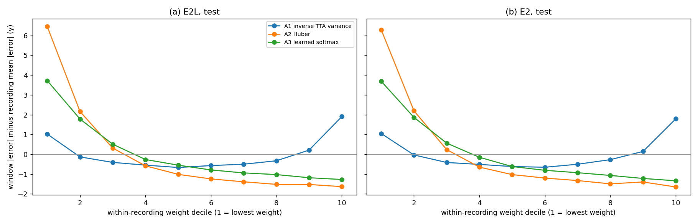
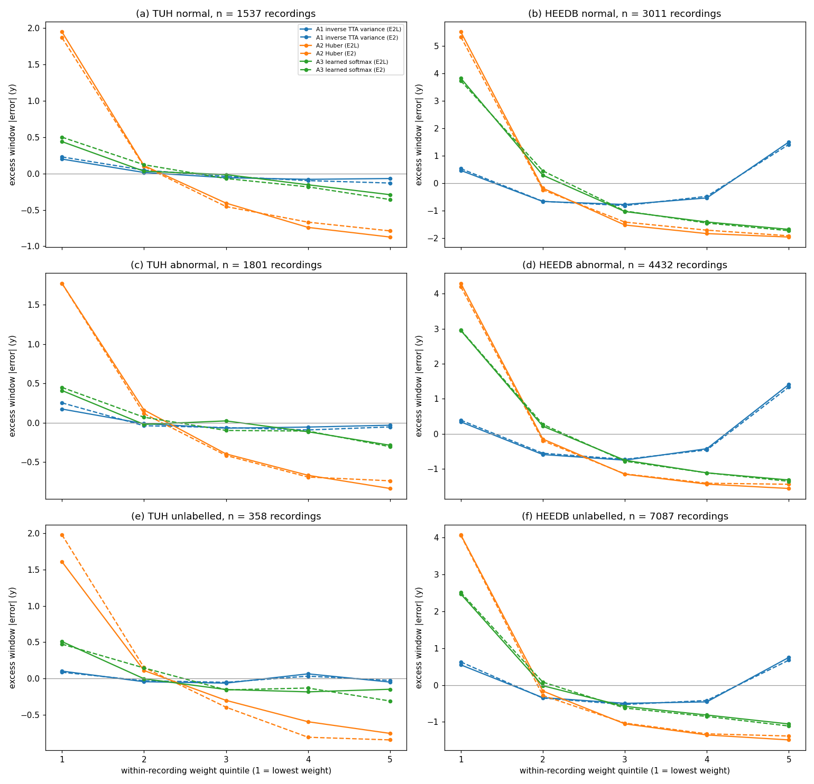
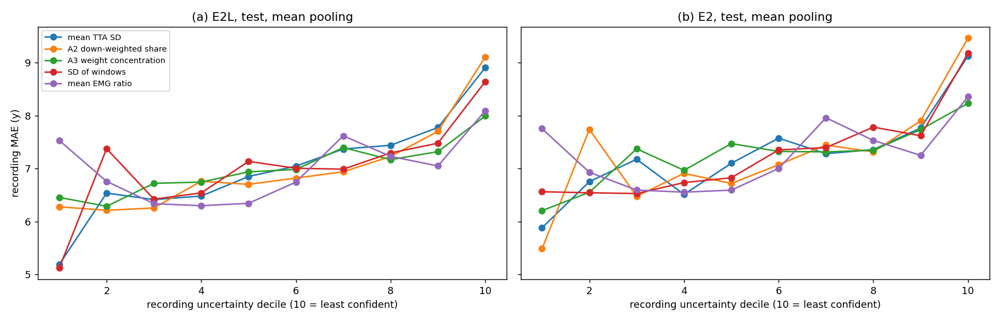
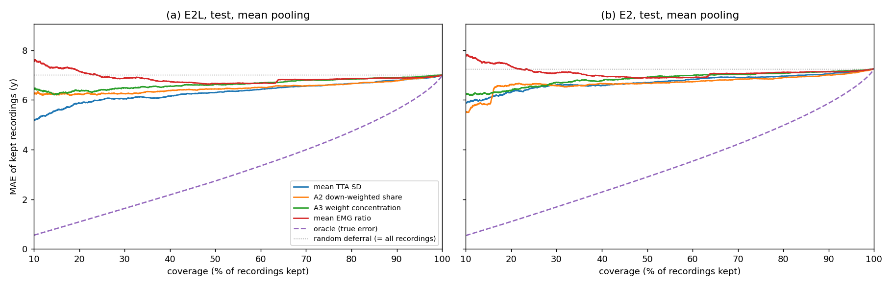
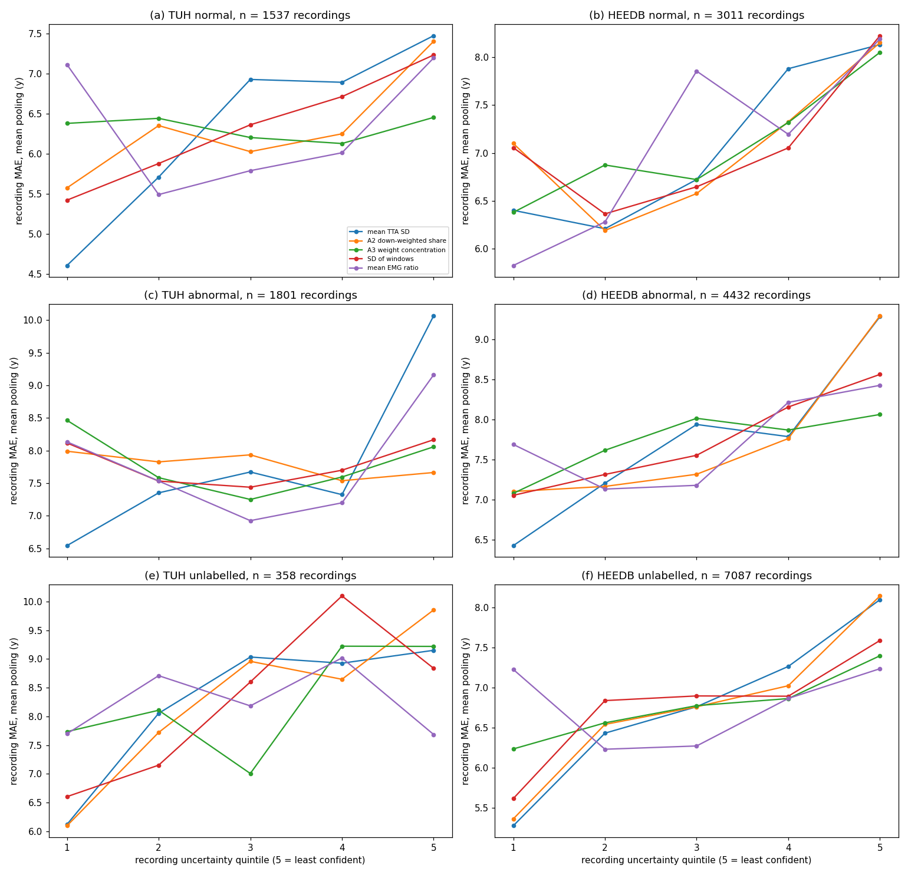
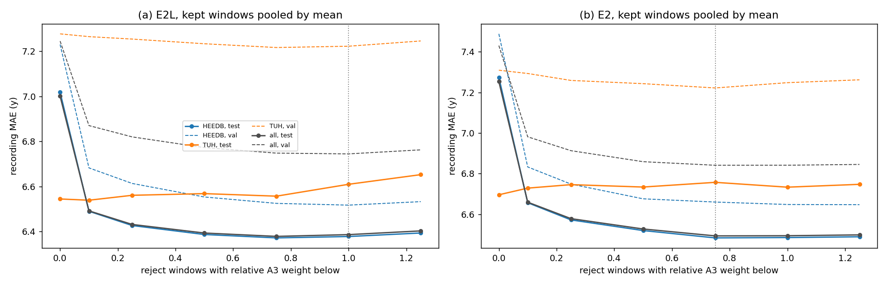
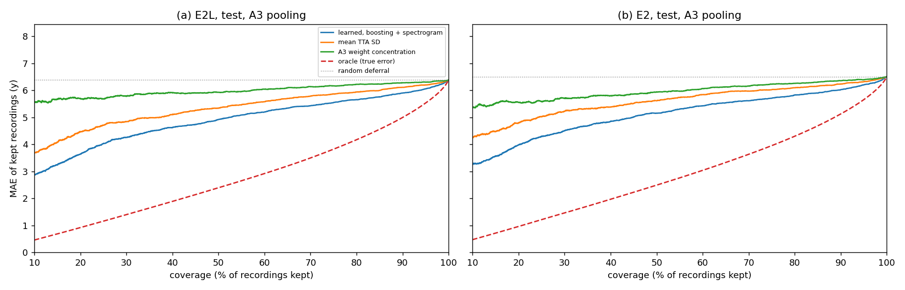
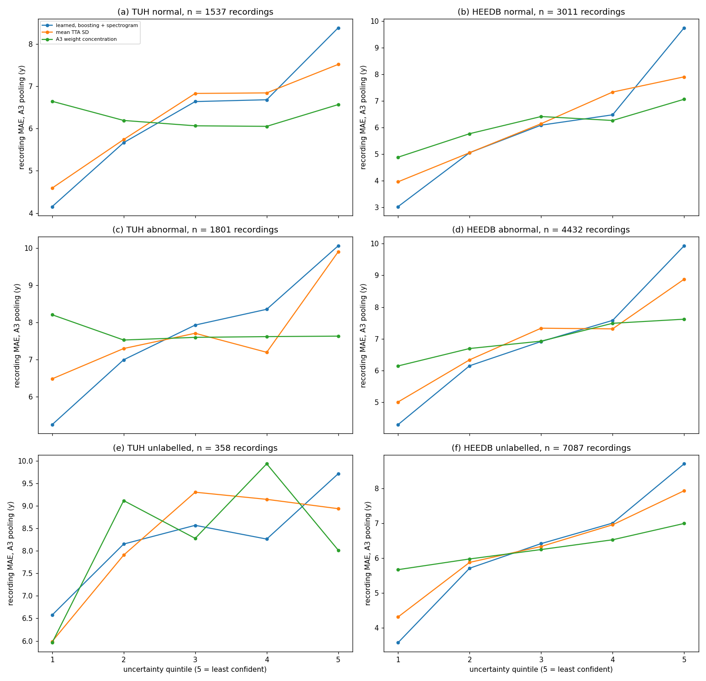

# Window confidence vs. error: Proposal A on E2L and E2

Results note, 2026-11-08. It implements Proposal A of
[`window_aggregation_plan.md`](window_aggregation_plan.md) (A1 inverse
TTA-variance, A2 Huber, A3 learned softmax weights, section 3 there) and
answers two questions before any of them is trusted:

1. **Window level.** Does the weight a method gives a window track that
   window's own error, especially *within* a recording, which is the only place
   pooling can use it?
2. **Recording level.** Does a per-recording confidence built from its windows
   track the recording's error, so that the least confident recordings can be
   flagged?

The run under test is **E2L** (TUH + HEEDB, 16 epochs, the last successful
run). The benchmark is **E2** (same recipe, data and split, 8 epochs). Both use
the identical val/test windows, so every difference below is paired.

Code: `scripts/window_confidence_predict.py` (scoring, TTA, descriptors),
`labram/eval/window_confidence.py` (weights, correlations, confidences),
`scripts/window_confidence_report.py` (tables and figures). Tables are in
`docs/data/window_confidence/`, and the window caches are in
`/data/runs/heedb/window_conf/` (outside git, 543k windows per run).

## 1. Setup

### Table 1.1. Runs and data

| | E2L | E2 |
|---|---|---|
| run dir | `/data/runs/heedb/e2l/finetune_20261104_215141_883` | `/data/runs/heedb/e2_r2/finetune` |
| training | 16 ep, batch 512 → 256, best epoch 11 | 8 ep, best epoch 7 |
| cohort | `tuh_heedb_v1`, 19 channels (A1/A2/T1/T2 dropped) | same |
| val recordings | 10,614 (TUH 3,422 + HEEDB 7,192) | same |
| test recordings | 7,612 (TUH 274 + HEEDB 7,338) | same |
| windows | 30 × 10 s per recording after the 60 s start trim (5 min), 542,758 in val + test | same |
| mean-pooled MAE, val / test (y) | 7.25 / 7.00 | 7.43 / 7.25 |

The mean-pooled MAEs reproduce the runs' logged and offline-scored values
exactly (`/data/runs/heedb/scores/E2{,L}_{tuab,heedb}_valtest.json`, to 0.001 y).

**Test-time augmentation.** Each window $i$ is scored $M = 5$ times: the
window itself ($\hat y_{i1} = \hat y_i$, the prediction the runs report), its
hemisphere-flipped copy, two crops shifted by $U(-5, 5)$ s inside the trimmed
recording, and a third shifted crop that is also flipped. The crop offsets are
seeded per window, so both runs see the same copies. With $y_c$ the age of
recording $c$ and $W_c$ its windows, every age is in years:

$$
\bar y_i=\frac1M\sum_{m=1}^{M}\hat y_{im},\qquad
\sigma_i^2=\frac1M\sum_{m=1}^{M}\bigl(\hat y_{im}-\bar y_i\bigr)^2 .
\tag{1.1}
$$

The median TTA SD $\sigma_i$ is 2.02 y for E2L and 1.90 y for E2.

**Window descriptors** $q_i$ are computed from the raw window ($\mu$V), after a
common-average reference over the channels that carry signal (`descriptors`):
the EMG ratio $P_{30\text{–}45}/P_{1\text{–}45}$ (the channel mean `emg` and
the channel max `emg_max`), `max_abs`, the mean and minimum channel SD
(`amp_uv`, `min_std`), $\log(1+\sigma_i^2)$, the distance
$\lvert\hat y_i-\operatorname{median}_{W_c}\hat y\rvert$ and the minute
within the 5 min stretch.

**Weights and pooling** (Eqs. (3.0)–(3.3) of the plan;
`labram/eval/window_confidence.py`). Every method pools
$\hat y_c=\sum_i w_i \tilde y_i/\sum_i w_i$:

$$
\text{A1: } w_i=\frac{1}{\sigma_i^2+\varepsilon},\ \tilde y_i=\bar y_i;\qquad
\text{A2: } w_i=\min\Bigl(1,\frac{\delta}{\lvert\hat y_i-\mu_c\rvert}\Bigr),\ \tilde y_i=\hat y_i;
\tag{1.2}
$$

$$
\text{A3: } w_i=\frac{\exp(\theta^\top z_i)}{\sum_{j\in W_c}\exp(\theta^\top z_j)},\ \tilde y_i=\hat y_i,\qquad
\theta=\arg\min_\theta \frac1{\lvert\mathcal V\rvert}\sum_{c\in\mathcal V}\operatorname{Huber}_{1}\bigl(\hat y_c^{\theta}-y_c\bigr)+10^{-3}\lVert\theta\rVert^2 ,
\tag{1.3}
$$

where $\mu_c$ is the Huber location found by 10 fixed-point steps from the
median (`huber_weights`), $z_i$ is $q_i$ standardized with val statistics, and
$\mathcal V$ is the set of val recordings. $\varepsilon$ is chosen on val from
$\{0.25, 1, 4, 16, 64\}$ (picked: 16 y² for both runs) and $\delta$ from
$\{0.5, \dots, 12\}$ (picked: 0.5 y for E2L, 1 y for E2). The A3 weights on val
are cross-fitted (5 recording folds), and test uses the $\theta$ fitted on all
of val.

## 2. Pooled MAE

### Table 2.1. Recording MAE (y) by pooling, val / test

Each cell is the MAE $\frac1N\sum_c\lvert\hat y_c-y_c\rvert$ for one pooling
rule of Eq. (1.2) / (1.3), or for the mean, the median, the 10 %-trimmed mean,
or the plain mean of $\bar y_i$ (`tta_mean`).

| pooling | E2L all | E2L TUH | E2L HEEDB | E2 all | E2 TUH | E2 HEEDB |
|---|---|---|---|---|---|---|
| mean (reported) | 7.25 / 7.00 | 7.28 / 6.54 | 7.23 / 7.02 | 7.43 / 7.25 | 7.31 / 6.70 | 7.49 / 7.27 |
| median | 6.99 / 6.64 | 7.31 / 6.58 | 6.84 / 6.64 | 7.12 / 6.83 | 7.31 / 6.72 | 7.03 / 6.83 |
| trimmed 10 % | 7.10 / 6.81 | 7.27 / 6.52 | 7.02 / 6.82 | 7.27 / 7.04 | 7.30 / 6.67 | 7.25 / 7.05 |
| TTA mean | 7.21 / 6.99 | 7.21 / 6.60 | 7.21 / 7.01 | 7.41 / 7.26 | 7.27 / 6.71 | 7.48 / 7.28 |
| A1 inverse TTA variance | 7.18 / 6.96 | 7.20 / 6.59 | 7.17 / 6.97 | 7.37 / 7.21 | 7.25 / 6.70 | 7.43 / 7.23 |
| A2 Huber | 6.99 / 6.64 | 7.31 / 6.57 | 6.84 / 6.64 | 7.12 / 6.83 | 7.31 / 6.71 | 7.03 / 6.83 |
| A3 learned softmax | **6.85 / 6.46** | 7.29 / 6.58 | **6.64 / 6.46** | **6.94 / 6.59** | 7.28 / 6.75 | **6.78 / 6.58** |

### Table 2.2. Paired change vs. mean pooling, test (y, 95 % bootstrap CI)

The cells give $\Delta=\frac1N\sum_c\bigl(\lvert\hat y_c^{\text{method}}-y_c\rvert-\lvert\hat y_c^{\text{mean}}-y_c\rvert\bigr)$,
with a 2,000-resample percentile interval over recordings
(`bootstrap_delta`). Negative is better.

| pooling | E2L all | E2L TUH (n = 274) | E2L HEEDB | E2 all | E2 HEEDB |
|---|---|---|---|---|---|
| A1 | −0.05 [−0.07, −0.03] | +0.05 [−0.04, +0.15] | −0.05 [−0.07, −0.03] | −0.04 [−0.06, −0.02] | −0.04 [−0.06, −0.03] |
| A2 (≈ median) | −0.36 [−0.40, −0.32] | +0.03 [−0.05, +0.11] | −0.38 [−0.42, −0.34] | −0.43 [−0.46, −0.39] | −0.44 [−0.48, −0.41] |
| A3 | −0.54 [−0.59, −0.49] | +0.03 [−0.09, +0.17] | −0.56 [−0.61, −0.50] | −0.66 [−0.72, −0.61] | −0.69 [−0.75, −0.63] |
| A3 vs. median | −0.18 [−0.23, −0.15] (HEEDB) | 0.00 [−0.13, +0.14] | | | −0.25 [−0.29, −0.20] (HEEDB) |

### Table 2.3. Test MAE (y) by dataset and report cohort

The same MAE as Table 2.1, test split only, per source dataset × report
cohort (normal / abnormal from the clinical report; HEEDB recordings without
a report are "unlabelled"; TUH test has no unlabelled recordings). Each cell
gives E2L / E2. The last rows give the paired change vs. the mean, as in
Table 2.2, with 95 % bootstrap CIs for E2L.

| pooling | TUH normal (149) | TUH abnormal (125) | HEEDB normal (1,518) | HEEDB abnormal (2,253) | HEEDB unlabelled (3,567) |
|---|---|---|---|---|---|
| mean (reported) | 4.91 / 5.13 | 8.50 / 8.56 | 7.12 / 7.43 | 7.56 / 7.83 | 6.64 / 6.86 |
| median | 4.91 / 5.13 | 8.56 / 8.62 | 6.57 / 6.79 | 7.17 / 7.37 | 6.34 / 6.51 |
| trimmed 10 % | 4.88 / 5.08 | 8.48 / 8.57 | 6.84 / 7.13 | 7.37 / 7.61 | 6.47 / 6.67 |
| TTA mean | 4.95 / 5.14 | 8.57 / 8.58 | 7.13 / 7.45 | 7.53 / 7.81 | 6.62 / 6.87 |
| A1 | 4.92 / 5.11 | 8.59 / 8.60 | 7.08 / 7.39 | 7.52 / 7.79 | 6.58 / 6.81 |
| A2 | 4.91 / 5.11 | 8.56 / 8.61 | 6.57 / 6.79 | 7.17 / 7.37 | 6.34 / 6.51 |
| A3 | **4.90** / 5.21 | 8.58 / 8.59 | **6.27 / 6.44** | **6.95 / 7.09** | **6.22 / 6.32** |
| Δ median, E2L | +0.00 [−0.10, +0.11] | +0.07 [−0.06, +0.21] | −0.55 [−0.67, −0.43] | −0.38 [−0.46, −0.31] | −0.30 [−0.35, −0.25] |
| Δ A3, E2L | −0.01 [−0.15, +0.14] | +0.09 [−0.14, +0.36] | −0.84 [−0.98, −0.70] | −0.61 [−0.72, −0.50] | −0.41 [−0.48, −0.34] |

On val (larger TUH cohorts: 1,388 normal, 1,676 abnormal, 358 unlabelled), the
TUH cells also stay within 0.15 y of the mean under every rule. The HEEDB
cells repeat the test pattern: A3 vs. mean is −0.90 / −0.66 / −0.42 y on
normal / abnormal / unlabelled for E2L (`docs/data/window_confidence/E2L_pooling_mae.csv`).
The largest gain is on **HEEDB normal** recordings, which under mean pooling
are worse than HEEDB unlabelled ones (7.12 vs. 6.64 y), and after A3 are about level with them.

Table 2.1, Table 2.2 and Table 2.3 show three things:

* **All of the gain is on HEEDB.** On TUH no pooling rule beats the mean by
  more than 0.08 y, on val (3,422 recordings) or on test. The median (= A2) is
  even slightly worse there (+0.03 [+0.01, +0.06] y on E2L val). This matches
  Table 14.2 of `age_regression.md` for TUAB.
* **A2 is the median.** Val selects the smallest $\delta$, where Huber equals
  the median. A2 adds nothing on top of it.
* **A3 is the best rule:** −0.54 y on E2L test and −0.66 y on E2, which is
  0.18–0.25 y better than the median on HEEDB. The ranking is the same on both
  runs, and E2L stays ahead of E2 under every rule. Section 3.3 shows where the
  A3 gain comes from.

## 3. Do window weights track window errors?

With window error $e_i=\hat y_i-y_c$ (A1 uses $\bar y_i-y_c$, the value it pools):

$$
\rho_{\text{within}}=\frac1{\lvert C\rvert}\sum_{c\in C}\operatorname{Spearman}_{i\in W_c}\bigl(w_i,\lvert e_i\rvert\bigr),\qquad
\Delta_i=\lvert e_i\rvert-\frac1{\lvert W_c\rvert}\sum_{j\in W_c}\lvert e_j\rvert ,
\tag{3.1}
$$

$$
s_{\text{within}}=\frac{\operatorname{Var}_i\bigl(e_i-\bar e_{c(i)}\bigr)}{\operatorname{Var}_i\bigl(\bar e_{c(i)}\bigr)+\operatorname{Var}_i\bigl(e_i-\bar e_{c(i)}\bigr)},\qquad
\bar e_c=\frac1{\lvert W_c\rvert}\sum_{i\in W_c}e_i ,
\tag{3.2}
$$

where $C$ is the set of recordings with at least 5 windows, and the variances
are sample variances over windows (`weight_error_correlation`,
`error_variance_split`). $\rho_{\text{within}} < 0$ means that, inside a
recording, a larger weight goes with a smaller error. $\Delta_i$ is a window's
excess error over its recording. $s_{\text{within}}$ is the share of
window-error variance that changes within a recording, which is the only part
any re-weighting of a recording's own windows can remove.

### Table 3.1. Weight vs. own window error, test

The columns are: $\rho_{\text{pooled}}$ (Spearman over all windows), $\rho_{\text{within}}$ (Eq. (3.1)),
the share of recordings with a negative within-recording $\rho$, and the mean
$\Delta_i$ (Eq. (3.1)) of each recording's lowest-weight and highest-weight
quintiles. For the descriptor rows the "weight" is $-x$, so a negative $\rho$
means that a larger value goes with a larger error. Each cell gives E2L / E2.

| weight | $\rho_{\text{pooled}}$ | $\rho_{\text{within}}$ | share $\rho<0$ | $\Delta$ low-w (y) | $\Delta$ high-w (y) |
|---|---|---|---|---|---|
| A1 $1/(\sigma_i^2+\varepsilon)$ | −0.11 / −0.10 | **−0.01 / −0.03** | 0.51 / 0.53 | +0.45 / +0.51 | **+1.06 / +0.97** |
| A2 Huber | −0.31 / −0.30 | −0.33 / −0.32 | 0.79 / 0.80 | +4.31 / +4.25 | −1.58 / −1.49 |
| A3 softmax | −0.17 / −0.18 | −0.17 / −0.18 | 0.71 / 0.73 | +2.75 / +2.78 | −1.23 / −1.28 |
| −EMG ratio (mean) | +0.03 / +0.03 | +0.04 / +0.04 | 0.45 / 0.44 | −0.02 / −0.01 | +1.24 / +1.25 |
| −EMG ratio (max) | +0.05 / +0.05 | +0.06 / +0.06 | 0.43 / 0.42 | −0.18 / −0.17 | +1.66 / +1.68 |
| −max \|x\| | −0.08 / −0.09 | −0.07 / −0.07 | 0.61 / 0.61 | +1.55 / +1.59 | +0.19 / +0.18 |

$s_{\text{within}}$ (Eq. (3.2)) on test is 0.34 for E2L and 0.30 for E2 (val:
0.29 and 0.27). About **two thirds of the window error is shared by all
windows of a recording**, so no pooling of those windows can remove it.

### Figure 3.1. Excess window error by within-recording weight decile

The y axis is the mean $\Delta_i$ (Eq. (3.1), years) per decile of the
within-recording weight rank (1 = the lowest weight in its recording), on
test, for all 7,612 recordings. (a) E2L, (b) E2.



Figure 3.1 and Table 3.1 give the window-level answer:

* **A2 and A3 weights track window error, and monotonically.** In about 80 %
  (A2) and 71 % (A3) of recordings, the lower-weight windows are the
  worse-predicted ones. The bottom decile is 6.5 y (A2) and 3.7 y (A3) worse
  than the recording's average window. The A2 result is partly built in: a
  window far from its recording's median is usually far from the truth too,
  because most of the error is shared (Eq. (3.2)).
* **A1 (TTA spread) does not track error within a recording**
  ($\rho_{\text{within}}\approx 0$). The relation is U-shaped: the *most*
  invariant windows (top weight decile) are 1.9 y worse than average, as bad
  as the least invariant ones (Figure 3.1).
* **EMG power is not a reliability signal here.** If anything, high-EMG
  windows err *less* ($\rho_{\text{within}}$ = +0.04 for $-$EMG). The
  "muscle reads young" effect of the TUAB analysis does not show up as a
  window-level error on this cohort. Large amplitude (`max_abs`) is a weak
  warning sign.

### Figure 3.2. Excess window error by weight quintile, per dataset and report cohort

Same quantity as Figure 3.1 (mean $\Delta_i$ of Eq. (3.1), years), here by
within-recording weight *quintile* and per dataset × report cohort. Val and
test are pooled so the TUH cohorts have enough recordings (A3's val weights
are cross-fitted, so no window is weighted by a $\theta$ fitted on its own
recording). E2L is drawn solid, E2 dashed. Panels: (a) TUH normal, (b) HEEDB
normal, (c) TUH abnormal, (d) HEEDB abnormal, (e) TUH unlabelled, (f) HEEDB
unlabelled; $n$ is in each panel title.



### Table 3.1b. Within-recording weight–error correlation per cohort, val + test

$\rho_{\text{within}}$ of Eq. (3.1), then the share of recordings with
$\rho<0$, per dataset × cohort (`cohort_tables`;
`docs/data/window_confidence/E2*_cohort_corr.csv`). Each cell gives E2L / E2.

| weight | TUH normal (1,537) | TUH abnormal (1,801) | TUH unlab. (358) | HEEDB normal (3,011) | HEEDB abnormal (4,432) | HEEDB unlab. (7,087) |
|---|---|---|---|---|---|---|
| A1 $\rho_{\text{within}}$ | −0.03 / −0.04 | −0.02 / −0.03 | +0.00 / +0.00 | −0.02 / −0.03 | +0.02 / +0.00 | −0.03 / −0.05 |
| A2 $\rho_{\text{within}}$ | −0.27 / −0.24 | −0.24 / −0.23 | −0.21 / −0.25 | −0.36 / −0.35 | −0.31 / −0.30 | −0.32 / −0.31 |
| A3 $\rho_{\text{within}}$ | −0.06 / −0.07 | −0.05 / −0.05 | −0.04 / −0.06 | −0.20 / −0.22 | −0.18 / −0.19 | −0.15 / −0.17 |
| A1 share $\rho<0$ | 0.53 / 0.56 | 0.51 / 0.51 | 0.50 / 0.49 | 0.52 / 0.53 | 0.48 / 0.50 | 0.53 / 0.55 |
| A2 share $\rho<0$ | 0.73 / 0.71 | 0.69 / 0.69 | 0.68 / 0.72 | 0.81 / 0.81 | 0.77 / 0.78 | 0.80 / 0.80 |
| A3 share $\rho<0$ | 0.60 / 0.61 | 0.58 / 0.59 | 0.56 / 0.57 | 0.73 / 0.76 | 0.72 / 0.73 | 0.70 / 0.72 |

Figure 3.2 and Table 3.1b break the window-level result down by cohort:

* **The weight–error relation is the same within each dataset across report
  cohorts**: normal, abnormal and unlabelled recordings give nearly identical
  curves. The difference is between **datasets**.
* **On HEEDB** (Figure 3.2(b, d, f)), the lowest-weight A2/A3 quintile is
  4–5.5 y (A2) and 2.5–3.8 y (A3) worse than the recording average. The A1
  U-shape appears in every HEEDB cohort: the most invariant quintile is
  +0.7 to +1.5 y.
* **On TUH** (Figure 3.2(a, c, e)), all curves are flat by comparison. A2's
  bottom quintile is still +1.6 to +2 y, but A3 is barely informative
  ($\rho_{\text{within}}\approx -0.05$) and A1 not at all. TUH windows within a
  recording are roughly interchangeable, which is why no pooling rule helps
  there (Table 2.3).
* E2 (dashed) lies on top of E2L in every panel.

### Table 3.2. Windows by within-recording TTA-variance decile, E2L test

The columns are the median $\sigma_i$ (Eq. (1.1)), the median descriptors and
the mean $\lvert\bar y_i-y_c\rvert$ per decile of the within-recording
$\sigma_i^2$ rank (`tta_profile`). Decile 1 holds the most invariant windows.

| decile | TTA SD (y) | mean ch. SD (µV) | max \|x\| (µV) | min ch. SD (µV) | \|error\| (y) |
|---|---|---|---|---|---|
| 1 | 0.56 | 14.6 | 113 | 6.6 | **9.91** |
| 2 | 1.02 | 16.3 | 133 | 7.8 | 8.22 |
| 3–8 | 1.35–2.88 | 16.1–17.1 | 130–146 | 7.9–8.3 | 7.34–7.68 |
| 9 | 3.43 | 18.0 | 159 | 8.6 | 7.87 |
| 10 | 4.70 | 22.0 | 219 | 9.6 | 9.02 |

Table 3.2 explains the U shape. The most invariant windows are
**low-amplitude windows** (14.6 µV mean channel SD vs. about 16.3 µV, weakest
channel 6.6 µV). They are stable under shift and flip because they carry
little signal, not because the model reads them well. Decile 10 holds the
high-amplitude, artifact-like windows. TTA spread therefore needs an
amplitude floor, or a two-sided weight, before it can serve as a confidence.
On its own it is not one.

### Table 3.3. Window error by position, and pooling after skipping the first windows

The upper rows give the mean $\lvert e_i\rvert$ (y) of the $k$-th window after
the 60 s start trim, on test. The lower rows give the recording MAE (y) when
each recording's first $k$ windows are skipped before mean pooling
(`position_tables`). Each cell gives E2L / E2.

| | k = 0 | 1 | 2 | 3 | 6 | 9 | 11 |
|---|---|---|---|---|---|---|---|
| HEEDB window \|error\| | 13.0 / 13.1 | 12.2 / 12.3 | 11.2 / 11.3 | 10.4 / 10.5 | 8.7 / 8.8 | 7.9 / 8.1 | 7.9 / 7.9 |
| TUH window \|error\| | 7.7 / 7.8 | 7.5 / 7.7 | 6.9 / 7.0 | 7.2 / 7.3 | 7.5 / 7.6 | 7.1 / 7.1 | 7.0 / 7.3 |

| skip first | 0 | 1 | 3 | 6 | 12 |
|---|---|---|---|---|---|
| HEEDB test, mean | 7.02 / 7.27 | 6.92 / 7.16 | 6.77 / 6.99 | 6.63 / 6.83 | 6.55 / 6.73 |
| HEEDB val, mean | 7.23 / 7.49 | 7.13 / 7.37 | 6.96 / 7.18 | 6.83 / 7.03 | 6.73 / 6.93 |
| TUH val, mean | 7.28 / 7.31 | 7.28 / 7.32 | 7.29 / 7.33 | 7.31 / 7.34 | 7.35 / 7.38 |

**This is where most of the HEEDB gain comes from.** In HEEDB, the first
~1.5 min after the 60 s trim are much worse (13 y window error, settling to
~7.9 y by window 9), while TUH is flat. Plain mean pooling over minutes 3–6
(skip 12) already gets HEEDB test from 7.02 to 6.55 y (E2L), most of the way
to A3's 6.46. A3 found the same thing on its own: its largest coefficients
weight later minutes up ($\theta_{\text{minute}}$ = +0.57 per minute for E2L,
+0.68 for E2) and penalize TTA variance and amplitude. The cause is
not established yet; the start of a routine HEEDB recording plausibly holds
electrode settling or activation procedures. Skipping windows also leaves
fewer windows per recording, so the fair fix is to *move* the 5 min budget
later for HEEDB (`data.trim_start_sec` of about 180–240 s), not to shorten it.
That needs re-scoring, and probably retraining, because training sees the
same early windows.

## 4. Does recording confidence track recording error?

Per-recording uncertainty scores $u_c$, where higher means less confident
(`recording_confidence`):

$$
\begin{aligned}
u^{\text{A1-se}}_c&=\Bigl(\sum_{i\in W_c}\frac1{\sigma_i^2+1}\Bigr)^{-1/2},&
u^{\text{A1-tta}}_c&=\frac1{\lvert W_c\rvert}\sum_{i\in W_c}\sigma_i,&
u^{\text{A2-mad}}_c&=1.4826\operatorname*{median}_{i\in W_c}\lvert\hat y_i-\operatorname{median}_{W_c}\hat y\rvert,\\
u^{\text{A2-down}}_c&=1-\frac1{\lvert W_c\rvert}\sum_{i\in W_c}w_i^{\text{A2}},&
u^{\text{A3-conc}}_c&=1-\frac{1}{\lvert W_c\rvert\sum_{i\in W_c}(w_i^{\text{A3}})^2},&
u^{\text{sd}}_c&=\operatorname{SD}_{i\in W_c}(\hat y_i),\quad u^{\text{emg}}_c=\overline{\text{emg}}_{W_c}.
\end{aligned}
\tag{4.1}
$$

Each score is scored against the mean-pooled recording error
$a_c=\lvert\hat y_c-y_c\rvert$:

$$
\rho=\operatorname{Spearman}_c(u_c,a_c),\qquad
\rho_{\text{age}}=\frac{\sum_b n_b\,\operatorname{Spearman}_{c\in b}(u_c,a_c)}{\sum_b n_b},
\tag{4.2}
$$

$$
\operatorname{MAE}@\kappa=\frac{1}{\lceil\kappa N\rceil}\sum_{k=1}^{\lceil\kappa N\rceil}a_{(k)},\qquad
\operatorname{AURC}=\frac1N\sum_{k=1}^{N}\frac1k\sum_{j=1}^{k}a_{(j)} ,
\tag{4.3}
$$

where $b$ runs over the age deciles of the group, and $a_{(k)}$ is the error of
the recording with the $k$-th smallest $u_c$
(`confidence_error_table`, `risk_coverage`). $\rho_{\text{age}}$ removes the
part of the association that only reflects age (errors and window noise both
change with age). MAE@$\kappa$ is the error left when the
$1-\kappa$ least confident recordings are deferred. AURC is its average over
all coverages. The floor is the oracle that defers by $a_c$ itself, and the
ceiling is the plain MAE (random deferral).

### Table 4.1. Recording uncertainty vs. recording error, test, all 7,612 recordings

Columns: Eqs. (4.2)–(4.3). Each cell gives E2L / E2. The plain MAE is 7.00 / 7.25 y.
The oracle AURC is 2.92 / 3.06 y.

| score | $\rho$ | $\rho_{\text{age}}$ | MAE@80 % | MAE@50 % | AURC |
|---|---|---|---|---|---|
| A1 pooled SE | 0.10 / 0.06 | 0.23 / 0.25 | 6.75 / 7.05 | 6.60 / 7.00 | 6.37 / 6.78 |
| A1 mean TTA SD | 0.14 / 0.10 | **0.28 / 0.30** | 6.67 / 6.96 | **6.30 / 6.69** | **6.14 / 6.56** |
| A2 MAD of windows | 0.14 / 0.11 | 0.23 / 0.24 | 6.65 / 6.93 | 6.45 / 6.71 | 6.26 / 6.58 |
| A2 down-weighted share | 0.14 / 0.13 | 0.21 / 0.25 | 6.65 / 6.90 | 6.44 / 6.67 | 6.31 / 6.51 |
| A3 weight concentration | 0.09 / 0.08 | 0.12 / 0.15 | 6.84 / 7.07 | 6.63 / 6.91 | 6.60 / 6.78 |
| SD of windows | 0.14 / 0.14 | 0.14 / 0.14 | 6.74 / 6.97 | 6.52 / 6.64 | 6.29 / 6.60 |
| mean EMG ratio | 0.04 / 0.04 | 0.04 / 0.05 | 6.86 / 7.12 | 6.66 / 6.89 | 6.94 / 7.16 |

### Table 4.2. The same on TUH val (3,422 recordings, the larger TUH split)

The plain MAE is 7.28 / 7.31 y. The oracle AURC is 2.90 / 2.99 y.

| score | $\rho$ | $\rho_{\text{age}}$ | MAE@80 % | MAE@50 % | AURC |
|---|---|---|---|---|---|
| A1 pooled SE | 0.18 / 0.15 | 0.21 / 0.22 | 6.85 / 6.95 | 6.40 / 6.57 | 6.04 / 6.29 |
| A1 mean TTA SD | 0.17 / 0.15 | 0.20 / 0.22 | 6.77 / 6.93 | 6.44 / 6.60 | 6.13 / 6.35 |
| A2 MAD of windows | 0.08 / 0.08 | 0.11 / 0.13 | 7.10 / 7.06 | 7.06 / 6.96 | 6.96 / 6.92 |
| A3 weight concentration | −0.01 / 0.01 | 0.00 / 0.03 | 7.23 / 7.28 | 7.35 / 7.24 | 7.56 / 7.45 |
| mean EMG ratio | 0.00 / 0.00 | 0.00 / 0.00 | 7.06 / 7.12 | 7.21 / 7.20 | 7.46 / 7.41 |

### Figure 4.1. Recording MAE by uncertainty decile, test

The y axis is the mean $a_c$ (years) per decile of each score of Eq. (4.1)
(10 = least confident), with mean pooling, for all 7,612 test recordings.
(a) E2L, (b) E2.



### Figure 4.2. Risk-coverage curves, test

The y axis is MAE@$\kappa$ (Eq. (4.3)) against the coverage $\kappa$ for four
scores. The dashed line is the oracle and the dotted line is random deferral.
Mean pooling, all 7,612 test recordings. (a) E2L, (b) E2.



### Figure 4.3. Recording MAE by uncertainty quintile, per dataset and report cohort

The y axis is the mean $a_c$ (years, mean pooling) per quintile of each score
of Eq. (4.1) (5 = least confident), for E2L, val and test pooled. Panels as
in Figure 3.2: (a) TUH normal, (b) HEEDB normal, (c) TUH abnormal, (d) HEEDB
abnormal, (e) TUH unlabelled, (f) HEEDB unlabelled.



### Table 4.3. Recording uncertainty vs. recording error per cohort, val + test

$\rho$ of Eq. (4.2) per dataset × cohort, then $\rho_{\text{age}}$ (here
within age *quintiles* of the cohort). Each cell gives E2L / E2.

| score | TUH normal | TUH abnormal | TUH unlab. | HEEDB normal | HEEDB abnormal | HEEDB unlab. |
|---|---|---|---|---|---|---|
| A1 mean TTA SD, $\rho$ | +0.18 / +0.15 | +0.14 / +0.12 | +0.18 / +0.14 | +0.13 / +0.08 | +0.13 / +0.11 | +0.17 / +0.11 |
| A2 down-weighted share, $\rho$ | +0.12 / +0.14 | +0.00 / +0.01 | +0.19 / +0.20 | +0.15 / +0.14 | +0.14 / +0.15 | +0.16 / +0.13 |
| A3 weight concentration, $\rho$ | +0.01 / +0.04 | −0.03 / −0.02 | +0.12 / +0.07 | +0.11 / +0.09 | +0.07 / +0.06 | +0.08 / +0.08 |
| SD of windows, $\rho$ | +0.15 / +0.13 | +0.03 / +0.03 | +0.17 / +0.17 | +0.17 / +0.17 | +0.12 / +0.13 | +0.13 / +0.12 |
| mean EMG ratio, $\rho$ | +0.02 / +0.01 | +0.03 / +0.03 | +0.01 / +0.04 | +0.13 / +0.12 | +0.06 / +0.05 | +0.03 / +0.04 |
| A1 mean TTA SD, $\rho_{\text{age}}$ | +0.17 / +0.18 | +0.18 / +0.20 | +0.14 / +0.12 | +0.26 / +0.26 | +0.24 / +0.26 | +0.24 / +0.25 |
| A2 down-weighted share, $\rho_{\text{age}}$ | +0.13 / +0.18 | +0.03 / +0.06 | +0.15 / +0.20 | +0.21 / +0.24 | +0.17 / +0.20 | +0.19 / +0.21 |
| SD of windows, $\rho_{\text{age}}$ | +0.15 / +0.17 | +0.06 / +0.09 | +0.16 / +0.15 | +0.16 / +0.15 | +0.06 / +0.06 | +0.14 / +0.15 |

Figure 4.3 and Table 4.3 break the recording-level result down by cohort:

* **The mean TTA SD is the only score that works in every cohort**
  ($\rho$ = 0.13–0.18, age-stratified 0.14–0.26). Its most confident quintile
  is the best-predicted quintile in 5 of 6 panels, and its least confident
  quintile is the worst in all 6.
* **TUH abnormal is the exception for the spread-based scores.** The window SD and the
  A2 share carry no signal there ($\rho\approx 0$, Figure 4.3(c)). Only
  the TTA SD separates the least confident quintile (10.1 y vs. 6.5 y for
  the most confident). A plausible reading is that abnormal TUH recordings
  have abnormal but *consistent* windows, so window disagreement does not
  flag them.
* **The EMG ratio is informative only on HEEDB normal** ($\rho$ = 0.13), where
  its lowest quintile has 5.8 y MAE vs. 6.3–8.2 y for the others. Everywhere else it is
  about 0, and on TUH normal its lowest-EMG quintile is among the *worst*.
* **A3's weight concentration is a confidence only on HEEDB** (0.07–0.11).
  On TUH it is about 0.

The recording-level answer, from Table 4.1, Table 4.2, Figure 4.1 and Figure 4.2:

* **There is a correlation, but it is weak.** The best scores reach
  $\rho\approx 0.14$, or 0.28–0.30 within age deciles. Mean TTA SD is the most
  useful score on both runs and both datasets. Deferring the least confident
  half lowers MAE from 7.00 to 6.30 y on E2L, about a quarter of the way to
  the oracle. Most of the effect sits in the extreme deciles: the least
  confident 10 % of recordings has MAE ≈ 9 y vs. 5–6.5 y for the most confident
  (Figure 4.1).
* **TTA spread is useful per recording even though it is useless per window.**
  A recording whose windows are *on average* unstable is a harder recording
  (Table 4.1). Within a recording, the ranking of windows by stability does
  not follow their errors (Table 3.1).
* **The A3 weights make a poor confidence**, and so does EMG power
  ($\rho\le 0.09$, and about 0 on TUH). A3 learns *which* windows to use, not
  how good the result is.
* **The age-stratified $\rho$ is higher than the plain one.** Within an age
  band, uncertainty predicts error better. Across ages, the large
  regression-to-the-mean errors of the youngest and oldest recordings are not
  matched by noisier windows, which dilutes the plain correlation.
* **E2 (the benchmark) shows the same pattern** at a lower level. Nothing in
  Sections 3–4 is specific to the longer-trained E2L, and E2L's extra epochs
  did not make the window confidences more or less informative.

## 5. Tuning A3 on val: spectrogram descriptors, rejection, learned confidence

Every choice in this section (L2 strength, descriptor set, rejection
threshold, pooling, confidence model) is made on **val**, with
cross-fitting over 5 folds grouped by subject (`subject_folds`). Test is
only used for reporting. Code: `scripts/window_spectral_descriptors.py`
(one model-free pass, 3,800 windows/s), `labram/eval/window_descriptors.py`,
`scripts/window_confidence_tuning.py`; tables in
`docs/data/window_confidence/tuning/`.

**Spectrogram descriptors** (per window, after the common-average reference
over present channels, channel-averaged unless stated):

* **STFT**, 18 features from 2 s Hann frames with a 0.5 s hop (`stft_descriptors`):
  log total 1–45 Hz power, log relative power in delta / theta / alpha /
  beta / gamma and 45–70 Hz, the coefficient of variation of each band's power
  over frames, spectral entropy, the aperiodic log-log slope over 2–40 Hz
  (alpha excluded), alpha peak frequency and prominence, the across-channel SD
  of log power, and log(max / median) frame power.
* **Wavelet**, 16 features from complex Morlet wavelets at 16 log-spaced
  frequencies, 1–45 Hz, 6 cycles, 1 s edges dropped (`cwt_descriptors`):
  per band, log relative power, burstiness (CV over time) and log
  peak-to-median power; plus wavelet entropy.

### Table 5.1. A3 by descriptor set, recording MAE (y)

Each row is A3 of Eq. (1.3) with one descriptor set and its L2 chosen on val
from $\{10^{-4}, 10^{-3}, 10^{-2}\}$. Val is cross-fitted. $\rho_{\text{within}}$
(Eq. (3.1)) is on test. Each cell gives E2L / E2.

| descriptors | # | val all | test all | test HEEDB | test TUH | $\rho_{\text{within}}$ test |
|---|---|---|---|---|---|---|
| base (Eq. (1.3)) | 8 | 6.85 / 6.94 | 6.46 / 6.59 | 6.46 / 6.59 | 6.56 / 6.74 | −0.17 / −0.18 |
| base + STFT | 26 | 6.77 / 6.87 | 6.39 / 6.52 | 6.38 / 6.51 | 6.58 / 6.72 | −0.16 / −0.18 |
| base + wavelet | 24 | 6.77 / 6.88 | 6.39 / 6.51 | 6.38 / 6.50 | 6.58 / 6.71 | −0.16 / −0.18 |
| **base + STFT + wavelet** (selected on val) | 42 | **6.75 / 6.86** | **6.38 / 6.50** | **6.37 / 6.49** | 6.62 / 6.70 | −0.16 / −0.18 |
| *mean pooling, for reference* | | 7.25 / 7.43 | 7.00 / 7.25 | 7.02 / 7.27 | 6.54 / 6.70 | |

Spectrogram descriptors improve A3 by a further **0.08–0.09 y** on test
(0.08–0.09 y on val too), on HEEDB. STFT and wavelet descriptors are
interchangeable, and both together add little over either alone. TUH is
unchanged. The largest standardized coefficients (E2L) are: across-channel
SD of log power −1.29 (one deviant channel → low weight), weakest-channel SD
−1.23 (a flat channel → *higher* weight once the other terms are held), log
total power +1.16, EMG ratio −1.15, TTA variance −0.88, wavelet theta/delta
peak-to-median −0.80 (transient bursts → low weight), aperiodic slope +0.80.
Several of these are collinear (power, amplitude, `max_abs`), so read them as
a group, not one by one.

### Table 5.2. Window rejection by A3 weight, recording MAE (y)

Windows whose relative A3 weight $r_i=w_i\lvert W_c\rvert$ (1 = the
recording's average weight) is below a threshold $t$ are dropped; every
recording keeps its 3 highest-weight windows. The rest are pooled by their
mean (`reject_windows`):

$$
K_c(t)=\{i\in W_c: r_i\ge t\}\cup\operatorname{top}_3(r),\qquad
\hat y_c=\frac1{\lvert K_c(t)\rvert}\sum_{i\in K_c(t)}\hat y_i .
\tag{5.1}
$$

The rows below use mean pooling of the kept windows, which val selected over
keeping their A3 weights. Each cell gives E2L / E2; "kept" is the share of
test windows kept.

| $t$ | kept | val all | test all | test HEEDB | test TUH |
|---|---|---|---|---|---|
| 0 (= mean pooling) | 1.00 / 1.00 | 7.25 / 7.43 | 7.00 / 7.25 | 7.02 / 7.27 | 6.54 / 6.70 |
| 0.1 | 0.86 / 0.82 | 6.87 / 6.98 | 6.49 / 6.66 | 6.49 / 6.66 | 6.54 / 6.73 |
| 0.25 | 0.76 / 0.70 | 6.82 / 6.91 | 6.43 / 6.58 | 6.43 / 6.57 | 6.56 / 6.75 |
| 0.5 | 0.60 / 0.54 | 6.77 / 6.86 | 6.39 / 6.53 | 6.39 / 6.52 | 6.57 / 6.73 |
| 0.75 | 0.46 / 0.42 | 6.75 / **6.84** | 6.38 / **6.49** | 6.37 / 6.48 | 6.56 / 6.76 |
| 1.0 | 0.35 / 0.33 | **6.75** / 6.84 | **6.39** / 6.49 | 6.38 / 6.49 | 6.61 / 6.73 |
| 1.25 | 0.27 / 0.26 | 6.76 / 6.85 | 6.40 / 6.50 | 6.39 / 6.49 | 6.65 / 6.75 |
| *A3 weights, no rejection* | 1.00 | 6.75 / 6.86 | 6.38 / 6.50 | 6.37 / 6.49 | 6.62 / 6.70 |

### Figure 5.1. Recording MAE against the window-rejection threshold

The y axis is the recording MAE (years) of Eq. (5.1) against $t$, test solid
and val dashed, for HEEDB, TUH and all recordings. The dotted line marks the
val-selected $t$. (a) E2L, (b) E2.



Table 5.2 and Figure 5.1 show that hard window rejection works, but gives the
same MAE as A3's soft weights. Dropping the 15 % lowest-weight windows
($t=0.1$) already takes HEEDB test from 7.02 to 6.49 y. Val picks
$t = 0.75$–1, which keeps only about 1/3–1/2 of the windows, and lands at 6.38 /
6.49 y, the same as A3 with all windows weighted. On **TUH, rejection never
helps**: the curves are flat on val and slightly rising on test.

### Table 5.3. Learned recording confidence vs. recording error, test

A regressor predicts the A3-pooled recording error from recording-level
summaries (`recording_features`, `fit_confidence`). The inputs are the A3
pooled age, the window-prediction SD / MAD / A3-weighted SD, the gaps
between the mean, median and A3 estimates, the A3 weight profile
($1-\text{ESS}/n$, max relative weight, entropy), the mean and A3-weighted
TTA SD, the mean and SD over windows of every A3 descriptor, and a HEEDB flag:

$$
\hat u_c=f(\mathbf x_c)\approx\log\bigl(1+\lvert\hat y_c^{\text{A3}}-y_c\rvert\bigr),\qquad
\kappa_c=-\hat u_c ,
\tag{5.2}
$$

where $f$ is ridge (standardized inputs, $\alpha=10$) or histogram gradient
boosting (300 trees, depth 3, learning rate 0.05, 100 recordings per leaf).
It is fitted on val and cross-fitted there, by subject. **$\kappa_c$ is the
confidence**, and a useful one is *negatively* correlated with the error: the
$\rho$ below is $\operatorname{Spearman}(\kappa_c, a_c)$, with $a_c$ the
A3-pooled absolute error and MAE@ / AURC from Eq. (4.3). Each cell gives
E2L / E2; val selected boosting + spectrogram for both runs (val $\rho$
−0.29 / −0.27).

| confidence $\kappa_c$ | $\rho$ | $\rho_{\text{age}}$ | MAE@80 % | MAE@50 % | AURC |
|---|---|---|---|---|---|
| learned, ridge | −0.28 / −0.27 | −0.24 / −0.26 | 5.83 / 5.96 | 5.08 / 5.24 | 4.81 / 4.99 |
| learned, boosting | −0.30 / −0.28 | −0.27 / −0.29 | 5.71 / 5.81 | 5.03 / 5.17 | 4.72 / 4.93 |
| learned, ridge + spectrogram | −0.29 / −0.27 | −0.24 / −0.25 | 5.71 / 5.84 | 5.04 / 5.19 | 4.77 / 4.97 |
| **learned, boosting + spectrogram** | **−0.31 / −0.28** | **−0.28 / −0.28** | **5.66 / 5.83** | **4.92 / 5.15** | **4.67 / 4.91** |
| − mean TTA SD (best single score, section 4) | −0.22 / −0.18 | −0.23 / −0.25 | 5.94 / 6.09 | 5.34 / 5.61 | 5.13 / 5.41 |
| − A3-weighted SD of windows | −0.20 / −0.16 | −0.20 / −0.21 | 6.03 / 6.16 | 5.63 / 5.85 | 5.38 / 5.63 |
| − A3 weight concentration | −0.08 / −0.10 | −0.10 / −0.14 | 6.22 / 6.26 | 5.93 / 5.94 | 5.96 / 5.90 |

The MAE of all test recordings (A3 pooling) is 6.38 / 6.50 y, and the oracle
AURC is 2.57 / 2.66 y.

### Table 5.4. Learned confidence per dataset and report cohort, val + test

$\rho=\operatorname{Spearman}(\kappa_c, a_c)$ per dataset × cohort over val
(cross-fitted) and test. Each cell gives E2L / E2.

| confidence | TUH normal (1,537) | TUH abnormal (1,801) | TUH unlab. (358) | HEEDB normal (3,011) | HEEDB abnormal (4,432) | HEEDB unlab. (7,087) |
|---|---|---|---|---|---|---|
| learned, boosting + spectrogram | −0.23 / −0.20 | −0.21 / −0.17 | −0.15 / −0.14 | **−0.36 / −0.32** | −0.29 / −0.27 | −0.30 / −0.27 |
| − mean TTA SD | −0.18 / −0.15 | −0.14 / −0.12 | −0.18 / −0.13 | −0.28 / −0.23 | −0.21 / −0.19 | −0.22 / −0.18 |
| − A3 weight concentration | −0.02 / −0.00 | +0.02 / +0.01 | −0.09 / −0.08 | −0.14 / −0.14 | −0.09 / −0.11 | −0.08 / −0.11 |

### Table 5.4b. Selective MAE per dataset and report cohort, test

For each test cohort: the reference MAE of plain mean pooling (no window
weights, no rejection; Table 2.3), the MAE of all its recordings with A3 pooling, then the
MAE@80 % and MAE@50 % of Eq. (4.3) when the cohort's least confident 20 % /
50 % are deferred by each confidence, then $\rho$ of the learned confidence. Each
cell gives E2L / E2. The TUH cohorts have 149 / 125 recordings, so their cells
move by several tenths of a year from one recording.

| cohort (n) | mean, no weights (ref.) | A3, all | learned @80 % | learned @50 % | TTA SD @80 % | TTA SD @50 % | A3 conc. @50 % | $\rho$ learned |
|---|---|---|---|---|---|---|---|---|
| TUH normal (149) | 4.91 / 5.13 | 4.90 / 5.10 | 4.88 / 5.12 | 4.31 / 4.37 | 4.76 / 5.19 | 4.47 / 4.25 | 4.86 / 4.97 | −0.15 / −0.12 |
| TUH abnormal (125) | 8.50 / 8.56 | 8.67 / 8.61 | 8.03 / 7.85 | **6.72** / 7.27 | 7.88 / 7.78 | 7.22 / 7.24 | 7.62 / 8.36 | −0.23 / −0.21 |
| HEEDB normal (1,518) | 7.12 / 7.43 | 6.15 / 6.33 | **5.21 / 5.44** | **4.41 / 4.68** | 5.71 / 6.00 | 4.82 / 5.12 | 5.46 / 5.49 | −0.37 / −0.33 |
| HEEDB abnormal (2,253) | 7.56 / 7.83 | 6.83 / 6.97 | **6.06 / 6.21** | **5.43 / 5.59** | 6.36 / 6.44 | 5.81 / 5.96 | 6.37 / 6.31 | −0.28 / −0.26 |
| HEEDB unlabelled (3,567) | 6.64 / 6.86 | 6.18 / 6.27 | **5.60 / 5.68** | **4.84 / 5.11** | 5.76 / 5.90 | 5.30 / 5.67 | 5.82 / 5.87 | −0.30 / −0.26 |

On every HEEDB cohort, the learned confidence beats the TTA SD by 0.4–0.6 y at
50 % coverage, and the largest drop is on HEEDB normal: 7.12 y with plain mean pooling, 6.15 y
with A3, 4.41 y on the more confident half. On the
small TUH cohorts the two are within noise of each other, apart from E2L TUH
abnormal (6.72 vs. 7.22 y).

### Figure 5.2. Risk-coverage of the learned confidence, test

The y axis is MAE@$\kappa$ (Eq. (4.3), A3 pooling) against coverage, for the
selected learned confidence, mean TTA SD and A3 weight concentration. The
dashed line is the oracle and the dotted line is random deferral. All 7,612
test recordings. (a) E2L, (b) E2.



### Figure 5.3. Recording MAE by uncertainty quintile per cohort, E2L

The y axis is the mean $a_c$ (A3 pooling) per quintile of $\hat u_c$ (5 = least
confident), val (cross-fitted) and test. Panels: (a) TUH normal, (b) HEEDB
normal, (c) TUH abnormal, (d) HEEDB abnormal, (e) TUH unlabelled, (f) HEEDB
unlabelled.



### Table 5.5. Record rejection at val-set thresholds, test

The threshold for a target reject share $f$ is the $(1-f)$ quantile of
$\hat u_c$ on all val recordings. It is applied unchanged to test
(`reject_records`):

$$
\tau_f=Q_{1-f}\bigl(\{\hat u_c\}_{c\in\mathcal V}\bigr),\qquad
\text{reject } c \iff \hat u_c>\tau_f .
\tag{5.3}
$$

The columns give the realized rejected share on test, the MAE of the kept and
of the rejected recordings, and the gain over keeping all of them (6.38 / 6.50 y).
The learned confidence is the selected one; mean TTA SD is the reference.
Each cell gives E2L / E2.

| target $f$ (val) | rejected (test) | MAE kept | MAE rejected | gain | gain with mean TTA SD |
|---|---|---|---|---|---|
| 5 % | 2.4 % / 2.7 % | 6.18 / 6.28 | 14.8 / 14.6 | 0.20 / 0.23 | 0.15 / 0.16 |
| 10 % | 5.9 % / 6.3 % | 6.01 / 6.15 | 12.3 / 11.8 | 0.37 / 0.36 | 0.24 / 0.23 |
| 20 % | 13.0 % / 13.9 % | 5.82 / 5.93 | 10.2 / 10.1 | 0.56 / 0.58 | 0.41 / 0.38 |
| 30 % | 22.4 % / 22.5 % | 5.61 / 5.76 | 9.0 / 9.1 | 0.77 / 0.74 | 0.56 / 0.49 |
| 50 % | 46.8 % / 45.9 % | 5.04 / 5.29 | 7.9 / 7.9 | 1.35 / 1.22 | 0.94 / 0.79 |

On HEEDB test, the 20 % val threshold rejects 13 % and keeps MAE 5.81 / 5.92 y.
On TUH test (274 recordings) it rejects 12 % / 16 % and keeps 6.08 / 6.04 y
(from 6.62 / 6.70 y).

The confidence answer, from Table 5.3, Table 5.4, Table 5.5, Figure 5.2 and Figure 5.3:

* **A confidence learned on val is clearly better than any single score.**
  $\rho$ = −0.31 vs. −0.22 for the mean TTA SD (E2L test), and the gain holds in
  every cohort except TUH unlabelled (358 recordings). Deferring half of the
  recordings leaves MAE 4.92 y instead of 5.34 y. Boosting beats ridge, and the
  spectrogram summaries add about 0.01–0.02 in $\rho$: small but consistent.
* **The extremes are where it pays.** The 5 % val threshold rejects 2.4 % of
  test recordings with **14.8 y** mean error. The least confident HEEDB-normal
  quintile has about 9.7 y vs. 3.0 y for the most confident (Figure 5.3(b)).
  For flagging recordings to review, this is the useful operating point.
* **Val thresholds transfer conservatively.** Test is an easier split (A3 MAE
  6.38 vs. 6.75 on val), so a val quantile rejects fewer test recordings than
  targeted (13 % for a 20 % target). A rule that must hit a coverage exactly
  should calibrate on the deployment distribution.
* **A3's own weights still make a poor confidence** ($\rho\approx-0.1$). The
  per-window weights are useful for pooling, but whether the recording as a
  whole is reliable needs the recording-level model of Eq. (5.2).
* **E2 shows the same ranking** everywhere, about 0.02–0.03 weaker.

## 6. Conclusions and next steps

1. **Window weights vs. window errors:** yes for A2/A3
   ($\rho_{\text{within}}$ = −0.33 / −0.17, monotone in Figure 3.1). No for A1:
   TTA invariance flags low-amplitude windows as reliable, but they are bad
   windows (Table 3.2).
2. **Recording confidence vs. recording error:** single scores give a real
   but weak signal ($\rho$ ≤ 0.14, 0.30 age-stratified; the best is the mean
   TTA SD). A confidence **learned on val** (Eq. (5.2), boosting on
   recording summaries + spectrogram descriptors) reaches $\rho$ = −0.31 vs.
   the A3 error on test (−0.22 for the TTA SD, −0.08 for A3's own weights) in
   every cohort but TUH unlabelled. Its 5 % val threshold rejects 2.4 % of
   test recordings with 14.8 y mean error (Table 5.5). Use it to flag
   recordings, not as an error bar.
3. **Pooling gains** (A3 −0.54 y on E2L test, −0.62 y with the spectrogram
   descriptors of Table 5.1; hard window rejection, Table 5.2, gives the same) are **HEEDB-only** and mostly
   undo the bad first 1.5 minutes after the trim (Table 3.3). The cleaner fix
   is a data fix: a later HEEDB eval/training window (`trim_start_sec` of about
   180–240 s for `corpus == heedb`). Re-score E2L with it first; if it holds,
   retrain. Expect most of the A3 margin to disappear once that is done.
4. About 2/3 of window error is shared by the recording (Eq. (3.2)). That
   bounds what any post-hoc pooling can do and supports Proposal B (training on
   recordings, plan section 4) as the main lever.
5. For A1 to be usable: add an amplitude floor (zero weight for windows with
   the minimum channel SD below ~7 µV) or a two-sided weight, and re-test
   Table 3.1.

6. Section 5 runs on top of the same caches. Spectral pass:
   `scripts/window_spectral_descriptors.py --data-path ... --run-dir <E2L dir>
   --out /data/runs/heedb/window_conf/spectral_descriptors.parquet` (about 10 min);
   analysis: `scripts/window_confidence_tuning.py --in-dir /data/runs/heedb/window_conf
   --spectral .../spectral_descriptors.parquet --run E2L --run E2 --out-dir
   /data/runs/heedb/window_conf/tuning --fig-dir docs/figures` (about 45 min on CPU).

Reproduce (about 15 min of setup plus 35 min on one A10G for val + test, both
runs in one pass; the report takes about 10 min on CPU):

```bash
PYTHONPATH=. python scripts/window_confidence_predict.py \
  --data-path /data/datasets/HEEDB/v4.1/cohorts/tuh_heedb_v1 \
  --run E2L=/data/runs/heedb/e2l/finetune_20261104_215141_883 \
  --run E2=/data/runs/heedb/e2_r2/finetune --out-dir /data/runs/heedb/window_conf
PYTHONPATH=. python scripts/window_confidence_report.py --in-dir /data/runs/heedb/window_conf \
  --run E2L --run E2 --out-dir /data/runs/heedb/window_conf/report --fig-dir docs/figures
```
