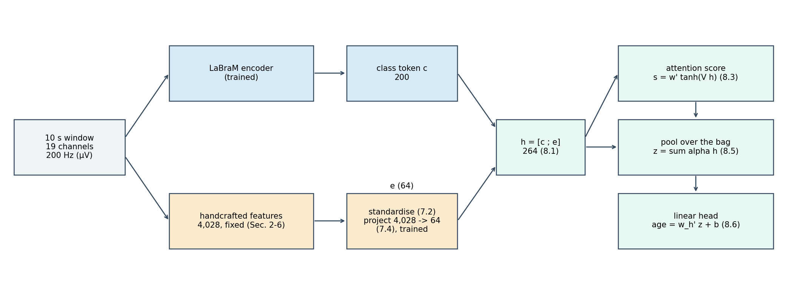
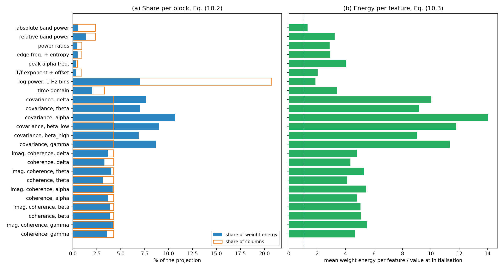

# Handcrafted window features inside the brain-age model

This document describes the experiment **P4F_L1, fold 0**: the phased attention-MIL brain-age model P4_L1
trained with a second input per 10 s window, a vector of 4,028 handcrafted EEG features
(`mil.window_features=handcrafted`). It gives every feature as the formula the code computes, how the
features are standardised and projected, where they enter the model, how the model was trained, how much
the trained model relies on each feature block, and the result against P4_L1 fold 0.

Everything else is P4_L1 fold 0 unchanged: the same cohort (`tuh_heedb_v1`, compact copy), the same
`cv_split.json` fold 0 (train 76,434 / validation 19,071 / test 7,612 recordings), the same recipe and the
same evaluation. The only change is the feature branch.

Code: `labram/layers/window_features.py` (features, projection), `labram/train/train_mil.py`
(`attach_mil`, `fit_window_features`), `labram/models/neural_transformer.py` (`forward`, `forward_bag`),
`scripts/window_feature_usage.py` (Section 10). Feature study that chose the blocks:
`scripts/feature_stack.py`.

## 1. Overview

The features are computed from the model's own input window, so training, validation, test and every
external cohort see exactly the same definition. Up to the standardised vector they are **fixed**: no
parameter of Sections 2–6 is learned, and no gradient flows into them. Two things are fitted once, on
12,800 training windows before training starts, and stored in the checkpoint: the tangent-space
reference matrices (Eq. (5.4)) and the standardisation (Eq. (7.3)). Only the projection to 64 numbers
(Eq. (7.4)) is trained with the rest of the model. The 64 numbers are joined to the window's class token,
and the joined vector is what the attention scores read, what the pool averages and what the head
predicts from (Figure 1.1).

### Figure 1.1. Where the features enter the model

One 10 s window of 19 channels goes two ways: through the LaBraM encoder to its 200-dimensional class
token $c$, and through the fixed feature extractor (Sections 2–6), the standardisation (7.2) and the
trained projection (7.4) to 64 numbers $e$. Their concatenation $h$ (8.1) feeds the attention score (8.3),
the pooled recording vector (8.5) and the linear age head (8.6).

### Table 1.1. The feature vector of one window

The blocks in the order of the vector; the columns give the count and where each block is defined.

| Block | Per | Count | Defined in |
|---|---|---|---|
| Spectral: band powers, ratios, edge frequency, entropy, alpha peak, 1/f fit | channel × 17 | 323 | Section 4.1 |
| Log power in 1 Hz bins, 1–45 Hz | channel × 44 | 836 | Section 4.2 |
| Time domain: activity, line length, moments, Hjorth, zero crossings | channel × 7 | 133 | Section 4.3 |
| Band covariances in the Riemannian tangent space | 6 bands × 171 | 1,026 | Section 5 |
| Connectivity: imaginary coherence and coherence per channel pair | 5 bands × 2 × 171 | 1,710 | Section 6 |
| **Total** | | **4,028** | Eq. (7.1) |

The blocks are the best choice per question of the recording-level feature study on the same fold:
10 s windows rather than 30 or 60 s; band covariances (all clean windows did as well as the calmest
third); connectivity per 10 s window; and an attention weighting of the windows as the best summary. Inside the model the per-recording summary is the attention
pool (8.5), which is why the features are computed per window here.

## 2. Input window and reference

A window is 10 s of the 19 scalp channels FP1, FP2, F3, F4, C3, C4, P3, P4, O1, O2, F7, F8, T3, T4, T5, T6,
FZ, CZ, PZ (A1, A2, T1, T2 are dropped by `data.drop_channels`) at $f_s = 200$ Hz, $L = 2000$ samples.
The model input is in units of 100 µV, so the branch first returns to µV:

$$ x_c(t) = 100\,\tilde{x}_c(t), \qquad c = 1,\ldots,19,\quad t = 0,\ldots,L-1 \tag{2.1} $$

where $\tilde{x}$ is the model input and $x$ is in µV. A channel a recording lacks is stored as zeros;
the present channels are

$$ \mathcal{P} = \{\, c : \max_t |x_c(t)| > 0 \,\} \tag{2.2} $$

and the common average reference is taken over them only, absent channels staying zero:

$$ x'_c(t) = \mathbf{1}[c \in \mathcal{P}] \left( x_c(t) - \frac{1}{|\mathcal{P}|} \sum_{c' \in \mathcal{P}} x_{c'}(t) \right) \tag{2.3} $$

(`HandcraftedWindowFeatures._spectra`). An absent channel gives constant feature values (for example
$\log_{10}\varepsilon$ for its log powers), which the standardisation (7.2) maps far from the training
mean and clips at $\pm 6$; its zero rows in the covariances are kept positive definite by the shrinkage
(5.3).

## 3. Spectral estimate

All spectral, covariance and connectivity features come from one Welch cross-spectral matrix per window:
segments of $N = 400$ samples (2 s) with 50 % overlap, so $S = 9$ segments per window. Segment $s$ of
channel $c$, mean removed, times a periodic Hann window $w$:

$$ u_{c,s}(n) = w(n) \left( x'_c(200s + n) - \bar{x}'_{c,s} \right), \qquad w(n) = \frac{1}{2}\left(1 - \cos\frac{2\pi n}{N}\right), \quad n = 0,\ldots,N-1 \tag{3.1} $$

where $\bar{x}'_{c,s}$ is the segment mean. Its discrete Fourier transform at $f_k = k f_s / N$
(0.5 Hz steps), kept for $1 \le f_k < 45$ Hz, i.e. $F = 88$ frequencies:

$$ U_{c,s}(f_k) = \sum_{n=0}^{N-1} u_{c,s}(n)\, e^{-2\pi i k n / N} \tag{3.2} $$

The cross-spectral density between channels $i$ and $j$ (µV²/Hz, one-sided):

$$ S_{ij}(f) = \frac{2}{f_s \sum_n w(n)^2 \, S} \sum_{s=1}^{S} U_{i,s}(f)\, \overline{U_{j,s}(f)} \tag{3.3} $$

and the power spectral density of channel $c$ is its diagonal:

$$ P_c(f) = \mathrm{Re}\, S_{cc}(f) \tag{3.4} $$

Band sums below use $\Delta f = 0.5$ Hz and half-open bands $[a, b)$ over these 88 frequencies.

## 4. Per-channel features (68 per channel, 1,292)

Computed for each of the 19 channels (`HandcraftedWindowFeatures._core`); the vector holds them
channel-major (channel 1's 68 values, then channel 2's, …). $\varepsilon = 10^{-12}$ throughout.

### Table 4.1. The 68 features of one channel

Index within the channel's 68, name, unit and defining equation.

| Index | Feature | Unit | Eq. |
|---|---|---|---|
| 1–5 | $\log_{10}$ absolute power, delta / theta / alpha / beta / gamma | log10 µV² | (4.3) |
| 6–10 | relative power, same bands | fraction | (4.4) |
| 11 | $\log_{10}$ theta / alpha | – | (4.5) |
| 12 | $\log_{10}$ (delta + theta) / (alpha + beta) | – | (4.6) |
| 13 | spectral edge frequency 95 % | Hz | (4.8) |
| 14 | spectral entropy | 0–1 | (4.9) |
| 15 | peak alpha frequency | Hz | (4.10) |
| 16 | aperiodic (1/f) exponent | – | (4.12) |
| 17 | aperiodic offset | log10 µV²/Hz | (4.12) |
| 18–61 | $\log_{10}$ power in 1 Hz bins $[1,2), \ldots, [44,45)$ | log10 µV² | (4.13) |
| 62 | $\log_{10}$ activity (variance) | log10 µV² | (4.15) |
| 63 | $\log_{10}$ line length | log10 µV | (4.15) |
| 64 | skewness | – | (4.16) |
| 65 | excess kurtosis | – | (4.16) |
| 66 | Hjorth mobility | – | (4.17) |
| 67 | Hjorth complexity | – | (4.17) |
| 68 | zero-crossing rate | per sample | (4.18) |

### 4.1 Spectral (17)

Bands $b \in$ {delta [1, 4), theta [4, 8), alpha [8, 13), beta [13, 30), gamma [30, 45)} Hz. Band power
and total power (µV²):

$$ B_c(b) = \Delta f \sum_{f \in b} P_c(f) \tag{4.1} $$

$$ T_c = \Delta f \sum_{1 \le f < 45} P_c(f) + \varepsilon \tag{4.2} $$

$$ \mathrm{abs}_c(b) = \log_{10}\left( B_c(b) + \varepsilon \right) \tag{4.3} $$

$$ \mathrm{rel}_c(b) = B_c(b) / T_c \tag{4.4} $$

With $\delta, \theta, \alpha, \beta$ the band powers (4.1) plus $\varepsilon$:

$$ r_1 = \log_{10}(\theta / \alpha) \tag{4.5} $$

$$ r_2 = \log_{10}\left( (\delta + \theta) / (\alpha + \beta) \right) \tag{4.6} $$

The normalised spectrum over the 88 frequencies:

$$ p_c(f) = P_c(f) \Big/ \left( \sum_{f'} P_c(f') + \varepsilon \right) \tag{4.7} $$

$$ \mathrm{SEF95}_c = \min \{\, f_k : \sum_{f \le f_k} p_c(f) \ge 0.95 \,\} \tag{4.8} $$

$$ H_c = -\frac{1}{\ln F} \sum_f p_c(f) \ln\left( p_c(f) + \varepsilon \right) \tag{4.9} $$

The peak alpha frequency is the highest point of the spectrum between 6 and 14 Hz:

$$ \mathrm{PAF}_c = \mathrm{argmax}_{6 \le f \le 14}\; P_c(f) \tag{4.10} $$

The aperiodic (1/f) fit is an ordinary least-squares line of log power on log frequency over
$\mathcal{F} = [2, 40]$ Hz without $[7, 14]$ Hz (the alpha peak left out):

$$ \log_{10}\left( P_c(f) + \varepsilon \right) \approx a_c + \beta_c \log_{10} f, \qquad f \in \mathcal{F} \tag{4.11} $$

$$ \chi_c = -\beta_c, \qquad \mathrm{offset}_c = a_c \tag{4.12} $$

### 4.2 Spectrum in 1 Hz bins (44)

$$ \mathrm{bin}_c(e) = \log_{10}\left( \Delta f \sum_{e \le f < e+1} P_c(f) + \varepsilon \right), \qquad e = 1, \ldots, 44 \tag{4.13} $$

Each bin holds two frequencies ($e$ and $e + 0.5$ Hz).

### 4.3 Time domain (7)

On the 1–45 Hz part of the whole window: the FFT of the referenced 2000-sample window (not the 2 s
segments of (3.1)), zeroed outside 1–45 Hz, transformed back:

$$ x^{b}_c = \mathcal{F}^{-1}\left[ \mathcal{F}[x'_c] \cdot \mathbf{1}[1 \le |f| \le 45] \right] \tag{4.14} $$

With $\mathrm{Var}$ the population variance over the window, $\Delta$ the first difference and
$v_0 = \mathrm{Var}(x^b_c) + \varepsilon$, $v_1 = \mathrm{Var}(\Delta x^b_c) + \varepsilon$,
$v_2 = \mathrm{Var}(\Delta^2 x^b_c) + \varepsilon$:

$$ \mathrm{activity}_c = \log_{10} v_0, \qquad \mathrm{linelength}_c = \log_{10}\left( \mathrm{mean}_t\, |\Delta x^b_c(t)| + \varepsilon \right) \tag{4.15} $$

$$ \mathrm{skew}_c = \mathrm{mean}_t\, z_c(t)^3, \qquad \mathrm{kurt}_c = \mathrm{mean}_t\, z_c(t)^4 - 3, \qquad z_c = \frac{x^b_c - \bar{x}^b_c}{\sigma_c + \varepsilon} \tag{4.16} $$

where $\sigma_c$ is the population standard deviation of $x^b_c$.

$$ \mathrm{mobility}_c = \sqrt{v_1 / v_0}, \qquad \mathrm{complexity}_c = \sqrt{v_2 / v_1} \,/\, \mathrm{mobility}_c \tag{4.17} $$

$$ \mathrm{ZCR}_c = \frac{1}{L-1} \sum_{t=1}^{L-1} \mathbf{1}\left[ \mathrm{sign}\, z_c(t) \ne \mathrm{sign}\, z_c(t-1) \right] \tag{4.18} $$

## 5. Band covariances in the tangent space (1,026)

Spatial structure: the covariance between channels in six bands, mapped to a flat space where linear
models apply (`_cov`, `_tangent`, `riemann_mean`; computed in float64).

Filter bank $b \in$ {delta [1, 4), theta [4, 8), alpha [8, 13), beta-low [13, 20), beta-high [20, 30),
gamma [30, 45)} Hz. The band covariance (19 × 19, µV²) is the real part of the cross-spectrum (3.3)
summed over the band:

$$ C_b = \Delta f \sum_{f \in b} \mathrm{Re}\, S(f) \tag{5.1} $$

The common average reference (2.3) makes $C_b$ rank 18 at most. It is therefore expressed on an
orthonormal basis $Q \in \mathbb{R}^{19 \times 18}$ of the vectors orthogonal to $\mathbf{1}$ (the first 18
columns of the QR factor of $I - \mathbf{1}\mathbf{1}^\top / 19$), and lightly shrunk towards a multiple
of the identity so it is always positive definite ($\gamma = 10^{-3}$):

$$ \tilde{C}_b = Q^\top C_b\, Q \tag{5.2} $$

$$ \hat{C}_b = (1 - \gamma)\, \tilde{C}_b + \gamma\, \frac{\mathrm{tr}\, \tilde{C}_b}{18}\, I \tag{5.3} $$

**Reference.** Per band, the affine-invariant (Karcher) mean $R_b$ of $\hat{C}_b$ over $M$ = 4,000
windows drawn (seed 0) from the 12,800 fit windows, by the fixed-point iteration started at the
arithmetic mean and stopped when the norm of the mean log is below $10^{-8}$ (at most 50 steps):

$$ R \leftarrow R^{1/2} \exp\left( \frac{1}{M} \sum_{m=1}^{M} \log\left( R^{-1/2} \hat{C}_{b,m} R^{-1/2} \right) \right) R^{1/2} \tag{5.4} $$

with $\log$, $\exp$ and powers of a symmetric matrix taken on its eigenvalues (eigenvalues clamped at
$10^{-12}$). $R_b^{-1/2}$ is stored in the checkpoint (`whiten`).

**Tangent vector.** The window's matrix, whitened by the reference and mapped by the matrix logarithm:

$$ T_b = \log\left( R_b^{-1/2}\, \hat{C}_b\, R_b^{-1/2} \right) \tag{5.5} $$

and vectorised as its upper triangle including the diagonal, off-diagonal entries times $\sqrt{2}$ (so the
Euclidean norm of the vector equals the Frobenius norm of $T_b$), $18 \cdot 19 / 2 = 171$ values per band:

$$ \tau_b = \left( T_{b,ii} \right)_{i} \cup \left( \sqrt{2}\, T_{b,ij} \right)_{i<j} \in \mathbb{R}^{171} \tag{5.6} $$

The vector holds the six bands in filter-bank order, $6 \times 171 = 1{,}026$ values. At the reference
($\hat{C}_b = R_b$) the tangent vector is zero, so each value measures how the window's spatial
covariance in a band departs from the typical training window, invariant to an invertible mixing of the
channels that is common to the window and the reference.

## 6. Connectivity (1,710)

Phase coupling between every pair of channels, from the same cross-spectra (`_conn`). The coherency of
channels $i$ and $j$ (complex, dimensionless):

$$ K_{ij}(f) = \frac{S_{ij}(f)}{\sqrt{P_i(f)\, P_j(f) + \varepsilon}} \tag{6.1} $$

For the 171 pairs $i < j$ and the five bands of Section 4.1, with $n_b$ the number of frequencies in
band $b$:

$$ \mathrm{iCOH}_{ij}(b) = \left| \frac{1}{n_b} \sum_{f \in b} \mathrm{Im}\, K_{ij}(f) \right| \tag{6.2} $$

$$ \mathrm{MSC}_{ij}(b) = \frac{1}{n_b} \sum_{f \in b} \left| K_{ij}(f) \right|^2 \tag{6.3} $$

The imaginary coherence (6.2) ignores zero-lag coupling, so it is insensitive to volume conduction and to
the common reference; the magnitude-squared coherence (6.3) keeps it. The vector holds them as band,
then kind (iCOH, MSC), then pair: $5 \times 2 \times 171 = 1{,}710$ values. With only $S = 9$ segments per
window, (6.3) is biased upwards (about $1/S$ for independent channels); the bias is about the same in
every window, so the standardisation (7.2) centres it away.

## 7. Standardisation and projection

The raw feature vector of a window joins the three parts, non-finite values set to 0:

$$ u = \left[\, \mathrm{core}\ (1{,}292) \;;\; \tau_1, \ldots, \tau_6\ (1{,}026) \;;\; \mathrm{conn}\ (1{,}710) \,\right] \in \mathbb{R}^{4028} \tag{7.1} $$

Each feature $j$ is standardised with the mean and standard deviation of the fit windows and clipped:

$$ z_j = \mathrm{clip}\left( \frac{u_j - \mu_j}{\sigma_j},\, -6,\, 6 \right) \tag{7.2} $$

$$ \mu_j = \frac{1}{M'} \sum_{m=1}^{M'} u_{j,m}, \qquad \sigma_j = \max\left( \sqrt{\frac{1}{M'-1} \sum_{m=1}^{M'} (u_{j,m} - \mu_j)^2},\; 10^{-6} \right) \tag{7.3} $$

over the $M'$ = 12,800 fit windows: the windows of the first 50 training batches (32 bags of 8 windows
each), taken before training starts (`fit_window_features`). Only training recordings contribute; the
statistics and the references (5.4) are frozen afterwards and travel with the checkpoint, so external
cohorts are scored with the training statistics (no refit).

The projection is the only trained part of the branch ($W \in \mathbb{R}^{64 \times 4028}$,
initialised $\mathcal{N}(0, 1/4028)$, $b_e = 0$; 257,856 parameters):

$$ e = \mathrm{Dropout}_{0.1}\left( W z + b_e \right) \in \mathbb{R}^{64} \tag{7.4} $$

## 8. Integration into the model

### 8.1 The joined window vector

Let $c_k \in \mathbb{R}^{200}$ be the class-token output of the LaBraM encoder for window $k$ (as in P4)
and $e_k$ its projected features (7.4). The model's window vector is their concatenation:

$$ h_k = \left[\, c_k \;;\; e_k \,\right] \in \mathbb{R}^{264} \tag{8.1} $$

The linear age head reads $h$ (z-scored age):

$$ \hat{y}_k = w_h^\top h_k + b_h = w_c^\top c_k + w_e^\top e_k + b_h \tag{8.2} $$

where $w_c$ and $w_e$ are the head weights of the class-token and feature parts. When the branch is
attached, $w_c$ and $b_h$ are those of the head as built and $w_e$ is drawn from
$\mathcal{N}(0, \mathrm{sd}(w_c)^2)$ (`attach_mil`).

### 8.2 Attention, pool and recording prediction

P4's pool is ungated attention MIL (Ilse et al. 2018) with the score computed on $h$
(`mil.pool=gated`, `mil.gated=false`, `mil.score_input=h`; `labram/layers/bag_pool.py`). For the $K$
windows of a bag, with $V \in \mathbb{R}^{128 \times 264}$ and $w_a \in \mathbb{R}^{128}$:

$$ s_k = w_a^\top \tanh\left( V h_k + b_V \right) \tag{8.3} $$

$$ \alpha_k = \frac{\exp(s_k)}{\sum_{k'=1}^{K} \exp(s_{k'})} \tag{8.4} $$

$$ z = \sum_{k=1}^{K} \alpha_k\, \mathrm{Dropout}_{0.1}(h_k) \tag{8.5} $$

$$ \hat{y} = w_h^\top z + b_h \tag{8.6} $$

Because the head is linear, the recording prediction is the attention-weighted mean of the window
predictions (8.2), up to the dropout in training:

$$ \hat{y} = \sum_{k=1}^{K} \alpha_k\, \hat{y}_k \tag{8.7} $$

and in years, with the training-split age mean and standard deviation $m_y$ = 53.54 and $s_y$ = 19.26:

$$ \mathrm{age} = m_y + s_y\, \hat{y} \tag{8.8} $$

So the features act in three places: in **which windows count** (the score (8.3) reads $e_k$), in
**what is averaged** (8.5) and in **the prediction** (8.6). In evaluation a bag is every window of
minutes 1–6 of the recording (30 windows, after the 60 s trims; external cohorts follow their protocol
of `scripts/mil_runs/eval_p4_features.sh`).

## 9. Training

The recipe is P4_L1's (17 epochs, AdamW, peak learning rate 2.8 × 10⁻⁴ with a 3-epoch warm-up and one
cosine schedule over all epochs, layer decay 0.65, weight decay 0.05, mixup $\mathrm{Beta}(0.4, 0.4)$,
Huber loss on z-scored age). The loss for a prediction $\hat{y}$ and target $y$, $\delta = 1$:

$$ \ell(\hat{y}, y) = \frac{1}{2}(\hat{y} - y)^2 \;\; \mathrm{if}\; |\hat{y} - y| \le \delta, \;\; \mathrm{else}\;\; \delta \left( |\hat{y} - y| - \delta / 2 \right) \tag{9.1} $$

In the joint bag epochs the bag loss is added to a per-window loss with weight $\lambda_w = 0.5$, every
window against its recording's age ($\bar{\ell}$ is the batch mean):

$$ \mathcal{L} = \bar{\ell}(\hat{y}, \tilde{y}) + \lambda_w\, \bar{\ell}(\hat{y}_k, y) \tag{9.2} $$

where bag mixup mixes the pooled vectors and the targets of two bags with $\lambda \sim \mathrm{Beta}(0.4, 0.4)$:

$$ \tilde{z} = \lambda z + (1 - \lambda) z', \qquad \tilde{y} = \lambda y + (1 - \lambda) y' \tag{9.3} $$

In the window phase mixup mixes the input signals of two windows instead, so the features (Sections
2–6) are computed from the mixed signal:

$$ \tilde{x} = \lambda x + (1 - \lambda) x', \qquad \tilde{y} = \lambda y + (1 - \lambda) y' \tag{9.4} $$

### Table 9.1. Training phases

What is trained in each phase; "×5" is the learning-rate multiplier of the pool, the head and the
feature projection (`mil.head_lr_scale`).

| Epochs | Phase | Input unit | Trained | Loss |
|---|---|---|---|---|
| 1–8 | window phase | single windows, 256 per step (8 per recording, 4 draws) | encoder, projection (7.4), head (8.2); no ×5 | Eq. (9.1) with (9.4) |
| 9 | attention only | bags of 8 windows, 32 bags per step, 2 bags per recording | pool (8.3) only, ×5; encoder, projection and head frozen | Eq. (9.1) with (9.3) |
| 10–17 | joint | same bags | everything; pool, head and projection ×5 | Eq. (9.2) with (9.3) |

The best epoch on validation MAE was epoch 16, as for P4_L1 fold 0.

## 10. How the trained model uses the features

Two diagnostics of the best checkpoint (`scripts/window_feature_usage.py`).

### 10.1 Which blocks the projection weights

Because each standardised feature (7.2) has unit variance, the weight energy of column $j$ of the
projection measures how strongly feature $j$ moves the 64 outputs:

$$ E_j = \sum_{r=1}^{64} W_{rj}^2 \tag{10.1} $$

Per block $\mathcal{B}$, its share of the total and its mean energy per feature relative to the value at
initialisation ($\mathbb{E}\, E_j = 64 / 4028$ for $W \sim \mathcal{N}(0, 1/4028)$):

$$ \mathrm{share}(\mathcal{B}) = \sum_{j \in \mathcal{B}} E_j \Big/ \sum_{j} E_j \tag{10.2} $$

$$ \rho(\mathcal{B}) = \frac{1}{|\mathcal{B}|} \sum_{j \in \mathcal{B}} E_j \Big/ \frac{64}{4028} \tag{10.3} $$

### Figure 10.1. Projection weight per feature block

Best checkpoint of P4F_L1 fold 0, all 24 blocks of the vector. (a) Share of the projection's weight
energy (10.2), next to the block's share of the 4,028 columns; (b) mean energy per feature relative to
initialisation (10.3), the dashed line at 1.

### Table 10.1. Projection weight by feature family

The blocks of Figure 10.1 summed into the five families of Table 1.1. Columns: number of features,
share of the columns, share of the weight energy (10.2), and $\rho$ (10.3).

| Family | Features | Columns | Weight energy | $\rho$ |
|---|---|---|---|---|
| Spectral (17 per channel) | 323 | 8.0 % | 3.6 % | 2.5 |
| 1 Hz bins | 836 | 20.8 % | 7.0 % | 1.9 |
| Time domain | 133 | 3.3 % | 2.0 % | 3.4 |
| **Band covariances (tangent)** | 1,026 | 25.5 % | **49.9 %** | **10.9** |
| Connectivity | 1,710 | 42.5 % | 37.5 % | 4.9 |

Half of the projection's weight sits on the band covariances, which are a quarter of the columns;
alpha (14.0) and beta-low (11.8) covariances carry the most per feature (Figure 10.1(b)). Weight
energy is a guide, not an importance measure: correlated features (neighbouring 1 Hz bins) share their
weight, so a block of many correlated columns gets less per column. It agrees with the recording-level
study, where the covariances were the only block that improved P4 on its own.

### 10.2 How much the prediction rests on the features

On 600 test recordings with all 19 channels (drawn with seed 0; 18,000 windows of minutes 1–6),
re-scored in the evaluation's mixed precision (largest difference to the evaluation 0.045 years). The
two parts of a window prediction (8.2) in years:

$$ a_k = s_y\, w_c^\top c_k, \qquad b_k = s_y\, w_e^\top e_k \tag{10.4} $$

and the two parts of the attention pre-activation (8.3), $V = [V_c \; V_e]$:

$$ \mathrm{RMS}_c = \sqrt{ \mathrm{mean}_{k,r} \left( V_c c_k \right)_r^2 }, \qquad \mathrm{RMS}_e = \sqrt{ \mathrm{mean}_{k,r} \left( V_e e_k \right)_r^2 } \tag{10.5} $$

The features are neutralised by setting every standardised value to its training mean, $z = 0$, which
gives the same $e$ for every window:

$$ e_k^{0} = b_e \tag{10.6} $$

### Table 10.2. Contribution of the features in the trained model

Rows: spread over windows of the two parts of the window prediction (10.4) and their correlation; the
two parts of the attention pre-activation (10.5); recording MAE (11.1) of the model as trained and
with the features neutralised (10.6), and the mean absolute change of the recording prediction.

| Measure | Value |
|---|---|
| SD of the class-token part $a_k$ | 15.65 years |
| SD of the feature part $b_k$ | 3.80 years |
| Correlation of $a_k$ and $b_k$ | 0.51 |
| Attention pre-activation, RMS of the class-token part | 1.99 |
| Attention pre-activation, RMS of the feature part | 1.73 |
| Recording MAE, as trained | 6.14 years |
| Recording MAE, features neutralised (10.6) | 7.20 years |
| Mean change of the recording prediction | 2.68 years |

The class token carries most of the age signal in the head (SD 15.6 against 3.8 years), but the
attention reads the features almost as strongly as the class token (RMS 1.73 against 1.99): the
features decide to a large part which windows count. Neutralising them costs 1.06 years. That
measures how much this model relies on them, not their value: a model trained without them (P4) is
not 1.06 years worse (Section 11).

## 11. Result against P4_L1 fold 0

Both models at their best epoch (16), scored identically. Per recording, MAE in years and the paired
change over the $n$ recordings of a group:

$$ \mathrm{MAE} = \frac{1}{n} \sum_{i=1}^{n} \left| \mathrm{age}_i - \widehat{\mathrm{age}}_i \right| \tag{11.1} $$

$$ \Delta = \frac{1}{n} \sum_{i=1}^{n} \left( \left| \mathrm{age}_i - \widehat{\mathrm{age}}^{\,\mathrm{F}}_i \right| - \left| \mathrm{age}_i - \widehat{\mathrm{age}}^{\,\mathrm{P4}}_i \right| \right) \tag{11.2} $$

where F is the model with features; negative is better. The 95 % interval of $\Delta$ is the 2.5th and
97.5th percentile of (11.2) over 2,000 bootstrap draws of patients (people for external cohorts), all
recordings of a drawn patient kept together:

$$ \Delta^{*}_r = \frac{\sum_{p \in \mathcal{D}_r} \sum_{i \in p} d_i}{\sum_{p \in \mathcal{D}_r} n_p}, \qquad r = 1, \ldots, 2000 \tag{11.3} $$

with $d_i$ the summand of (11.2), $\mathcal{D}_r$ the $r$-th draw of patients with replacement and $n_p$
the recordings of patient $p$.

### Table 11.1. Temple and Harvard, validation and test

Columns: recordings, MAE (11.1) of P4 and of P4 + features, change (11.2) with its 95 % interval (11.3)
on test. Validation values come from the training logs, which hold no per-recording predictions, so
they have no interval. "No verdict": no normal / abnormal report.

| Dataset | Report | Val n | Val P4 | Val + features | Test n | Test P4 | Test + features | Test change [95 % CI] |
|---|---|---|---|---|---|---|---|---|
| All | all | 19,071 | 6.59 | 6.39 | 7,612 | 6.06 | 5.92 | −0.14 [−0.20, −0.08] |
| Harvard | all | 12,963 | 6.14 | 5.93 | 7,338 | 6.05 | 5.91 | −0.13 [−0.20, −0.07] |
| Harvard | normal | 2,632 | 5.54 | 5.31 | 1,518 | 5.71 | 5.71 | −0.01 [−0.12, +0.11] |
| Harvard | abnormal | 4,000 | 6.77 | 6.57 | 2,253 | 6.62 | 6.52 | −0.10 [−0.24, +0.04] |
| Harvard | no verdict | 6,331 | 5.99 | 5.79 | 3,567 | 5.82 | 5.61 | −0.21 [−0.30, −0.12] |
| Temple | all | 6,108 | 7.55 | 7.37 | 274 | 6.32 | 6.02 | −0.30 [−0.65, +0.05] |
| Temple | normal | 2,295 | 6.55 | 6.40 | 149 | 4.65 | 4.51 | −0.14 [−0.49, +0.19] |
| Temple | abnormal | 3,320 | 8.21 | 7.99 | 125 | 8.31 | 7.81 | −0.50 [−1.17, +0.17] |
| Temple | no verdict | 493 | 7.85 | 7.74 | – | – | – | – |

### Table 11.2. External cohorts, test only

Never trained on. Columns: recordings, people, MAE (11.1) of both models and the change (11.2) with its
95 % interval (11.3, people resampled). TDBRAIN is scored on adults, as in the reports.

| Cohort | Subset | Recordings | People | P4 | + features | Change [95 % CI] |
|---|---|---|---|---|---|---|
| Dortmund | healthy | 3,262 | 608 | 5.29 | 5.09 | −0.20 [−0.33, −0.07] |
| TDBRAIN | adults, all | 2,222 | 1,062 | 5.48 | 5.30 | −0.18 [−0.32, −0.05] |
| TDBRAIN | adults, healthy | 354 | 179 | 5.43 | 5.49 | +0.06 [−0.30, +0.42] |
| TDBRAIN | adults, with an indication | 1,868 | 883 | 5.49 | 5.26 | −0.22 [−0.37, −0.08] |
| SRM | healthy | 153 | 111 | 4.99 | 4.70 | −0.29 [−0.79, +0.21] |
| LEMON | healthy | 214 | 214 | 4.73 | 4.65 | −0.08 [−0.37, +0.20] |
| CHBP | healthy | 250 | 250 | 7.45 | 7.73 | +0.28 [−0.41, +0.93] |

The features improve validation by about 0.2 years in every cell and the hospital test set by 0.14
years, five times the spread between P4 folds (0.03 years); Dortmund and TDBRAIN adults improve by about
0.2 years. Gains concentrate in clinical recordings (no verdict, with an indication); healthy and
normal-report groups change little, except Dortmund. CHBP, the cohort with the recording-device shift,
leans worse. This is one run on one fold; a second fold is needed before calling it the new best.

## 12. Where in the code

### Table 12.1. Code map

Each step of this document and the function that implements it.

| Step | Equations | Code |
|---|---|---|
| Units, reference, Welch cross-spectra | (2.1)–(3.4) | `labram/layers/window_features.py::HandcraftedWindowFeatures._spectra`, `WindowFeatureBranch._signal` |
| Per-channel features | (4.1)–(4.18) | `HandcraftedWindowFeatures._core` |
| Band covariances, reference, tangent vectors | (5.1)–(5.6) | `_cov`, `riemann_mean`, `_tangent`, `fit` |
| Connectivity | (6.1)–(6.3) | `_conn` |
| Standardisation, projection | (7.1)–(7.4) | `HandcraftedWindowFeatures.fit` / `forward`, `WindowFeatureBranch.forward` |
| Fit on training windows | (5.4), (7.3) | `labram/train/train_mil.py::fit_window_features` |
| Joined vector, wider head | (8.1), (8.2) | `labram/train/train_mil.py::attach_mil`, `NeuralTransformer.forward` / `forward_bag` |
| Attention pool | (8.3)–(8.7) | `labram/layers/bag_pool.py::GatedAttentionPool` |
| Training phases, losses | (9.1)–(9.4) | `labram/train/train_mil.py`, `labram/train/train_finetune.py` |
| Usage diagnostics | (10.1)–(10.6) | `scripts/window_feature_usage.py` |
| Evaluation and comparison | (11.1)–(11.3) | `scripts/mil_runs/eval_p4_features.sh`, `scripts/mil_runs/compare_runs.py` |
| Reference numpy implementation (tested equal) | Sections 4–6 | `labram/features/extractors.py`, `tests/test_window_features.py` |

Run settings: `mil.window_features=handcrafted`, `mil.feature_dim=64`, `mil.feature_dropout=0.1`,
`mil.feature_fit_batches=50`, on top of the P4_L1 fold-0 configuration
(`scripts/mil_runs/run_local_p4_features.sh`).
